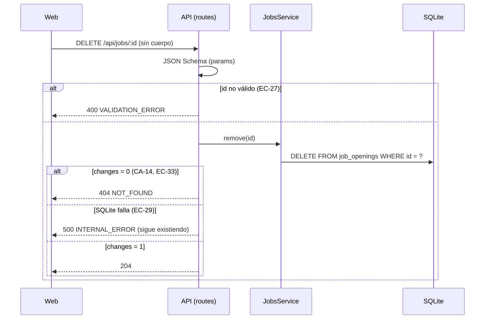
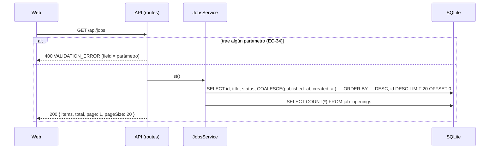
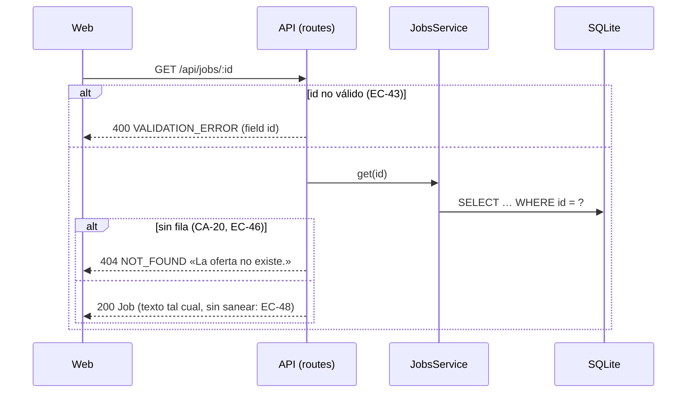

# HU-01 — Crear, editar y consultar ofertas en borrador — Diseño técnico (backend)

- **Origen:** `specs/PRD.md` (estado Ready, 2026-10-06)
- **Generado por:** backend-architect
- **Scope cubierto:** RF-01 a RF-06 (parte API), RF-07, RNF-01, RNF-02 y RNF-03. La parte web de RF-01 a RF-06,
  RNF-04 y RNF-05 está en `plans/TECHNICAL_DOC-frontend.md`, que consume el *Contrato de API* de este documento tal
  cual.

## Enfoque técnico

Nace el módulo `jobs` (`apps/api/src/modules/jobs/`) con las capas de `docs/ARCHITECTURE.md`: `routes.ts` (plugin
Fastify con sus JSON Schema) → `service.ts` (reglas, sin HTTP) → `repository.ts` (SQL preparado de `node:sqlite`).
`buildApp` compone el módulo inyectándole el repositorio, el reloj y la función de transacción; nada de singletons.

Como es la primera HU, crea también las piezas transversales que reutilizarán HU-02 a HU-05, sin más alcance del que
esta HU necesita:

| Pieza | Para qué |
|---|---|
| Configuración de Ajv (`apps/api/src/http/validation.ts`) | Esquema estricto de verdad: con la configuración por defecto de Fastify, un campo desconocido se **quita en silencio** (`removeAdditional: true`) y `"40000"` se **convierte** a entero (`coerceTypes: 'array'`); comprobado con Fastify 5.12.5, rompería EC-02, EC-11 y EC-34 |
| Normalización previa (`trimTextFields`) | Recortar antes de validar (S-03) para que el JSON Schema sea la única fuente de las reglas por campo |
| Manejador de errores (`apps/api/src/http/error-handler.ts`) | Único sitio que construye el envelope de DEC-01, también para 404 de ruta, JSON malformado, 413, 415 y 500 |
| `AppError` (`apps/api/src/errors.ts`) | Errores de dominio con `code` estable que lanza el servicio |
| Reloj (`apps/api/src/clock.ts`) | `now()` inyectado (DEC-09) |
| `withTransaction` (`apps/api/src/db/transaction.ts`) | `BEGIN IMMEDIATE … COMMIT`, `ROLLBACK` ante error; se une a una transacción en curso (DEC-06) |
| Utilidades de test (`apps/api/test/helpers/test-app.ts`) | App sobre `:memory:` migrada, reloj controlable e inyección de fallos de SQLite con un *trigger* |

**Alternativa principal descartada:** validar en el servicio a mano (recorte, longitudes, enum, enteros) y dejar el
JSON Schema solo para la forma. Duplica reglas en dos sitios, contradice DEC-01/DEC-07 («validación con JSON Schema
por ruta») y obliga a construir `details` en cada servicio.

## Módulos y ficheros afectados

| Módulo | Fichero | Cambio |
|---|---|---|
| transversal | `apps/api/src/app.ts` | modificar: opciones de Ajv, `registerErrorHandling`, `now` en `AppOptions`, registro de `jobsRoutes` con prefijo `/api/jobs` |
| transversal | `apps/api/src/clock.ts` | nuevo: `type Clock = () => Date`, `systemClock` (~10 líneas) |
| transversal | `apps/api/src/errors.ts` | nuevo: `AppError`, `ErrorDetail`, `notFound(message)`, `validationError(details)` (~40) |
| transversal | `apps/api/src/http/validation.ts` | nuevo: `ajvOptions`, `idParamsSchema`, `type IdParams`, `trimTextFields`, `NO_CONTROL_CHARS` y `NO_CONTROL_CHARS_EXCEPT_WHITESPACE` (patrones de EC-50, DEC-11.8) (~60) |
| transversal | `apps/api/src/http/error-handler.ts` | nuevo: `registerErrorHandling(app)`, traducción de errores de Ajv y de Fastify al envelope (~120) |
| transversal | `apps/api/src/db/transaction.ts` | nuevo: `withTransaction(db, fn)` (~25) |
| transversal | `apps/api/src/db/migrations/001-create-job-openings.sql` | nuevo: tabla `job_openings` e índice |
| transversal | `apps/api/src/db/seed.ts` | modificar: 4 borradores inventados (RF-07) |
| jobs | `apps/api/src/modules/jobs/schemas.ts` | nuevo: tipos (`Job`, `JobInput`, `JobPatch`, `JobListItem`, `JobPage`) y JSON Schema (~120) |
| jobs | `apps/api/src/modules/jobs/repository.ts` | nuevo: `createJobsRepository(db)` (~110) |
| jobs | `apps/api/src/modules/jobs/service.ts` | nuevo: `createJobsService({ repository, now, transaction })` (~80) |
| jobs | `apps/api/src/modules/jobs/routes.ts` | nuevo: `jobsRoutes` (plugin `FastifyPluginAsync<{ service: JobsService }>`) (~90) |
| tests | `apps/api/test/helpers/test-app.ts` | nuevo: `createTestApp`, `createTestClock`, `failWrites`, `createJob` |
| tests | `apps/api/test/http/error-handler.test.ts`, `apps/api/test/db/transaction.test.ts` | nuevos |
| tests | `apps/api/test/jobs/{create,create-adversarial,control-chars,enumeration,update,delete,get,list,migration,seed,performance}.test.ts` | nuevos (`create-adversarial`: EC-01, EC-02, EC-05, EC-08, EC-11 y EC-17; `control-chars`: EC-50; `enumeration`: EC-32) |
| transversal | `apps/api/src/listen-options.ts` | nuevo: `listenOptions` extraído de `server.ts` para probar EC-32 |
| tests | `apps/api/test/health.test.ts`, `apps/api/test/logger.test.ts` | sin cambios (la firma de `buildApp` sigue siendo compatible) |

Todos los ficheros nuevos quedan por debajo de 300 líneas; ninguna función pasa de 50.

## Contrato de API

### Convenciones (todas las rutas)

- JSON en UTF-8. Las peticiones **con cuerpo** (`POST`, `PATCH`) llevan `Content-Type: application/json`. **`GET` y
  `DELETE` van sin cuerpo y sin `Content-Type`**: Fastify responde 400 a un `Content-Type: application/json` con
  cuerpo vacío.
- **Longitudes en caracteres Unicode (puntos de código)**, no en bytes ni en unidades UTF-16: así cuentan Ajv
  (`unicode: true`) y `length()` de SQLite. «🎨» cuenta 1. En la web, contar con `[...text].length`, no con
  `text.length` ni con el atributo `maxLength` de HTML.
- **Normalización previa** (hook `preValidation`, solo si el cuerpo es un objeto JSON): `title`, `description` y
  `location`, si son `string`, se recortan (`String.prototype.trim`); `description` y `location` que quedan `""`
  pasan a `null`. `title` no se convierte (un `""` lo rechaza `minLength`). `workMode` y los salarios no se tocan:
  solo valen los literales exactos (`" híbrida"` o `"hibrida"` dan 400).
- **Fechas**: ISO 8601 UTC con milisegundos (`2026-10-06T22:30:00.000Z`), las pone el sistema con el reloj inyectado.
- **IDs**: enteros. En la ruta se validan como texto con `pattern: "^[1-9][0-9]{0,14}$"` (sin ceros a la izquierda,
  ≤ 15 cifras, dentro de `Number.MAX_SAFE_INTEGER`) y se convierten con `Number()` (DD-02).
- **Orden de comprobación**: JSON Schema (400) → existencia (404) → reglas del servicio (400). Un `PATCH` inválido a un
  ID inexistente da 400.

### Envelope de error

```json
{ "error": { "code": "VALIDATION_ERROR", "message": "Hay campos con errores.",
             "details": [{ "field": "title", "message": "Debe tener al menos 3 caracteres." }] } }
```

- `details` solo en `VALIDATION_ERROR`: **un elemento por campo** (el primer error de ese campo). `field` es el nombre
  de la propiedad (`title`, `salaryMin`, `status`, `id`…) o, si el error es de la parte entera, `body`, `params` o
  `querystring`.
- Ningún `message` repite el valor recibido ni incluye SQL, rutas de fichero o *stack traces*.

| HTTP | `code` | `message` | Cuándo |
|---|---|---|---|
| 400 | `VALIDATION_ERROR` | «Hay campos con errores.» | Falla el JSON Schema de `body`, `params` o `querystring`, o la regla mínimo ≤ máximo |
| 400 | `VALIDATION_ERROR` | «El cuerpo de la petición no es JSON válido.» (`details: [{ field: "body", … }]`) | JSON malformado, o vacío con `Content-Type: application/json` |
| 404 | `NOT_FOUND` | «La oferta no existe.» | `:id` sin fila |
| 404 | `NOT_FOUND` | «El recurso no existe.» | Ruta o método inexistente (`setNotFoundHandler`) |
| 413 | `PAYLOAD_TOO_LARGE` | «El cuerpo de la petición es demasiado grande.» | Cuerpo > 1 MiB (`bodyLimit` por defecto de Fastify) |
| 415 | `UNSUPPORTED_MEDIA_TYPE` | «Tipo de contenido no admitido.» | `Content-Type` sin parser (p. ej., `application/x-www-form-urlencoded`) |
| 4xx | `BAD_REQUEST` | «La petición no es válida.» | Cualquier otro error 4xx de Fastify (mismo `statusCode`) |
| 500 | `INTERNAL_ERROR` | «Error interno. Inténtalo de nuevo.» | Cualquier otro error (SQLite incluido); se registra en el log con `request.log.error` |

Mensajes de `details` por *keyword* de Ajv (genéricos, reutilizables por las HU siguientes; DD-03):

| Keyword | `message` |
|---|---|
| `required` | «Es obligatorio.» |
| `additionalProperties` | «Campo no permitido.» (`field` = la propiedad sobrante) |
| `minLength` / `maxLength` | «Debe tener al menos {n} caracteres.» / «Debe tener como máximo {n} caracteres.» |
| `enum` | «Debe ser uno de estos valores: {valores no nulos separados por «, »}.» |
| `type` | `integer` → «Debe ser un número entero.»; `string` → «Debe ser un texto.»; `object` → «Debe ser un objeto JSON.»; otro → «Tipo de dato no válido.» |
| `exclusiveMinimum` / `minimum` / `maximum` | «Debe ser mayor que {n}.» / «Debe ser mayor o igual que {n}.» / «Debe ser menor o igual que {n}.» |
| `minProperties` | «Envía al menos un campo.» (`field: "body"`) |
| `pattern` / `format` | «Formato no válido.» |
| cualquier otro | «Valor no válido.» |
| regla del servicio | `salaryMin`: «El salario mínimo no puede ser mayor que el máximo.» |

### Esquemas compartidos (`apps/api/src/modules/jobs/schemas.ts`)

```json
"JobFields": {
  "title":       { "type": "string",            "minLength": 3, "maxLength": 120, "pattern": NO_CONTROL_CHARS },
  "description": { "type": ["string", "null"],  "maxLength": 5000, "pattern": NO_CONTROL_CHARS_EXCEPT_WHITESPACE },
  "location":    { "type": ["string", "null"],  "minLength": 2, "maxLength": 120, "pattern": NO_CONTROL_CHARS },
  "workMode":    { "type": ["string", "null"],  "enum": ["presencial", "híbrida", "remota", null] },
  "salaryMin":   { "type": ["integer", "null"], "exclusiveMinimum": 0, "maximum": 9007199254740991 },
  "salaryMax":   { "type": ["integer", "null"], "exclusiveMinimum": 0, "maximum": 9007199254740991 }
}
"Job": { "type": "object", "additionalProperties": false,
  "required": ["id","title","description","location","workMode","salaryMin","salaryMax","status","createdAt","publishedAt","closedAt"],
  "properties": { "id": { "type": "integer" }, "...JobFields": "con los mismos tipos (salida)",
    "status": { "type": "string", "enum": ["draft","published","closed"] },
    "createdAt": { "type": "string" }, "publishedAt": { "type": ["string","null"] }, "closedAt": { "type": ["string","null"] } } }
"JobListItem": { "type": "object", "additionalProperties": false, "required": ["id","title","status","referenceDate"],
  "properties": { "id": { "type": "integer" }, "title": { "type": "string" },
    "status": { "type": "string", "enum": ["draft","published","closed"] }, "referenceDate": { "type": "string" } } }
"JobPage": { "type": "object", "additionalProperties": false, "required": ["items","total","page","pageSize"],
  "properties": { "items": { "type": "array", "items": { "$ref": "JobListItem" } },
    "total": { "type": "integer" }, "page": { "type": "integer" }, "pageSize": { "type": "integer" } } }
"IdParams": { "type": "object", "additionalProperties": false, "required": ["id"],
  "properties": { "id": { "type": "string", "pattern": "^[1-9][0-9]{0,14}$" } } }
```

Los opcionales sin valor se devuelven como `null`, nunca ausentes. `publishedAt` y `closedAt` son siempre `null` en
esta HU; van ya en el contrato para que HU-02 no lo cambie. Los esquemas de `response` filtran cualquier campo extra.

### Endpoints

| Método y ruta | Entrada | 2xx | Errores |
|---|---|---|---|
| `POST /api/jobs` | `body`: `{ type: object, additionalProperties: false, required: ["title"], properties: JobFields }` | **201** `Job` (`status: "draft"`, `createdAt = now()`, `publishedAt`/`closedAt` `null`) | 400 `VALIDATION_ERROR` · 413 · 415 · 500 |
| `GET /api/jobs` | `querystring`: `{ type: object, additionalProperties: false, properties: {} }` (cualquier parámetro da 400 hasta HU-02) | **200** `JobPage`: `page: 1`, `pageSize: 20`, `total` = todas las filas; `items` = 20 primeras por `referenceDate` desc e `id` desc; `referenceDate = publishedAt ?? createdAt` | 400 `VALIDATION_ERROR` (`field` = el parámetro) · 500 |
| `GET /api/jobs/:id` | `params`: `IdParams` | **200** `Job` | 400 `VALIDATION_ERROR` (`field: "id"`) · 404 `NOT_FOUND` · 500 |
| `PATCH /api/jobs/:id` | `params`: `IdParams`; `body`: `{ type: object, additionalProperties: false, minProperties: 1, properties: JobFields }`. Campo ausente = sin cambios; `null` (o `""` en `description`/`location`) = sin valor; `title` no admite `null` | **200** `Job` con los valores fusionados; `status` y `createdAt` intactos | 400 `VALIDATION_ERROR` (incluida la regla mínimo ≤ máximo sobre los valores **fusionados**) · 404 `NOT_FOUND` · 413 · 415 · 500 |
| `DELETE /api/jobs/:id` | `params`: `IdParams`; sin cuerpo | **204** sin cuerpo | 400 `VALIDATION_ERROR` · 404 `NOT_FOUND` (también en el segundo `DELETE`) · 500 |

Ejemplo `POST /api/jobs` con `{ "title": "  Técnica/o de selección  ", "workMode": "híbrida", "location": "Valencia",
"salaryMin": 32000, "salaryMax": 40000 }` → 201:

```json
{ "id": 5, "title": "Técnica/o de selección", "description": null, "location": "Valencia", "workMode": "híbrida",
  "salaryMin": 32000, "salaryMax": 40000, "status": "draft", "createdAt": "2026-10-06T22:30:00.000Z",
  "publishedAt": null, "closedAt": null }
```

### Firmas internas (para `/task-planner`)

```ts
// apps/api/src/app.ts
export interface AppOptions { db: DatabaseSync; logger?: FastifyServerOptions['logger']; now?: Clock }
// apps/api/src/modules/jobs/service.ts
export interface JobsService {
  create(input: JobInput): Job;
  get(id: number): Job;                    // NOT_FOUND
  update(id: number, patch: JobPatch): Job; // NOT_FOUND, VALIDATION_ERROR (mínimo > máximo)
  remove(id: number): void;                 // NOT_FOUND
  list(): JobPage;
}
// apps/api/src/db/transaction.ts
export function withTransaction<T>(db: DatabaseSync, fn: () => T): T;
```

`AppError` no usa *parameter properties* en el constructor (no son sintaxis borrable con `erasableSyntaxOnly`).

## Migración de datos

`apps/api/src/db/migrations/001-create-job-openings.sql` (nuevo; la aplica `apps/api/src/db/migrate.ts` dentro de su
propia transacción, así que el fichero no lleva `BEGIN`/`COMMIT`). Fichero en UTF-8 con `í` en NFC.

```sql
-- HU-01: ofertas (JobOpening). Instantes en ISO 8601 UTC con milisegundos, como los da Date#toISOString().
CREATE TABLE job_openings (
  id           INTEGER PRIMARY KEY AUTOINCREMENT,
  title        TEXT    NOT NULL CHECK (length(title) BETWEEN 3 AND 120),
  description  TEXT    CHECK (description IS NULL OR length(description) BETWEEN 1 AND 5000),
  location     TEXT    CHECK (location IS NULL OR length(location) BETWEEN 2 AND 120),
  work_mode    TEXT    CHECK (work_mode IS NULL OR work_mode IN ('presencial', 'híbrida', 'remota')),
  salary_min   INTEGER CHECK (salary_min IS NULL OR (typeof(salary_min) = 'integer' AND salary_min > 0)),
  salary_max   INTEGER CHECK (salary_max IS NULL OR (typeof(salary_max) = 'integer' AND salary_max > 0)),
  status       TEXT    NOT NULL DEFAULT 'draft' CHECK (status IN ('draft', 'published', 'closed')),
  created_at   TEXT    NOT NULL CHECK (created_at GLOB '[0-9][0-9][0-9][0-9]-[0-9][0-9]-[0-9][0-9]T[0-9][0-9]:[0-9][0-9]:[0-9][0-9].[0-9][0-9][0-9]Z'),
  published_at TEXT    CHECK (published_at IS NULL OR published_at GLOB '[0-9][0-9][0-9][0-9]-[0-9][0-9]-[0-9][0-9]T[0-9][0-9]:[0-9][0-9]:[0-9][0-9].[0-9][0-9][0-9]Z'),
  closed_at    TEXT    CHECK (closed_at IS NULL OR closed_at GLOB '[0-9][0-9][0-9][0-9]-[0-9][0-9]-[0-9][0-9]T[0-9][0-9]:[0-9][0-9]:[0-9][0-9].[0-9][0-9][0-9]Z'),
  CHECK (salary_min IS NULL OR salary_max IS NULL OR salary_min <= salary_max),                 -- INV-07
  CHECK ((status = 'draft'     AND published_at IS NULL     AND closed_at IS NULL)
      OR (status = 'published' AND published_at IS NOT NULL AND closed_at IS NULL)
      OR (status = 'closed'    AND published_at IS NOT NULL AND closed_at IS NOT NULL)),          -- INV-01, INV-04, INV-05 (fechas)
  CHECK (status = 'draft' OR (description IS NOT NULL AND location IS NOT NULL AND work_mode IS NOT NULL)) -- INV-04
);

CREATE INDEX job_openings_reference_date_idx
  ON job_openings (COALESCE(published_at, created_at) DESC, id DESC);
```

| Aspecto | Efecto |
|---|---|
| Filas existentes | Ninguna: la tabla es nueva (EC-07, EC-40, EC-47) |
| Invariantes en la base | RN-03 (longitudes y enum), RN-04 e INV-07 (banda), INV-01 (estados), coherencia estado-fechas e INV-04 por adelantado (DD-08). `typeof(...) = 'integer'` rechaza reales (`40000.5`); el `GLOB` garantiza que el orden por texto es cronológico |
| Lo que no está en la base | Las transiciones `draft → published → closed` y «no borrar si no es `draft`» (INV-03): las comprueba el servicio de HU-02 dentro de la transacción (DEC-08); si se quieren en la base, un *trigger* se añade con una migración nueva sin reconstruir la tabla |
| Índice | Sirve el `ORDER BY COALESCE(published_at, created_at) DESC, id DESC` del listado; la consulta usa la misma expresión |
| `AUTOINCREMENT` | Un ID borrado no se reutiliza (DD-07) |
| Reversión | No hay migraciones *down* en el repo: `npm run db:reset` regenera la base (DEC-03) |

**Seed** (`apps/api/src/db/seed.ts`): 4 borradores inventados, completos y válidos (RN-02 a RN-04), insertados con el
repositorio dentro de `withTransaction`, con `created_at` fijos y escalonados (orden determinista):

| Título | Modalidad | Ubicación | Banda (€/año) | `created_at` |
|---|---|---|---|---|
| Analista de datos junior | `híbrida` | Sevilla | 26 000-31 000 | `2026-09-21T08:00:00.000Z` |
| Técnico/a de soporte IT | `presencial` | Zaragoza | — | `2026-09-24T09:30:00.000Z` |
| Diseñador/a de producto | `remota` | Bilbao | — | `2026-09-28T07:15:00.000Z` |
| Desarrollador/a frontend (React) | `híbrida` | Valencia | 34 000-42 000 | `2026-10-01T10:00:00.000Z` |

Cada uno con una descripción inventada de 1-3 frases. Sin personas ni empresas reales.

## Diagrama de secuencia

**RF-01 · Crear un borrador** (camino feliz y error principal)

```mermaid
sequenceDiagram
  participant W as Web
  participant A as API (routes)
  participant S as JobsService
  participant D as SQLite
  W->>A: POST /api/jobs { title, … }
  A->>A: preValidation: trim; "" → null en description/location
  A->>A: JSON Schema (Ajv estricto)
  alt cuerpo inválido (EC-01, EC-02, CA-03…CA-08)
    A-->>W: 400 VALIDATION_ERROR + details
  else válido
    A->>S: create(input)
    S->>S: salaryMin ≤ salaryMax (si vienen los dos)
    S->>D: INSERT … RETURNING * (status 'draft', created_at = now().toISOString())
    alt SQLite falla (EC-05)
      D-->>S: error
      S-->>A: throw
      A-->>W: 500 INTERNAL_ERROR (log con err; sin stack al cliente)
    else ok
      D-->>S: fila
      A-->>W: 201 Job
    end
  end
```

**RF-02 · Validar los campos** (tres capas, misma regla en alta y edición)

```mermaid
sequenceDiagram
  participant A as API (routes)
  participant H as ErrorHandler
  participant S as JobsService
  participant D as SQLite
  A->>A: Ajv: tipos, longitudes, enum, additionalProperties, minProperties
  alt falla el esquema
    A->>H: error.validation[] + validationContext
    H-->>A: 400 VALIDATION_ERROR, un detail por campo, mensaje por keyword
  else pasa
    A->>S: create / update
    alt mínimo > máximo (con valores fusionados en PATCH)
      S-->>H: AppError VALIDATION_ERROR (field salaryMin)
      H-->>A: 400
    else ok
      S->>D: escritura; los CHECK son la última defensa (EC-16)
    end
  end
```

**RF-03 · Editar un borrador**

```mermaid
sequenceDiagram
  participant W as Web
  participant A as API (routes)
  participant S as JobsService
  participant D as SQLite
  W->>A: PATCH /api/jobs/:id { campos }
  A->>A: preValidation + JSON Schema (params y body)
  alt inválido (EC-19, EC-20, EC-25, CA-12)
    A-->>W: 400 VALIDATION_ERROR
  else válido
    A->>S: update(id, patch)
    S->>D: BEGIN IMMEDIATE
    S->>D: SELECT … WHERE id = ?
    alt no existe (EC-24, EC-30)
      S->>D: ROLLBACK
      A-->>W: 404 NOT_FOUND
    else existe
      S->>S: merged = { ...actual, ...patch }; mínimo ≤ máximo
      S->>D: UPDATE job_openings SET <6 columnas fijas> WHERE id = ? RETURNING *
      alt SQLite falla (EC-22)
        S->>D: ROLLBACK
        A-->>W: 500 INTERNAL_ERROR (el borrador queda igual)
      else ok
        S->>D: COMMIT
        A-->>W: 200 Job
      end
    end
  end
```

**RF-04 · Borrar un borrador**



**RF-05 · Listar ofertas**



**RF-06 · Consultar una oferta**



## Error paths

Tests en `apps/api/test/jobs/` salvo que se indique otra carpeta. «web» = la parte de la pantalla está en
`plans/TECHNICAL_DOC-frontend.md`.

| Edge case (PRD) | Dónde se detecta | Estrategia | Respuesta o efecto observable | Test |
|---|---|---|---|---|
| EC-01 | Parser JSON de Fastify / JSON Schema (`type: object`) | rechazar | 400 `VALIDATION_ERROR` (`field: "body"`); 0 filas | `create-adversarial.test.ts` › «EC-01 cuerpo no JSON, [] o "x" → 400 sin filas» |
| EC-02 | JSON Schema (`additionalProperties: false`, `removeAdditional: false`) | rechazar | 400 con `status`/`createdAt`/`id` en `details`; 0 filas | `create-adversarial.test.ts` › «CA-08/EC-02 campos de solo lectura o desconocidos → 400» |
| EC-03 | `preValidation` (`trimTextFields`) | normalizar | 201 con `title: "Técnica/o de selección"` | `create.test.ts` › «CA-02/EC-03 recorta y guarda todos los campos» |
| EC-04 | Ajv (`unicode`) y `length()` de SQLite | aceptar por puntos de código | 201, devuelto igual; 120 emojis sí, 121 no | `create.test.ts` › «EC-04 tildes, eñes y emoji; cuenta caracteres, no bytes» |
| EC-05 | `repository.insert` | propagar al manejador | 500 `INTERNAL_ERROR` sin *stack*; 0 filas · web: formulario se queda | `create-adversarial.test.ts` › «EC-05 fallo de SQLite al insertar → 500 sin filas» |
| EC-06 | — (sin clave natural, DT-03) | aceptar | API: dos `POST` → dos borradores con IDs distintos · web: «Guardar» deshabilitado | `create.test.ts` › «EC-06/EC-09 dos POST iguales crean dos borradores» |
| EC-07 | — | N/A — tabla nueva, sin filas anteriores | — | — |
| EC-08 | `repository` (sentencias preparadas) | parametrizar | 201 con el texto literal; `job_openings` sigue existiendo | `create-adversarial.test.ts` › «EC-08 inyección SQL se guarda literal» |
| EC-09 | — (DT-03) | aceptar | Igual que EC-06 | `create.test.ts` › «EC-06/EC-09 …» |
| EC-10 | JSON Schema (`enum`) | rechazar | 400 en `workMode` para «teletrabajo», «Híbrida», «hibrida» | `create.test.ts` › «CA-05/EC-10 modalidad fuera de los literales → 400» |
| EC-11 | JSON Schema (`type: integer`, `exclusiveMinimum`) sin coerción | rechazar | 400 en el extremo para `"40000"`, `40000.5`, `0`, `-1` | `create-adversarial.test.ts` › «CA-07/EC-11 banda inválida → 400» |
| EC-12 | JSON Schema tras el recorte | rechazar / aceptar | 3, 120, 5 000, 2 y 120 → 201; 2, 121, 5 001, 1 y 121 → 400 | `create.test.ts` › «CA-03/CA-04/CA-06 fronteras de longitud» |
| EC-13 | Servicio (`assertSalaryRange`) | aceptar | 201 en los tres casos | `create.test.ts` › «CA-07/EC-13 solo mínimo, solo máximo o iguales → 201» |
| EC-14 | — | N/A — validación pura, sin base | — | — |
| EC-15 | — | N/A — sin estado compartido | — | — |
| EC-16 | `CHECK` de `job_openings` | rechazar en la base | `INSERT` directo con mínimo > máximo lanza `CHECK constraint failed` | `migration.test.ts` › «EC-16 la base rechaza mínimo > máximo» |
| EC-17 | JSON Schema (`maxLength`) / `bodyLimit` | rechazar | Descripción de 1 MB → 400 en `description`; cuerpo > 1 MiB → 413 `PAYLOAD_TOO_LARGE`; 0 filas | `create-adversarial.test.ts` › «EC-17 descripción de 1 MB → 400; > 1 MiB → 413» |
| EC-18 | — | N/A — validar no tiene efectos | — | — |
| EC-19 | JSON Schema (`minProperties: 1`) | rechazar | 400 (`field: "body"`, «Envía al menos un campo.») | `update.test.ts` › «EC-19 PATCH {} → 400» |
| EC-20 | `trimTextFields` + `minLength` | rechazar | 400 en `title`; fila sin cambios | `update.test.ts` › «CA-12/EC-20 título vacío, de 2 o modalidad inválida → 400 sin cambios» |
| EC-21 | `trimTextFields` (`""` → `null`) | normalizar | 200, `description: null` | `update.test.ts` › «CA-10/EC-21 vaciar la descripción → null» |
| EC-22 | `repository.update` dentro de `withTransaction` | `ROLLBACK` y propagar | 500 `INTERNAL_ERROR`; `GET` devuelve lo de antes | `update.test.ts` › «EC-22 fallo de SQLite al editar → 500 sin cambios» |
| EC-23 | Servicio (lectura-fusión-escritura) | última escritura, campo a campo | Dos `PATCH` con campos distintos se suman; con el mismo campo gana el segundo | `update.test.ts` › «CA-11/EC-23 gana la última escritura, campo a campo» |
| EC-24 | Servicio (`findById` en la transacción) | rechazar | 404 `NOT_FOUND` · web: mensaje y volver al listado | `update.test.ts` › «EC-24/EC-30 PATCH de una oferta borrada → 404» |
| EC-25 | JSON Schema (`additionalProperties: false`) | rechazar | 400 con el campo en `details`; fila sin cambios | `update.test.ts` › «EC-25 PATCH con status, createdAt o id → 400 sin cambios» |
| EC-26 | Servicio | repetir es inocuo | 200 las dos veces, mismo cuerpo | `update.test.ts` › «EC-26 el mismo PATCH dos veces → 200 igual» |
| EC-27 | JSON Schema (`IdParams.pattern`) | rechazar | 400 `field: "id"`; nada cambia | `delete.test.ts` › «EC-27 DELETE /api/jobs/abc → 400» |
| EC-28 | Servicio + listado | — | 204; luego `GET /api/jobs` → `items: []`, `total: 0` · web: estado «vacío» | `delete.test.ts` › «EC-28 borrar el único deja el listado vacío» |
| EC-29 | `repository.deleteById` | propagar | 500 `INTERNAL_ERROR`; `GET /api/jobs/:id` sigue dando 200 | `delete.test.ts` › «EC-29 fallo de SQLite al borrar → 500 y sigue» |
| EC-30 | Servicio | rechazar | `PATCH` tras `DELETE` → 404 | `update.test.ts` › «EC-24/EC-30 …» |
| EC-31 | — | N/A — un borrador no tiene inscripciones (RV-17) y el módulo nace aquí | — | — |
| EC-32 | `listenOptions` (`apps/api/src/listen-options.ts`) y esquema de `response` | aceptar (sin datos personales; `127.0.0.1`, DEC-04) | IDs secuenciales; la respuesta de una oferta ajena solo trae los campos de `Job` o 404 en el envelope; la API escucha en `127.0.0.1:3001` salvo `API_HOST`/`API_PORT` explícitos | `enumeration.test.ts` › «EC-32 sin variables de entorno → 127.0.0.1:3001» y «EC-32 GET /api/jobs/1..N → campos exactos de oferta o 404 en el envelope» |
| EC-33 | `repository.deleteById` (`changes = 0`) | rechazar | 404 `NOT_FOUND` en el envelope; nada cambia | `delete.test.ts` › «CA-14/EC-33 segundo DELETE → 404» |
| EC-34 | JSON Schema (`querystring`, `additionalProperties: false`) | rechazar | 400 `field: "page"` | `list.test.ts` › «EC-34 cualquier parámetro → 400» |
| EC-35 | Repositorio (`LIMIT 20`, `COUNT(*)`) | — | 0 → `items: []`, `total: 0`; 20 → 20 y `total` 20; 21 → 20 y `total` 21 | `list.test.ts` › «CA-17/EC-35 0, 20 y 21 ofertas» |
| EC-36 | Reloj inyectado | guardar UTC | API: `referenceDate: "2026-10-06T22:30:00.000Z"` · web: 07/10/2026 | `list.test.ts` › «CA-16/EC-36 devuelve el instante UTC del reloj» |
| EC-37 | `ORDER BY …, id DESC` | desempate | Mismo `createdAt` → primero el ID mayor | `list.test.ts` › «EC-37 misma fecha → ID mayor primero» |
| EC-38 | — | web: ver TECHNICAL_DOC-frontend | API: 500 en el envelope (cubierto en `http/error-handler.test.ts`) | web |
| EC-39 | — | N/A — lectura sin efectos | — | — |
| EC-40 | — | N/A — tabla nueva y con `CHECK` (EC-16) | — | — |
| EC-41 | Respuesta JSON | devolver literal | `title` con `` sale igual · web: se pinta como texto | `list.test.ts` › «EC-41 el título con HTML se devuelve literal» |
| EC-42 | — | N/A — `GET` sin efectos | — | — |
| EC-43 | JSON Schema (`IdParams.pattern`) | rechazar | 400 `field: "id"` para `abc`, `1.5`, `0`, `007` · web: mismo mensaje que «no existe» | `get.test.ts` › «EC-43 ID no entero → 400» |
| EC-44 | Esquema de `response` (opcionales `null`) | — | 200 con `description`, `location`, `workMode`, `salaryMin`, `salaryMax` a `null` · web: «Sin indicar» | `get.test.ts` › «EC-44 solo título → opcionales null» |
| EC-45 | — | web: ver TECHNICAL_DOC-frontend | — | web |
| EC-46 | Servicio | rechazar | `GET`/`PATCH`/`DELETE` tras borrar → 404 · web: lo muestra | `get.test.ts` › «EC-46 GET tras borrado → 404» |
| EC-47 | — | N/A — el módulo nace con esta HU | — | — |
| EC-48 | Respuesta JSON | devolver literal, sin sanear | `description` con `<script>` y `<b>` sale igual · web: texto literal | `get.test.ts` › «CA-19/EC-48 todos los campos y el HTML tal cual» |
| EC-49 | — | N/A — `GET` sin efectos | — | — |
| EC-50 | JSON Schema (`pattern` en `JobFields`: `NO_CONTROL_CHARS` en `title` y `location`; `NO_CONTROL_CHARS_EXCEPT_WHITESPACE` en `description`) | rechazar (DT-05, DEC-11.8) | Un carácter C0 (U+0000-U+001F) o DEL (U+007F) en título o ubicación, o en la descripción salvo `\n`, `\r` y `\t` → 400 `VALIDATION_ERROR` con el campo en `details` («Formato no válido.», sin repetir el valor); no se guarda nada, en alta y en edición | `control-chars.test.ts` › «EC-50 NUL … del título/de la ubicación/de la descripción», «EC-50 un NUL no provoca 500», «EC-50 tras los rechazos no hay filas nuevas ni cambios en la base» |

## Threat modeling

| STRIDE | Amenaza concreta | Mitigación | Riesgo residual |
|---|---|---|---|
| Suplantación | Sin login (DEC-04): cualquiera con acceso a `127.0.0.1:3001` actúa como reclutador. Una web maliciosa abierta en el navegador del reclutador intenta un CSRF contra la API local | La API escucha solo en `127.0.0.1`. Sin cabeceras CORS: `PATCH`, `DELETE` y `POST` con `application/json` exigen *preflight* y el navegador los bloquea. Un `POST` «simple» con `text/plain` llega como cadena y el esquema (`type: object`) lo rechaza con 400; `application/x-www-form-urlencoded` da 415 | *DNS rebinding* (no se valida `Host`): bajo, aceptado para un taller local |
| Manipulación | Inyección SQL en título o descripción (EC-08); *mass assignment* de `status`, `createdAt`, `id` (EC-02, EC-25) | Solo sentencias preparadas; el `UPDATE` usa una lista fija de 6 columnas (sin `SET` dinámico). `additionalProperties: false` con `removeAdditional: false`: lo sobrante da 400 en vez de descartarse. `status` y `created_at` solo los fija el servicio | Ninguno conocido |
| Repudio | No se sabe quién creó o borró una oferta | Rol único (DEC-04); los logs registran método, ruta y `reqId` | Aceptado: sin usuarios no hay autoría |
| Exposición de datos | *Stack traces*, SQL o mensajes internos en errores (RNF-03); campos de más en respuestas | Un único `setErrorHandler`: los 500 responden un mensaje fijo y el detalle va solo al log. Los mensajes de `details` no repiten el valor recibido. Esquemas de `response` por código filtran campos; el listado devuelve 4 campos (DEC-10) | Los mensajes de error de SQLite (expresión del `CHECK`, nombre de columna) llegan al log del servidor, nunca al cliente; no contienen valores |
| Denegación de servicio | Cuerpos enormes (EC-17), listados sin límite, expresiones regulares costosas | `bodyLimit` de 1 MiB → 413; `maxLength` por campo; listado fijo de 20; los cuatro `pattern` (ID; `NO_CONTROL_CHARS` en `title` y `location`; `NO_CONTROL_CHARS_EXCEPT_WHITESPACE` en `description`) son clases de caracteres anclados, lineales y sobre textos acotados por `maxLength`; `allErrors` sobre un objeto de ≤ 6 propiedades conocidas | Un cliente local puede saturar la API a peticiones: aceptado (local, un usuario) |
| Elevación de privilegios | — | N/A — no hay roles (DEC-04) | — |
| Enumeración de IDs | IDs secuenciales (EC-32) | Una oferta no tiene datos personales; API local | Aceptado |
| XSS almacenado | `<script>` en título o descripción (EC-41, EC-48) | La API guarda y devuelve el texto tal cual (sin sanear, para no corromper datos); el escape es de la web (RNF-04) | Depende de la web: ver TECHNICAL_DOC-frontend |

## Datos personales

**No toca datos personales.** `JobOpening` no tiene ninguno (FEAT-01, RGPD §1) y esta HU no lee ni escribe
`Candidate`, `Application` ni `StageChange`. Aun así, las piezas transversales que nacen aquí se diseñan para cuando
lleguen candidatos (HU-03):

- Los logs siguen sin cuerpos ni query (`apps/api/src/logger.ts`); el manejador de errores solo registra los 500, con
  el objeto de error, nunca `request.body`.
- Ningún mensaje de error (`message` ni `details[].message`) incluye el valor recibido: un email inválido de HU-03 no
  acabará en la respuesta ni en el log.
- El listado devuelve solo los campos de la lista (RGPD §6.2).
- Retención y supresión: N/A (sin datos personales). El borrado de ofertas es físico (S-12).
- Seed y fixtures: solo títulos, ciudades y descripciones inventados.

## Decisiones de diseño

### DD-01: Recortar en `preValidation` y validar todo con JSON Schema
- **Contexto:** S-03 exige recortar antes de validar, y el JSON Schema no puede recortar.
- **Opciones consideradas:** A) hook `preValidation` que recorta y pasa `""` a `null` en los opcionales, y Ajv valida
  después. B) Validar longitudes y vacíos en el servicio. C) `pattern: "\\S"` sin recortar y recorte en el servicio
  (las longitudes contarían los espacios).
- **Elegida:** A, con un `trimTextFields(body, { trim, emptyToNull })` genérico en `apps/api/src/http/validation.ts`.
- **Razón:** una sola fuente de reglas por campo (el esquema), `details` uniforme y reutilizable por HU-03.
- **Tradeoff:** el hook muta `request.body` antes de validar; quien lea solo el esquema no ve el recorte (se documenta
  junto a cada `preValidation`).

### DD-02: Ajv sin coerción ni `removeAdditional`, con `allErrors`; IDs como texto con `pattern`
- **Contexto:** la configuración por defecto de Fastify (`coerceTypes: 'array'`, `removeAdditional: true`) acepta
  `"40000"` como entero y quita `status` en silencio (comprobado con Fastify 5.12.5). Sin coerción, `:id` llega como
  texto.
- **Opciones consideradas:** A) `ajv.customOptions: { coerceTypes: false, removeAdditional: false, allErrors: true }`
  y `id` como `string` con `pattern`, convertido con `Number()`. B) Un compilador Ajv por parte de la petición (body
  sin coerción, params con coerción), como en la documentación de Fastify. C) Defaults de Fastify y comprobaciones a
  mano.
- **Elegida:** A.
- **Razón:** B exige importar `ajv` directamente, una dependencia nueva (DEC-05) para un caso que un `pattern`
  resuelve; C rompe EC-02, EC-11 y EC-34.
- **Tradeoff:** los numéricos de `params` y `querystring` (p. ej., `page` y `pageSize` de HU-02) se declaran como texto
  con `pattern` y se convierten en la ruta. Transversal: recogida en DEC-11 (DD-13).

### DD-03: `details` = `[{ field, message }]` con mensajes en castellano por *keyword*
- **Contexto:** la web muestra el `message` de la API junto a cada campo (diseño §4); Ajv da mensajes en inglés.
- **Opciones consideradas:** A) traducción genérica por *keyword* en el manejador central. B) Mensajes por campo en
  `config` de cada ruta. C) `ajv-errors` (`errorMessage` en el esquema).
- **Elegida:** A.
- **Razón:** cero configuración por ruta, mismos mensajes en todas las HU y sin dependencia nueva (C).
- **Tradeoff:** mensajes menos específicos («Debe tener al menos 3 caracteres.» en vez de «El título debe…»); la web
  ya los pinta junto al campo, que da el contexto.

### DD-04: Mínimo ≤ máximo en el servicio sobre los valores fusionados, con `CHECK` de respaldo
- **Contexto:** en un `PATCH` parcial puede llegar solo uno de los dos extremos.
- **Opciones consideradas:** A) regla en el servicio tras fusionar con la fila actual + `CHECK` en la base. B) `$data`
  de Ajv (`maximum: { $data: "1/salaryMax" }`). C) Solo el `CHECK` y traducir el error de SQLite a 400.
- **Elegida:** A.
- **Razón:** B no ve el valor guardado; C acopla el servicio al texto de los errores de SQLite.
- **Tradeoff:** la regla vive en dos sitios (servicio y base), que los tests cubren por separado (CA-07, EC-16).

### DD-05: `PATCH` como lectura-fusión-escritura en una transacción, con columnas fijas
- **Contexto:** gana la última escritura, campo a campo (DEC-08, EC-23), y hay que validar con los valores fusionados.
- **Opciones consideradas:** A) `withTransaction`: `SELECT`, fusión, `UPDATE` de las 6 columnas editables. B) `UPDATE`
  con `SET` construido a partir de las claves recibidas.
- **Elegida:** A.
- **Razón:** una única sentencia SQL fija (sin SQL dinámico) y la fusión ya hace falta para DD-04.
- **Tradeoff:** dos sentencias por edición en lugar de una; irrelevante con `node:sqlite` síncrono y un usuario.

### DD-06: Reloj inyectado `Clock = () => Date` en `buildApp`
- **Contexto:** DEC-09 pide `now()` como dependencia; CA-01 y CA-16 fijan la fecha de creación.
- **Opciones consideradas:** A) `buildApp({ db, now })` con `systemClock` por defecto, pasado al servicio. B) `DEFAULT
  (strftime(...))` en SQLite. C) `vi.useFakeTimers()` en los tests.
- **Elegida:** A.
- **Razón:** B no se puede fijar desde los tests; C también congela los temporizadores de Fastify y es frágil.
- **Tradeoff:** cada servicio que ponga fechas recibe `now` en su factoría.

### DD-07: `AUTOINCREMENT` en `job_openings`
- **Contexto:** el borrado es físico (S-12). Sin `AUTOINCREMENT`, SQLite reutiliza el ID máximo borrado.
- **Opciones consideradas:** A) `INTEGER PRIMARY KEY AUTOINCREMENT`. B) `INTEGER PRIMARY KEY` (rowid).
- **Elegida:** A.
- **Razón:** con B, una pestaña con una oferta ya borrada podría editar otra nueva con el mismo ID en lugar de recibir
  404 (EC-24, EC-30, EC-46).
- **Tradeoff:** una tabla interna `sqlite_sequence` y una escritura más por alta.

### DD-08: Coherencia estado-fechas e INV-04 como `CHECK` desde la migración 001
- **Contexto:** SQLite no permite añadir un `CHECK` a una tabla existente; hacerlo en HU-02 obligaría a reconstruirla.
- **Opciones consideradas:** A) Incluir ya los `CHECK` de coherencia de `status`/`published_at`/`closed_at` y de INV-04.
  B) Solo los de RN-03, RN-04, INV-01 e INV-07 que pide el PRD y reconstruir la tabla en HU-02 si hacen falta.
- **Elegida:** A.
- **Razón:** son invariantes ya validadas de FEAT-01 (INV-04, INV-05) y en HU-01 solo hay borradores, que las cumplen
  siempre; HU-02 las encuentra defendidas en la base.
- **Tradeoff:** HU-02 hereda un modelo que no diseñó; si necesitara otra regla, tendría que reconstruir la tabla.

### DD-09: Módulo como plugin con dependencias inyectadas desde `buildApp`
- **Contexto:** sin singletons; DEC-06 conecta los puertos en `app.ts`.
- **Opciones consideradas:** A) `app.register(jobsRoutes, { prefix: '/api/jobs', service })`, con el servicio creado en
  `buildApp`. B) Plugin que recibe `db` y monta su repositorio y su servicio dentro.
- **Elegida:** A.
- **Razón:** `app.ts` es el único punto de composición; HU-04 conectará ahí el puerto «estado de la oferta» sin tocar
  el plugin.
- **Tradeoff:** `buildApp` crece una línea por módulo.

### DD-10: Errores de dominio (`AppError`) traducidos en un único `setErrorHandler`
- **Contexto:** el envelope tiene que ser idéntico en todas las rutas y en los errores del propio Fastify (RNF-03).
- **Opciones consideradas:** A) El servicio lanza `AppError(code, statusCode, message, details?)`; el manejador
  central construye la respuesta. B) Cada ruta captura y responde.
- **Elegida:** A; `registerErrorHandling(app)` se llama en `buildApp` **antes** de registrar los módulos, para que lo
  hereden.
- **Razón:** un solo sitio decide `code`, mensaje y log; las rutas no tienen `try/catch`.
- **Tradeoff:** el servicio conoce el `statusCode` (no es HTTP puro); se acepta porque no conoce ni `request` ni
  `reply`.

### DD-11: `withTransaction` que se une a una transacción en curso
- **Contexto:** HU-02 (cierre) llamará a una operación de `inscripciones` dentro de su transacción (DEC-06), y esa
  operación también puede necesitar transacción cuando se use sola.
- **Opciones consideradas:** A) `withTransaction(db, fn)`: si `db.isTransaction`, ejecuta `fn` sin abrir otra; si no,
  `BEGIN IMMEDIATE` / `COMMIT` y `ROLLBACK` + relanzar ante error. B) `BEGIN`/`COMMIT` a mano en cada servicio.
  C) `SAVEPOINT` anidados.
- **Elegida:** A (`isTransaction` existe en `DatabaseSync` de Node 24, comprobado).
- **Razón:** la operación interna sirve sola y dentro de otra transacción sin cambiar su código.
- **Tradeoff:** un error dentro de una transacción unida deshace también la exterior (es lo que pide DEC-06); no hay
  *rollback* parcial.

### DD-12: Tope técnico de los salarios en `Number.MAX_SAFE_INTEGER`
- **Contexto:** Ajv da por entero `1e300`; SQLite lo guardaría como `REAL`, el `CHECK typeof(...) = 'integer'` fallaría
  y la API respondería 500 en vez de 400.
- **Opciones consideradas:** A) `maximum: 9007199254740991`. B) Un tope de negocio (p. ej., 1 000 000 €/año).
- **Elegida:** A.
- **Razón:** no inventa una regla de producto (el PRD solo pide «entero > 0») y cierra el 500.
- **Tradeoff:** sigue admitiendo salarios absurdos; si producto quiere un tope, es una regla nueva.

### DD-13: Convenciones de validación y errores de la API como DEC-11 (antes OD-01)
- **Contexto:** DD-02, DD-03, DD-06, DD-10 y DD-11 fijan cómo validan y responden a los errores todas las rutas de
  HU-02 a HU-05, y cambian la configuración de Ajv que Fastify trae por defecto; por eso son transversales.
- **Opciones consideradas:** A) Recogerlas en un `DEC-NN` nuevo (DEC-11). B) Dejarlas como decisiones locales de esta
  HU. C) Las alternativas técnicas: compiladores Ajv por parte (dependencia `ajv` directa), `ajv-errors` (dependencia)
  o validación en los servicios (duplica reglas).
- **Elegida:** A. **Aprobada** por el aprobador el 2026-10-06; el team-lead la añade a
  `docs/07_architecture_principles/DECISIONS.md`. Contenido:
  (1) Ajv con `coerceTypes: false`, `removeAdditional: false` y `allErrors: true`. (2) Los numéricos de `params` y
  `querystring` se declaran como `string` con `pattern` y se convierten en la ruta. (3) Los textos se recortan en
  `preValidation` (`trimTextFields`) y los opcionales vacíos pasan a `null`. (4) `details` es `[{ field, message }]`,
  un elemento por campo, con mensajes en castellano por *keyword* y sin repetir el valor recibido. (5) Códigos
  adicionales: `INTERNAL_ERROR` (500), `PAYLOAD_TOO_LARGE` (413), `UNSUPPORTED_MEDIA_TYPE` (415), `BAD_REQUEST` (otros
  4xx). (6) Reloj `Clock = () => Date` inyectado en `buildApp({ now })` (concreta DEC-09). (7) Transacciones con
  `withTransaction(db, fn)`, que se une a una en curso (concreta DEC-06). (8) Los textos rechazan con 400 los
  caracteres de control C0 y DEL mediante `pattern` (`NO_CONTROL_CHARS`; en textos multilínea,
  `NO_CONTROL_CHARS_EXCEPT_WHITESPACE`, que admite `\n`, `\r` y `\t`), añadido en la review ronda 1 (EC-50, DT-05).
- **Razón:** el esquema estricto de DEC-07 no se cumple con la configuración por defecto de Ajv en Fastify, S-03 pide
  recortar antes de validar y la web muestra el `message` de la API junto al campo. Si no se escribe como DEC, cada HU
  lo volvería a decidir.
- **Tradeoff:** toda ruta nueva usa `idParamsSchema` o un `pattern` para los numéricos, y ningún servicio construye
  respuestas de error. HU-02 a HU-05 quedan atadas a reutilizar `registerErrorHandling`, `trimTextFields`,
  `withTransaction` y `createTestApp`.

## Impacto en decisiones

| DEC | Relación | Detalle |
|---|---|---|
| DEC-01 | Aplica y amplía | Envelope en un único `setErrorHandler`/`setNotFoundHandler`. Añade los códigos `INTERNAL_ERROR` (500), `PAYLOAD_TOO_LARGE` (413), `UNSUPPORTED_MEDIA_TYPE` (415) y `BAD_REQUEST` (otros 4xx) |
| DEC-03 | Aplica | Migración nueva `001-create-job-openings.sql`; seed inventado |
| DEC-04 | Aplica | Sin autenticación. **Si llegara un login:** un hook `onRequest` de sesión antes de los módulos, `401`/`403` en el envelope, y una columna de autoría en `job_openings` (nueva migración) |
| DEC-05 | Respeta | Sin dependencias nuevas (DD-02 y DD-03 evitan `ajv` y `ajv-errors`) |
| DEC-06 | Aplica y concreta | `jobs` es dueño de `job_openings`; no importa otros módulos. `withTransaction` (DD-11) es la pieza que usarán las operaciones internas |
| DEC-07 | Aplica | 201/200/204, 400 `VALIDATION_ERROR` con `details`, 404 `NOT_FOUND`. El esquema estricto exige cambiar la configuración de Ajv (DD-02) |
| DEC-08 | Aplica | Última escritura en `PATCH` (DD-05); alta sin idempotencia por DT-03 |
| DEC-09 | Aplica y concreta | `Clock = () => Date` en `buildApp` (DD-06); ISO 8601 UTC con milisegundos |
| DEC-10 | Aplica parcialmente | Forma `{ items, total, page, pageSize }`, `pageSize` 20, desempate por ID, campos de lista. `page`/`pageSize` llegan en HU-02, como texto con `pattern` (DD-02) |
| **DEC-11** | Nueva (aprobada el 2026-10-06) | Convenciones de validación y errores de la API: ver DD-13 |

`/module-sync` deberá añadir a la lista de piezas transversales de `docs/_modules.md` `apps/api/src/http/`,
`apps/api/src/errors.ts` y `apps/api/src/clock.ts`.

## Estrategia de tests

Vitest con `app.inject` sobre `openDatabase(':memory:')` + `migrate` + `buildApp`, a través de
`apps/api/test/helpers/test-app.ts`:

| Utilidad | Qué hace |
|---|---|
| `createTestApp({ now? })` | Devuelve `{ app, db }`; cierra con `app.close()` en `afterEach` |
| `createTestClock(iso)` | `{ now, set(iso), advance(ms) }` para fijar y escalonar `createdAt` |
| `failWrites(db, 'INSERT' \| 'UPDATE' \| 'DELETE')` | Crea `CREATE TRIGGER … BEFORE <op> ON job_openings BEGIN SELECT RAISE(ABORT, 'fallo simulado'); END` (fallo real de SQLite, sin *mocks*) |
| `createJob(app, body)` | `POST /api/jobs` y devuelve el `Job` |

Qué se simula: el reloj y los fallos de escritura (con *trigger*). Qué no: SQLite (base real en memoria), Fastify, Ajv
y el serializador. Datos: títulos y ciudades inventados (los del PRD). Las fronteras se generan con `'a'.repeat(n)` y
`'🎨'.repeat(n)`.

| RF / RNF | CA y EC | Fichero › test | `[adversarial]` |
|---|---|---|---|
| RF-01 | CA-01 | `jobs/create.test.ts` › «CA-01 solo el título → 201 en draft con createdAt del reloj y aparece en el listado» | |
| RF-01 | CA-02, EC-03 | `jobs/create.test.ts` › «CA-02/EC-03 recorta y guarda todos los campos» | |
| RF-01 | — | `jobs/create.test.ts` › «RF-01 descripción y ubicación vacías o de espacios se guardan como null» | |
| RF-01 | EC-01 | `jobs/create-adversarial.test.ts` › «EC-01 cuerpo no JSON, [] o "x" → 400 sin filas» | sí |
| RF-01 | CA-08, EC-02 | `jobs/create-adversarial.test.ts` › «CA-08/EC-02 campos de solo lectura o desconocidos → 400 con el campo en details» | sí |
| RF-01 | EC-04 | `jobs/create.test.ts` › «EC-04 tildes, eñes y emoji; cuenta caracteres, no bytes» | |
| RF-01 | EC-05 | `jobs/create-adversarial.test.ts` › «EC-05 fallo de SQLite al insertar → 500 sin stack y sin filas» | sí |
| RF-01 | EC-06, EC-09 | `jobs/create.test.ts` › «EC-06/EC-09 dos POST iguales crean dos borradores» | |
| RF-01 | EC-08 | `jobs/create-adversarial.test.ts` › «EC-08 inyección SQL se guarda literal y la tabla sigue» | sí |
| RF-02 | CA-03, CA-04, CA-06, EC-12 | `jobs/create.test.ts` › «CA-03/CA-04/CA-06 fronteras de longitud» (`it.each`) | |
| RF-02 | CA-05, EC-10 | `jobs/create.test.ts` › «CA-05/EC-10 modalidad fuera de los literales → 400; los tres se aceptan» | |
| RF-02 | CA-07, EC-11, EC-13 | `jobs/create-adversarial.test.ts` › «CA-07/EC-11 banda inválida → 400» y `jobs/create.test.ts` › «CA-07/EC-13 solo mínimo, solo máximo o iguales → 201» | sí (EC-11) |
| RF-02 | EC-16 | `jobs/migration.test.ts` › «EC-16 la base rechaza mínimo > máximo» y «la base rechaza estado, modalidad, salario, título y fecha fuera de dominio» | sí |
| RF-02 | EC-17 | `jobs/create-adversarial.test.ts` › «EC-17 descripción de 1 MB → 400; > 1 MiB → 413» | sí |
| RF-03 | CA-09 | `jobs/update.test.ts` › «CA-09 cambia descripción y ubicación; sigue en draft y createdAt igual» | |
| RF-03 | CA-10, EC-21 | `jobs/update.test.ts` › «CA-10/EC-21 vaciar la descripción → null» | |
| RF-03 | CA-11, EC-23 | `jobs/update.test.ts` › «CA-11/EC-23 gana la última escritura, campo a campo» | |
| RF-03 | CA-12, EC-20 | `jobs/update.test.ts` › «CA-12/EC-20 título vacío, de 2 o modalidad inválida → 400 sin cambios» | sí |
| RF-03 | — | `jobs/update.test.ts` › «RF-02 mínimo nuevo mayor que el máximo guardado → 400 en salaryMin» | sí |
| RF-03 | EC-19 | `jobs/update.test.ts` › «EC-19 PATCH {} → 400» | |
| RF-03 | EC-22 | `jobs/update.test.ts` › «EC-22 fallo de SQLite al editar → 500 sin cambios» | sí |
| RF-03 | EC-24, EC-30 | `jobs/update.test.ts` › «EC-24/EC-30 PATCH de una oferta borrada → 404» | |
| RF-03 | EC-25 | `jobs/update.test.ts` › «EC-25 PATCH con status, createdAt o id → 400 sin cambios» | sí |
| RF-03 | EC-26 | `jobs/update.test.ts` › «EC-26 el mismo PATCH dos veces → 200 igual» | |
| RF-04 | CA-13 | `jobs/delete.test.ts` › «CA-13 204 sin cuerpo y después GET → 404» | |
| RF-04 | CA-14, EC-33 | `jobs/delete.test.ts` › «CA-14/EC-33 segundo DELETE → 404 en el envelope» | sí |
| RF-04 | EC-27 | `jobs/delete.test.ts` › «EC-27 DELETE /api/jobs/abc → 400» | |
| RF-04 | EC-28 | `jobs/delete.test.ts` › «EC-28 borrar el único deja el listado vacío» | |
| RF-04 | EC-29 | `jobs/delete.test.ts` › «EC-29 fallo de SQLite al borrar → 500 y sigue» | sí |
| RF-04 | DD-07 | `jobs/delete.test.ts` › «DD-07 un ID borrado no se reutiliza» | |
| RF-05 | CA-15 | `jobs/list.test.ts` › «CA-15 25 borradores → 20 más recientes, total 25, page 1, pageSize 20» | |
| RF-05 | CA-16, EC-36 | `jobs/list.test.ts` › «CA-16/EC-36 devuelve el instante UTC del reloj» | |
| RF-05 | CA-17, EC-35 | `jobs/list.test.ts` › «CA-17/EC-35 0, 20 y 21 ofertas» | |
| RF-05 | EC-37 | `jobs/list.test.ts` › «EC-37 misma fecha → ID mayor primero» | |
| RF-05 | EC-34 | `jobs/list.test.ts` › «EC-34 cualquier parámetro → 400» | sí |
| RF-05 | EC-41 | `jobs/list.test.ts` › «EC-41 el título con HTML se devuelve literal» y «RF-05 los items solo traen id, title, status y referenceDate» | sí |
| RF-06 | CA-19, EC-48 | `jobs/get.test.ts` › «CA-19/EC-48 todos los campos y el HTML tal cual» | |
| RF-06 | CA-20 | `jobs/get.test.ts` › «CA-20 ID inexistente → 404 sin datos» | sí |
| RF-06 | EC-43 | `jobs/get.test.ts` › «EC-43 ID no entero → 400» | sí |
| RF-06 | EC-44, EC-46 | `jobs/get.test.ts` › «EC-44 solo título → opcionales null» y «EC-46 GET tras borrado → 404» | |
| RF-02 | EC-50 | `jobs/control-chars.test.ts` › alta («EC-50 NUL … del título/de la ubicación/de la descripción», «EC-50 … se rechaza en título, ubicación y descripción», «EC-50 tabulador, salto de línea y retorno de carro en la descripción se aceptan y se guardan», «EC-50 un NUL no provoca 500») y edición («EC-50 tras los rechazos no hay filas nuevas ni cambios en la base») | sí |
| RF-04, RF-06 | EC-32 | `jobs/enumeration.test.ts` › «EC-32 sin variables de entorno → 127.0.0.1:3001», «EC-32 API_HOST y API_PORT vacíos → 127.0.0.1:3001», «EC-32 las variables ajenas no cambian el host», «EC-32 solo API_HOST y API_PORT, explícitos, cambian dónde escucha», «EC-32 GET /api/jobs/1..N → campos exactos de oferta o 404 en el envelope» | sí |
| RF-07 | criterio de RF-07 | `jobs/seed.test.ts` › «RF-07 migrate + seed → 4 borradores, 2 con banda, todos cumplen RN-02 a RN-04» | |
| RNF-01 | — | `jobs/performance.test.ts` › «RNF-01 GET /api/jobs y /api/jobs/:id < 200 ms con 100 ofertas» | |
| RNF-02 | — | `jobs/performance.test.ts` › «RNF-02 POST, PATCH y DELETE < 500 ms con 100 ofertas» | |
| RNF-03 | — | `http/error-handler.test.ts` › «ruta /api inexistente → 404», «JSON malformado → 400», «Content-Type no admitido → 415», «error no controlado → 500 sin stack ni mensaje interno y registrado en el log», «mensajes por keyword» | sí |
| transversal | DD-11 | `db/transaction.test.ts` › «confirma», «deshace y relanza ante error», «se une a una transacción en curso» | |
| transversal | DD-08 | `jobs/migration.test.ts` › «DD-08 la base rechaza published sin published_at o sin campos obligatorios» | |

Los tests de rendimiento hacen una petición de calentamiento antes de medir con `performance.now()`. La parte web
(Testing Library) y el e2e (Playwright) están en `plans/TECHNICAL_DOC-frontend.md`.

## Riesgos

| Riesgo | Probabilidad (1–5) | Impacto (1–5) | Mitigación |
|---|---|---|---|
| Sin coerción (DD-02), HU-02 declara `page`/`pageSize` como enteros y Ajv los rechaza siempre | 3 | 2 | DEC-11 (DD-13) lo deja escrito; `idParamsSchema` sirve de ejemplo |
| La web cuenta longitudes con `text.length` (UTF-16) y discrepa de la API con emojis | 3 | 2 | Convención en el *Contrato de API*; EC-04 lo prueba en la API |
| La web envía `Content-Type: application/json` en `GET`/`DELETE` sin cuerpo → 400 | 3 | 3 | Convención en el contrato; el frontend lo cubre en su cliente de API |
| Los `CHECK` adelantados (DD-08) no encajan con el diseño de HU-02 | 2 | 3 | Salen de INV-04 e INV-05 ya validadas; tests en `migration.test.ts` |
| Hasta HU-02, `DELETE` y `PATCH` no comprueban el estado (no hay ofertas `published`) | 2 | 4 | Fuera de scope explícito; HU-02 añade el 409 en la misma transacción (UC-05 · E1, UC-02 · E1/E4) |
| Tests de rendimiento inestables en portátiles lentos | 2 | 2 | Umbrales del PRD (holgados para `inject`), calentamiento previo |
| ~~`data/e2e.db` no se regenera entre ejecuciones (`server.ts` solo migra) y acumula ofertas~~ **Resuelto** | — | — | Resuelto por DD-08 de `plans/TECHNICAL_DOC-frontend.md`: el comando del `webServer` de Playwright regenera la base antes de arrancar la API |

## Open Decisions

No hay decisiones abiertas. La antigua OD-01 (DEC-11) se aprobó el 2026-10-06 y está en DD-13.

## Fuera de scope

- Comprobación de estado en `PATCH` y `DELETE` (409 `INVALID_TRANSITION` para `published`/`closed`), publicar,
  cerrar y duplicar: HU-02.
- Parámetros `page`, `pageSize`, `status` y `q` de `GET /api/jobs`: HU-02.
- Las 6 ofertas restantes del seed (4 `published`, 2 `closed`): HU-02.
- Puerto «estado de la oferta» para `inscripciones` (DEC-06): HU-04.
- Idempotencia del alta (clave de idempotencia): descartada por DT-03.
- Normalización Unicode (NFC) de los textos: no la pide el PRD; `workMode` exige el literal exacto.
- Cabecera `Location` en el 201, CORS y validación de `Host`.

## Checklist de implementación

Orden para `/task-planner` (cada paso con sus tests en verde antes del siguiente):

1. **Transversal:** `apps/api/src/clock.ts`, `apps/api/src/errors.ts`, `apps/api/src/http/validation.ts`,
   `apps/api/src/http/error-handler.ts`, `apps/api/src/db/transaction.ts`; en `apps/api/src/app.ts`, `ajv.customOptions`,
   `registerErrorHandling(app)` antes de cualquier ruta y `now` en `AppOptions`. Tests:
   `apps/api/test/helpers/test-app.ts`, `apps/api/test/http/error-handler.test.ts`,
   `apps/api/test/db/transaction.test.ts`; `health.test.ts` y `logger.test.ts` siguen en verde.
2. **Migración:** `apps/api/src/db/migrations/001-create-job-openings.sql` + `apps/api/test/jobs/migration.test.ts`.
3. **Repositorio y esquemas:** `apps/api/src/modules/jobs/schemas.ts` y `repository.ts` (`insert`, `findById`,
   `update`, `deleteById`, `listPage`, `count`; mapeo `snake_case` → `camelCase` en un `toJob(row)`).
4. **Servicio:** `apps/api/src/modules/jobs/service.ts` (`create`, `get`, `update`, `remove`, `list`;
   `assertSalaryRange`).
5. **Rutas:** `apps/api/src/modules/jobs/routes.ts` (5 rutas, `preValidation` con `trimTextFields`, esquemas de
   `response` por código) y registro en `buildApp` con prefijo `/api/jobs`.
6. **Tests de ruta:** `create`, `update`, `delete`, `get` y `list` (`apps/api/test/jobs/`).
7. **Seed:** `apps/api/src/db/seed.ts` + `apps/api/test/jobs/seed.test.ts`; `npm run db:reset` sin errores.
8. **Rendimiento:** `apps/api/test/jobs/performance.test.ts`.
9. **Integración:** `npm test -w apps/api`, `npm run typecheck`, `npm run lint` con la salida pegada.
