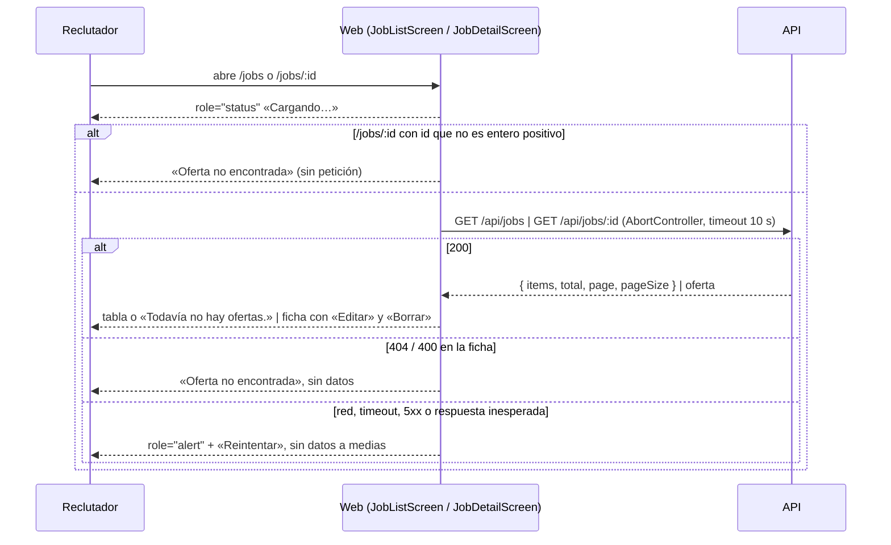

# HU-01 — Crear, editar y consultar ofertas en borrador — Diseño técnico (frontend)

- **Origen:** `specs/PRD.md` (estado Ready, 2026-10-06)
- **Generado por:** frontend-architect
- **Scope cubierto:** RF-01, RF-02, RF-03, RF-04, RF-05 y RF-06 (parte web). RF-07 es solo backend.

## Enfoque técnico

Primera HU de la web. Se resuelve con **React a secas, sin dependencias nuevas**:

- **Navegación** con un router mínimo propio sobre la History API (`pushState` + `popstate`), en
  `apps/web/src/components/router.tsx` (DD-01). Cuatro rutas: `/jobs`, `/jobs/new`, `/jobs/:id` y `/jobs/:id/edit`;
  `/` redirige a `/jobs`. El servidor de Vite ya sirve `index.html` en cualquier ruta (SPA *fallback*), así que los
  enlaces directos y `page.goto('/jobs/7')` funcionan sin configuración.
- **Datos:** un cliente HTTP compartido (`apps/web/src/components/http.ts`) que hace `fetch` a `/api/...`, aplica un
  *timeout* de 10 s, valida el envelope de DEC-01 y lanza un `ApiError` tipado; encima, el cliente de la feature
  (`apps/web/src/features/jobs/api.ts`) con una función por endpoint y comprobación mínima de la forma de la
  respuesta. Un hook `useResource` (cargando / error / datos + `retry`, con `AbortController`) sirve a las tres
  pantallas que leen (DD-03).
- **Pantallas:** contenedor (estado y llamadas) + presentacionales (props, sin `fetch`). Un único formulario para alta
  y edición; la edición envía solo los campos cambiados (DD-04). El borrado se confirma con un `<dialog>` nativo
  abierto con `showModal()` (DD-05).
- **Fechas** con `Intl.DateTimeFormat('es-ES', { timeZone: 'Europe/Madrid' })` en `dd/mm/aaaa` (DD-06).

**Alternativa principal descartada:** `react-router`. Resuelve lo mismo con más superficie (loaders, data routers) de
la que piden cuatro rutas, y exige un `DEC-NN` y una dependencia más en portátiles del taller (DEC-05). Si una HU
futura necesita rutas anidadas o *loaders*, se reabre con su `DEC-NN`.

## Dependencias

- **Contrato de API:** lo fija la sección «Contrato de API» de
  `docs/03_delivery/hu/HU-01-ofertas-borrador/plans/TECHNICAL_DOC-backend.md`, y la web lo consume tal cual. Lo
  confirmó `backend-architect` el 2026-10-06. Si cambia, solo se tocan `apps/web/src/features/jobs/types.ts`, `api.ts`
  y `job-form-model.ts`.
- **Lo que usa la web** (resumen; manda el TECHNICAL_DOC-backend):

| Elemento | Contrato |
|---|---|
| Oferta completa (`POST` 201, `GET /:id` 200, `PATCH` 200) | `{ id, title, description, location, workMode, salaryMin, salaryMax, status, createdAt, publishedAt, closedAt }`. Los opcionales sin valor llegan **siempre** como `null`, nunca ausentes. Fechas ISO 8601 UTC con milisegundos (`2026-10-06T22:30:00.000Z`). `publishedAt` y `closedAt` valen `null` en HU-01 |
| Item del listado (`GET /api/jobs`) | `{ id, title, status, referenceDate }` (`referenceDate = publishedAt ?? createdAt`), dentro de `{ items, total, page: 1, pageSize: 20 }`. Cualquier parámetro de query da 400 |
| `workMode` | literal exacto `presencial`, `híbrida` (í en NFC) o `remota`. `""` da 400; para vaciarlo se envía `null` |
| `details` de `VALIDATION_ERROR` | un elemento `{ field, message }` por campo. `field` es la propiedad del cuerpo, incluidas las sobrantes («Campo no permitido.»); `"id"` si el error está en el parámetro de ruta y `"body"` si es del cuerpo entero (`PATCH {}` → «Envía al menos un campo.»). Si el mínimo supera al máximo, el error va en `salaryMin`. El `message` de nivel superior es «Hay campos con errores.» |
| Vaciar un opcional | `null` en `POST` y `PATCH` (en `POST` también vale omitirlo). `title` no admite `null`. En `PATCH`, un campo omitido no cambia. La web omite los opcionales vacíos en el alta y, en la edición, envía `null` para vaciarlos (nunca `""`) |
| Otros errores | 404 `NOT_FOUND` («La oferta no existe.»), 500 `INTERNAL_ERROR`, 413 `PAYLOAD_TOO_LARGE` y 415 `UNSUPPORTED_MEDIA_TYPE`, todos en el envelope |
| Cabeceras | `GET` y `DELETE` van **sin cuerpo y sin `Content-Type`**: con `application/json` y el cuerpo vacío, Fastify responde 400. `requestJson` solo pone `Content-Type: application/json` cuando hay `body` |
| IDs de ruta | enteros positivos sin ceros a la izquierda (`abc`, `1.5`, `0` → 400 en `id`). `parseJobId` usa la misma regla (`/^[1-9]\d{0,14}$/`) |
| Longitudes | cuentan caracteres Unicode (`[...s].length`), no unidades UTF-16; por eso la web no usa `maxLength` |

## Módulos y ficheros afectados

| Módulo | Fichero | Cambio |
|---|---|---|
| transversal | `apps/web/src/App.tsx` | modificar: *shell* (cabecera, `nav`, `main`, pie con el estado de la API) y tabla de rutas |
| transversal | `apps/web/src/main.tsx` | modificar: importa `styles.css` |
| transversal | `apps/web/src/styles.css` | nuevo: estilos mínimos (foco visible, errores, tabla, `.visually-hidden`) |
| transversal | `apps/web/src/components/router.tsx` | nuevo: `usePath`, `navigate`, `Link`, `matchPath` |
| transversal | `apps/web/src/components/http.ts` | nuevo: `requestJson`, `ApiError`, `userMessage` |
| transversal | `apps/web/src/components/use-resource.ts` | nuevo: hook de lectura con `AbortController` y `retry` |
| transversal | `apps/web/src/components/format.ts` | nuevo: `formatDate`, `formatInteger` |
| transversal | `apps/web/src/components/StatusMessages.tsx` | nuevo: `LoadingMessage`, `ErrorMessage` (con «Reintentar»), `Notice` |
| transversal | `apps/web/src/components/FormField.tsx` | nuevo: `label` + control + ayuda + error con `aria-describedby` |
| transversal | `apps/web/src/components/ConfirmDialog.tsx` | nuevo: `<dialog>` modal de confirmación; el hook interno `useModalDialog` lleva `showModal`/`close`, el foco y `cancel` |
| transversal | `apps/web/src/components/ApiHealth.tsx` | nuevo: lo que hoy hace `App.tsx` con `/api/health`, movido al pie |
| jobs | `apps/web/src/features/jobs/types.ts` | nuevo: `Job`, `JobListItem`, `JobPage`, `JobStatus`, `WorkMode`, `JobInput`, `JobPatch` |
| jobs | `apps/web/src/features/jobs/api.ts` | nuevo: `listJobs`, `getJob`, `createJob`, `updateJob`, `deleteJob` |
| jobs | `apps/web/src/features/jobs/paths.ts` | nuevo: `jobPaths` y `parseJobId` |
| jobs | `apps/web/src/features/jobs/labels.ts` | nuevo: etiquetas de estado y modalidad, `formatSalaryBand` |
| jobs | `apps/web/src/features/jobs/job-form-model.ts` | nuevo: valores, validación en cliente, `toCreateInput`, `toPatch` |
| jobs | `apps/web/src/features/jobs/JobListScreen.tsx` · `JobTable.tsx` | nuevo: contenedor y tabla del listado |
| jobs | `apps/web/src/features/jobs/JobDetailScreen.tsx` · `JobDetails.tsx` | nuevo: contenedor y ficha |
| jobs | `apps/web/src/features/jobs/DeleteJobAction.tsx` | nuevo: botón «Borrar» + diálogo; el hook interno `useDeleteJob` lleva el `DELETE`, su estado y la navegación |
| jobs | `apps/web/src/features/jobs/JobFormScreen.tsx` · `JobForm.tsx` | nuevo: contenedor (alta y edición) y formulario |
| tests | `apps/web/test/App.test.tsx` | modificar: rutas, redirección y página no encontrada; el estado de la API se mantiene |
| tests | `apps/web/test/helpers/fetch.ts` · `apps/web/test/helpers/dialog.ts` | nuevo: `fetch` simulado por ruta y *polyfill* de `showModal`/`close` (jsdom no los implementa) |
| tests | `apps/web/test/components/*.test.ts(x)` | nuevo: `http`, `format`, `router`, `ConfirmDialog` |
| tests | `apps/web/test/features/jobs/*.test.ts(x)` | nuevo: modelo del formulario y las tres pantallas |
| e2e | `playwright.config.ts` | modificar (DD-08): el `webServer` de la API ejecuta `npm run db:reset -w apps/api && npm run start -w apps/api` con `ATS_DB_PATH` = `data/e2e.db`; puertos de e2e 3101 (API) y 5174 (web), pasados como `API_PORT` y `WEB_PORT` a los dos servidores; `reuseExistingServer: false`; `workers: 1`. **No se crea fichero de `globalSetup`** (ver DD-08) |
| e2e | `e2e/smoke.spec.ts` | modificar: la página de entrada es el listado (h1 «Ofertas») |
| e2e | `e2e/jobs.spec.ts` | nuevo: flujos de alta, edición, borrado, consulta y API caída |

Los tests van en `apps/web/test/` porque `apps/web/vite.config.ts` solo incluye `test/**/*.test.{ts,tsx}`.

## Pantallas y estados

**Shell** (`App.tsx`): `<header>` con «ATS» y `<nav aria-label="Principal">` con el enlace «Ofertas»
(`aria-current="page"` en `/jobs`); `<main tabIndex={-1}>` con la pantalla; `<footer>` con `ApiHealth`
(«Estado de la API: ok», como hoy, para que `docs/SETUP.md` y `README.md` sigan valiendo). Al navegar (no en la
primera carga) el foco va a `<main>` y `document.title` pasa a «{pantalla} · ATS». Ruta desconocida → h1 «Página no
encontrada» y enlace «Ir a las ofertas».

| Pantalla (ruta) | Contenedor → presentacionales | Cargando | Vacío | Error | Con datos |
|---|---|---|---|---|---|
| Listado (`/jobs`) | `JobListScreen` → `JobTable`, `StatusMessages` | `role="status"` «Cargando ofertas…» | «Todavía no hay ofertas.» + enlace «Nueva oferta» | `role="alert"` con el mensaje y botón «Reintentar»; sin tabla | `<table>` con `<caption>` «Ofertas»: Título (enlace a la ficha), Estado, Fecha (`<time>`); si `total > items.length`, «Se muestran las 20 más recientes de {total}.» |
| Nueva oferta (`/jobs/new`) | `JobFormScreen` → `JobForm` | N/A (no lee) | N/A | `role="alert"` sobre los botones, sin perder lo escrito | formulario vacío |
| Ficha (`/jobs/:id`) | `JobDetailScreen` → `JobDetails`, `DeleteJobAction` | `role="status"` «Cargando la oferta…» | N/A — recurso único; su equivalente es «no encontrada» | `role="alert"` + «Reintentar»; 404 o ID no válido → h1 «Oferta no encontrada», texto y enlace «Volver a las ofertas», sin datos | h1 = título; `<dl>`: Estado, Descripción, Ubicación, Modalidad, Banda salarial, Fecha de creación; «Sin indicar» si no hay valor; acciones «Editar» (enlace) y «Borrar» (botón) solo si `status === 'draft'` |
| Editar (`/jobs/:id/edit`) | `JobFormScreen` → `JobForm` | `role="status"` «Cargando la oferta…» | N/A | como la ficha (lectura) o como el alta (al guardar) | formulario con los valores actuales |

Avisos tras navegar (`Notice`, `role="status"`): «Oferta creada.», «Cambios guardados.», «Oferta borrada.». Viajan en
`history.state` (texto fijo, sin datos de la oferta) y los muestra la pantalla de destino.

**Formulario** (`JobForm`, `<form noValidate>`, h1 «Nueva oferta» o «Editar oferta»):

| Campo | Control (nombre accesible) | Regla en cliente (refleja RF-02; la API manda) | Mensaje |
|---|---|---|---|
| `title` | `<input type="text" required>` «Título (obligatorio)» | recortado, 3-120 caracteres contados con `Array.from()` (code points, EC-04) | vacío: «Escribe un título.» · fuera de rango: «El título debe tener entre 3 y 120 caracteres.» |
| `description` | `<textarea>` «Descripción» · ayuda «Hasta 5 000 caracteres.» | recortada, ≤ 5 000 | «La descripción no puede pasar de 5 000 caracteres.» |
| `location` | `<input type="text">` «Ubicación» | recortada; si no queda vacía, 2-120 | «La ubicación debe tener entre 2 y 120 caracteres.» |
| `workMode` | `<select>` «Modalidad»: «Sin indicar», «Presencial», «Híbrida», «Remota» (valores literales de la API) | uno de los 3 o vacío | «Elige presencial, híbrida o remota.» |
| `salaryMin` / `salaryMax` | `<input type="text" inputMode="numeric">` «Salario mínimo (€/año)» / «Salario máximo (€/año)» | vacío o `/^\d+$/` y > 0; mínimo ≤ máximo si vienen los dos | «Escribe un número entero mayor que 0, sin puntos ni espacios.» · «El salario mínimo no puede ser mayor que el máximo.» (en el mínimo) |

- **Sin `maxLength` nativo:** cuenta unidades UTF-16 y cortaría títulos con emoji válidos (EC-04).
- Validación al enviar. Con errores: `aria-invalid="true"`, mensaje en `<p id="{campo}-error">` enlazado con
  `aria-describedby` y foco en el primer campo con error; no sale ninguna petición.
- Errores 400 del servidor: cada `details[i]` con `field` del formulario va junto a su campo con su `message`; el
  resto (campo desconocido, cuerpo) va al `role="alert"` del formulario. Lo escrito se conserva siempre.
- «Guardar» (`<button type="submit">`) queda `disabled` con el texto «Guardando…» mientras hay una petición en curso;
  «Cancelar» es un enlace (`/jobs` en el alta, `/jobs/:id` en la edición).

**Diálogo de borrado** (`ConfirmDialog`, `<dialog aria-labelledby aria-describedby>` con `showModal()`): título
«¿Borrar la oferta?», texto «Vas a borrar «{título}». No se puede deshacer.», botones «Cancelar» (foco inicial, DT-02)
y «Borrar oferta». `showModal()` hace inerte el resto de la página (trampa de foco) y `Escape` dispara `cancel`, que
cierra el diálogo; al cerrar sin borrar, el foco vuelve a «Borrar». Mientras se borra, los dos botones quedan
`disabled`.

**Accesibilidad que usan los tests** (`getByRole`/`getByLabelText`): `heading` «Ofertas» / «Nueva oferta» / «Editar
oferta» / {título} / «Oferta no encontrada»; `link` «Nueva oferta», {título}, «Editar», «Cancelar», «Volver a las
ofertas»; `button` «Guardar», «Borrar», «Borrar oferta», «Cancelar», «Reintentar»; `table` «Ofertas»; `dialog`
«¿Borrar la oferta?»; `status` y `alert`. Contraste AA: texto `#1a1a1a` y errores `#b00020` sobre blanco; foco con
`outline: 3px solid` visible en `:focus-visible`. Textos largos con `overflow-wrap: anywhere` y la descripción con
`white-space: pre-wrap`.

## Migración de datos

N/A — esta parte es solo web: no hay esquema ni seed en el frontend. La migración y el seed (RF-07) están en
`TECHNICAL_DOC-backend.md`. La web no guarda nada en `localStorage`, `sessionStorage` ni *cookies*.

## Diagrama de secuencia

RF-01 (alta) y RF-02 (validación):

```mermaid
sequenceDiagram
  participant R as Reclutador
  participant W as Web (JobFormScreen)
  participant A as API
  R->>W: rellena y pulsa «Guardar»
  W->>W: validateJobForm(values)
  alt error en cliente
    W-->>R: errores junto a cada campo, foco en el primero (sin petición)
  else válido
    W->>W: «Guardar» disabled
    W->>A: POST /api/jobs (toCreateInput)
    alt 201
      A-->>W: oferta completa
      W-->>R: navigate /jobs/:id + «Oferta creada.»
    else 400 VALIDATION_ERROR
      A-->>W: { error: { details } }
      W-->>R: message junto a cada campo; lo escrito se conserva
    else 500 / red / timeout
      W-->>R: role="alert" en el formulario; «Guardar» se reactiva
    end
  end
```

RF-03 (edición):

```mermaid
sequenceDiagram
  participant R as Reclutador
  participant W as Web (JobFormScreen)
  participant A as API
  W->>A: GET /api/jobs/:id
  A-->>W: 200 oferta → formulario con valores actuales (404 → «Oferta no encontrada»)
  R->>W: cambia campos y pulsa «Guardar»
  W->>W: validateJobForm + toPatch(original, values)
  alt sin cambios
    W-->>R: navigate /jobs/:id (sin petición)
  else con cambios
    W->>A: PATCH /api/jobs/:id (solo campos cambiados; vaciados → null)
    alt 200
      W-->>R: navigate /jobs/:id + «Cambios guardados.»
    else 400
      W-->>R: errores junto al campo; nada cambia
    else 404 (borrada en otra pestaña)
      W-->>R: role="alert" «Esta oferta ya no existe.» + enlace al listado
    end
  end
```

RF-04 (borrado):

```mermaid
sequenceDiagram
  participant R as Reclutador
  participant W as Web (DeleteJobAction)
  participant A as API
  R->>W: «Borrar»
  W-->>R: dialog.showModal(), foco en «Cancelar»
  alt «Cancelar» o Escape
    W-->>R: cierra, foco a «Borrar»; sin petición
  else «Borrar oferta»
    W->>W: botones disabled
    W->>A: DELETE /api/jobs/:id
    alt 204
      W-->>R: navigate /jobs + «Oferta borrada.»
    else 404
      W-->>R: role="alert" «Esta oferta ya no existe.» + enlace al listado
    else 500 / red
      W-->>R: role="alert" en el diálogo; botones reactivados
    end
  end
```

RF-05 (listado) y RF-06 (ficha):



## Error paths

«API» = el comportamiento lo fija y lo prueba `TECHNICAL_DOC-backend.md`; la columna dice qué hace la web, si algo.

| Edge case (PRD) | Dónde se detecta | Estrategia | Respuesta o efecto observable en la web | Test |
|---|---|---|---|---|
| EC-01 | API | API: ver TECHNICAL_DOC-backend | La web siempre envía un objeto JSON; si llegara un 400 sin `field` de formulario, `role="alert"` del formulario | `JobFormScreen.test.tsx` (400 sin campo) |
| EC-02 | API | API: ver TECHNICAL_DOC-backend | `toCreateInput` nunca incluye `status`, `createdAt` ni `id`; un 400 con esos `field` va al `role="alert"` | `job-form-model.test.ts` |
| EC-03 | Cliente + API | validar sobre el valor recortado; la API recorta y guarda | Se envía recortado; la ficha muestra lo que devuelve la API | `job-form-model.test.ts`, `e2e/jobs.spec.ts` (CA-02) |
| EC-04 | Cliente | contar con `Array.from()`; sin `maxLength` nativo | «Diseñador/a UX 🎨» y 120 caracteres con emoji pasan la validación del cliente y se muestran igual | `job-form-model.test.ts` |
| EC-05 | `requestJson` (500) | mostrar y conservar | `role="alert"` con el `message` del envelope («Error interno. Inténtalo de nuevo.»); sigue en el formulario con lo escrito; «Guardar» se reactiva | `JobFormScreen.test.tsx` |
| EC-06 | Contenedor | `disabled` + guarda con `useRef` mientras envía | Un doble clic produce **una** llamada a `fetch` | `JobFormScreen.adversarial.test.tsx` `[adversarial]` |
| EC-07 | — | N/A — el módulo nace con esta HU (sin filas previas) | — | — |
| EC-08 | API | API: ver TECHNICAL_DOC-backend | La web lo trata como texto: se muestra literal | `e2e/jobs.spec.ts` (título con `'); DROP TABLE`) |
| EC-09 | — | aceptado (DT-03) | Tras un error de red no se reintenta solo: el reclutador decide; si se crea un duplicado, lo borra | `JobFormScreen.test.tsx` (red: una sola llamada) |
| EC-10 | Cliente (`<select>`) + API | solo se pueden elegir los 3 literales; un 400 en `workMode` se muestra junto al select | Error junto a «Modalidad» con el `message` de la API | `JobFormScreen.test.tsx` (400 simulado) |
| EC-11 | Cliente + API | `/^\d+$/` y > 0 | «40000.5», «0», «-1», «40.000» → error junto al campo, sin petición | `job-form-model.test.ts` |
| EC-12 | Cliente + API | mismos umbrales que la API | 2/121, 5 001, 1/121 → error; 3/120, 5 000, 2/120 → se envía | `job-form-model.test.ts` |
| EC-13 | Cliente | mínimo ≤ máximo solo si vienen los dos | Los tres casos se envían; la ficha muestra «40.000 – 40.000 €/año», «Desde 32.000 €/año», «Hasta 40.000 €/año» | `job-form-model.test.ts`, `labels.test.ts` |
| EC-14 | — | N/A — validación pura, sin dependencias | — | — |
| EC-15 | — | N/A — validación sin estado compartido | — | — |
| EC-16 | API/BD | API: ver TECHNICAL_DOC-backend | Sin reacción en la web | — |
| EC-17 | Cliente + API | el cliente corta a 5 000 antes de enviar; un 413 se muestra con su `message` | «La descripción no puede pasar de 5 000 caracteres.» sin petición | `job-form-model.test.ts`, `JobFormScreen.test.tsx` (413) |
| EC-18 | — | N/A — validar no tiene efectos | — | — |
| EC-19 | Contenedor | `toPatch` sin cambios → no se llama a la API | Vuelve a la ficha sin petición (nunca envía `{}`) | `JobFormScreen.adversarial.test.tsx` `[adversarial]` |
| EC-20 | Cliente + API | título obligatorio también al editar | «Escribe un título.» junto al título; ningún `PATCH` | `JobFormScreen.edit.test.tsx` |
| EC-21 | `toPatch` | opcional vaciado → `null` | Ficha con «Sin indicar» | `job-form-model.test.ts`, `e2e/jobs.spec.ts` (CA-10) |
| EC-22 | `requestJson` (500) | como EC-05 | `role="alert"` en la edición; lo escrito se conserva | `JobFormScreen.edit.test.tsx` |
| EC-23 | API | última escritura; la web envía solo lo cambiado | Dos pestañas: queda lo de la última | `e2e/jobs.spec.ts` (CA-11) |
| EC-24 | `ApiError` 404 en `PATCH` | mensaje + salida | `role="alert"` «Esta oferta ya no existe.» + enlace «Volver a las ofertas» | `JobFormScreen.adversarial.test.tsx` `[adversarial]` |
| EC-25 | API | API: ver TECHNICAL_DOC-backend | `toPatch` solo emite campos editables | `job-form-model.test.ts` |
| EC-26 | API | API: ver TECHNICAL_DOC-backend | Sin reacción específica | — |
| EC-27 | `parseJobId` | no se construye una URL con un ID no entero | `/jobs/abc` → «Oferta no encontrada», sin «Borrar» ni petición | `JobDetailScreen.test.tsx` |
| EC-28 | Listado | estado vacío tras el borrado | Vuelve a `/jobs` y ve «Todavía no hay ofertas.» | `JobListScreen.test.tsx` (vacío) |
| EC-29 | `requestJson` (500) | mostrar sin cerrar | `role="alert"` en el diálogo; la oferta sigue en la ficha | `DeleteJobAction.test.tsx` |
| EC-30 | API | como EC-24 | Ver EC-24 | `JobFormScreen.adversarial.test.tsx` |
| EC-31 | — | N/A — un borrador no tiene inscripciones y el módulo nace con esta HU | — | — |
| EC-32 | — | API: ver TECHNICAL_DOC-backend (DEC-04) | La URL solo lleva el ID de la oferta, que no es dato personal | — |
| EC-33 | Contenedor + API | botones `disabled` mientras borra; un 404 se muestra | Doble clic → una sola llamada; si llega un 404, «Esta oferta ya no existe.» | `DeleteJobAction.test.tsx` `[adversarial]` |
| EC-34 | API | la web llama a `GET /api/jobs` sin parámetros | Sin reacción | `api.test.ts` (URL exacta) |
| EC-35 | Listado | vacío / tabla / aviso de total | 0 → vacío; 20 → 20 filas sin aviso; 21 → 20 filas y «Se muestran las 20 más recientes de 21.» | `JobListScreen.test.tsx` |
| EC-36 | `formatDate` | `Intl` con `timeZone: 'Europe/Madrid'` | `2026-10-06T22:30:00Z` → «07/10/2026» | `format.test.ts`, `JobListScreen.test.tsx` |
| EC-37 | API | la web pinta en el orden recibido, sin reordenar | Mismo orden que `items` | `JobListScreen.test.tsx` |
| EC-38 | `requestJson` (red, timeout, 5xx, sin envelope) | estado «error» | `role="alert"` + «Reintentar», sin tabla | `JobListScreen.test.tsx`, `e2e/jobs.spec.ts` (`route.abort`) |
| EC-39 | — | N/A — lectura sin efectos | — | — |
| EC-40 | `isJobPage` | forma inesperada → estado «error» | `role="alert"`, sin filas a medias | `api.test.ts` `[adversarial]` |
| EC-41 | React (escapado) | prohibido `dangerouslySetInnerHTML` | `` se ve como texto; 0 `img` en la tabla | `JobListScreen.test.tsx` `[adversarial]` |
| EC-42 | — | N/A — `GET` sin efectos | — | — |
| EC-43 | `parseJobId` + `ApiError` 400 | mismo mensaje que 404 | «Oferta no encontrada» para `/jobs/abc`, `/jobs/1.5` y 400 de la API | `JobDetailScreen.test.tsx` |
| EC-44 | `JobDetails` | `null` → «Sin indicar» | Ningún «null», «undefined» ni `<dd>` vacío | `JobDetailScreen.test.tsx` |
| EC-45 | `requestJson` | estado «error» | `role="alert"` + «Reintentar», sin datos | `JobDetailScreen.test.tsx` |
| EC-46 | Acción siguiente | 404 en `PATCH` o `DELETE` | Ver EC-24 y EC-33 | `JobFormScreen.adversarial.test.tsx`, `DeleteJobAction.test.tsx` |
| EC-47 | — | N/A — el módulo nace con esta HU | — | — |
| EC-48 | React (escapado) | texto literal, `pre-wrap` | `<script>` y `<b>` se ven como texto; 0 `b`/`script` dentro de la ficha | `JobDetailScreen.test.tsx` `[adversarial]` |
| EC-49 | — | N/A — `GET` sin efectos | — | — |
| EC-50 | API (DT-05) | API: ver TECHNICAL_DOC-backend; sin validación en el cliente | Como cualquier 400: el `message` de `details` aparece junto a su campo (título, descripción o ubicación), con `aria-invalid` y foco en él; lo escrito se conserva | `JobFormScreen.edit.test.tsx` (400 junto al campo, mismo camino) |

Errores del cliente HTTP (`userMessage`): sin red, *timeout* o 5xx sin envelope → «No se ha podido conectar con el
servidor. Vuelve a intentarlo en unos segundos.»; respuesta 2xx con forma inesperada → «La respuesta del servidor no
es válida. Vuelve a intentarlo.»; cualquier error con envelope (incluidos `INTERNAL_ERROR`, `PAYLOAD_TOO_LARGE` y
`UNSUPPORTED_MEDIA_TYPE`) → su `message`. Una cancelación por desmontaje (`AbortError` propio) no se muestra nunca.

## Threat modeling

| STRIDE | Amenaza concreta en la web | Mitigación | Riesgo residual |
|---|---|---|---|
| Suplantación | — | N/A — sin login, rol único, API en `127.0.0.1` (DEC-04) | Ninguno nuevo |
| Manipulación | XSS con el título o la descripción (EC-41, EC-48) | Solo interpolación JSX (escapada); prohibido `dangerouslySetInnerHTML`, `innerHTML` y `href` con datos de la API; tests `[adversarial]` | Bajo: depende de la review (no hay regla de ESLint que lo bloquee) |
| Manipulación | ID manipulado en la URL (`/jobs/..%2Fhealth`, `/jobs/1.5`) | `parseJobId` (`/^[1-9]\d{0,14}$/`) antes de construir `/api/jobs/{id}` | Ninguno |
| Repudio | — | N/A — sin usuarios (DEC-04) | — |
| Exposición de información | Detalles internos en pantalla o consola | Solo se muestra `error.message` del envelope o un texto fijo; nunca el cuerpo crudo ni `stack`; sin `console.log` de respuestas | Ninguno |
| Denegación de servicio | Envío de textos enormes; listas muy largas | Validación de longitudes en cliente antes de enviar; el listado nunca pinta más de lo que devuelve la API (20) | Bajo |
| Elevación de privilegios | — | N/A — un único rol | — |

## Datos personales

No toca datos personales: la oferta no los contiene (PRD, «Datos personales»; `docs/RGPD.md` §1). La URL solo lleva el
ID numérico de la oferta, `history.state` solo textos fijos («Oferta creada.») y la web no persiste nada en el
navegador. La regla queda fijada para las HU de candidatos, que reutilizarán `router.tsx`: nunca datos personales en
la URL ni en `history.state`.

## Decisiones de diseño

### DD-01: Navegación con un router mínimo propio sobre la History API
- **Contexto:** primera HU con varias pantallas; el PRD exige URL por pantalla y deja la elección al diseño (DEC-05).
- **Opciones consideradas:** A) `react-router` (dependencia nueva + `DEC-NN`). B) Router propio con `pushState` y rutas
  limpias (`/jobs/7`). C) Router propio con *hash* (`#/jobs/7`). D) Estado en memoria sin URL.
- **Elegida:** B, en `apps/web/src/components/router.tsx` (≈ 80 líneas): `usePath()` con `useSyncExternalStore`
  sobre `popstate`, `navigate(to, { replace?, notice? })`, `<Link>` que renderiza `<a href>` e intercepta solo el clic
  primario sin modificadores, y `matchPath(pattern, path)`.
- **Razón:** cuatro rutas no justifican una dependencia; Vite sirve `index.html` en cualquier ruta, así que B no
  necesita configuración; enlaces reales (`<a href>`) que abren en pestaña nueva y funcionan con el teclado.
- **Tradeoff:** se mantiene código propio (sin rutas anidadas, *loaders* ni bloqueo de navegación con cambios sin
  guardar); C evitaría depender del *fallback* del servidor y D sería más simple, pero rompe «atrás», enlaces directos
  y `page.goto` en los e2e.

### DD-02: Cliente HTTP compartido con `ApiError` y *timeout*
- **Contexto:** tres features consumirán el mismo envelope; la API «que no responde» (CA-18) tiene que acabar en
  estado «error», no en «cargando» para siempre.
- **Opciones consideradas:** A) `fetch` directo en cada `api.ts`. B) `requestJson` en `apps/web/src/components/http.ts`
  que combina la señal del llamador con `AbortSignal.timeout(10_000)` (`AbortSignal.any`), traduce red, *timeout*,
  envelope y cuerpo no JSON a `ApiError { status, code, message, details }`, y devuelve `undefined` en 204.
- **Elegida:** B.
- **Razón:** un único sitio que conoce DEC-01; los `api.ts` de cada feature solo tipan y validan forma.
- **Tradeoff:** 10 s fijos: una API lenta pero viva da error antes de responder (aceptable en local); el cliente no
  reintenta solo (EC-09).

### DD-03: Hook `useResource` para las lecturas
- **Contexto:** listado, ficha y edición repiten cargando / error / datos / reintento con `AbortController`.
- **Opciones consideradas:** A) `useEffect` a mano en cada pantalla. B) `useResource(load, deps)` compartido →
  `{ state: 'loading' | 'error' | 'success', data, error, retry }`. C) Librería de datos (TanStack Query).
- **Elegida:** B, en `apps/web/src/components/use-resource.ts`.
- **Razón:** quita duplicación sin dependencia; aborta en el desmontaje y con `StrictMode` (doble efecto en
  desarrollo) no pinta respuestas obsoletas.
- **Tradeoff:** sin caché ni revalidación: volver al listado vuelve a pedirlo (deseable aquí: siempre fresco).

### DD-04: Un formulario para alta y edición; la edición envía solo lo cambiado
- **Contexto:** RF-01 y RF-03 comparten campos y reglas; `PATCH {}` da 400 (EC-19) y gana la última escritura
  campo a campo (EC-23).
- **Opciones consideradas:** A) Enviar siempre los seis campos en el `PATCH`. B) `toPatch(original, values)` con solo
  los cambiados (vaciado → `null`) y, sin cambios, volver a la ficha sin petición.
- **Elegida:** B. Estado del formulario en cadenas (`JobFormValues`); conversión y validación puras en
  `job-form-model.ts`.
- **Razón:** dos pestañas que tocan campos distintos no se pisan; nunca se envía `{}`; el modelo puro se prueba sin
  DOM.
- **Tradeoff:** si otra pestaña cambió un campo que esta no tocó, esta no lo «restaura»: el resultado mezcla las dos
  ediciones (coherente con DEC-08, pero menos intuitivo que A).

### DD-05: Confirmación de borrado con `<dialog>` nativo y `showModal()`
- **Contexto:** DT-02 pide un diálogo accesible con foco inicial en «Cancelar».
- **Opciones consideradas:** A) `window.confirm`. B) `<div role="dialog">` con trampa de foco propia. C) `<dialog>` con
  `showModal()`.
- **Elegida:** C, en `apps/web/src/components/ConfirmDialog.tsx`, reutilizable (HU-02 lo usará para cerrar ofertas).
- **Razón:** el navegador da la inercia del fondo, `Escape` y el rol `dialog`; solo hay que fijar el foco inicial y
  devolverlo al cerrar.
- **Tradeoff:** jsdom no implementa `showModal`/`close`: los tests de componente necesitan un *polyfill*
  (`apps/web/test/helpers/dialog.ts`) y la trampa de foco y `Escape` reales solo se prueban en Playwright. A no es
  accesible ni personalizable; B es más código propio.

### DD-06: Fechas con `Intl` en Europe/Madrid y formato numérico propio
- **Contexto:** DEC-09: UTC en la API, `dd/mm/aaaa` en Europe/Madrid en la interfaz.
- **Opciones consideradas:** A) `Intl.DateTimeFormat('es-ES', { timeZone: 'Europe/Madrid', day: '2-digit', month:
  '2-digit', year: 'numeric' })`. B) Librería de fechas.
- **Elegida:** A, en `apps/web/src/components/format.ts`, con `<time dateTime={iso}>`. Una cadena no parseable se
  muestra como «Fecha no válida» (no «Invalid Date»).
- **Razón:** DEC-09 descarta librerías; la zona fija hace el resultado independiente de la zona del portátil.
- **Tradeoff:** depende de los datos ICU del navegador y de Node (completos en Node 24 y Chromium).

### DD-07: El estado de la API se queda en el pie
- **Contexto:** hoy `App.tsx` solo muestra «Estado de la API: …»; `docs/SETUP.md` y `README.md` piden comprobarlo.
- **Opciones consideradas:** A) Quitarlo y actualizar esos docs. B) Moverlo a `ApiHealth` en el `<footer>`.
- **Elegida:** B.
- **Razón:** no rompe la comprobación de la instalación del taller y no mezcla la salud con la pantalla de ofertas.
- **Tradeoff:** hay dos `role="status"` en la página de entrada; `e2e/smoke.spec.ts` deja de usar `getByRole('status')`
  y pasa a `getByText('Estado de la API: ok')`.

### DD-08: `data/e2e.db` se regenera en el arranque del `webServer` de la API, no en `globalSetup`
- **Contexto:** el aprobador pide e2e deterministas en cualquier portátil, con `data/e2e.db` regenerada en cada
  ejecución. Hoy la base se reutiliza entre ejecuciones y los dos `webServer` tienen `reuseExistingServer: true` fuera
  de CI.
- **Comprobación:** en `@playwright/test` 1.63.0, `createGlobalSetupTasks` (`node_modules/playwright/lib/runner/index.js`,
  línea 6321) ejecuta primero `createPluginSetupTasks` (los `webServer`) y **después** los `globalSetup`. Cuando corre
  `globalSetup`, la API ya tiene abierta `data/e2e.db` en modo WAL. Si `reset.ts` borra entonces `e2e.db`, `-wal` y
  `-shm`, la API sigue escribiendo en los ficheros borrados y nunca ve la base nueva, o la deja corrupta.
- **Opciones consideradas:**
  - A) `globalSetup` con `db:reset`: inseguro por el orden de arriba.
  - B) `globalSetup` que arranca él mismo la API después del reset: duplica lo que ya hace `webServer`.
  - C) Reset en el comando del `webServer` de la API: `npm run db:reset -w apps/api && npm run start -w apps/api`, con
    el `ATS_DB_PATH` que ya fija su `env`.
- **Elegida:** C, con tres ajustes:
  - `reuseExistingServer: false` en los dos servidores: si no, un `npm run dev` abierto se reutilizaría y los e2e
    probarían contra `data/ats.db`.
  - Puertos propios de e2e (API 3101 y web 5174): así `npm run e2e` convive con `npm run dev`.
  - `workers: 1`.
- **Razón:** el reset termina antes de que la API abra la base. `reset.ts` ya honra `ATS_DB_PATH`, `&&` funciona en
  `sh` y en `cmd.exe`, y no hace falta ningún fichero nuevo.
- **Tradeoff:**
  - Cada ejecución arranca la API desde cero (unos segundos más).
  - Los e2e ya no se pueden lanzar contra una app que ya esté arrancada.
  - Con un solo *worker*, la suite no se paraleliza.

## Impacto en decisiones

| DEC | Cómo se aplica |
|---|---|
| DEC-01 | React 19 + Vite; el cliente HTTP interpreta el envelope `{ error: { code, message, details? } }` |
| DEC-03 | Los e2e siguen en su propia base, `data/e2e.db`, que ahora se regenera en cada ejecución (DD-08); sin cambio en la decisión |
| DEC-04 | Sin login ni roles en la web; la seguridad se centra en XSS, IDs en la URL y tamaños |
| DEC-05 | **Sin dependencias nuevas** (ni router, ni formularios, ni `user-event`/`jest-dom` en tests): no hace falta `DEC-NN` |
| DEC-07 | La web distingue 400 (junto al campo), 404 (no encontrada) y 5xx (alerta con reintento) |
| DEC-08 | Ediciones: última escritura, con solo los campos cambiados (DD-04); doble envío bloqueado en la web |
| DEC-09 | `formatDate` en Europe/Madrid `dd/mm/aaaa` (DD-06) |
| DEC-10 | La web consume `{ items, total, page, pageSize }` y avisa si `total > items.length`; paginación en HU-02 |

`docs/ARCHITECTURE.md` («Web») y el futuro `docs/05_modules/ofertas/technical.md` deben recoger el router y el cliente
compartidos en `apps/web/src/components/`: lo hace `/module-sync` al cerrar la HU.

## Estrategia de tests

Vitest + Testing Library en `apps/web/test/` (jsdom). Consultas por rol y *label*; `fetch` simulado con
`vi.stubGlobal` mediante `apps/web/test/helpers/fetch.ts` (respuestas por método y ruta, registro de llamadas y respeto
de la señal de aborto); `fireEvent` (no hay `user-event`) y aserciones con `expect` de Vitest (no hay `jest-dom`). La
ruta inicial se fija con `history.replaceState` antes de `render`. Datos inventados («Desarrollador/a backend
(Node.js)», «Técnica/o de selección», «Valencia»). Se simula solo la red; el modelo, el formateo y el router son
reales.

| RF | Vitest (fichero → qué) | Playwright (`e2e/jobs.spec.ts`) |
|---|---|---|
| RF-01 | `JobFormScreen.test.tsx` → alta con solo título navega a la ficha (CA-01); cuerpo enviado recortado y sin opcionales vacíos (CA-02); 500 y red conservan lo escrito (EC-05); `JobFormScreen.adversarial.test.tsx` → `[adversarial]` doble clic = 1 `fetch` en alta y en edición (EC-06) | CA-01: alta solo con título → ficha → aparece en el listado. CA-02: alta completa con espacios, híbrida, Valencia, 32 000-40 000 |
| RF-02 | `job-form-model.test.ts` → fronteras 2/3/120/121, 5 000/5 001, 1/2/120/121, emoji, salarios `0`, `-1`, `40000.5`, `40.000`, min > max, min = max, solo uno (CA-03 a CA-07, EC-04, EC-11 a EC-13); `JobFormScreen.test.tsx` → 400 con `details` de título y modalidad junto al campo con `aria-describedby` y foco en el primero (CA-03, CA-05, CA-12) | CA-03 en la UI: título de 2 caracteres → error junto al campo y sigue en el formulario |
| RF-03 | `JobFormScreen.edit.test.tsx` → precarga, `PATCH` solo con cambios, vaciado → `null` (CA-09, CA-10, EC-21), título vacío sin `PATCH` (EC-20), 400 junto al campo (CA-12), 500 (EC-22); `JobFormScreen.adversarial.test.tsx` → `[adversarial]` sin cambios no llama (EC-19) y 404 al guardar (EC-24, EC-30) | CA-09 y CA-10: editar descripción y ubicación, luego vaciar la descripción → «Sin indicar». CA-11: dos páginas editan el mismo borrador; queda la última |
| RF-04 | `DeleteJobAction.test.tsx` → diálogo con nombre de la oferta y foco en «Cancelar» (DT-02), cancelar no llama, confirmar → `DELETE` y listado (CA-13), `[adversarial]` doble clic = 1 llamada y 404 mostrado (EC-33, CA-14), 500 (EC-29); `ConfirmDialog.test.tsx` → evento `cancel` cierra y devuelve el foco | CA-13: «Borrar» → `Escape` (sigue) → «Borrar» → «Borrar oferta» → listado sin la oferta; foco inicial en «Cancelar» |
| RF-05 | `JobListScreen.test.tsx` → cargando, vacío (CA-17), error + «Reintentar» (CA-18, EC-38), 20/21 elementos (CA-15, EC-35), fecha 07/10/2026 (CA-16), orden recibido (EC-37), `[adversarial]` título con `` como texto (EC-41); `api.test.ts` → URL sin parámetros (EC-34), `[adversarial]` forma inesperada → error (EC-40); `format.test.ts` → EC-36 | Listado del seed: los 4 borradores en orden, con «Borrador» y fecha `dd/mm/aaaa` (RF-05, RF-07). CA-18: `page.route('**/api/jobs', r => r.abort())` → «error» con `role="alert"` |
| RF-06 | `JobDetailScreen.test.tsx` → ficha completa con «Editar» y «Borrar» y ninguna otra acción (CA-19), «Sin indicar» (EC-44), 404, 400 y `/jobs/abc` → «Oferta no encontrada» sin datos (CA-20, EC-43, EC-27), error + reintento (EC-45), `[adversarial]` `<b>`/`<script>` como texto (EC-48) | CA-19: título `Oferta <b>X</b>` se ve literal. CA-20: `/jobs/999999999` → «Oferta no encontrada» |
| Transversal | `http.test.ts` (envelope, 204, no JSON, `GET`/`DELETE` sin `Content-Type` y `POST`/`PATCH` con él, red, *timeout* con `timeoutMs` corto, aborto propio silencioso), `router.test.tsx` (`Link` sin modificadores navega; con Ctrl no), `App.test.tsx` (`/` → `/jobs`, ruta desconocida, estado de la API en el pie) | `e2e/smoke.spec.ts`: `/` muestra h1 «Ofertas» y «Estado de la API: ok» |

**Criterio → test** (CA de API pura en el backend): CA-01, CA-02 → e2e + `JobFormScreen.test.tsx`; CA-03 a CA-07 →
`job-form-model.test.ts` + `JobFormScreen.test.tsx`; CA-08, CA-14 (envelope) → backend; CA-09, CA-10, CA-12 →
`JobFormScreen.edit.test.tsx` + e2e; CA-11 → e2e; CA-13 → `DeleteJobAction.test.tsx` + e2e; CA-15 a CA-17 →
`JobListScreen.test.tsx`; CA-18 → `JobListScreen.test.tsx` + e2e; CA-19, CA-20 → `JobDetailScreen.test.tsx` + e2e.

**E2E deterministas sobre `data/e2e.db` (DD-08):** cada `npm run e2e` arranca con la base regenerada (esquema,
migraciones y seed de RF-07: los 4 borradores inventados). Por eso los tests usan **títulos fijos** y pueden comprobar
el estado inicial:

- **Nuevo test de listado sobre el seed:** los 4 borradores del seed salen con estado «Borrador» y fecha
  `dd/mm/aaaa`, en el orden de la API (RF-05 y RF-07 de extremo a extremo). Solo comprueba el **orden relativo** de esas
  4 filas, así que no le afecta lo que creen o borren los demás tests.
- **Sin dependencias entre tests:** cada test que escribe crea sus propias ofertas con un título fijo y distinto de los
  de los demás tests y del seed.
- **Un solo *worker*:** `workers: 1` en `playwright.config.ts`, para que dos ficheros no escriban a la vez.

El estado «vacío» (CA-17) y los 25 elementos (CA-15) **siguen en Vitest**. En e2e exigirían borrar el seed o crear 21
ofertas, y el resultado dependería del orden de los tests. El orden real con 25 ofertas ya lo prueba el backend con
`fastify.inject`. Selectores por rol y nombre, como en Testing Library.

## Checklist de implementación

1. `types.ts`, `paths.ts`, `labels.ts`, `components/format.ts` + tests.
2. `components/http.ts` + `features/jobs/api.ts` + tests (`helpers/fetch.ts`).
3. `components/router.tsx`, `use-resource.ts`, `StatusMessages.tsx`, `ApiHealth.tsx`; `App.tsx` y `styles.css`;
   `App.test.tsx` y `e2e/smoke.spec.ts` actualizados.
4. `JobTable` + `JobListScreen` + test.
5. `JobDetails` + `JobDetailScreen` + test.
6. `job-form-model.ts` + test; `FormField` + `JobForm` + `JobFormScreen` (alta y edición) + test.
7. `ConfirmDialog` + `DeleteJobAction` + tests (`helpers/dialog.ts`).
8. `playwright.config.ts` (DD-08: reset en el comando del `webServer` de la API, puertos propios de e2e,
   `reuseExistingServer: false`, `workers: 1`); comprobar que dos `npm run e2e` seguidos dan el mismo resultado.
9. `e2e/jobs.spec.ts`.

Umbrales: ≤ 300 líneas por fichero y ≤ 50 por función; `JobFormScreen` delega validación y conversión en
`job-form-model.ts` y el borrado vive en `DeleteJobAction` para no superarlos.

## Riesgos

| Riesgo | Probabilidad (1–5) | Impacto (1–5) | Mitigación |
|---|---|---|---|
| El contrato del backend cambia tras este diseño | 2 | 3 | Contrato confirmado por `backend-architect` (2026-10-06); `api.test.ts` fija la forma esperada y un cambio solo toca 3 ficheros de `features/jobs/` |
| `workMode` enviado en NFD (`híbrida` con tilde combinada) | 1 | 3 | Los valores salen de las `<option>` del código fuente, en NFC; `job-form-model.test.ts` comprueba el literal exacto |
| Los e2e no parten de la base regenerada (un servidor reutilizado que usa `data/ats.db`) | 2 | 4 | DD-08: el reset va en el comando del `webServer`, con puertos propios y `reuseExistingServer: false`; si los puertos de e2e están ocupados, Playwright falla en vez de probar contra otra base |
| Un reintento de Playwright (`retries` en CI) vuelve a crear la oferta de un test con el mismo título fijo | 2 | 2 | En local `retries` es 0; en el reintento, los tests buscan su oferta con `.first()` |
| Cambia el seed de RF-07 (títulos o fechas) | 2 | 2 | El test del seed lee los títulos de una constante única en `e2e/jobs.spec.ts`, que se actualiza junto al seed |
| jsdom sin `showModal` | 5 | 2 | *Polyfill* en `apps/web/test/helpers/dialog.ts`; foco y `Escape` reales en Playwright |
| Gestión de foco al navegar poco anunciada en lectores de pantalla | 2 | 2 | Foco en `<main>` + `document.title` por pantalla; revisión manual con VoiceOver en `/qa-e2e` |

## Open Decisions

No hay decisiones abiertas.

## Fuera de scope

- Filtros, cambio de página y de tamaño del listado (HU-02).
- Acciones «Publicar», «Cerrar» y «Duplicar», ficha de una oferta cerrada y edición o borrado de ofertas no `draft`
  (HU-02); `JobDetails` ya decide las acciones por estado para que HU-02 solo las añada.
- Aviso de cambios sin guardar al salir del formulario.
- Pantallas de candidatos e inscripciones (FEAT-02, FEAT-03).
