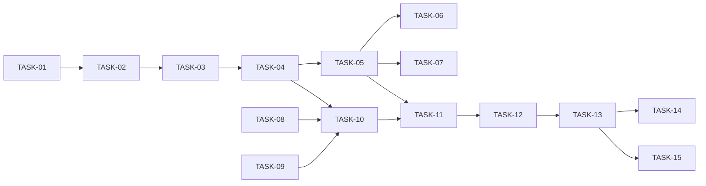

# HU-01 — Crear, editar y consultar ofertas en borrador — Roadmap de tareas

## Resumen
- **Fuente de verdad:** `plans/TECHNICAL_DOC-backend.md` y `plans/TECHNICAL_DOC-frontend.md` (no el PRD).
- **Tareas:** 15 (S: 0 · M: 4 · L: 11) · estimación total: **44 h** (backend 19 h, web 21,5 h, e2e 3,5 h).
- **Scope:** backend 7 (TASK-01 a TASK-07) · frontend 7 (TASK-08 a TASK-14) · e2e 1 (TASK-15).
- **Cobertura:** cada RF del PRD → tareas; cada CA → al menos un test; cada edge case Must → test o `N/A` razonado
  (tablas de abajo).
- **Por qué 15 (el máximo):** HU fullstack y primera del producto: 5 endpoints, 4 pantallas y todas las piezas
  transversales de API y web que reutilizarán HU-02 a HU-05, más 4 tareas `[adversarial]` separadas. No está partida
  por capas: cada endpoint y cada pantalla es una rebanada con su test; las únicas tareas «de capa» son los `[setup]`
  transversales (TASK-01, TASK-08, TASK-09) y la migración (TASK-02).

| ID | Título | Scope | Complejidad | Depende de |
|---|---|---|---|---|
| TASK-01 | Base transversal de la API (Ajv, envelope, reloj, transacciones) `[setup]` | backend | L (3,5 h) | — |
| TASK-02 | Tabla `job_openings` `[migration]` | backend | M (1,5 h) | TASK-01 |
| TASK-03 | Alta: `POST /api/jobs` | backend | L (3,5 h) | TASK-02 |
| TASK-04 | Ficha, listado y seed: `GET /api/jobs/:id`, `GET /api/jobs` | backend | L (3,5 h) | TASK-03 |
| TASK-05 | Edición y borrado: `PATCH`, `DELETE` | backend | L (3,5 h) | TASK-04 |
| TASK-06 | Alta y edición en la API frente a hostiles y fallos `[adversarial]` | test (backend) | M (2 h) | TASK-05 |
| TASK-07 | Borrado, listado y ficha en la API frente a hostiles y fallos `[adversarial]` | test (backend) | M (1,5 h) | TASK-05 |
| TASK-08 | Cliente HTTP, formato y contrato web `[setup]` | frontend | L (3,5 h) | — |
| TASK-09 | Router, `useResource` y componentes compartidos `[setup]` | frontend | L (3 h) | — |
| TASK-10 | Listado como pantalla de entrada (*shell*) | frontend | L (3 h) | TASK-04, TASK-08, TASK-09 |
| TASK-11 | Ficha y borrado con confirmación | frontend | L (3,5 h) | TASK-05, TASK-10 |
| TASK-12 | Formulario de alta | frontend | L (3,5 h) | TASK-11 |
| TASK-13 | Edición en la web y errores del servidor | frontend | L (3 h) | TASK-12 |
| TASK-14 | La web frente a dobles envíos, borradas, respuestas inesperadas y HTML `[adversarial]` | test (frontend) | M (2 h) | TASK-13 |
| TASK-15 | Recorridos e2e sobre base regenerada `[e2e]` | test (e2e) | L (3,5 h) | TASK-13 |

## Fases

| Fase | Tareas | Objetivo |
|---|---|---|
| 1 · Setup | TASK-01, TASK-08, TASK-09 | Piezas transversales de DEC-11 (API) y de la web (cliente HTTP, router, componentes), de las que dependen todas las demás |
| 2 · Núcleo API | TASK-02, TASK-03, TASK-04, TASK-05 | Tabla, 5 endpoints con su JSON Schema y tests, seed (RF-07) y rendimiento (RNF-01, RNF-02) |
| 3 · Pantallas | TASK-10, TASK-11, TASK-12, TASK-13 | Listado, ficha + borrado, alta y edición, cada una con sus tests de Testing Library |
| 4 · Adversariales y e2e | TASK-06, TASK-07, TASK-14, TASK-15 | Casos hostiles por RF Must y recorridos de Playwright |

## Dependencias

**Camino crítico:** TASK-01 → 02 → 03 → 04 → 05 → 11 → 12 → 13 → 15 (≈ 29 h). TASK-08 y TASK-09 tienen holgura: van en
paralelo con el backend.

## Orden de implementación

En el taller, uno por tarea y en orden: **01, 02, 03, 04, 05, 06, 07, 08, 09, 10, 11, 12, 13, 14, 15**.

Paralelismo posible **sin compartir ficheros** (máx. 4 builders, `IMPLEMENTATION-RULE.md` R4.1):
- TASK-08 y TASK-09 en paralelo entre sí y con TASK-01 a TASK-05 (web frente a API).
- TASK-10 en paralelo con TASK-05 (cuando acabe TASK-04).
- TASK-06 y TASK-07 en paralelo entre sí (ficheros de test distintos; si alguna destapa un fallo en
  `apps/api/src/modules/jobs/service.ts` o `routes.ts`, la otra espera).
- TASK-14 y TASK-15 en paralelo entre sí.

Ficheros que se tocan en secuencia (no paralelizar): `apps/api/src/modules/jobs/{schemas,repository,service,routes}.ts`
(TASK-03 → 04 → 05), `apps/api/test/helpers/test-app.ts` (TASK-01 → 02 → 03), `apps/web/src/App.tsx`
(TASK-10 → 11 → 12 → 13), `apps/web/test/features/jobs/JobFormScreen.test.tsx` (TASK-12 → 13 → 14).

## RF Must × tarea `[adversarial]`

| RF (Must) | Tarea(s) `[adversarial]` | Edge cases cubiertos (categoría de `QUALITY-GATES.md` §3) | Resto de categorías |
|---|---|---|---|
| RF-01 | TASK-06 (API), TASK-14 (web) | 1 EC-01, EC-02 · 3 EC-05 · 6 EC-08 · 4 EC-06 (web) | 2 EC-03, EC-04 y 7 EC-09 en TASK-03/12/13; 5 EC-07 N/A |
| RF-02 | TASK-06 (API) | 1 EC-11 · 6 EC-17 | 1 EC-10, 2 EC-12, EC-13 en TASK-03/12; 5 EC-16 en TASK-02; 3 EC-14, 4 EC-15, 7 EC-18 N/A |
| RF-03 | TASK-06 (API), TASK-14 (web) | 1 EC-20 + regla de banda fusionada · 3 EC-22 · 5 EC-24 · 6 EC-25 · 1 EC-19 y 5 EC-24/EC-30 (web) | 1 EC-19, 2 EC-21, 4 EC-23, 7 EC-26 en TASK-05; EC-23 en TASK-15 |
| RF-04 | TASK-07 (API), TASK-14 (web) | 1 EC-27 · 3 EC-29 · 7 EC-33 · 7 EC-33 + CA-14 (web) · 4 EC-30 (TASK-06 y TASK-14) | 2 EC-28 en TASK-05/10; 5 EC-31 N/A; 6 EC-32 sin test (aceptado en *Threat modeling*) |
| RF-05 | TASK-07 (API), TASK-14 (web) | 1 EC-34 · 6 EC-41 + solo campos de lista · 6 EC-41 y 5 EC-40 (web) | 2 EC-35/36/37 en TASK-04/10; 3 EC-38 en TASK-01/10/15; 4 EC-39, 7 EC-42 N/A |
| RF-06 | TASK-07 (API), TASK-14 (web) | 1 EC-43 + CA-20 · 4 EC-46 · 6 EC-48 (web) | 2 EC-44 y 6 EC-48 (API) en TASK-04/11; 3 EC-45 en TASK-11; 5 EC-47, 7 EC-49 N/A |

RF-07 es Should: sin adversarial obligatorio (sus `CHECK` se prueban en TASK-02).

## Cobertura PRD → tareas

| RF / RNF | Task(s) |
|---|---|
| RF-01 Crear un borrador | TASK-03, TASK-06, TASK-12, TASK-13, TASK-14, TASK-15 |
| RF-02 Validar los campos | TASK-01, TASK-02, TASK-03, TASK-06, TASK-12, TASK-13 |
| RF-03 Editar un borrador | TASK-05, TASK-06, TASK-13, TASK-14, TASK-15 |
| RF-04 Borrar un borrador | TASK-05, TASK-07, TASK-11, TASK-14, TASK-15 |
| RF-05 Listar ofertas | TASK-04, TASK-07, TASK-08, TASK-10, TASK-14, TASK-15 |
| RF-06 Consultar una oferta | TASK-04, TASK-07, TASK-11, TASK-14, TASK-15 |
| RF-07 Migración y seed (Should) | TASK-02, TASK-04, TASK-15 |
| RNF-01 Lecturas < 200 ms | TASK-04 |
| RNF-02 Acciones < 500 ms | TASK-05 |
| RNF-03 Errores en el envelope, sin *stack* | TASK-01, TASK-06, TASK-07 |
| RNF-04 Sin HTML interpretado | TASK-10, TASK-11, TASK-14, TASK-15 |
| RNF-05 Accesibilidad | TASK-09, TASK-10, TASK-11, TASK-12 |

| CA | Task(s) | CA | Task(s) |
|---|---|---|---|
| CA-01 | TASK-03, TASK-04, TASK-12, TASK-15 | CA-11 | TASK-05, TASK-15 |
| CA-02 | TASK-03, TASK-12, TASK-15 | CA-12 | TASK-06, TASK-13 |
| CA-03 | TASK-03, TASK-12, TASK-15 | CA-13 | TASK-05, TASK-11, TASK-15 |
| CA-04 | TASK-03, TASK-12 | CA-14 | TASK-07, TASK-14 |
| CA-05 | TASK-03, TASK-12 | CA-15 | TASK-04, TASK-10 |
| CA-06 | TASK-03, TASK-12 | CA-16 | TASK-04, TASK-08, TASK-10 |
| CA-07 | TASK-03, TASK-06, TASK-12 | CA-17 | TASK-04, TASK-10 |
| CA-08 | TASK-06 | CA-18 | TASK-10, TASK-15 |
| CA-09 | TASK-05, TASK-13, TASK-15 | CA-19 | TASK-04, TASK-11, TASK-14, TASK-15 |
| CA-10 | TASK-05, TASK-13, TASK-15 | CA-20 | TASK-07, TASK-11, TASK-15 |

| EC | Task(s) | EC | Task(s) | EC | Task(s) |
|---|---|---|---|---|---|
| EC-01 | TASK-06, TASK-13 | EC-18 | N/A (validar no tiene efectos) | EC-35 | TASK-04, TASK-10 |
| EC-02 | TASK-06, TASK-12, TASK-13 | EC-19 | TASK-05, TASK-14 | EC-36 | TASK-04, TASK-08, TASK-10 |
| EC-03 | TASK-03, TASK-12, TASK-15 | EC-20 | TASK-06, TASK-13 | EC-37 | TASK-04, TASK-10 |
| EC-04 | TASK-03, TASK-12 | EC-21 | TASK-05, TASK-13, TASK-15 | EC-38 | TASK-01, TASK-08, TASK-10, TASK-15 |
| EC-05 | TASK-06, TASK-12 | EC-22 | TASK-06, TASK-13 | EC-39 | N/A (lectura sin efectos) |
| EC-06 | TASK-03, TASK-14 | EC-23 | TASK-05, TASK-15 | EC-40 | TASK-14 (web; N/A en la API) |
| EC-07 | N/A (módulo nuevo) | EC-24 | TASK-06, TASK-14 | EC-41 | TASK-07, TASK-14 |
| EC-08 | TASK-06, TASK-15 | EC-25 | TASK-06, TASK-13 | EC-42 | N/A (`GET` sin efectos) |
| EC-09 | TASK-03, TASK-13 | EC-26 | TASK-05 | EC-43 | TASK-07, TASK-11 |
| EC-10 | TASK-03, TASK-12 | EC-27 | TASK-07, TASK-11 | EC-44 | TASK-04, TASK-11 |
| EC-11 | TASK-06, TASK-12 | EC-28 | TASK-05, TASK-10 | EC-45 | TASK-11 |
| EC-12 | TASK-03, TASK-12 | EC-29 | TASK-07, TASK-11 | EC-46 | TASK-07, TASK-14 |
| EC-13 | TASK-03, TASK-08, TASK-12 | EC-30 | TASK-06, TASK-14 | EC-47 | N/A (módulo nuevo) |
| EC-14 | N/A (validación pura) | EC-31 | N/A (borrador sin inscripciones) | EC-48 | TASK-04, TASK-14 |
| EC-15 | N/A (sin estado compartido) | EC-32 | Sin test: aceptado en *Threat modeling* | EC-49 | N/A (`GET` sin efectos) |
| EC-16 | TASK-02 | EC-33 | TASK-07, TASK-14 | | |
| EC-17 | TASK-06, TASK-12, TASK-13 | EC-34 | TASK-07, TASK-08 | | |

Transversales del diseño sin RF propio: DD-07 (ID no reutilizado) en TASK-05; DD-08 (`CHECK` adelantados) en TASK-02;
DD-11 (`withTransaction`) en TASK-01; DD-08 frontend (base de e2e regenerada) en TASK-15.

## Riesgos

**Heredados del diseño:**
- HU-02 declarará `page`/`pageSize` como enteros y Ajv los rechazará sin coerción (DEC-11). Mitigación: DEC-11 y
  `idParamsSchema` como ejemplo (TASK-01).
- La web cuenta longitudes con `text.length` y discrepa de la API con emojis. Mitigación: `Array.from()` y sin
  `maxLength` nativo (TASK-12); EC-04 probado en API y web.
- La web envía `Content-Type: application/json` en `GET`/`DELETE` sin cuerpo → 400. Mitigación: `requestJson` y su test
  (TASK-08).
- Los `CHECK` adelantados (DD-08) no encajan con el diseño de HU-02. Mitigación: tests en `migration.test.ts` (TASK-02).
- Hasta HU-02, `PATCH` y `DELETE` no comprueban el estado (solo hay borradores). Fuera de scope explícito.
- Tests de rendimiento inestables en portátiles lentos. Mitigación: calentamiento previo (TASK-04, TASK-05).
- jsdom sin `showModal`. Mitigación: *polyfill* (TASK-09); foco y `Escape` reales en Playwright (TASK-15).
- Los e2e no parten de la base regenerada si se reutiliza un servidor. Mitigación: DD-08 (TASK-15).
- Cambia el seed (títulos o fechas). Mitigación: constante única `SEED_TITLES` en `e2e/jobs.spec.ts` (TASK-15).
- `workMode` en NFD. Mitigación: valores de las `<option>` en NFC y test del literal (TASK-12).

**Del troceado:**
- **15 tareas, en el máximo del gate**, y 11 de tamaño L, varias estimadas en 3,5 h (TASK-01, 03, 04, 05, 08, 11, 12,
  15). Si un builder supera las 4 h, se para y se parte la tarea por funcionalidad en `/implementar-hu`, no se sigue.
- Estados intermedios de la web: entre TASK-10 y TASK-13, «Nueva oferta», la ficha o «Editar» pueden caer en «Página
  no encontrada» porque su ruta aún no existe. Es esperado; el e2e completo solo se exige en TASK-15.
- El *smoke* (`e2e/smoke.spec.ts`) cambia en TASK-10 y necesita `GET /api/jobs` real (TASK-04).
- Las tareas `[adversarial]` pueden destapar fallos en código ya integrado: se corrigen dentro de la propia tarea (techo
  de 2 ciclos) y, si el fallo es de diseño, se escala.

**Huecos del diseño detectados y decididos por el team-lead (2026-10-06):**
1. **`parseJobId`**: la web usa la misma expresión que la API, `^[1-9][0-9]{0,14}$` (≤ 15 cifras). El
   TECHNICAL_DOC-frontend escribía `\d{0,15}` por error, aunque decía «la misma regla». TASK-08.
2. **`detail` del JSON malformado**: `{ field: "body", message: "Debe ser un objeto JSON." }` (el diseño solo fijaba
   `field`). TASK-01 y TASK-06.
3. **Etiquetas de estado en la web**: «Borrador», «Publicada» y «Cerrada» (el diseño solo fijaba «Borrador»).
   TASK-08.
4. **`data/e2e.db`**: el riesgo del TECHNICAL_DOC-backend («`data/e2e.db` no se regenera entre ejecuciones y acumula
   ofertas») **queda resuelto por DD-08 del TECHNICAL_DOC-frontend**: la base se regenera en el comando del `webServer`
   de la API (TASK-15, que además lo documenta en `playwright.config.ts` y `docs/SETUP.md`). Manda DD-08.
