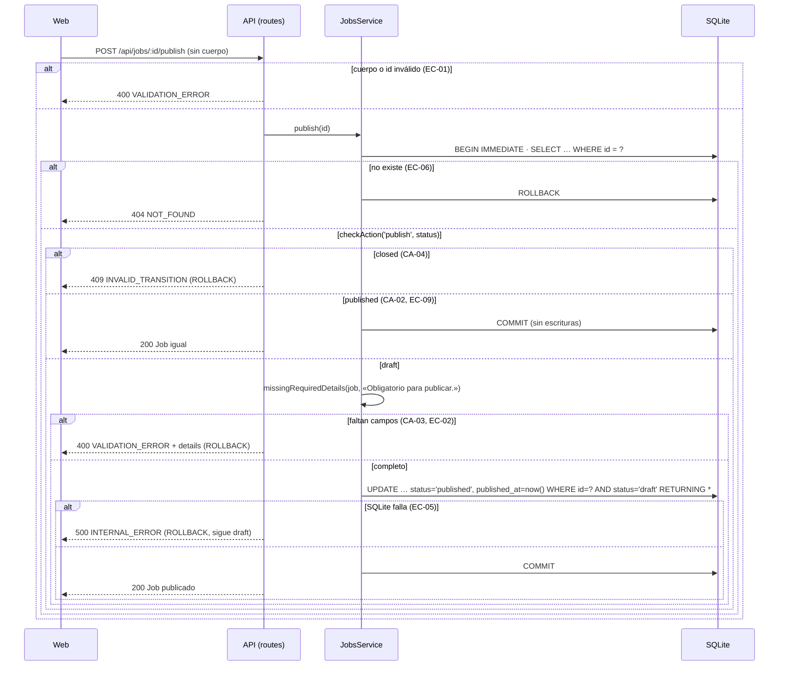
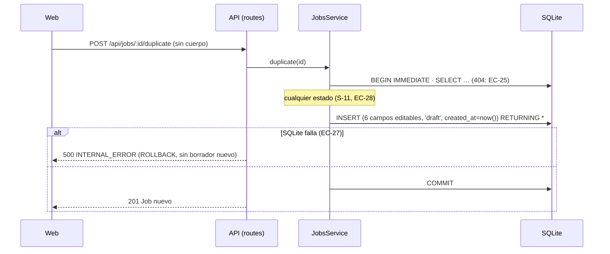

# HU-02 — Publicar, cerrar, duplicar y listar ofertas con filtros — Diseño técnico (backend)

- **Origen:** `specs/PRD.md` (estado Ready, v1.1, 2026-10-06)
- **Generado por:** backend-architect
- **Scope cubierto:** RF-01 a RF-05 (parte API), RF-07, RNF-01, RNF-02, RNF-03 y RNF-06. La parte web de RF-01 a RF-06,
  RNF-04 y RNF-05 está en `plans/TECHNICAL_DOC-frontend.md`, que consume el *Contrato de API* de este documento tal
  cual.

## Enfoque técnico

Se amplía el módulo `jobs` sin rediseñar las piezas de HU-01: `AppError` y el manejador único, `trimTextFields`,
`idParamsSchema`, `withTransaction`, el reloj inyectado, `createTestApp` y `failWrites` (DEC-11). Hay cinco cambios:

| Pieza | Qué hace |
|---|---|
| **Reglas de estado en una tabla** (`rules.ts`, nuevo) | `checkAction(acción, estado)` → `apply` · `noop` · 409 `INVALID_TRANSITION`. La usan `publish`, `close`, `update` y `remove` dentro de su `withTransaction` (DEC-08), después del 404 y antes de las reglas de campos (orden de DT-04) |
| **Puerto hacia `inscripciones`** (`applications-port.ts`, nuevo) | `JobApplicationsPort`: lectura `countActiveApplications(jobId)` (DT-01) y operación interna `rejectActiveApplications({ jobId, closedAt })` (DT-02), inyectados en el servicio desde `buildApp`. Hoy es un *stub* (`noJobApplications`: 0 y no hace nada). HU-05 lo conecta en `apps/api/src/app.ts` sin tocar `jobs` |
| **Acciones sin cuerpo** | `POST /:id/publish`, `/:id/close`, `/:id/duplicate` y `GET /:id/close-preview`. Un hook `rejectBody` da 400 si llega cualquier cuerpo (DT-03) |
| **Listado con filtros** | `status`, `q`, `page` y `pageSize` validados como texto con `pattern` (DEC-11.2). Búsqueda con una función SQL determinista `fold_search` (minúsculas + NFD sin marcas), registrada en la conexión, e `instr` (literal: `%` y `_` no son comodines) |
| **Escrituras entre sitios** (DEC-12, `http/cross-site.ts`, nuevo) | Un hook `onRequest` registrado en `buildApp` antes de los módulos rechaza con 403 `CROSS_SITE_REQUEST` cualquier `POST`, `PATCH` o `DELETE` que llegue con `Sec-Fetch-Site: cross-site`. Si falta la cabecera, deja pasar (DD-06) |

Sin migración: las transiciones las comprueba el servicio (tabla `checkAction` y guarda de estado en el `UPDATE`), con
los `CHECK` que ya trae la 001 como red.

**Alternativa principal descartada:** columna `title_search` normalizada (migración + escritura doble en `insert`,
`update` y `duplicate`). Una migración `.sql` no puede calcular NFD para rellenar las filas existentes, y `migrate.ts`
solo ejecuta SQL. La función SQL no guarda nada derivado y usa el mismo plegado en los dos lados (DD-04).

## Módulos y ficheros afectados

| Módulo | Fichero | Cambio |
|---|---|---|
| transversal | `apps/api/src/errors.ts` | modificar: `invalidTransition(message)` → `AppError('INVALID_TRANSITION', 409, message)` (~35 líneas) |
| transversal | `apps/api/src/http/validation.ts` | modificar: `rejectBody` (hook `preValidation`) (~70) |
| transversal | `apps/api/src/db/text-search.ts` | **nuevo**: `foldSearchText(text)` y `registerTextSearch(db)` (función SQL `fold_search`) (~30). HU-03 lo reutiliza |
| transversal | `apps/api/src/http/cross-site.ts` | **nuevo**: `registerCrossSiteGuard(app)` (hook `onRequest`, DEC-12, DD-06) (~25) |
| transversal | `apps/api/src/app.ts` | modificar: `registerCrossSiteGuard(app)` justo después de `registerErrorHandling(app)` y antes de cualquier ruta; `jobApplications?: JobApplicationsPort` en `AppOptions` (por defecto `noJobApplications`) y `applications` al crear el servicio (~65) |
| transversal | `apps/api/src/db/seed.ts` | modificar: +6 ofertas (4 `published`, 2 `closed`) vía repositorio; `SEED_TITLES_IN_LIST_ORDER` por fecha de referencia (~150) |
| jobs | `apps/api/src/modules/jobs/applications-port.ts` | **nuevo**: `JobApplicationsPort`, `noJobApplications` (~30) |
| jobs | `apps/api/src/modules/jobs/rules.ts` | **nuevo**: `checkAction`, `missingRequiredDetails`, `salaryRangeDetails`, `assertNoDetails` (~85) |
| jobs | `apps/api/src/modules/jobs/schemas.ts` | modificar: `listQuerySchema` con 4 parámetros, `closePreviewSchema`, tipos `JobListQuery`, `JobListQuerystring` y `ClosePreview`, `DEFAULT_PAGE`/`DEFAULT_PAGE_SIZE` (~205) |
| jobs | `apps/api/src/modules/jobs/repository.ts` | modificar: `listPage(filter, limit, offset)`, `count(filter)`, `markPublished`, `markClosed`; llama a `registerTextSearch(db)` (~185) |
| jobs | `apps/api/src/modules/jobs/service.ts` | modificar: `publish`, `close`, `closePreview`, `duplicate`, `list(query)`; estado en `update` y `remove` (~175). `assertSalaryRange` pasa a `rules.ts` |
| jobs | `apps/api/src/modules/jobs/routes.ts` | modificar: 4 rutas nuevas, `trimSearchText` y `toListQuery` (~140) |
| tests | `apps/api/test/helpers/test-app.ts` | modificar: `createTestApp({ now?, jobApplications? })`, `createApplicationsSpy`, `publishJob`, `closeJob`, `createPublishedJob` (~115) |
| tests | `apps/api/test/jobs/{publish,close,status-rules,duplicate,list-filters,list-filters-adversarial}.test.ts`, `apps/api/test/db/text-search.test.ts`, `apps/api/test/http/cross-site.test.ts` | **nuevos** (cada uno < 300; `cross-site` va en un fichero hermano porque `error-handler.test.ts` está a 299) |
| tests | `apps/api/test/jobs/list.test.ts` | modificar: EC-34 de HU-01 (ver *Estrategia de tests*) |
| tests | `apps/api/test/jobs/seed.test.ts` · `apps/api/test/jobs/performance.test.ts` | modificar: CA-24 · RNF-01/RNF-02 de HU-02 |

Sin cambios: `update.test.ts`, `delete.test.ts`, `create*.test.ts`, `get.test.ts`, `control-chars.test.ts`,
`enumeration.test.ts`, `migration.test.ts` (usa `toContain` con la 001) y `http/error-handler.test.ts` (299 líneas: no
se toca, según la deuda abierta). Siguen en verde porque solo trabajan con borradores.

## Contrato de API

### Convenciones (además de las de HU-01, que siguen vigentes)

- **Acciones sin cuerpo** (`publish`, `close`, `duplicate`): el cliente **no envía cuerpo ni `Content-Type`**.
  Cualquier cuerpo (también `{}`, `null` o un texto) → 400 `VALIDATION_ERROR` con
  `details: [{ field: "body", message: "Esta acción no admite cuerpo." }]`. `Content-Type: application/json` sin
  cuerpo → 400 «El cuerpo de la petición no es JSON válido.» (lo que ya hacía HU-01); `x-www-form-urlencoded` o
  `multipart` → 415. `rejectBody` corre en `preValidation`, antes que el esquema de `params`: con un ID inválido y además
  un cuerpo, `details` solo trae `body` (los dos casos son 400).
- **Escrituras entre sitios** (DEC-12): un `POST`, `PATCH` o `DELETE` con `Sec-Fetch-Site: cross-site` → 403
  `CROSS_SITE_REQUEST`, antes que cualquier otra comprobación y en todas las rutas (también las de HU-01). `same-origin`,
  `same-site`, `none` o sin cabecera → la petición sigue. `GET` nunca se bloquea.
- **Orden de comprobación** (DT-04 + DEC-12): `Sec-Fetch-Site` (403) → JSON Schema / `rejectBody` (400) → existencia
  (404) → estado (409) → reglas del servicio (400).
- **409** `INVALID_TRANSITION`: un mensaje por caso, sin `details`, sin ID ni datos de la oferta.
- **Repetir** publicar o cerrar → 200 con la oferta tal cual, sin escribir (no se llama a `now()` ni al puerto).

| HTTP | `code` | `message` | Cuándo |
|---|---|---|---|
| 403 | `CROSS_SITE_REQUEST` | «Petición no permitida desde otro sitio.» | Escritura con `Sec-Fetch-Site: cross-site` (DEC-12). Sin `details` ni datos de la petición |
| 409 | `INVALID_TRANSITION` | «Una oferta cerrada no se puede publicar.» | `publish` sobre `closed` |
| 409 | `INVALID_TRANSITION` | «Un borrador no se puede cerrar: publícalo primero.» | `close` sobre `draft` |
| 409 | `INVALID_TRANSITION` | «Una oferta cerrada no se puede editar.» | `PATCH` sobre `closed` |
| 409 | `INVALID_TRANSITION` | «Una oferta publicada no se puede borrar.» | `DELETE` sobre `published` |
| 409 | `INVALID_TRANSITION` | «Una oferta cerrada no se puede borrar.» | `DELETE` sobre `closed` |
| 400 | `VALIDATION_ERROR` | «Hay campos con errores.» · `details[].message` «Obligatorio para publicar.» | `publish` de un `draft` incompleto: un elemento por campo, en el orden `title`, `description`, `location`, `workMode` (la banda nunca) |
| 400 | `VALIDATION_ERROR` | «Hay campos con errores.» · «Obligatorio en una oferta publicada.» | `PATCH` de una `published` que, tras la fusión, deja vacío alguno de esos 4 campos. Si además falla la banda, `salaryMin` va en el mismo `details` |

### Esquemas nuevos (`apps/api/src/modules/jobs/schemas.ts`)

```json
"ListQuery": { "type": "object", "additionalProperties": false, "properties": {
  "status":   { "type": "string", "enum": ["draft", "published", "closed"] },
  "q":        { "type": "string", "maxLength": 100, "pattern": NO_CONTROL_CHARS },
  "page":     { "type": "string", "pattern": "^[1-9][0-9]{0,8}$" },
  "pageSize": { "type": "string", "pattern": "^(?:[1-9][0-9]?|100)$" } } }
"ClosePreview": { "type": "object", "additionalProperties": false, "required": ["activeApplications"],
  "properties": { "activeApplications": { "type": "integer", "minimum": 0 } } }
```

`Job`, `JobListItem`, `JobPage` e `IdParams`, sin cambios.

Mensajes de la querystring, comprobados con Fastify 5.12.5 y la configuración de Ajv de DEC-11:

| Entrada | `details` |
|---|---|
| `status=Published`, `status=` o `status=archived` | `status`: «Debe ser uno de estos valores: draft, published, closed.» |
| `status=draft&status=closed` (llega como *array*) | `status`: «Debe ser un texto.» |
| `page=0`, `-1`, `1.5`, `abc`, `007` o `page=` | `page`: «Formato no válido.» |
| `pageSize=0`, `101`, `abc` o `007` | `pageSize`: «Formato no válido.» |
| `q` de 101 puntos de código tras recortar | `q`: «Debe tener como máximo 100 caracteres.» |
| `q` con C0 o DEL **dentro** del texto (`a%09b`, `a%0Ab`, `a%00`) | `q`: «Formato no válido.» |
| `sort=title` o cualquier otro parámetro | `sort`: «Campo no permitido.» |

### Endpoints

| Método y ruta | Entrada | 2xx | Errores |
|---|---|---|---|
| `POST /api/jobs/:id/publish` (nuevo) | `params`: `IdParams`; sin cuerpo | **200** `Job`: `status: "published"`, `publishedAt = now()`. Ya `published` → **200** igual, sin cambios | 400 (`id`, `body`, campos pendientes) · 404 · 409 · 415 · 500 |
| `POST /api/jobs/:id/close` (nuevo) | `params`: `IdParams`; sin cuerpo | **200** `Job`: `status: "closed"`, `closedAt = now()`; en la misma transacción, `rejectActiveApplications` una vez. Ya `closed` → **200** igual, sin invocar el puerto | 400 · 404 · 409 · 415 · 500 `INTERNAL_ERROR` |
| `GET /api/jobs/:id/close-preview` (nuevo) | `params`: `IdParams` | **200** `ClosePreview` `{ "activeApplications": 0 }`, en cualquier estado (hoy siempre 0) | 400 · 404 · 500 |
| `POST /api/jobs/:id/duplicate` (nuevo) | `params`: `IdParams`; sin cuerpo | **201** `Job` nuevo: los 6 campos editables de la original, `status: "draft"`, `createdAt = now()`, `publishedAt`/`closedAt` `null`. No es idempotente | 400 · 404 · 415 · 500 |
| `GET /api/jobs` (modificar) | `querystring`: `ListQuery`. `q` se recorta antes de validar; vacío tras recortar = sin filtro | **200** `JobPage`: filtros en Y, mismo orden que en HU-01 (`referenceDate` desc, `id` desc), `total` del resultado filtrado, `page` y `pageSize` aplicados (por defecto 1 y 20). Página más allá de la última → `items: []` con el `total` real | 400 · 500 |
| `PATCH /api/jobs/:id` (modificar) | Igual que en HU-01 | **200** `Job`; en una `published`, `status` y fechas intactos | + 409 si `closed` · + 400 con obligatorios vacíos si `published` |
| `DELETE /api/jobs/:id` (modificar) | Igual que en HU-01 | **204** solo si `draft` | + 409 si `published` o `closed` |

Ejemplo: `POST /api/jobs/7/publish` con el reloj en `2026-10-06T08:00:00.000Z` → 200
`{ "id": 7, …, "status": "published", "createdAt": "2026-10-01T10:00:00.000Z", "publishedAt": "2026-10-06T08:00:00.000Z", "closedAt": null }`.

### Firmas internas (para `/task-planner`)

```ts
// apps/api/src/modules/jobs/applications-port.ts (nuevo). Lo define `jobs`; lo implementará `inscripciones` (HU-05).
export interface JobApplicationsPort {
  /** Lectura (DT-01): inscripciones de la oferta en etapa no final. Síncrona. */
  countActiveApplications(jobId: number): number;
  /** Operación interna (DT-02, UC-19): rechaza las activas. Se llama dentro de la transacción del cierre, después
   *  del UPDATE y solo en la transición real. Devuelve cuántas rechazó (UC-19 · P5). Si lanza, se deshace todo. */
  rejectActiveApplications(input: { jobId: number; closedAt: string }): number;
}
export const noJobApplications: JobApplicationsPort; // { countActiveApplications: () => 0, rejectActiveApplications: () => 0 }

// apps/api/src/app.ts
export interface AppOptions { db: DatabaseSync; logger?: …; now?: Clock; jobApplications?: JobApplicationsPort }

// apps/api/src/modules/jobs/service.ts
export interface JobsService {
  create(input: JobInput): Job;
  get(id: number): Job;
  update(id: number, patch: JobPatch): Job;  // + INVALID_TRANSITION (closed); VALIDATION_ERROR (obligatorios si published)
  remove(id: number): void;                  // + INVALID_TRANSITION (published, closed); ahora en withTransaction
  list(query: JobListQuery): JobPage;        // JobListQuery = { status?: JobStatus; q?: string; page: number; pageSize: number }
  publish(id: number): Job;                  // NOT_FOUND, INVALID_TRANSITION, VALIDATION_ERROR
  close(id: number): Job;                    // NOT_FOUND, INVALID_TRANSITION; errores del puerto → ROLLBACK
  closePreview(id: number): ClosePreview;    // NOT_FOUND
  duplicate(id: number): Job;                // NOT_FOUND
}
export interface JobsServiceDeps { repository; now; transaction; applications: JobApplicationsPort }

// apps/api/src/modules/jobs/rules.ts (nuevo)
export type JobAction = 'publish' | 'close' | 'update' | 'remove';
export function checkAction(action: JobAction, status: JobStatus): 'apply' | 'noop'; // lanza invalidTransition
export function missingRequiredDetails(fields: JobEditableFields, message: string): ErrorDetail[];
export function salaryRangeDetails(min: number | null | undefined, max: number | null | undefined): ErrorDetail[];
export function assertNoDetails(details: ErrorDetail[]): void; // lanza validationError si no está vacío

// apps/api/src/modules/jobs/repository.ts
interface JobListFilter { status: JobStatus | null; q: string | null } // q ya plegado con foldSearchText
listPage(filter: JobListFilter, limit: number, offset: number): JobListItem[];
count(filter: JobListFilter): number;
markPublished(id: number, publishedAt: string): Job | undefined; // UPDATE … WHERE id = ? AND status = 'draft' RETURNING *
markClosed(id: number, closedAt: string): Job | undefined;       // UPDATE … WHERE id = ? AND status = 'published' RETURNING *

// apps/api/src/db/text-search.ts (nuevo)
export function foldSearchText(text: string): string; // text.toLowerCase().normalize('NFD').replace(/\p{M}/gu, '')
export function registerTextSearch(db: DatabaseSync): void; // db.function('fold_search', { deterministic: true }, …)
```

Consulta del listado (una sola sentencia fija, parámetros con nombre; la de `COUNT(*)` usa el mismo `WHERE`):

```sql
SELECT id, title, status, COALESCE(published_at, created_at) AS reference_date
  FROM job_openings
 WHERE (:status IS NULL OR status = :status)
   AND (:q IS NULL OR instr(fold_search(title), :q) > 0)
 ORDER BY COALESCE(published_at, created_at) DESC, id DESC
 LIMIT :limit OFFSET :offset
```

Verificado con Node 24.21: `db.function` existe, registrarla dos veces sobre la misma conexión no falla, `gestion`
encuentra «GESTIÓN» y «Gestión» guardada en NFD, `pena` encuentra «peña» y «penalizaciones», y `%` solo encuentra
títulos que lo contienen.

**Cómo conectan HU-04 y HU-05 (solo en `apps/api/src/app.ts`).** HU-05 sustituye el valor por defecto
`jobApplications ?? noJobApplications` por un adaptador sobre las operaciones del módulo `applications`
(`countActiveApplications` → su lectura; `rejectActiveApplications` → UC-19). Como `withTransaction` se une a la
transacción en curso (DEC-11.7), lo que UC-19 escriba entra en el `BEGIN IMMEDIATE` del cierre. `applications` no
importa el tipo de `jobs`: TypeScript lo comprueba de forma estructural al asignarlo en `app.ts` (DEC-06: `inscripciones`
no importa `ofertas`). El puerto «estado de la oferta» de HU-04 también se monta en `app.ts`, con un adaptador sobre
`jobsService.get(id).status`; `jobs` no cambia.

## Migración de datos

**N/A: la 001 ya trae las columnas y los `CHECK`.** Verificado en
`apps/api/src/db/migrations/001-create-job-openings.sql:12-18`: `published_at` y `closed_at` con `GLOB` ISO, coherencia
estado-fechas (`:15-17`, INV-01 e INV-05 en lo que toca a las fechas) y obligatorios fuera de `draft` (`:18`, INV-04).
El índice `:21-22` sirve también para el orden del listado filtrado, y la búsqueda no necesita columna (DD-04).

| Aspecto | Dónde se defiende |
|---|---|
| Transiciones (RN-06), «una `closed` no se edita» (INV-02), «solo se borra un `draft`» (INV-03), fecha de publicación fija (INV-08) | Solo en el servicio, dentro de `withTransaction`: `checkAction` (DD-02) y la guarda `AND status = '<origen>'` de `markPublished`/`markClosed` (DD-08). Así lo fija el PRD («Modelo de datos»); los *triggers* se descartaron (DD-12) |
| Coherencia estado-fechas y obligatorios fuera de `draft` | En la base (`CHECK` de la 001) y en el servicio (400 con `details`) |
| Filas existentes | No se tocan: en `data/ats.db` de HU-01 todas son `draft` y se publican sin migrar nada (EC-07) |

**Seed** (`apps/api/src/db/seed.ts`, RF-07). Se añaden 6 ofertas inventadas, insertadas con
`repository.insert` → `markPublished` → `markClosed` dentro del `withTransaction` que ya existe (DD-10). Las fechas son
fijas, todas las ofertas cumplen RN-02 a RN-04, cada publicación es posterior a la creación y cada cierre, posterior a
la publicación:

| Título | Estado | Modalidad · ubicación | Banda (€/año) | `created_at` | `published_at` | `closed_at` |
|---|---|---|---|---|---|---|
| Desarrollador/a backend (Node.js) | `published` | `remota` · Málaga | 36 000-45 000 | 2026-09-29T09:00 | 2026-10-02T08:00 | — |
| Administrativo/a contable | `published` | `presencial` · Murcia | — | 2026-09-22T07:45 | 2026-09-25T10:15 | — |
| Técnico/a de selección de personal | `published` | `híbrida` · Valencia | 30 000-37 000 | 2026-09-17T10:00 | 2026-09-19T08:30 | — |
| Responsable de gestión de nóminas | `published` | `presencial` · Madrid | 38 000-46 000 | 2026-09-10T08:00 | 2026-09-12T09:00 | — |
| Becario/a de marketing digital | `closed` | `remota` · Barcelona | 12 000-14 000 | 2026-08-25T10:00 | 2026-08-27T08:00 | 2026-09-26T15:30 |
| Auxiliar de logística | `closed` | `presencial` · Getafe | — | 2026-08-18T08:00 | 2026-08-20T09:00 | 2026-09-15T16:00 |

(Todas en UTC, con `:00.000Z`.) Cada una lleva una descripción inventada de 1-2 frases, sin personas ni empresas
reales. `SEED_TITLES_IN_LIST_ORDER` pasa a ordenarse por `publishedAt ?? createdAt` descendente. Orden resultante: Node.js, frontend (React),
Diseñador/a, Administrativo/a, Soporte IT, Analista, Selección, Nóminas, Marketing, Logística. Los 4 borradores de
HU-01 mantienen su orden relativo, que es lo que comprueba `e2e/jobs.spec.ts:7-13`.

## Diagrama de secuencia

**RF-01 · Publicar**



**RF-02 · Cerrar (lectura previa y cierre en una transacción)**

```mermaid
sequenceDiagram
  participant W as Web
  participant A as API (routes)
  participant S as JobsService
  participant P as JobApplicationsPort
  participant D as SQLite
  W->>A: GET /api/jobs/:id/close-preview
  A->>S: closePreview(id)
  S->>D: SELECT … WHERE id = ? (404 si no existe)
  S->>P: countActiveApplications(id)
  P-->>S: 0 (stub hasta HU-05)
  A-->>W: 200 { activeApplications: 0 }
  Note over W: diálogo; «Cancelar» no envía nada (CA-06)
  W->>A: POST /api/jobs/:id/close (sin cuerpo)
  A->>S: close(id)
  S->>D: BEGIN IMMEDIATE · SELECT …
  alt checkAction: draft (CA-08)
    A-->>W: 409 INVALID_TRANSITION (ROLLBACK)
  else closed (CA-07, EC-13, EC-16)
    A-->>W: 200 Job igual (puerto NO invocado)
  else published
    S->>D: UPDATE … status='closed', closed_at=now() WHERE id=? AND status='published' RETURNING *
    S->>P: rejectActiveApplications({ jobId, closedAt })
    alt falla el UPDATE o el puerto (CA-09, EC-12)
      S->>D: ROLLBACK
      A-->>W: 500 INTERNAL_ERROR (sigue published, closedAt null)
    else
      S->>D: COMMIT
      A-->>W: 200 Job cerrado
    end
  end
```

**RF-03 · Editar y borrar según el estado**

```mermaid
sequenceDiagram
  participant W as Web
  participant A as API (routes)
  participant S as JobsService
  participant D as SQLite
  W->>A: PATCH /api/jobs/:id { campos } · o DELETE /api/jobs/:id
  A->>A: trim + JSON Schema (400 antes que el estado: EC-18, EC-23)
  A->>S: update(id, patch) · remove(id)
  S->>D: BEGIN IMMEDIATE · SELECT … (404)
  S->>S: checkAction('update' | 'remove', status)
  alt update en closed · remove en published/closed (CA-10, CA-12, CA-13, EC-21, EC-24)
    A-->>W: 409 INVALID_TRANSITION (ROLLBACK, nada cambia)
  else update
    S->>S: merged; si published → missingRequiredDetails(merged, «Obligatorio en una oferta publicada.») + salaryRangeDetails
    alt details (CA-11, EC-17)
      A-->>W: 400 VALIDATION_ERROR (ROLLBACK)
    else
      S->>D: UPDATE 6 columnas fijas · COMMIT (500 + ROLLBACK si falla: EC-20)
      A-->>W: 200 Job (status y fechas intactos: EC-19)
    end
  else remove en draft
    S->>D: DELETE … · COMMIT
    A-->>W: 204
  end
```

**RF-04 · Duplicar**



**RF-05 · Listar con filtros y paginación**

```mermaid
sequenceDiagram
  participant W as Web
  participant A as API (routes)
  participant S as JobsService
  participant D as SQLite
  W->>A: GET /api/jobs?status=&q=&page=&pageSize=
  A->>A: preValidation: q.trim() · JSON Schema (ListQuery)
  alt parámetro inválido o desconocido (CA-19..CA-21, EC-32, EC-33)
    A-->>W: 400 VALIDATION_ERROR (field = parámetro)
  else
    A->>S: list({ status, q, page, pageSize }) (números convertidos en la ruta)
    S->>S: q → foldSearchText(q); "" → sin filtro
    S->>D: SELECT … WHERE filtros ORDER BY … LIMIT :pageSize OFFSET (page-1)*pageSize
    S->>D: SELECT COUNT(*) … mismo WHERE
    A-->>W: 200 { items, total, page, pageSize }
  end
```

**RF-06 · Ficha por estado:** N/A en el backend. La ficha usa `GET /api/jobs/:id` de HU-01 sin cambios (ya devuelve
`status`, `publishedAt` y `closedAt`); web: ver `TECHNICAL_DOC-frontend.md`.

## Error paths

Tests en `apps/api/test/jobs/` salvo que se indique otra carpeta. «web» = la parte de pantalla está en
`plans/TECHNICAL_DOC-frontend.md`.

| Edge case (PRD) | Dónde se detecta | Estrategia | Respuesta o efecto observable | Test |
|---|---|---|---|---|
| EC-01 | `rejectBody` · `IdParams` | rechazar | 400 (`body` o `id`); sigue en `draft` | `publish.test.ts` › «EC-01 ID no válido o con cuerpo → 400 sin cambios» |
| EC-02 | `missingRequiredDetails` tras `checkAction` | rechazar | 400 con `description`, `location` y `workMode`; `publishedAt` nulo | `publish.test.ts` › «CA-03/EC-02 campos pendientes → 400, uno por campo, y sigue en draft» |
| EC-03 | Servicio (la banda no cuenta) | aceptar | 200 `published` sin banda; también con 120/5 000 caracteres | `publish.test.ts` › «EC-03 sin banda o en las fronteras de longitud → se publica» |
| EC-04 | Reloj inyectado | guardar UTC | `publishedAt: "2026-10-06T22:30:00.000Z"` · web: 07/10/2026 | `publish.test.ts` › «EC-04 publishedAt es el instante UTC del reloj» · web |
| EC-05 | `markPublished` en `withTransaction` (`failWrites UPDATE`) | `ROLLBACK` | 500 `INTERNAL_ERROR` sin *stack*; `draft` y `publishedAt` nulo · web: alerta | `publish.test.ts` › «EC-05 fallo de SQLite al publicar → 500 y sigue en draft» |
| EC-06 | `findById` en la transacción | rechazar | 404 `NOT_FOUND` · web: mensaje | `publish.test.ts` › «EC-06 publicar una oferta borrada → 404» |
| EC-07 | `CHECK` de la 001 · sin migración de datos | rechazar / aceptar | El `INSERT` corrupto falla; un borrador creado con `POST` se publica | `migration.test.ts` › «DD-08 la base rechaza published sin published_at…» (existe) · `publish.test.ts` › «EC-07 un borrador creado con POST se publica sin migrar nada» |
| EC-08 | Manejador de errores | — | Cuerpo exacto `{ error: { code: "NOT_FOUND", message: "La oferta no existe." } }`, sin el ID | `publish.test.ts` › «EC-08 IDs inexistentes → 404 sin ID ni datos» |
| EC-09 | `checkAction` → `noop` | idempotente | 200 con el mismo `publishedAt` · web: botón deshabilitado | `publish.test.ts` › «CA-02/EC-09 segunda publicación → 200 con la misma fecha» |
| EC-10 | `rejectBody` · `IdParams` | rechazar | 400; sigue `published` | `close.test.ts` › «EC-10 ID no válido (1.5) o con cuerpo → 400 sin cambios» |
| EC-11 | Puerto (stub) · reloj | — | `close-preview` → `{ activeApplications: 0 }`; `closedAt: "2026-10-06T22:30:00.000Z"` · web: 07/10/2026 | `close.test.ts` › «CA-05/EC-11 previa con 0, cierre con closedAt del reloj y puerto invocado una vez» |
| EC-12 | Puerto o `markClosed` dentro de `withTransaction` | `ROLLBACK` | 500 `INTERNAL_ERROR`; `published`, `closedAt` nulo | `close.test.ts` › «CA-09/EC-12 el punto de rechazo falla → 500 y sigue publicada» y «EC-12 fallo de SQLite al cerrar → 500 y sigue publicada» |
| EC-13 | `checkAction` → `noop` | idempotente | 200 con el `closedAt` del primero | `close.test.ts` › «CA-07/EC-13/EC-16 segundo cierre → 200 sin cambios ni nueva invocación» |
| EC-14 | — | N/A en HU-02: no hay inscripciones. Ventana declarada en `hu.md`; la prueba es de HU-05 (UC-04 · A1) | — | — |
| EC-15 | Manejador de errores · JSON literal | — | El 500 del cierre, sin *stack*; el título con HTML vuelve literal · web: texto en el diálogo | `close.test.ts` › «CA-09/EC-12 …» (comprueba el envelope exacto) · web |
| EC-16 | `checkAction` → `noop` antes del puerto | idempotente | 200; el espía registra 1 sola llamada | `close.test.ts` › «CA-07/EC-13/EC-16 …» |
| EC-17 | `missingRequiredDetails` tras `trim`/`emptyToNull` | rechazar | 400 en el campo, «Obligatorio en una oferta publicada.»; no cambia | `status-rules.test.ts` › «CA-11/EC-17 vaciar un obligatorio de una publicada → 400 sin cambios» (`it.each`: `"   "`, `location: null`, `workMode: null`) |
| EC-18 | JSON Schema antes que el estado | rechazar | 400 en `title` sobre una `closed` | `status-rules.test.ts` › «EC-18 PATCH inválido a una cerrada → 400 (esquema antes que estado)» |
| EC-19 | Servicio | aceptar | 200; `status` y `publishedAt` iguales | `status-rules.test.ts` › «EC-19 cambiar o vaciar la banda de una publicada → 200 sin tocar estado ni fechas» |
| EC-20 | `repository.update` en `withTransaction` | `ROLLBACK` | 500; `GET` igual que antes | `status-rules.test.ts` › «EC-20 fallo de SQLite al editar una publicada → 500 sin cambios» |
| EC-21 | `checkAction` dentro de la transacción | rechazar | 409 en los dos casos; si el borrado llega antes, publicar da 404 | `status-rules.test.ts` › «CA-12/EC-21 PATCH tras cerrarla → 409 y nada cambia» y «EC-21 DELETE tras publicarla → 409; publicar tras borrarla → 404» |
| EC-22 | `CHECK` INV-04 (001:18) | rechazar en la base | `INSERT` `published` sin modalidad falla | `migration.test.ts` › «DD-08 … published sin modalidad» (existe) |
| EC-23 | JSON Schema (`additionalProperties`) | rechazar | 400 en `status`/`publishedAt`; nada cambia | `status-rules.test.ts` › «EC-23 PATCH con status o publishedAt sobre una publicada → 400 sin cambios» |
| EC-24 | `checkAction` | — | `DELETE` ×2 → 409 ×2; `PATCH` ×2 → 200 ×2 con el mismo cuerpo | `status-rules.test.ts` › «CA-13/EC-24 dos DELETE de una publicada → 409; el mismo PATCH dos veces → 200 igual» |
| EC-25 | `IdParams` · `findById` | rechazar | 400 / 404; mismo número de filas | `duplicate.test.ts` › «EC-25 ID no válido → 400; inexistente → 404; no se crea nada» |
| EC-26 | `insert(editableFields(original))` | copiar | Borrador con solo el título; título de 120 sin sufijo | `duplicate.test.ts` › «EC-26 borrador con solo título y título de 120 se copian tal cual» |
| EC-27 | `insert` en `withTransaction` (`failWrites INSERT`) | `ROLLBACK` | 500; sin filas nuevas; la original igual | `duplicate.test.ts` › «EC-27 fallo de SQLite al duplicar → 500 sin borrador nuevo» |
| EC-28 | Servicio (sin `checkAction`) | aceptar | 201 aunque esté `closed` | `duplicate.test.ts` › «CA-14/EC-28 duplicar una cerrada → 201 borrador; la original no cambia» |
| EC-29 | — | N/A — la copia lee una fila que ya cumple la 001 | — | — |
| EC-30 | JSON literal · solo 6 columnas | copiar literal | `description` con `<script>` idéntica; sin inscripciones (no hay) | `duplicate.test.ts` › «EC-30 la copia guarda el HTML tal cual» |
| EC-31 | — (sin clave natural, DT-03) | aceptar | Dos `POST` → dos borradores con IDs distintos · web: botón deshabilitado | `duplicate.test.ts` › «EC-31 dos duplicados → dos borradores» |
| EC-32 | `listQuerySchema` | rechazar | 400 con el parámetro en `details` (tabla de mensajes) | `list-filters-adversarial.test.ts` › «EC-32 parámetro inválido o desconocido → 400 con el parámetro» (`it.each` de los 8 casos del PRD) |
| EC-33 | `trimSearchText` + `pattern` `NO_CONTROL_CHARS` | rechazar | 400 en `q` con tabulador, salto de línea o NUL **dentro** del texto; en los bordes se recortan (DD-05) | `list-filters-adversarial.test.ts` › «CA-20/EC-33 q con carácter de control dentro → 400» y «DD-05 tabulador al borde de q se recorta» |
| EC-34 | `LIMIT`/`OFFSET` · `maxLength` · `pattern` | — | 20 → 1 página; 21 → 2; `pageSize` 1 y 100 válidos, 101 → 400; `q` 100 → 200, 101 → 400; más allá de la última → `items: []` y `total` real | `list-filters.test.ts` › «CA-17/EC-34 fronteras de página» · `list-filters-adversarial.test.ts` › «CA-19/CA-20 pageSize 101 y q de 101 → 400» |
| EC-35 | `foldSearchText` en los dos lados | normalizar | «gestion»/«GESTIÓN» encuentran «gestión»; «ano» encuentra «año»; `q` vacío o de espacios = sin filtro | `list-filters.test.ts` › «EC-35 sin mayúsculas ni tildes; q vacío = sin filtro» |
| EC-36 | — | web: ver TECHNICAL_DOC-frontend | API: 500 en el envelope (ya probado en `http/error-handler.test.ts`) | web |
| EC-37 | `OFFSET` | aceptar (DEC-10) | Publicar entre página 1 y 2 puede repetir una oferta | `list-filters.test.ts` › «EC-37 publicar entre páginas desplaza el orden (aceptado)» |
| EC-38 | `fold_search` sobre el título guardado | normalizar | `Géstión` guardado lo encuentran «gestion» y «gestión» | `list-filters.test.ts` › «EC-38 título guardado en NFD» |
| EC-39 | Sentencia preparada + `instr` · `logger.ts` | literal | `' OR 1=1 --`, `%`, `_` → 0 resultados salvo títulos que los contengan; la tabla sigue; `q` no sale en los logs | `list-filters-adversarial.test.ts` › «EC-39 inyección, % y _ son literales» y «RNF-06/EC-39 el valor de q no aparece en los logs» |
| EC-40 | — | N/A — `GET` sin efectos | — | — |
| EC-41 | — | N/A — ID inválido cubierto por HU-01 | — | — |
| EC-42 | `Job` con las 3 fechas | — | API: `createdAt`, `publishedAt` y `closedAt` informados en una `closed` · web: formato | `close.test.ts` › «CA-05/EC-11 …» · web |
| EC-43 | — | web: ver TECHNICAL_DOC-frontend | API: 500 en el envelope (EC-05, EC-12, EC-27) | web |
| EC-44 | `checkAction('update')` | rechazar | API: 409 (CA-12) · web: mensaje y recarga | `status-rules.test.ts` › «CA-12/EC-21 …» · web |
| EC-45 | — | N/A — la 001 impide una `closed` sin `closed_at` | — | — |
| EC-46 | — | web: ver TECHNICAL_DOC-frontend (la API devuelve el texto literal, EC-48 de HU-01) | — | web |
| EC-47 | — | N/A — `GET` sin efectos | — | — |
| EC-48 | `foldSearchText` (ñ → n) | aceptar (DT-05) | `q=Pena` encuentra las dos ofertas | `list-filters.test.ts` › «EC-48 q=Pena encuentra peña y penalizaciones (consecuencia aceptada de DT-05)» |
| EC-49 (nuevo, DEC-12) | Hook `onRequest` de `registerCrossSiteGuard` (antes de parsear el cuerpo y de validar) | rechazar | `POST /api/jobs/:id/close` (y cualquier `POST`/`PATCH`/`DELETE`) con `Sec-Fetch-Site: cross-site` → 403 `{ error: { code: "CROSS_SITE_REQUEST", message: "Petición no permitida desde otro sitio." } }` y nada cambia; con `same-origin`, `same-site`, `none` o sin cabecera → la respuesta normal (2xx); un `GET` con `cross-site` → 200 | `http/cross-site.test.ts` › «EC-49 escritura cross-site → 403 y nada cambia» (`it.each` sobre `POST /api/jobs`, `POST /:id/publish`, `POST /:id/close`, `POST /:id/duplicate`, `PATCH /:id` y `DELETE /:id`), «EC-49 same-origin, same-site, none o sin cabecera → 2xx» y «EC-49 GET cross-site → 200» |

## Threat modeling

| STRIDE | Amenaza concreta | Mitigación | Riesgo residual |
|---|---|---|---|
| Suplantación (CSRF) | **Nuevo en HU-02:** las acciones son `POST` **sin cuerpo ni `Content-Type`**, es decir, peticiones «simples» sin *preflight*. Una web maliciosa abierta en el navegador del reclutador puede hacer `fetch('http://127.0.0.1:3001/api/jobs/3/close', { method: 'POST', mode: 'no-cors' })` (o un `sendBeacon`) y cerrar, publicar o duplicar ofertas. Cerrar es irreversible y, con HU-05, rechazará inscripciones. En HU-01 no pasaba: el alta exige un objeto JSON, y `PATCH`/`DELETE` exigen *preflight* | **DEC-12 (DD-06, EC-49):** el hook `onRequest` rechaza con 403 `CROSS_SITE_REQUEST` toda escritura con `Sec-Fetch-Site: cross-site`, que es lo que mandan los navegadores actuales en ese ataque. Además, `rejectBody` da 400 a un formulario `text/plain` y 415 a uno `urlencoded`/`multipart` | Un navegador que no envíe `Sec-Fetch-Site` pasa (sin la cabecera se deja pasar, para no romper `inject` ni los clientes que no son navegador). *DNS rebinding*, como en HU-01. Aceptado (DEC-04) |
| Manipulación | *Mass assignment* en las acciones (`{ "status": "draft" }`); `PATCH` con `status`/`publishedAt` (EC-23); inyección SQL en `q` (EC-39); saltarse el servicio con SQL directo | `rejectBody`; `additionalProperties: false` sin `removeAdditional`; SQL fijo con parámetros con nombre (sin `SET` ni `WHERE` dinámicos); `instr` sin comodines; transiciones comprobadas en el servicio dentro de la transacción, con guarda de estado en el `UPDATE` (DD-02, DD-08) | Un SQL directo que se salte el servicio podría violar RN-06/INV-02/INV-03 (sin *triggers*, DD-12); solo los `CHECK` de la 001 lo frenan. Aceptado: ningún otro módulo escribe en `job_openings` (DEC-06) |
| Repudio | No se sabe quién publicó o cerró | Rol único (DEC-04); el log registra método, ruta y `reqId` | Aceptado |
| Exposición de datos | Detalles internos en el 500 del cierre (RNF-03); datos de la oferta en un 409; `q` en los logs (RNF-06) | Manejador único: mensaje fijo, el error solo va al log. Los 409 y el 403 no llevan `details` ni ID. Los mensajes de SQLite y del puerto solo llegan al log y no contienen valores. `logger.ts` quita la query | En HU-03, `q` podrá llevar datos personales: el mismo *serializer* lo cubre |
| Denegación de servicio | `pageSize` enorme; `q` largo; `page` gigante; expresiones regulares costosas | `pageSize` ≤ 100; `q` ≤ 100; `page` ≤ 9 cifras (desplazamiento < 2^53); los `pattern` son clases ancladas y lineales; `fold_search` es O(longitud del título) por fila | Aceptado (local, un usuario) |
| Elevación de privilegios | — | N/A — sin roles (DEC-04) | — |
| Enumeración de IDs | Recorrer `/:id/publish`, `/:id/close-preview` | Ofertas sin datos personales; 404 sin ID | Aceptado. Con login (DEC-04), esto pasaría a 404/403 por propietario |

## Datos personales

**No toca datos personales.** `JobOpening` no tiene ninguno (RGPD §1). `close-preview` devuelve solo un número
agregado (hoy 0), sin identificar inscripciones ni candidatos. El puerto `rejectActiveApplications` no devuelve datos
personales a `jobs`, solo un número; lo que escriba UC-19 (etapas y retención) es de HU-05.

- Logs: método, ruta sin query y `reqId` (`apps/api/src/logger.ts:11`). Los 500 registran el objeto de error (mensaje
  de SQLite o del puerto), nunca `request.body` ni `request.query`. El test de RNF-06 lo fija para `q`.
- Ni `message` ni `details[].message` repiten el valor recibido (DEC-11.4), tampoco el de `q`.
- Seed y fixtures: títulos, ciudades y descripciones inventados.
- Retención y supresión: N/A.

## Decisiones de diseño

### DD-01: Acciones como sub-recursos `POST` sin cuerpo, con el hook `rejectBody`
- **Contexto:** DT-03 fija `POST /:id/publish|close|duplicate` sin cuerpo, y un cuerpo da 400.
- **Opciones consideradas:** A) Hook `preValidation` que da 400 si `request.body !== undefined`. B) `body: { not: {} }`
  en el esquema. C) Ignorar el cuerpo.
- **Elegida:** A, en `apps/api/src/http/validation.ts` (reutilizable).
- **Razón:** con B, Fastify 5.12.5 también valida `undefined`, así que una petición sin cuerpo daría 400 (probado). C
  incumple DT-03 y DEC-07.
- **Tradeoff:** el hook corre antes que el esquema de `params`: con un ID inválido y además un cuerpo, solo se informa
  de `body`.

### DD-02: Reglas de estado en una tabla (`checkAction`)
- **Contexto:** cuatro acciones × tres estados, con salida `apply`, `noop` (200 sin cambios) o 409 con mensaje propio.
- **Opciones consideradas:** A) `Record<JobAction, Record<JobStatus, 'apply' | 'noop' | { conflict: string }>>` en
  `rules.ts` y una función de ≤ 3 ramas. B) `if` por estado en cada método del servicio.
- **Elegida:** A.

| Acción | `draft` | `published` | `closed` |
|---|---|---|---|
| `publish` | apply (si está completa) | noop | 409 |
| `close` | 409 | apply | noop |
| `update` | apply | apply (+ obligatorios) | 409 |
| `remove` | apply | 409 | 409 |

- **Razón:** una sola fuente que se lee como la tabla del PRD; mantiene `service.ts` por debajo de 10 ramas por
  función; un test de tabla (`it.each`) la recorre entera.
- **Tradeoff:** una indirección más al leer el servicio.

### DD-03: Puerto `JobApplicationsPort` inyectado, con *stub* por defecto y sustituible en `AppOptions`
- **Contexto:** DT-01 y DT-02; DEC-06 (`ofertas → inscripciones`, conexión en `app.ts`); `inscripciones` no existe
  todavía; CA-09 necesita un rechazo que falle.
- **Opciones consideradas:** A) Una interfaz con dos métodos (lectura y operación interna), `noJobApplications` por
  defecto y `jobApplications?` en `AppOptions`. B) Dos dependencias sueltas (`countActive`, `rejectActive`). C) Que
  `jobs` importe `applications` cuando exista (DEC-06 lo permite). D) Eventos en proceso.
- **Elegida:** A. La firma de la operación recibe un objeto (`{ jobId, closedAt }`) y devuelve `number` (UC-19 · P5),
  para que HU-05 no tenga que cambiarla.
- **Razón:** HU-05 solo toca `app.ts`; los tests inyectan un espía o un fallo sin *mocks* de módulo. C obligaría a
  editar `jobs` en HU-05, y D rompe la transacción única (DEC-06).
- **Tradeoff:** `AppOptions` crece con una opción que en producción solo cambia HU-05. El *stub* devuelve 0 aunque haya
  inscripciones (la ventana de INV-05 declarada, EC-14).

### DD-04: Búsqueda con la función SQL `fold_search` + `instr`
- **Contexto:** DEC-10 y DT-05: NFD sin marcas y en minúsculas en los dos lados, búsqueda literal y `total` filtrado,
  sin dependencias (DEC-05).
- **Opciones consideradas:** A) `db.function('fold_search', { deterministic: true }, foldSearchText)`, registrada en
  `createJobsRepository(db)`, con `instr(fold_search(title), :q) > 0`. B) Columna `title_search` (migración, relleno de
  las filas existentes con JS fuera de `migrate.ts`, escritura doble). C) Filtrar en JS después de leer todas las
  filas. D) `LIKE … ESCAPE` (no quita tildes).
- **Elegida:** A. `foldSearchText` (`apps/api/src/db/text-search.ts`) es la misma función para `q` y para el título.
- **Razón:** un único plegado; `COUNT`, `LIMIT` y `OFFSET` siguen en SQL; sin esquema nuevo. B no se puede rellenar
  desde un `.sql`; C carga la tabla entera en cada petición.
- **Tradeoff:** recorre la tabla entera (sin índice sobre el texto plegado): basta para el volumen del taller
  (RNF-01, 100 ofertas). La función tiene que estar registrada en cada conexión: lo garantiza la factoría del
  repositorio, y una conexión sin ella daría 500 «no such function».

### DD-05: Querystring como texto con `pattern`; `q` recortado antes de validar
- **Contexto:** DEC-11.2/.3/.8 y DT-05.
- **Opciones consideradas:** A) `pageSize` con `^(?:[1-9][0-9]?|100)$` (1-100 en el esquema) y `q` recortado con
  `trimTextFields(request.query, { trim: ['q'], emptyToNull: [] })`. B) `pageSize` con `^[1-9][0-9]{0,2}$` y el
  tope ≤ 100 en el servicio. C) No recortar `q`.
- **Elegida:** A.
- **Razón:** el mismo conjunto que DT-05 en una sola regla, sin una segunda fuente; el recorte sigue DEC-11.3 y lo que
  hace HU-01 con el título (EC-50: un control «en medio» da 400).
- **Tradeoff:** `pageSize=101` responde «Formato no válido.» en vez de «Debe ser menor o igual que 100.». Un
  tabulador o salto de línea **al borde** de `q` se recorta y responde 200 (verificado con `%09ab%09`); EC-33 se prueba
  con el carácter dentro del texto.

### DD-06: Escrituras entre sitios rechazadas con 403 `CROSS_SITE_REQUEST` (DEC-12, antes OD-01)
- **Contexto:** las acciones `POST` sin cuerpo son peticiones «simples»: una web ajena puede cerrar una oferta sin
  *preflight* (*Threat modeling*). El aprobador aprobó OD-01 como **DEC-12**: se rechazan con 403 todas las escrituras
  (`POST`, `PATCH`, `DELETE`) con `Sec-Fetch-Site: cross-site`, y sin la cabecera se deja pasar.
- **Opciones consideradas:** A) Hook `onRequest` global en `apps/api/src/http/cross-site.ts`
  (`registerCrossSiteGuard(app)`), registrado en `buildApp` justo después de `registerErrorHandling(app)` y antes de
  `/api/health` y de los módulos; lanza `new AppError('CROSS_SITE_REQUEST', 403, 'Petición no permitida desde otro
  sitio.')`, que traduce el manejador único. B) Comprobarlo en cada plugin de módulo. C) Exigir cuerpo JSON en las
  acciones (rompe DT-03). D) Código genérico `FORBIDDEN`.
- **Elegida:** A con el código `CROSS_SITE_REQUEST`.
- **Razón:** `onRequest` corre antes de parsear el cuerpo y de validar, así que nada se procesa. Al estar en la raíz
  cubre las rutas de HU-01 y las futuras sin que cada módulo lo recuerde. Un código específico deja claro el motivo en
  el cliente y en los tests, y no ocupa `FORBIDDEN` para cuando haya permisos (DEC-04). La web va por el *proxy* de Vite
  (`same-origin`) y `inject` no envía la cabecera: no les afecta.
- **Tradeoff:** sin la cabecera no protege (navegadores antiguos); `same-site` pasa (otra web en otro puerto del
  mismo host). Añade el código 403 a los de DEC-07/DEC-11.5.
- **Test:** `apps/api/test/http/cross-site.test.ts` (EC-49): 403 con `cross-site` en las seis escrituras y la base sin
  cambios; 2xx con `same-origin`, `same-site`, `none` y sin cabecera; `GET` con `cross-site` → 200.

### DD-12: Reglas de estado en la base con *triggers* — **descartada** por el aprobador
- **Contexto:** RN-06, INV-02, INV-03 e INV-08 no están en la 001; se propuso una migración 002 con 4 *triggers*
  `BEFORE UPDATE/DELETE`.
- **Opciones consideradas:** A) *Triggers* en una 002. B) Solo el servicio (`checkAction` + guarda SQL), con los
  `CHECK` de la 001, como describe el PRD («Modelo de datos»).
- **Elegida:** B.
- **Razón (aprobador):** complejidad sin valor didáctico, y la 002 es la de candidatos en HU-03.
- **Tradeoff:** un SQL directo que se salte el servicio podría reabrir, editar una cerrada o borrar una publicada; los
  `CHECK` de la 001 solo impiden estados incoherentes con sus fechas y obligatorios.

### DD-07: Obligatorios y banda en un único 400
- **Contexto:** publicar (RV-02) y editar una publicada (S-09) exigen los mismos 4 campos con mensajes distintos
  (DT-04); el `PATCH` ya valida la banda.
- **Opciones consideradas:** A) `missingRequiredDetails(fields, message)` + `salaryRangeDetails` concatenados en un
  único `validationError`. B) Lanzar el primero que falle.
- **Elegida:** A.
- **Razón:** un elemento por campo (DEC-11.4); la web marca todos los campos a la vez.
- **Tradeoff:** `assertSalaryRange` de HU-01 pasa a `rules.ts` (refactor pequeño; `create` lo sigue usando).

### DD-08: Transición = `UPDATE` con guarda de estado dentro de `withTransaction`; repetir no escribe
- **Contexto:** DEC-08 (estado comprobado dentro de la transacción), INV-08 y S-01.
- **Opciones consideradas:** A) `SELECT` → `checkAction` → `UPDATE … WHERE id = ? AND status = '<origen>' RETURNING *`
  con fecha fija en el SQL. B) `UPDATE` condicional sin `SELECT` previo y deducir el caso por `changes`.
- **Elegida:** A. Si el `UPDATE` no devuelve fila (imposible bajo `BEGIN IMMEDIATE`), el servicio lanza un `Error` →
  500.
- **Razón:** distinguir 404, 409 y `noop` exige leer el estado; la guarda en SQL refuerza la de la transacción.
- **Tradeoff:** dos sentencias por transición; irrelevante con `node:sqlite` síncrono.

### DD-09: Duplicar reutiliza `insert` con los 6 campos editables
- **Contexto:** RN-10 y S-11: misma información, sin fechas ni enlace a la original, en cualquier estado.
- **Opciones consideradas:** A) `repository.insert(editableFields(original), now())` dentro de `withTransaction`. B)
  `INSERT … SELECT` en SQL.
- **Elegida:** A.
- **Razón:** reutiliza el `INSERT_SQL` (que fija `'draft'`) y `editableFields` de HU-01; B duplica la lista de
  columnas.
- **Tradeoff:** lectura + inserción en vez de una sentencia.

### DD-10: El seed publica y cierra con el repositorio, no con el servicio
- **Contexto:** RF-07 pide fechas fijas y escalonadas; el servicio usa el reloj y el puerto.
- **Opciones consideradas:** A) `insert` → `markPublished` → `markClosed` con fechas fijas. B) `INSERT` directo con
  `status` y fechas. C) El servicio con un reloj falso.
- **Elegida:** A.
- **Razón:** usa las mismas sentencias que la API, con su guarda de estado (`AND status = '<origen>'`), así que las
  transiciones del seed son válidas por construcción; C exige montar el puerto en el seed.
- **Tradeoff:** el seed no comprueba los obligatorios del servicio (los cubre el `CHECK` INV-04 y el test CA-24). En
  HU-04/05, el seed de inscripciones no podrá dejar activas las de una oferta `closed` (INV-05).

### DD-11: Lectura previa al cierre en `GET /api/jobs/:id/close-preview`
- **Contexto:** DT-01 deja el nombre al diseño; el contrato `Job` no cambia.
- **Opciones consideradas:** A) `GET /:id/close-preview` → `{ activeApplications }`, 200 en cualquier estado.
  B) `GET /api/applications/count?jobId=` (el módulo aún no existe). C) Añadir el número a `Job`.
- **Elegida:** A.
- **Razón:** vive en `jobs` y no depende de HU-04; no hay 409 porque el PRD solo declara 200/400/404 y es una lectura.
- **Tradeoff:** una petición más al abrir el diálogo; el número puede cambiar entre la lectura y el cierre (sin
  inscripciones hoy; en HU-05, el cierre rechaza las que haya en ese momento).

## Impacto en decisiones

| DEC | Relación | Detalle |
|---|---|---|
| DEC-01 | Aplica | Todas las rutas nuevas con JSON Schema y envelope (RNF-03) |
| DEC-03 | Aplica | Sin migración nueva (la 001 basta; DD-12 descartada); seed inventado |
| DEC-04 | Aplica | Sin autenticación. **Si llegara un login:** sesión en `onRequest`, 401/403 en el envelope y autoría (`published_by`, `closed_by`) en una migración nueva. El CSRF de las escrituras lo cubre DEC-12 |
| DEC-05 | Respeta | Sin dependencias: `String.prototype.normalize` y `DatabaseSync#function` de Node 24 |
| DEC-06 | Aplica y concreta | `jobs` define `JobApplicationsPort` (una lectura y una operación interna) y lo recibe por inyección (DD-03); `jobs` no importa `applications`. **Propuesta no bloqueante:** ampliar la lista de puertos de DEC-06 con «inscripciones activas de una oferta» (lo define `ofertas`, lo implementa `inscripciones`), ya aprobado como DT-01/DT-02 |
| DEC-07 | Aplica | 409 `INVALID_TRANSITION`, 201 al duplicar, 200 al repetir; 403 `CROSS_SITE_REQUEST` por DEC-12 |
| DEC-08 | Aplica | Estado comprobado dentro de `withTransaction`; repetir → 200 sin escribir; edición: última escritura |
| DEC-09 | Aplica | `publishedAt`/`closedAt` con `now()` inyectado, ISO UTC con milisegundos |
| DEC-10 | Aplica y concreta | Paginación, `total` filtrado, desempate por ID. **Propuesta no bloqueante:** recoger en DEC-10 la implementación de la búsqueda (`foldSearchText` + `fold_search` + `instr`, DD-04) para que HU-03 la reutilice |
| DEC-11 | Aplica | .2 (`page`/`pageSize` como texto), .3 (recorte de `q`), .4 (`details`), .5, .7 y .8 (`q` sin controles) |
| **DEC-12** | Nueva (aprobada; la escribe el coordinador en `DECISIONS.md`) | `POST`, `PATCH` y `DELETE` con `Sec-Fetch-Site: cross-site` → 403; sin cabecera, se deja pasar. Se implementa en DD-06 con el código `CROSS_SITE_REQUEST` (EC-49) |
| DT-04 de HU-01 | Superada | `GET /api/jobs` ya admite parámetros (cambia el test EC-34 de HU-01) |

`/module-sync` deberá actualizar `docs/05_modules/ofertas/technical.md` (ya no hay latentes, endpoints nuevos, el
puerto) y añadir `apps/api/src/db/text-search.ts` y `apps/api/src/http/cross-site.ts` a las piezas transversales de
`docs/_modules.md`.

## Estrategia de tests

Vitest + `app.inject` sobre `:memory:` migrada (`createTestApp`). Se simulan el reloj (`createTestClock`), los fallos
de SQLite (`failWrites`, *trigger* real) y el puerto (`createApplicationsSpy({ failOnReject? })` →
`{ port, rejectCalls }`, que se pasa como `jobApplications`). No se simulan SQLite, Fastify, Ajv ni el serializador.
Datos: los títulos inventados del PRD. Las aserciones de error comparan el envelope **completo** (RNF-03).

| RF / RNF | CA / EC | Fichero › test | `[adversarial]` |
|---|---|---|---|
| RF-01 | CA-01, EC-04 | `publish.test.ts` › «CA-01 publica un borrador completo con publishedAt del reloj» | |
| RF-01 | CA-02, EC-09 | `publish.test.ts` › «CA-02/EC-09 segunda publicación → 200 con la misma fecha» | |
| RF-01 | CA-03, EC-02 | `publish.test.ts` › «CA-03/EC-02 campos pendientes → 400, uno por campo, y sigue en draft» | sí |
| RF-01 | CA-04 | `publish.test.ts` › «CA-04 publicar una cerrada → 409 y nada cambia» | sí |
| RF-01 | EC-01, EC-03, EC-05..EC-08 | `publish.test.ts` (nombres en *Error paths*) | sí (01, 05, 08) |
| RF-02 | CA-05, EC-11, EC-42 | `close.test.ts` › «CA-05/EC-11 previa con 0, cierre con closedAt del reloj y puerto invocado una vez» | |
| RF-02 | CA-06 | web (no sale petición) · API: `close.test.ts` › «CA-06 la previa no cambia la oferta» | |
| RF-02 | CA-07, EC-13, EC-16 | `close.test.ts` › «CA-07/EC-13/EC-16 segundo cierre → 200 sin cambios ni nueva invocación» | |
| RF-02 | CA-08 | `close.test.ts` › «CA-08 cerrar un borrador → 409 y sigue en draft» | sí |
| RF-02 | CA-09, EC-12, EC-15 | `close.test.ts` › «CA-09/EC-12 el punto de rechazo falla → 500 y sigue publicada» y «EC-12 fallo de SQLite al cerrar → 500 y sigue publicada» | sí |
| RF-02 | EC-10, DT-01 | `close.test.ts` › «EC-10 …» y «DT-01 close-preview de una oferta inexistente → 404; ID inválido → 400» | sí |
| RF-03 | CA-10 | `status-rules.test.ts` › «CA-10 PATCH válido a una cerrada → 409 y nada cambia» | sí |
| RF-03 | CA-11, EC-17 | `status-rules.test.ts` › «CA-11/EC-17 …» | sí |
| RF-03 | CA-12, EC-21, EC-44 | `status-rules.test.ts` › «CA-12/EC-21 PATCH tras cerrarla → 409 y nada cambia» | sí |
| RF-03 | CA-13, EC-24 | `status-rules.test.ts` › «CA-13/EC-24 …» (publicada y cerrada) | sí |
| RF-03 | EC-18..EC-20, EC-23 | `status-rules.test.ts` (nombres en *Error paths*) | sí (18, 20, 23) |
| RF-03 | DD-02 | `status-rules.test.ts` › «DD-02 tabla de acciones × estados» (`it.each` sobre la API) | |
| RF-04 | CA-14, EC-28 | `duplicate.test.ts` › «CA-14/EC-28 duplicar una cerrada → 201 borrador; la original no cambia» | |
| RF-04 | CA-15 | `duplicate.test.ts` › «CA-15 duplicar un borrador y una publicada → borradores sin fechas» | |
| RF-04 | EC-25..EC-27, EC-30, EC-31 | `duplicate.test.ts` (nombres en *Error paths*) | sí (25, 27, 30) |
| RF-05 | CA-16, EC-35 | `list-filters.test.ts` › «CA-16 published + gestion → 2 en orden, total 2» y «EC-35 …» | |
| RF-05 | CA-17, EC-34 | `list-filters.test.ts` › «CA-17/EC-34 fronteras de página (20/21, pageSize 1 y 100, más allá de la última)» | |
| RF-05 | CA-19 | `list-filters-adversarial.test.ts` › «CA-19 pageSize 101 o 0 → 400 en pageSize» | sí |
| RF-05 | CA-20, EC-33 | `list-filters-adversarial.test.ts` › «CA-20 q de 101 → 400; de 100 → 200» y «CA-20/EC-33 …» | sí |
| RF-05 | CA-21 | `list-filters-adversarial.test.ts` › «CA-21 status=archived → 400 en status» | sí |
| RF-05 | EC-32, EC-37..EC-39, EC-48 | `list-filters*.test.ts` (nombres en *Error paths*) | sí (32, 39) |
| RF-05 | DD-04 | `db/text-search.test.ts` › «foldSearchText: minúsculas, sin tildes, ñ → n, entrada en NFD» | |
| RF-07 | CA-24 | `seed.test.ts` › «CA-24 migrate + seed → 10 ofertas: 4 draft, 4 published, 2 closed, con fechas coherentes» | |
| DEC-12 (DD-06) | EC-49 | `http/cross-site.test.ts` › «EC-49 escritura cross-site → 403 y nada cambia» (seis escrituras), «EC-49 same-origin, same-site, none o sin cabecera → 2xx» y «EC-49 GET cross-site → 200» | sí |
| RNF-01 | — | `performance.test.ts` › «RNF-01 listado con filtros y pageSize=100, ficha y close-preview < 200 ms con 100 ofertas» | |
| RNF-02 | — | `performance.test.ts` › «RNF-02 publicar, cerrar, duplicar, PATCH y DELETE < 500 ms con 100 ofertas» | |
| RNF-03 | — | Cubierto por los envelopes exactos de 409/500 en `publish`, `close` y `status-rules` | sí |
| RNF-06 | EC-39 | `list-filters-adversarial.test.ts` › «RNF-06/EC-39 el valor de q no aparece en los logs» (logger con `stream`, como `test/logger.test.ts`) | sí |

**Tests de HU-01 que cambian y por qué:**

| Test | Cambio | Por qué |
|---|---|---|
| `apps/api/test/jobs/list.test.ts:94-110` › «EC-34 cualquier parámetro → 400» | `?page=2` y `?q=x` pasan a ser válidos: se sustituyen por `?sort=title` y `?foo=1` (sigue «Campo no permitido.»). Se renombra a «EC-34 (HU-01) parámetro desconocido → 400» | RF-05 supera DT-04 de HU-01 (*Contradicciones revisadas* del PRD) |
| `apps/api/test/jobs/seed.test.ts` | Se reescribe como CA-24: `total` 10, recuento por estado, orden por fecha de referencia, fechas coherentes y RN-02 a RN-04 | RF-07 |
| `apps/api/test/jobs/performance.test.ts` | Se añaden las rutas nuevas a los presupuestos | RNF-01/RNF-02 de HU-02 |
| `apps/api/test/helpers/test-app.ts` | `jobApplications` opcional y los *helpers* nuevos; la firma actual sigue siendo válida | DD-03 |

Los demás tests de HU-01 siguen igual y tienen que seguir en verde: solo usan borradores, a los que `checkAction`
permite todo. La web (Testing Library) y el e2e, incluido el ajuste de
`apps/web/test/features/jobs/JobDetailScreen.test.tsx:69`, están en `plans/TECHNICAL_DOC-frontend.md`.

## Riesgos

| Riesgo | Probabilidad (1–5) | Impacto (1–5) | Mitigación |
|---|---|---|---|
| CSRF sobre los `POST` sin cuerpo (cerrar es irreversible) | 2 | 4 | DEC-12 (DD-06, EC-49); queda el residuo de los navegadores sin `Sec-Fetch-Site` |
| Una conexión sin `fold_search` → 500 «no such function» | 2 | 3 | Se registra en `createJobsRepository(db)` (idempotente); los tests de seed y listado lo ejercitan |
| Un SQL directo se salta las reglas de estado (sin *triggers*, DD-12) | 1 | 3 | DEC-06: ningún otro módulo escribe en `job_openings`; `CHECK` de la 001; guarda de estado en `markPublished`/`markClosed` |
| La web envía `Content-Type: application/json` en las acciones sin cuerpo → 400 | 3 | 3 | Convención del contrato (igual que el `DELETE` de HU-01); el frontend lo cubre en su cliente |
| `e2e/jobs.spec.ts:7-13` deja de ver los 4 borradores del seed si los e2e crean más de 10 ofertas antes (página de 20) | 2 | 2 | El seed conserva su orden relativo; lo revisa el diseño frontend |
| Ventana de INV-05 entre HU-04 y HU-05 (EC-14) | 3 | 3 | Declarada en `hu.md`; la cierra HU-05 sustituyendo el *stub* en `app.ts` |
| `closedAt` anterior a `publishedAt` si el reloj retrocede | 1 | 1 | Solo con reloj manipulado; no se defiende en la base |

## Open Decisions

No hay decisiones abiertas. La antigua OD-01 (CSRF en las escrituras) se aprobó como DEC-12 y está en DD-06; la
migración 002 de *triggers* se descartó (DD-12).

## Fuera de scope

- Rechazo real de inscripciones y número real de activas (UC-19, HU-05): solo el puerto y su *stub*.
- Puerto «estado de la oferta» para `inscripciones` (HU-04), que se montará en `app.ts` sobre `jobsService.get`.
- Reabrir, despublicar, enlazar la duplicada con la original; filtrar por otros campos u ordenar de otra forma.
- Índice para la búsqueda (*full-text* o columna plegada): innecesario con el volumen del taller (DD-04).
- Deuda de HU-01: SEC-01 (cabeceras) y SEC-04 (tope de `details`).

## Checklist de implementación

Orden para `/task-planner` (cada paso con sus tests en verde antes del siguiente; propuesta de 9 tareas):

1. **Transversal:** `invalidTransition` en `apps/api/src/errors.ts`; `rejectBody` en
   `apps/api/src/http/validation.ts`; `apps/api/src/db/text-search.ts` + `apps/api/test/db/text-search.test.ts`;
   `apps/api/src/modules/jobs/applications-port.ts`; `jobApplications` en `AppOptions` (`apps/api/src/app.ts`);
   *helpers* en `apps/api/test/helpers/test-app.ts`.
2. **DEC-12:** `apps/api/src/http/cross-site.ts` (`registerCrossSiteGuard`), registrado en `apps/api/src/app.ts`
   después de `registerErrorHandling` y antes de cualquier ruta + `apps/api/test/http/cross-site.test.ts` (EC-49; los
   casos de las rutas nuevas se añaden al fichero en las tareas 4-6).
3. **Reglas y RF-03:** `apps/api/src/modules/jobs/rules.ts`; `update` y `remove` con `checkAction` y obligatorios
   (`remove` dentro de `withTransaction`) + `apps/api/test/jobs/status-rules.test.ts` (publicadas y cerradas creadas
   con `markPublished`/`markClosed` del repositorio hasta la tarea 4, o directamente tras ella).
4. **RF-01:** `markPublished` (repositorio) → `publish` (servicio) → `POST /:id/publish` (rutas) + `publish.test.ts`.
5. **RF-02:** `markClosed` → `close` y `closePreview` → `POST /:id/close` y `GET /:id/close-preview` + `close.test.ts`.
6. **RF-04:** `duplicate` → `POST /:id/duplicate` + `duplicate.test.ts`.
7. **RF-05:** `listQuerySchema` y tipos → `listPage`/`count` con filtro y `registerTextSearch` → `list(query)` →
   `trimSearchText` y `toListQuery` + `list-filters.test.ts`, `list-filters-adversarial.test.ts` y el cambio de EC-34
   en `list.test.ts`.
8. **RF-07:** `apps/api/src/db/seed.ts` + `seed.test.ts` (CA-24); `npm run db:reset` sin errores.
9. **Rendimiento e integración:** `performance.test.ts`; `npm test -w apps/api`, `npm run typecheck` y
   `npm run lint`, con la salida pegada.
