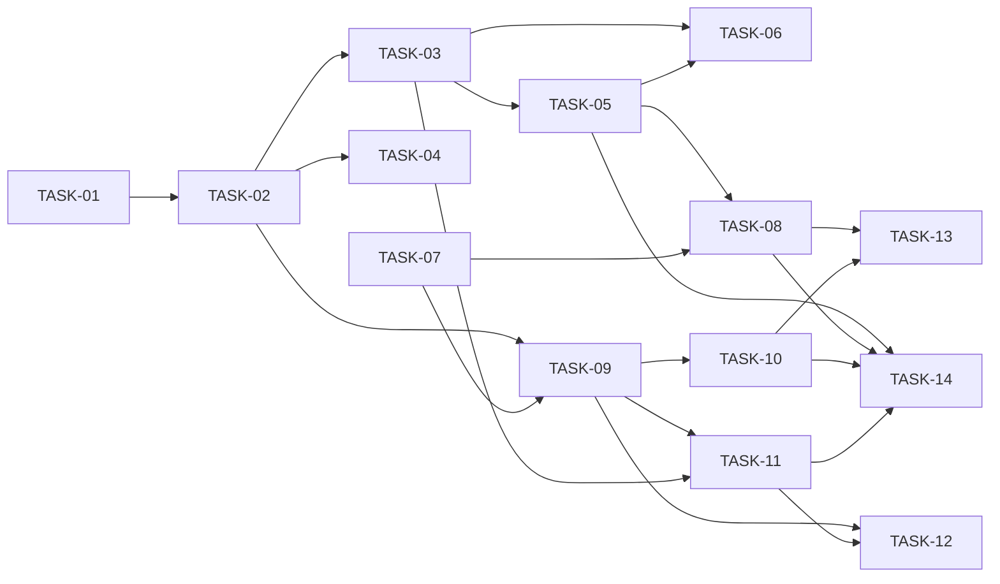

# HU-02 — Publicar, cerrar, duplicar y listar ofertas con filtros — Roadmap de tareas

## Resumen
- **Fuente de verdad:** `plans/TECHNICAL_DOC-backend.md` y `plans/TECHNICAL_DOC-frontend.md` (no el PRD).
- **Tareas:** 14 (S: 0 · M: 6 · L: 8) · estimación total: **37 h** (API 15,5 h, web 18 h, e2e 3,5 h).
- **Capa:** `api` 6 (TASK-01 a TASK-06) · `web` 8 (TASK-07 a TASK-14, incluida la `[e2e]`).
- **Cobertura:** cada RF del PRD → tareas; cada CA → al menos un test; cada edge case Must → test o `N/A` razonado
  (tablas de abajo). Todos los RF del PRD están cubiertos por el diseño (paso 2 sin huecos de RF).
- **Por qué 14 (cerca del máximo):** HU fullstack con 4 rutas nuevas, 2 cambiadas, 3 pantallas cambiadas y un diálogo
  nuevo. Cada capacidad es una rebanada vertical de una sola capa; las tareas de «capa» son solo los dos `[setup]`
  (TASK-01, TASK-07). Por el gate 4, la parte hostil de cada RF Must va en tareas `[adversarial]` **aparte del camino
  feliz y de tamaño M** (TASK-04, TASK-06, TASK-12, TASK-13), que agrupan varios RF de la misma capa.

| ID | Título | Capa | Complejidad | Depende de |
|---|---|---|---|---|
| TASK-01 | Base de la API: escrituras entre sitios (DEC-12), puerto de inscripciones y seed de 10 ofertas `[setup]` | api | L (3 h) | — |
| TASK-02 | Publicar, cerrar y duplicar en la API | api | L (3,5 h) | TASK-01 |
| TASK-03 | Editar y borrar según el estado en la API | api | M (2 h) | TASK-02 |
| TASK-04 | Publicar, cerrar y duplicar en la API frente a hostiles y fallos `[adversarial]` | api | M (2 h) | TASK-02 |
| TASK-05 | Listado con filtros, búsqueda y paginación en la API, y rendimiento | api | L (3 h) | TASK-03 |
| TASK-06 | Edición, borrado y listado en la API frente a hostiles y fallos `[adversarial]` | api | M (2 h) | TASK-03, TASK-05 |
| TASK-07 | Piezas transversales de la web, cliente de la API y URL del listado `[setup]` | web | L (3,5 h) | — |
| TASK-08 | Listado con filtros, búsqueda y paginación en la web | web | L (3 h) | TASK-05, TASK-07 |
| TASK-09 | Ficha por estado y cierre con confirmación | web | L (3 h) | TASK-02, TASK-07 |
| TASK-10 | Publicar y duplicar desde la ficha | web | M (2 h) | TASK-09 |
| TASK-11 | Editar y borrar según el estado en la web | web | L (2,5 h) | TASK-03, TASK-09 |
| TASK-12 | Cierre, ficha, edición y borrado en la web frente a hostiles y fallos `[adversarial]` | web | M (2 h) | TASK-09, TASK-11 |
| TASK-13 | Publicar, duplicar y listado en la web frente a hostiles y fallos `[adversarial]` | web | M (2 h) | TASK-08, TASK-10 |
| TASK-14 | Recorridos e2e del ciclo de vida y del listado filtrado `[e2e]` | web | L (3,5 h) | TASK-05, TASK-08, TASK-10, TASK-11 |

## Fases

| Fase | Tareas | Objetivo |
|---|---|---|
| 1 · Setup | TASK-01, TASK-07 | 409, acciones sin cuerpo, DEC-12, puerto hacia `inscripciones`, transiciones en el repositorio y seed (API); `useSearch`, `setData`, `ConfirmDialog`, cliente y `list-query.ts` (web) |
| 2 · Núcleo API | TASK-02, TASK-03, TASK-05 | Las 4 rutas nuevas, las reglas de estado en `PATCH`/`DELETE`, el listado filtrado y el rendimiento |
| 3 · Pantallas | TASK-08, TASK-09, TASK-10, TASK-11 | Listado con filtros, ficha por estado con cierre, publicar y duplicar, edición y borrado según el estado |
| 4 · Adversariales y e2e | TASK-04, TASK-06, TASK-12, TASK-13, TASK-14 | Casos hostiles por RF Must (API y web) y recorridos de Playwright |

## Dependencias

**Camino crítico:** TASK-01 → 02 → 03 → 05 → 08 → 14 (≈ 18 h). La cadena 01 → 02 → 03 → 05 es secuencial porque las
cuatro tocan `apps/api/src/modules/jobs/{schemas,repository,service,routes}.ts`. TASK-07 tiene holgura (va en paralelo
con toda la API); las `[adversarial]` no bloquean nada y acaban antes que la e2e si arrancan en cuanto se libera su
camino feliz.

Las pantallas dependen de la tarea de la API que crea su endpoint (regla de `/task-planner`), aunque sus tests de
Vitest simulan `fetch`.

## Orden de implementación

En el taller, una por tarea y en orden: **01, 02, 03, 04, 05, 06, 07, 08, 09, 10, 11, 12, 13, 14**.

Paralelismo posible **sin compartir ficheros** (máx. 4 builders, `docs/IMPLEMENTATION-RULE.md`):
- TASK-07 (web) en paralelo con TASK-01 a TASK-06 (API).
- TASK-03 y TASK-04 en paralelo tras TASK-02: la 03 toca `service.ts` y `status-rules.test.ts`; la 04, solo
  `publish|close|duplicate.test.ts` y `cross-site.test.ts`. TASK-04 también va en paralelo con TASK-05.
- TASK-09 en paralelo con TASK-03, TASK-04 y TASK-05 (web frente a API).
- TASK-06 (tests de la API) en paralelo con cualquier tarea de la web.
- TASK-08 en paralelo con TASK-09, TASK-10 y TASK-11: `styles.css` es solo de TASK-08 (incluida la separación de
  `.actions`).
- TASK-10 y TASK-11 en paralelo tras TASK-09 (y TASK-03 para la 11): la 10 toca `use-job-actions.ts`,
  `JobDetailScreen.tsx` y su test; la 11, el formulario, `DeleteJobAction.tsx`, `JobActions.tsx` y sus tests.
- TASK-12, TASK-13 y TASK-14 en paralelo entre sí: ficheros de test distintos (y `e2e/`). Si una `[adversarial]`
  destapa un fallo en `src/`, las demás esperan a que se integre el arreglo.

Ficheros que se tocan en secuencia (no paralelizar): `apps/api/src/modules/jobs/{schemas,repository,service,routes}.ts`
(TASK-01 → 02 → 03 → 05), `apps/api/test/helpers/test-app.ts` (TASK-01 → 02), `apps/api/test/http/cross-site.test.ts`
(TASK-01 → 04), `apps/api/test/jobs/{publish,close,duplicate}.test.ts` (TASK-02 → 04),
`apps/api/test/jobs/status-rules.test.ts` (TASK-03 → 06), `apps/web/src/features/jobs/JobListScreen.tsx`
(TASK-07 → 08), `apps/web/src/features/jobs/JobDetailScreen.tsx` (TASK-09 → 10), `JobActions.tsx` y
`DeleteJobAction.tsx` (TASK-09 → 11), y los ficheros de test de la web que amplían TASK-12 y TASK-13 (después de la
tarea de camino feliz que los crea).

## RF Must × tarea `[adversarial]`

Todas aparte del camino feliz, de tamaño M y de una sola capa.

| RF (Must) | Tarea(s) `[adversarial]` · tamaño | Edge cases hostiles cubiertos (categoría de `QUALITY-GATES.md` §3) | Resto de categorías |
|---|---|---|---|
| RF-01 Publicar | TASK-04 (api, M 2 h) · TASK-13 (web, M 2 h) | 1 EC-01, EC-02 · 3 EC-05 · 4 EC-06 · 6 EC-08, EC-49 · 7 EC-09 (web) · 3 EC-05/EC-43 (web) | 2 EC-03, EC-04 y 7 EC-09 (API) en TASK-02; 5 EC-07 en TASK-02 (+ `migration.test.ts`, existe) |
| RF-02 Cerrar | TASK-04 (api, M 2 h) · TASK-12 (web, M 2 h) | 1 EC-10 · 3 EC-12 · 6 EC-15, EC-49 · 3 EC-43, 4 409/404, 6 EC-15 y 7 EC-16 (web) | 2 EC-11, 4 EC-13 y 7 EC-16 (API) en TASK-02; 5 EC-14 N/A (ventana de INV-05, la prueba HU-05) |
| RF-03 Editar y borrar según el estado | TASK-06 (api, M 2 h) · TASK-12 (web, M 2 h) | 1 EC-18 · 3 EC-20 · 4 EC-21 · 6 EC-23 · 7 EC-24 · 3 EC-20, 4 EC-21 y 6 EC-23 (web) | 1 EC-17 y 2 EC-19 en TASK-03/11; 5 EC-22 en `migration.test.ts` (existe) |
| RF-04 Duplicar | TASK-04 (api, M 2 h) · TASK-13 (web, M 2 h) | 1 EC-25 · 3 EC-27 · 6 EC-30, EC-49 · 7 EC-31 (web) · 3 EC-27/EC-43 (web) | 2 EC-26, 4 EC-28 y 7 EC-31 (API) en TASK-02; 5 EC-29 N/A |
| RF-05 Listado | TASK-06 (api, M 2 h) · TASK-13 (web, M 2 h) | 1 EC-32, EC-33, CA-19 a CA-21 · 6 EC-39 y RNF-06 · 1 EC-32, EC-33, 3 EC-36 y 6 EC-39 (web) | 2 EC-34, EC-35, EC-48 y 5 EC-38 en TASK-05; 4 EC-37 aceptado (TASK-05); 7 EC-40 N/A |
| RF-06 Ficha por estado | TASK-12 (web, M 2 h) · TASK-13 (web, M 2 h) | 6 EC-46 · 3 EC-43 (cierre) · 4 EC-44 (409 + recarga) (TASK-12) · 3 EC-43 (publicar y duplicar) (TASK-13) | 2 EC-42 en TASK-09; 1 EC-41, 5 EC-45 y 7 EC-47 N/A |

RF-07 (seed) es Should: sin adversarial obligatorio; su test CA-24 está en TASK-01.

## Cobertura PRD → tareas

| RF / RNF | Task(s) |
|---|---|
| RF-01 Publicar | TASK-01, TASK-02, TASK-04, TASK-07, TASK-09, TASK-10, TASK-13, TASK-14 |
| RF-02 Cerrar | TASK-01, TASK-02, TASK-04, TASK-07, TASK-09, TASK-12, TASK-14 |
| RF-03 Editar y borrar según el estado | TASK-02 (tabla de reglas), TASK-03, TASK-06, TASK-09, TASK-11, TASK-12, TASK-14 |
| RF-04 Duplicar | TASK-02, TASK-04, TASK-07, TASK-10, TASK-13, TASK-14 |
| RF-05 Listado con filtros y paginación | TASK-05, TASK-06, TASK-07, TASK-08, TASK-13, TASK-14 |
| RF-06 Ficha por estado | TASK-09, TASK-10, TASK-12, TASK-13, TASK-14 |
| RF-07 Seed hasta 10 ofertas (Should) | TASK-01, TASK-14 |
| RNF-01 Lecturas < 200 ms | TASK-05 |
| RNF-02 Acciones < 500 ms | TASK-05 |
| RNF-03 Errores en el envelope, sin *stack* | TASK-01 (403), TASK-03 (409), TASK-04 (409 y 500), TASK-06 (500) |
| RNF-04 Sin HTML interpretado | TASK-04 (EC-30), TASK-08, TASK-12 (EC-15, EC-46) |
| RNF-05 Accesibilidad | TASK-07, TASK-08, TASK-09, TASK-10, TASK-11 |
| RNF-06 `q` fuera de los logs | TASK-06 |
| DEC-12 (EC-49) | TASK-01, TASK-04 |

| CA | Task(s) | CA | Task(s) | CA | Task(s) |
|---|---|---|---|---|---|
| CA-01 | TASK-02, TASK-10, TASK-14 | CA-09 | TASK-04, TASK-09 | CA-17 | TASK-05, TASK-08 |
| CA-02 | TASK-02 | CA-10 | TASK-03, TASK-09, TASK-11 | CA-18 | TASK-08, TASK-14 |
| CA-03 | TASK-04, TASK-10, TASK-14 | CA-11 | TASK-03, TASK-11, TASK-14 | CA-19 | TASK-06, TASK-08, TASK-14 |
| CA-04 | TASK-04 | CA-12 | TASK-03, TASK-11, TASK-14 | CA-20 | TASK-06, TASK-07, TASK-08 |
| CA-05 | TASK-02, TASK-09, TASK-14 | CA-13 | TASK-03, TASK-06, TASK-09, TASK-12 | CA-21 | TASK-06, TASK-08 |
| CA-06 | TASK-02, TASK-09, TASK-14 | CA-14 | TASK-02, TASK-10, TASK-14 | CA-22 | TASK-09, TASK-14 |
| CA-07 | TASK-02 | CA-15 | TASK-02, TASK-10 | CA-23 | TASK-09, TASK-14 |
| CA-08 | TASK-04 | CA-16 | TASK-05, TASK-08, TASK-14 | CA-24 | TASK-01 |

| EC | Task(s) | EC | Task(s) | EC | Task(s) |
|---|---|---|---|---|---|
| EC-01 | TASK-04, TASK-07 | EC-18 | TASK-06 | EC-35 | TASK-05, TASK-07 |
| EC-02 | TASK-04, TASK-10 | EC-19 | TASK-03, TASK-11 | EC-36 | TASK-13, TASK-14 |
| EC-03 | TASK-02 | EC-20 | TASK-06, TASK-12 | EC-37 | TASK-05 (web: test de HU-01, existe) |
| EC-04 | TASK-02, TASK-09 | EC-21 | TASK-03, TASK-06, TASK-12 | EC-38 | TASK-05 |
| EC-05 | TASK-04, TASK-13 | EC-22 | `migration.test.ts` (existe) | EC-39 | TASK-06, TASK-13 |
| EC-06 | TASK-04, TASK-13 | EC-23 | TASK-06, TASK-12 | EC-40 | N/A (`GET` sin efectos) |
| EC-07 | TASK-02 (+ `migration.test.ts`, existe) | EC-24 | TASK-06, TASK-09 | EC-41 | N/A (lo cubre HU-01) |
| EC-08 | TASK-04 | EC-25 | TASK-04, TASK-13 | EC-42 | TASK-02, TASK-09 |
| EC-09 | TASK-02, TASK-13 | EC-26 | TASK-02, TASK-10 | EC-43 | TASK-12, TASK-13, TASK-14 |
| EC-10 | TASK-04, TASK-07 | EC-27 | TASK-04, TASK-13 | EC-44 | TASK-03, TASK-11, TASK-12, TASK-14 |
| EC-11 | TASK-02, TASK-09 | EC-28 | TASK-02 | EC-45 | N/A (la 001 lo impide) |
| EC-12 | TASK-04, TASK-09 | EC-29 | N/A (fila ya válida) | EC-46 | TASK-12 |
| EC-13 | TASK-02, TASK-09, TASK-14 | EC-30 | TASK-04 (web: test EC-48 de HU-01, existe) | EC-47 | N/A (`GET` sin efectos) |
| EC-14 | N/A en HU-02 (ventana de INV-05; HU-05) | EC-31 | TASK-02, TASK-13 | EC-48 | TASK-05 |
| EC-15 | TASK-04, TASK-12 | EC-32 | TASK-06, TASK-07, TASK-13 | EC-49 | TASK-01, TASK-04 |
| EC-16 | TASK-02, TASK-12 | EC-33 | TASK-06, TASK-07, TASK-13 | | |
| EC-17 | TASK-03, TASK-11 | EC-34 | TASK-05, TASK-06, TASK-07, TASK-08 | | |

Transversales del diseño sin RF propio: DD-02 (tabla de reglas) en TASK-02/03; DD-05 (recorte de `q`) en TASK-05/06;
DD-09 del frontend (e2e con títulos fijos) en TASK-14.

**Tests de HU-01 que cambian (en la tarea que cambia su comportamiento):** `apps/api/test/jobs/seed.test.ts` (TASK-01),
`apps/api/test/helpers/test-app.ts` (TASK-01, TASK-02), `apps/api/test/jobs/list.test.ts:94-110` y
`apps/api/test/jobs/performance.test.ts` (TASK-05), `apps/web/test/features/jobs/api.test.ts:49` (TASK-07),
`apps/web/test/features/jobs/JobListScreen.test.tsx` (TASK-08), `apps/web/test/features/jobs/JobDetailScreen.test.tsx:69`
(TASK-09), `apps/web/test/features/jobs/DeleteJobAction.test.tsx` (TASK-12, con el `onConflict` de TASK-11) y
`e2e/jobs.spec.ts` (TASK-14).

## Riesgos

**Heredados del diseño:**
- CSRF residual: un navegador que no envíe `Sec-Fetch-Site` pasa (DEC-12). Mitigación: 403 en todas las escrituras
  (TASK-01, TASK-04).
- Una conexión sin `fold_search` → 500 «no such function». Mitigación: se registra en `createJobsRepository(db)`;
  `seed.test.ts` y los tests del listado lo ejercitan (TASK-05).
- Un SQL directo se salta las reglas de estado (sin *triggers*, DD-12). Mitigación: guarda de estado en
  `markPublished`/`markClosed` (TASK-01) y `CHECK` de la 001.
- La web envía `Content-Type: application/json` en las acciones sin cuerpo → 400. Mitigación: test de `api.test.ts`
  (TASK-07).
- Los e2e de HU-01 dejan de ver los borradores en la página 1. Mitigación: DD-09, `?status=draft&pageSize=100`
  (TASK-14).
- Ventana de INV-05 entre HU-04 y HU-05 (EC-14). Declarada en `hu.md`; la cierra HU-05 sustituyendo el *stub* en
  `apps/api/src/app.ts`.
- `closedAt` anterior a `publishedAt` si el reloj retrocede. Solo con reloj manipulado; no se defiende.
- Fecha de publicación o cierre en e2e cerca de medianoche (UTC frente a Madrid). Mitigación: fecha esperada calculada
  con `Intl` desde la respuesta de la API (TASK-14).
- Aviso local y de `history.state` mezclados al pasar a la copia. Mitigación: `key={id}` (TASK-09) y test de duplicar
  (TASK-10).
- Pérdida de foco al paginar o tras una acción; `setState` en efectos al resincronizar los filtros (lint de hooks v7).
  Mitigación: DD-03, DD-07 y el patrón «ajustar el estado durante el render» (TASK-08, TASK-09, TASK-10).

**Del troceado:**
- **14 tareas, cerca del máximo de 15.** Si un builder supera las 4 h, se para y se parte por funcionalidad; la HU solo
  admite una tarea más.
- **Código de error implementado antes que su test hostil:** las tareas de camino feliz implementan las ramas de error
  (409, 404, 500, doble clic) y las `[adversarial]` las prueban justo después. Hasta entonces esas ramas solo están
  cubiertas por typecheck y lint; por eso las `[adversarial]` pueden destapar fallos en código ya integrado: se corrigen
  dentro de la propia tarea (techo de 2 ciclos) y, si el fallo es de diseño, se escala.
- **Estados intermedios esperados:** entre TASK-09 y TASK-10, «Publicar» y «Duplicar» se ven pero no hacen nada (TD,
  § Checklist paso 3). Hasta TASK-08 el listado sigue con «Se muestran las 20 más recientes de N». Con el seed nuevo de
  TASK-01, `e2e/jobs.spec.ts` puede fallar hasta TASK-14; el e2e completo solo se exige en TASK-14.
- **Umbral de 300 líneas:** `JobDetailScreen.test.tsx` (231) pasaría de 300, así que los estados de la ficha van a
  `JobDetailScreen.states.test.tsx` (TASK-09); las `[adversarial]` dicen qué hermano crear si su fichero se acerca al
  umbral.

**Huecos del diseño cerrados (decisiones aceptadas por el aprobador):**
1. **`clearFiltersPath(query)`** («Quitar filtros») → `/jobs` sin parámetros (TASK-07; lo usan TASK-08 y TASK-13).
2. **Query del listado en la web** → lista de pares `[clave, valor]`, coherente con `listJobs([])` (TASK-07).
3. **`DeleteJobAction` con `disabled`** → prop nueva para que «Borrar» se deshabilite mientras se publica o duplica
   (TASK-09).
4. **`ClosedJobNotice`** → dentro de `JobFormScreen.tsx` (TASK-11).

Otros, sin decisión pendiente: las etiquetas de los `details` del 400 del listado viven en `JobListScreen.tsx`
(TASK-08); el TECHNICAL_DOC-backend cita el PRD v1.1 (hoy v1.2, que solo añade EC-49 y DT-09, ya recogidos en el diseño)
y sus DD no van en orden (DD-12 antes de DD-07).
