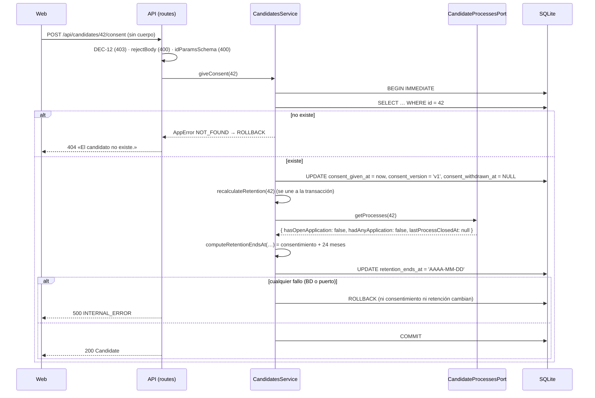

# HU-03 — Alta, edición y búsqueda de candidatos, con consentimiento — Diseño técnico (backend)

- **Origen:** `specs/PRD.md` (estado Ready, 2026-10-06)
- **Generado por:** backend-architect
- **Scope cubierto:** RF-01 a RF-08 (parte API), RNF-01 a RNF-05 y RNF-08. RNF-06, RNF-07 y RNF-09 son de la web
  (`plans/TECHNICAL_DOC-frontend.md`); la API los apoya devolviendo el texto literal y rutas solo con ID.

## Enfoque técnico

Módulo nuevo `apps/api/src/modules/candidates/` con el mismo patrón que `jobs` (`docs/05_modules/ofertas/technical.md`):
plugin de rutas con JSON Schema estricto → servicio sin HTTP que lanza `AppError` → repositorio con SQL preparado. Se
reutilizan sin duplicar: `apps/api/src/http/error-handler.ts`, `trimTextFields`, `rejectBody`, `idParamsSchema` y
`NO_CONTROL_CHARS*` (`apps/api/src/http/validation.ts`), `withTransaction` (`apps/api/src/db/transaction.ts`),
`foldSearchText`/`registerTextSearch` (`apps/api/src/db/text-search.ts`), el reloj `now` de `buildApp` y la guarda
DEC-12 (`apps/api/src/http/cross-site.ts`), que ya protege los `POST` nuevos sin tocarla.

Tres piezas propias:
1. **Normalización antes de validar** (`normalize.ts`, hook `preValidation`): recorte, email en minúsculas y skills
   recortadas, en minúsculas, sin vacías y deduplicadas **antes** de que el esquema cuente `maxItems: 20` (EC-12).
2. **Fórmula de retención pura** (`retention.ts`) + **puerto de procesos** (`processes-port.ts`, stub «sin
   inscripciones» conectado en `buildApp`) + **operación interna** `recalculateRetention(id)` en el servicio: el único
   camino que escribe `retention_ends_at`, usado por el alta, los dos cambios de consentimiento y, desde HU-04/05, por
   `inscripciones` dentro de su transacción (DEC-06, DEC-11.7).
3. **Enmienda de DEC-11.4** en `apps/api/src/http/error-handler.ts`: `details` acotado a los campos declarados en el
   esquema; las claves no declaradas se agrupan en un único elemento sin nombre (DT-10 d, SEC-04/DP-01, SEC-03 de HU-02).

**Alternativa principal descartada:** normalizar en el servicio tras validar. Obligaría a quitar `maxItems` del esquema
(21 skills con un duplicado son válidas) y a validar el recuento a mano en el servicio, con dos fuentes de error para el
mismo campo.

## Módulos y ficheros afectados

| Módulo | Fichero | Cambio |
|---|---|---|
| candidates | `apps/api/src/db/migrations/002-create-candidates.sql` | nuevo |
| candidates | `apps/api/src/modules/candidates/schemas.ts` | nuevo: tipos, JSON Schema, `CONSENT_TEXT_VERSION = 'v1'`, `DEFAULT_PAGE*` propios |
| candidates | `apps/api/src/modules/candidates/normalize.ts` | nuevo: `normalizeCandidateBody(body)` (pura) |
| candidates | `apps/api/src/modules/candidates/retention.ts` | nuevo: `computeRetentionEndsAt`, `madridCalendarDate`, `addMonthsClamped` (puras) |
| candidates | `apps/api/src/modules/candidates/processes-port.ts` | nuevo: `CandidateProcessesPort`, `noCandidateProcesses` |
| candidates | `apps/api/src/modules/candidates/repository.ts` | nuevo |
| candidates | `apps/api/src/modules/candidates/service.ts` | nuevo |
| candidates | `apps/api/src/modules/candidates/routes.ts` | nuevo: plugin `candidatesRoutes` (prefijo `/api/candidates`) |
| transversal | `apps/api/src/app.ts` | modificar: compone `candidates`; opción `candidateProcesses?` |
| transversal | `apps/api/src/errors.ts` | modificar: `ErrorDetail.existingId?`, `duplicate(...)` |
| transversal | `apps/api/src/http/error-handler.ts` | modificar: enmienda DEC-11.4; mensajes de `maxItems`, `false schema`, tipos `boolean`/`array` |
| transversal | `apps/api/src/http/validation.ts` | modificar: `forbiddenFields(names)` → `{ [name]: false }` |
| ofertas | `apps/api/src/modules/jobs/schemas.ts` | modificar: declara `id`, `status`, `createdAt`, `publishedAt`, `closedAt` con `forbiddenFields` en alta y edición (sus 400 no cambian) |
| transversal | `apps/api/src/db/seed.ts` · `apps/api/src/db/seed-candidates.ts` | modificar (`seed(db, now = new Date())`) · nuevo (30 candidatos) |
| transversal | `apps/api/test/helpers/test-app.ts` · `apps/api/test/helpers/candidates.ts` | modificar (`candidateProcesses?`; `failWrites(db, op, { table, column })` con `job_openings` por defecto) · nuevo |
| docs | `docs/07_architecture_principles/DECISIONS.md` | modificar: texto nuevo de DEC-11.4 (tarea B-01) |
| tests | `apps/api/test/candidates/*.test.ts` · `apps/api/test/http/error-details.test.ts` · `apps/api/test/jobs/error-details-regression.test.ts` | nuevos (ver *Estrategia de tests*) |
| tests | `apps/api/test/http/error-handler.test.ts:236,238,292` · `apps/api/test/jobs/create-adversarial.test.ts:78` (línea previa al cambio; hoy el caso de `foo` está en :92-105) · `apps/api/test/jobs/list.test.ts:94-97` · `apps/api/test/jobs/list-filters-adversarial.test.ts:62` | modificar solo las 6 aserciones de DD-11: las 5 de **claves no declaradas** más `apps/api/test/http/error-handler.test.ts:236` (el campo `boolean` de la ruta sintética, por el mensaje nuevo «Debe ser verdadero o falso.») |

Sin dependencias nuevas: `format: 'email'` lo trae el Ajv de Fastify 5.12.5 (comprobado: `ana.gil` y `ana.gil@` dan
`keyword: 'format'`), y JSON1 (`json_each`, `json_valid`) viene en el SQLite de Node 24.

## Contrato de API

Todas las respuestas de error van en `{ error: { code, message, details? } }`. Códigos comunes a todas las rutas:
**403** `CROSS_SITE_REQUEST` en escrituras desde otro sitio (DEC-12, global), **500** `INTERNAL_ERROR` («Error interno.
Inténtalo de nuevo.», sin datos). Orden de comprobación: guarda DEC-12 (403) → `rejectBody` (400) → normalización
`preValidation` → JSON Schema de `params`/`body`/`querystring` (400) → existencia (404) → unicidad (409), todo lo
posterior al esquema dentro de `withTransaction`.

### Tipos de respuesta

```ts
// Ficha completa: 11 campos, siempre presentes; opcionales sin valor → null (nunca ausentes).
interface Candidate {
  id: number; fullName: string; email: string; phone: string | null; summary: string | null; skills: string[];
  createdAt: string;                // ISO 8601 UTC con ms
  consentGivenAt: string | null;    // ISO 8601 UTC; con consentVersion (INV-04)
  consentVersion: string | null;    // 'v1'
  consentWithdrawnAt: string | null;// solo con consentGivenAt
  retentionEndsAt: string | null;   // 'AAAA-MM-DD' de Europe/Madrid; null = «mientras dure el proceso» (desde HU-04)
}
interface CandidateListItem { id: number; fullName: string; email: string; skills: string[] } // exactamente 4 (RNF-04)
interface CandidatePage { items: CandidateListItem[]; total: number; page: number; pageSize: number } // DEC-10
```

Consentimiento **vigente** = `consentGivenAt !== null && consentWithdrawnAt === null`; retirado = ambos no nulos; nunca
dado = ambos nulos. La web lo deriva de estos campos.

### Reglas por campo (alta y edición, `candidateFieldsSchema`)

| Campo | Normalización (`preValidation`) | JSON Schema | Mensaje típico |
|---|---|---|---|
| `fullName` | `trim` | `string`, `minLength 2`, `maxLength 100`, `pattern NO_CONTROL_CHARS` | «Debe tener al menos 2 caracteres.» |
| `email` | `trim` + `toLowerCase()` | `string`, `maxLength 254`, `format: 'email'`, `pattern NO_CONTROL_CHARS` | «Formato no válido.» |
| `phone` | `trim`; `""` → `null` | `['string','null']`, `pattern ^\+?(?=(?:[^0-9]*[0-9]){6})[0-9 ()-]{6,20}$` (DT-05; excluye controles) | «Formato no válido.» |
| `summary` | `trim`; `""` → `null` | `['string','null']`, `maxLength 2000`, `pattern NO_CONTROL_CHARS_EXCEPT_WHITESPACE` | «Debe tener como máximo 2000 caracteres.» |
| `skills` | si es array **solo de textos**: `trim`, `toLowerCase()`, sin vacías, deduplicadas en orden de primera aparición; si no, intacto | `array`, `maxItems 20`, `items: string, minLength 1, maxLength 40, pattern NO_CONTROL_CHARS` | «Debe tener como máximo 20 elementos.» |
| `consent` (solo alta) | — | `boolean` (sin coerción: `"sí"` → 400) | «Debe ser verdadero o falso.» |

Campos de solo lectura declarados con `forbiddenFields` (esquema `false`, salen con su nombre y «Campo no permitido.»):
`id`, `createdAt`, `consentGivenAt`, `consentVersion`, `consentWithdrawnAt`, `retentionEndsAt`; en `PATCH`, además,
`consent`. Cualquier otra clave → un único `{ field: 'body', message: 'Hay campos no permitidos.' }` (DEC-11.4
enmendada). Las longitudes cuentan puntos de código (Ajv `unicode`), igual que `length()` de SQLite.

### Endpoints

| Método y ruta | Entrada | Éxito | Errores |
|---|---|---|---|
| `POST /api/candidates` | `body`: `createCandidateBodySchema` = `{ type: 'object', additionalProperties: false, required: ['fullName','email'], properties: { ...candidateFieldsSchema, consent, ...forbiddenFields(READ_ONLY) } }` | **201** `Candidate` | 400 `VALIDATION_ERROR` · 403 · **409 `DUPLICATE`** · 413 `PAYLOAD_TOO_LARGE` · 415 `UNSUPPORTED_MEDIA_TYPE` · 500 |
| `GET /api/candidates` | `querystring`: `{ additionalProperties: false, properties: { q: string ≤100 NO_CONTROL_CHARS, skill: string ≤40 NO_CONTROL_CHARS, page: string ^[1-9][0-9]{0,8}$, pageSize: string ^(?:[1-9][0-9]?\|100)$ } }`; `q` y `skill` se recortan antes; vacíos = sin filtro | **200** `CandidatePage` | 400 · 500 |
| `GET /api/candidates/:id` | `params`: `idParamsSchema` | **200** `Candidate` | 400 (`id`) · 404 `NOT_FOUND` · 500 |
| `PATCH /api/candidates/:id` | `params` + `body`: `updateCandidateBodySchema` = como el alta sin `required` ni `consent`, `minProperties: 1`, `fullName`/`email` no admiten `null` | **200** `Candidate` (también sin cambios) | 400 · 403 · 404 · 409 `DUPLICATE` · 413 · 415 · 500 |
| `POST /api/candidates/:id/consent` | `params`; **sin cuerpo** (`rejectBody`) | **200** `Candidate` con `consentGivenAt = now`, `consentVersion = 'v1'`, `consentWithdrawnAt = null` y retención recalculada (registrar y renovar) | 400 (`body` o `id`) · 403 · 404 · 500 |
| `POST /api/candidates/:id/consent/withdrawal` | `params`; **sin cuerpo** (`rejectBody`) | **200** `Candidate`: con uno vigente, `consentWithdrawnAt = now` y retención recalculada; sin uno vigente, la ficha **sin cambios** | 400 · 403 · 404 · 500 |

No existe `DELETE` (RN-13): `DELETE /api/candidates/:id` cae en el `setNotFoundHandler` → 404 `NOT_FOUND` «El recurso
no existe.» (RNF-05).

### Errores específicos

| Código | HTTP | `message` | `details` |
|---|---|---|---|
| `VALIDATION_ERROR` | 400 | «Hay campos con errores.» (JSON malformado: «El cuerpo de la petición no es JSON válido.») | `[{ field, message }]` acotado (DEC-11.4 enmendada); `rejectBody`: `[{ field: 'body', message: 'Esta acción no admite cuerpo.' }]` |
| `NOT_FOUND` | 404 | «El candidato no existe.» | — |
| `DUPLICATE` | 409 | «Ya existe un candidato con este email.» | `[{ field: 'email', message: 'Ya existe un candidato con este email.', existingId: <id> }]`; nunca el email ni otro dato del existente |

### Firmas internas

```ts
// processes-port.ts — lo define candidatos, lo implementa inscripciones en HU-04 (DEC-06).
export interface CandidateProcesses {
  hasOpenApplication: boolean;          // ¿alguna inscripción en etapa no final?
  hadAnyApplication: boolean;           // ¿tuvo alguna vez?
  lastProcessClosedAt: string | null;   // instante ISO UTC del cierre del último proceso; contrato: no nulo si
}                                       // hadAnyApplication && !hasOpenApplication
export interface CandidateProcessesPort { getProcesses(candidateId: number): CandidateProcesses }  // síncrono
export const noCandidateProcesses: CandidateProcessesPort; // { false, false, null }

// retention.ts — puras, sin reloj ni BD.
export function madridCalendarDate(instant: string): string;            // Intl, timeZone 'Europe/Madrid' → 'AAAA-MM-DD'
export function addMonthsClamped(date: string, months: number): string; // 31/08 + 6 → 28/02 o 29/02
export function computeRetentionEndsAt(facts: {
  createdAt: string; consentGivenAt: string | null; consentWithdrawnAt: string | null; processes: CandidateProcesses;
}): string | null; // abierta → null; si no, máx. de: consentimiento vigente +24; cierre +6; alta +6 si nunca tuvo.
                   // Lanza Error si el puerto incumple su contrato (ningún plazo aplicable) → 500 y ROLLBACK.

// service.ts
export interface CandidatesService {
  create(input: CandidateInput): Candidate;      // insert (retención null) + recalculateRetention, una transacción
  get(id: number): Candidate;
  update(id: number, patch: CandidatePatch): Candidate; // lectura-fusión-escritura de 5 columnas; nunca retención
  list(query: CandidateListQuery): CandidatePage;
  giveConsent(id: number): Candidate;            // registrar o renovar
  withdrawConsent(id: number): Candidate;        // sin vigente: devuelve la ficha sin now(), sin escribir, sin recálculo
  recalculateRetention(id: number): Candidate;   // operación interna exportada; se une a la transacción en curso
}
export interface CandidatesServiceDeps {
  repository: CandidatesRepository; now: Clock; transaction: <T>(fn: () => T) => T; processes: CandidateProcessesPort;
}
// app.ts: buildApp({ db, logger?, now?, jobApplications?, candidateProcesses = noCandidateProcesses })
```

`repository.ts` (`createCandidatesRepository(db)`, llama a `registerTextSearch(db)`): `findById`, `findIdByEmail`,
`insert(fields, createdAt, consent)`, `updateFields(id, fields)` (lista fija: `full_name, email, phone, summary,
skills`), `setConsent(id, { givenAt, version, withdrawnAt })`, `setRetention(id, date | null)`, `listPage(filter, limit,
offset)` y `count(filter)` (solo `id, full_name, email, skills`, sin `SELECT *`), e `isDuplicateEmailError(error)`
(`errcode === 2067` y mensaje con `candidates.email`, comprobado en Node 24: la transacción sigue abierta tras el fallo).

## Migración de datos

`apps/api/src/db/migrations/002-create-candidates.sql` (la siguiente libre; la `001` es de ofertas). Tabla nueva: no
hay filas previas.

| Columna | Tipo | Restricción |
|---|---|---|
| `id` | `INTEGER PRIMARY KEY AUTOINCREMENT` | — |
| `full_name` | `TEXT NOT NULL` | `length` 2-100 |
| `email` | `TEXT NOT NULL` | `length` 3-254 y `email = lower(trim(email))` (INV-02; el formato `email` de Ajv solo admite ASCII) |
| `phone` | `TEXT` | nulo o `length` 6-21 |
| `summary` | `TEXT` | nulo o `length` 1-2000 |
| `skills` | `TEXT NOT NULL DEFAULT '[]'` | `json_valid(skills) AND json_type(skills) = 'array' AND json_array_length(skills) <= 20` |
| `created_at` | `TEXT NOT NULL` | `GLOB` ISO con ms (como `001`) |
| `consent_given_at` · `consent_withdrawn_at` | `TEXT` | nulo o `GLOB` ISO con ms |
| `consent_version` | `TEXT` | nulo o `GLOB 'v[0-9]*'` |
| `retention_ends_at` | `TEXT` | nulo o `GLOB '[0-9][0-9][0-9][0-9]-[0-9][0-9]-[0-9][0-9]'` |

- `CHECK ((consent_given_at IS NULL) = (consent_version IS NULL))` y `CHECK (consent_withdrawn_at IS NULL OR
  consent_given_at IS NOT NULL)` (INV-04).
- `CREATE UNIQUE INDEX candidates_email_uq ON candidates (email)` (INV-01, DEC-08).
- `CREATE INDEX candidates_created_at_idx ON candidates (created_at DESC, id DESC)` (orden del listado).
- Sin trigger ni `ON DELETE`: no hay borrado (INV-05).

**Seed** (`apps/api/src/db/seed-candidates.ts`, invocado desde `seed(db, now)` en la misma transacción que las
ofertas; `reset.ts` no cambia gracias al valor por defecto): 30 candidatos inventados con `@example.com` (DT-08):
`createdAt = now − (3 + 5·i) días` (i = 0…29: entre 3 y 148 días, ninguno vencido porque alta + 6 meses ≥ 181 días);
10 con consentimiento vigente (`givenAt = createdAt + 1 día`), 4 retirados (`givenAt = createdAt + 1 día`; `withdrawnAt = givenAt + 2 días`,
siempre ≤ `now`) y 16 sin él; 0-4 skills del conjunto de DT-08; varios sin teléfono ni resumen. Retención con
`computeRetentionEndsAt` y `noCandidateProcesses`. Escribe con el repositorio (sin SQL propio). Las 10 ofertas no
cambian: `e2e/jobs*.spec.ts` y `apps/api/test/jobs/seed.test.ts` siguen igual.

## Diagrama de secuencia



El alta sigue el mismo esquema: `INSERT` (retención `NULL`, consentimiento si `consent: true`) → `recalculateRetention`
→ `COMMIT`; un `UNIQUE` de `candidates_email_uq` se traduce dentro de la transacción a `findIdByEmail` + 409.

## Error paths

| Edge case (PRD) | Dónde se detecta | Estrategia | Respuesta o efecto observable | Test |
|---|---|---|---|---|
| EC-01 | Parser JSON / esquema (`type: object`) | rechazar | 400 `details [{ body }]`; 0 filas | `candidates/create-adversarial.test.ts` |
| EC-02 | Esquema: `consent` `boolean`; solo lectura con `forbiddenFields` | rechazar | 400 con el campo nombrado (`consent`, `retentionEndsAt`, `createdAt`, `id`…); 0 filas | `candidates/create-adversarial.test.ts` |
| EC-03 | `normalize.ts` | normalizar | 201; nombre igual; email `inigo.nunez@example.com` | `candidates/create.test.ts` |
| EC-04 | SQLite (trigger `RAISE(ABORT)` en `INSERT`) | `ROLLBACK` + manejador | 500 sin datos; 0 filas | `candidates/create-adversarial.test.ts` |
| EC-05 | Índice `candidates_email_uq` | traducir `errcode 2067` | una 201, otra 409 con `existingId` de la primera; 1 fila | `candidates/create-adversarial.test.ts` |
| EC-06 | — | N/A — tabla nueva sin filas previas | — | — |
| EC-07 | Servicio (`duplicate`) | mensaje fijo | 409 solo con `existingId`; cuerpo sin el email | `candidates/create-adversarial.test.ts` |
| EC-08 | Índice único | igual que EC-05 | 2 `POST` iguales en `Promise.all` → 201 + 409 | `candidates/create-adversarial.test.ts` |
| EC-09 | Esquema (`format`, `maxLength`, `pattern`, `items.type`) | rechazar | 400 en `email`/`phone`/`skills`; sin valores | `candidates/create-adversarial.test.ts` |
| EC-10 | `trim` + `minLength` | rechazar | 400 en `fullName` | `candidates/create-adversarial.test.ts` |
| EC-11 | Esquema | límites | 2/100/2000/40 → 201; 1/101/2001/41 → 400 (con emoji y tildes) | `candidates/create.test.ts` |
| EC-12 | `normalize.ts` + `maxItems` | normalizar y luego contar | 20 → 201; 21 distintas → 400; 21 con duplicado → 201; orden `typescript, sql`; ninguna → `[]` | `candidates/normalize.test.ts`, `candidates/create.test.ts` |
| EC-13 | `pattern` de teléfono | rechazar | `12345`, 21 tras «+», `------` → 400; resto 201 tal cual | `candidates/create.test.ts` |
| EC-14 | — | N/A — validación pura | — | — |
| EC-15 | — | N/A — sin estado; unicidad en EC-05/EC-22 | — | — |
| EC-16 | `CHECK` de la migración | rechazar en BD | `INSERT` crudo con email en mayúsculas o versión sin fecha → error `CHECK` | `candidates/migration.test.ts` |
| EC-17 | `bodyLimit` 1 MiB · `maxLength 2000` | rechazar | > 1 MiB → 413; 1 MB < 1 MiB → 400 en `summary` sin repetir valor; `<script>` → 201 literal | `candidates/create-adversarial.test.ts` |
| EC-18 | — | N/A — normalizar es idempotente (cubierto en `normalize.test.ts`: `f(f(x)) = f(x)`) | — | `candidates/normalize.test.ts` |
| EC-19 | Esquema (`minProperties`, `forbiddenFields` con `consent`) | rechazar | 400; ficha igual | `candidates/update.test.ts` |
| EC-20 | `idParamsSchema` | rechazar | 400 en `id` | `candidates/update.test.ts` |
| EC-21 | `normalize.ts` (`""` → `null`) | vaciar | 200; `phone`/`summary` `null`, `skills []`; retención igual | `candidates/update.test.ts` |
| EC-22 | Servicio (última escritura) · índice único | aceptar · traducir | dos `PATCH` → gana el último; mismo email libre a la vez → 200 + 409 con ID | `candidates/update-adversarial.test.ts` |
| EC-23 | SQLite (trigger en `UPDATE`) | `ROLLBACK` | 500; ficha igual | `candidates/update-adversarial.test.ts` |
| EC-24 | `updateFields` sin la columna de retención | no recalcular | `retention_ends_at` puesta a `NULL` por SQL sigue `null` tras el `PATCH` | `candidates/update.test.ts` |
| EC-25 | Servicio (404) · mensaje fijo | rechazar | IDs secuenciales inexistentes → 404 idéntico; 409 sin email | `candidates/update-adversarial.test.ts` |
| EC-26 | — | repetir | mismo `PATCH` dos veces → 200 y ficha idéntica; retención y consentimiento iguales | `candidates/update.test.ts` |
| EC-27 | Esquema de `querystring` | rechazar | 400; cuerpo sin el texto de `q`; clave desconocida → `{ field: 'querystring' }` | `candidates/list-adversarial.test.ts` |
| EC-28 | Servicio / SQL | límites | 0, 20, 21; página de más → `items []` con `total`; `pageSize 100` y `q` de 100 → 200; solo espacios → sin filtro | `candidates/list.test.ts` |
| EC-29 | `fold_search` + orden | plegar | dos «José» encontrados; `ruiz@exa` por email; empate de `createdAt` → ID mayor primero | `candidates/list.test.ts` |
| EC-30 | Web | — | (frontend) | `plans/TECHNICAL_DOC-frontend.md` |
| EC-31 | — | N/A — lectura sin efectos | — | — |
| EC-32 | — | N/A — solo escriben la API y el seed, que normalizan | — | — |
| EC-33 | SQL preparado + `instr` | literal | `' OR 1=1 --` → 0; `%` y `_` literales; `items` con 4 claves; `q` fuera de logs | `candidates/list-adversarial.test.ts`, `candidates/privacy-logs.test.ts` |
| EC-34 | — | N/A — `GET` | — | — |
| EC-35 | `idParamsSchema` | rechazar | `abc`, `1.5` → 400 en `id` | `candidates/get.test.ts` |
| EC-36 | Respuesta | `null` explícito | `phone`/`summary` `null`, `skills []`; alta 2026-10-06T22:30Z → retención 2027-04-07 | `candidates/get.test.ts` |
| EC-37 | Web | — | (frontend) | `plans/TECHNICAL_DOC-frontend.md` |
| EC-38 | — | lectura | `GET` tras un `PATCH` devuelve lo último | `candidates/update.test.ts` |
| EC-39 | — | N/A en esta HU (retención nula solo con HU-04) | — | — |
| EC-40 | API devuelve texto tal cual | sin sanear | `<script>`/`<b>`/`<i>x</i>` literales en la ficha | `candidates/get.test.ts` |
| EC-41 | — | N/A — `GET` | — | — |
| EC-42 | `rejectBody` · `idParamsSchema` | rechazar | cuerpo (`{ consentGivenAt }`, `{}`) → 400 `body`; `abc` → 400 `id`; nada cambia | `candidates/consent-adversarial.test.ts` |
| EC-43 | `computeRetentionEndsAt` | aplicar fórmula | retirar con alta de hace 8 meses → retención pasada guardada | `candidates/consent.test.ts` |
| EC-44 | `addMonthsClamped` · `giveConsent` | recortar mes; sustituir | 2028-02-29 → 2030-02-28; reotorgar → fecha y versión nuevas y retirada `null` | `candidates/retention.test.ts`, `candidates/consent.test.ts` |
| EC-45 | Trigger en `UPDATE OF retention_ends_at` | `ROLLBACK` | 500; consentimiento y retención como antes | `candidates/consent-adversarial.test.ts` |
| EC-46 | `BEGIN IMMEDIATE` serializa | última gana | retirar y renovar en `Promise.all` → estado final con retención = fórmula (INV-03) | `candidates/consent-adversarial.test.ts` |
| EC-47 | `CHECK` INV-04 | rechazar en BD | retirada sin otorgamiento → error `CHECK` | `candidates/migration.test.ts` |
| EC-48 | Servicio | 404 fijo | 404 en los dos `POST`; sin datos | `candidates/consent-adversarial.test.ts` |
| EC-49 | `withdrawConsent` (no-op) · `giveConsent` | idempotente · renovar | retirar dos veces → 200 igual; registrar dos veces → fecha nueva | `candidates/consent.test.ts` |
| EC-50 | — | N/A — entrada interna tipada | — | — |
| EC-51 | `madridCalendarDate` + `addMonthsClamped` | calcular | 2027-04-07, 2027-02-28, 2028-02-29, 2027-04-25, 2026-09-30 | `candidates/retention.test.ts` |
| EC-52 | `computeRetentionEndsAt` | máximo | 2027-03-15 | `candidates/retention.test.ts` |
| EC-53 | Puerto que lanza | `ROLLBACK` | alta → 500 y 0 filas; consentimiento → 500 y nada cambia | `candidates/create-adversarial.test.ts`, `candidates/consent-adversarial.test.ts` |
| EC-54 | — | N/A — pura y síncrona | — | — |
| EC-55 | `computeRetentionEndsAt` | abierta manda | `null`; retirado no cuenta | `candidates/retention.test.ts` |
| EC-56 | Manejador | envelope | 500 sin *stack* ni datos | `candidates/consent-adversarial.test.ts` |
| EC-57 | `recalculateRetention` | idempotente | dos llamadas → misma fecha | `candidates/retention.test.ts`, `candidates/consent.test.ts` |
| EC-58 | `pattern` `NO_CONTROL_CHARS*` | rechazar | NUL/`\n` en nombre, `\t` interior en skill, `\u007F` en email/teléfono → 400; resumen con `\n\r\t` → 201; con `\u0007` → 400 | `candidates/create-adversarial.test.ts` |
| EC-59 | Manejador (DEC-11.4 enmendada) | agrupar | 1 000 claves (una `lucia.ferrer@example.com`) → 400 con `[{ field: 'body', message: 'Hay campos no permitidos.' }]`; cuerpo sin «lucia»; 0 filas | `candidates/create-adversarial.test.ts`, `http/error-details.test.ts` |

## Threat modeling

| STRIDE | Amenaza concreta | Mitigación |
|---|---|---|
| Suplantación | Otra web o app en otro puerto local lanza `POST …/consent/withdrawal` (petición simple, sin *preflight*) | DEC-12 global (`apps/api/src/http/cross-site.ts`, `apps/api/test/http/cross-site.test.ts`); un caso propio en `consent-adversarial.test.ts`. Sin login (DEC-04) |
| Manipulación | *Mass assignment* de `retentionEndsAt`, fechas o versión del consentimiento | `additionalProperties: false` + `forbiddenFields`; `UPDATE` con lista fija; la retención solo la escribe `setRetention` desde `recalculateRetention` |
| Manipulación | Inyección SQL por `q`, `skill`, campos | Sentencias preparadas con parámetros; `instr` y `json_each … = :skill` (sin `LIKE`) |
| Repudio | No consta quién registró o retiró el consentimiento | Aceptado por DEC-04 (rol único); la prueba es fecha + versión (art. 7.1). Con login: guardar el actor en los cambios de consentimiento |
| Exposición | Email del existente en el 409; nombres de clave en `details`; datos en logs; ficha completa en el listado | 409 con `existingId` y mensaje fijo; DEC-11.4 enmendada; logger sin cuerpo ni query (`apps/api/src/logger.ts`); `candidateListItemSchema` de 4 campos |
| Exposición | Enumeración de IDs | 404 idéntico para cualquier ID inexistente; aceptado por DEC-04 (loopback). Con login: autorización por reclutador en `GET/PATCH /:id` |
| Denegación | Cuerpo con miles de claves, `q` enorme, `pageSize` alto | `bodyLimit` 1 MiB (413), `details` acotado, `q` ≤ 100, `pageSize` ≤ 100 |
| Elevación | — | N/A — un único rol (DEC-04) |

## Datos personales

- **Entran:** nombre y apellidos, email, teléfono, resumen y skills (cuerpo de `POST`/`PATCH`); `q` y `skill` en la
  query del listado. **Se guardan:** esos cinco más `created_at`, `consent_given_at`, `consent_version`,
  `consent_withdrawn_at` y `retention_ends_at` (minimización: nada más; sin historial, DT-03).
- **Se devuelven:** la ficha completa solo en `GET /:id`, alta, edición y consentimiento; el listado, solo
  `id, fullName, email, skills`; el 409, solo `existingId`.
- **Retención:** `retention_ends_at` con la fórmula única de RN-07 en cada alta y cambio de consentimiento; editar no la
  toca (RN-10). La supresión al vencer es de la feature A.
- **Nunca en logs ni errores:** el logger no registra cuerpos y quita la query; el `path` lleva solo IDs. Ningún
  `message` ni `details` repite valores ni nombres de clave no declaradas (DEC-11.4 enmendada). Los 500 registran el
  objeto de error: los mensajes de SQLite de `CHECK`/`UNIQUE` llevan nombres de columna, no valores. Lo fija
  `candidates/privacy-logs.test.ts` (CA-32, RNF-03).
- **Seed y tests:** solo nombres inventados y `@example.com`.

## Decisiones de diseño

### DD-01: Skills como columna JSON
- **Contexto:** hasta 20 etiquetas por candidato, filtro por skill exacta, orden de primera aparición.
- **Opciones consideradas:** A) `skills TEXT` con array JSON y `json_each` en el filtro. B) Tabla hija `candidate_skills`.
- **Elegida:** A.
- **Razón:** una sola fila por candidato (insert y `PATCH` sin borrar/reinsertar hijos), conserva el orden sin columna
  de posición y el `CHECK` de JSON1 acota a 20. Con 1 000 candidatos el `EXISTS (json_each)` cabe en < 200 ms.
- **Tradeoff:** sin índice por skill; si el volumen creciera mucho, habría que migrar a tabla hija.

### DD-02: Búsqueda plegada en la consulta, sin columna normalizada
- **Contexto:** `q` sin mayúsculas ni tildes en nombre o email (DEC-10).
- **Opciones consideradas:** A) `instr(fold_search(full_name), :q) OR instr(email, :q)` como `jobs`. B) Columna
  `search_text` mantenida al escribir.
- **Elegida:** A.
- **Razón:** reutiliza `foldSearchText` sin duplicar el plegado y sin riesgo de desfase entre columna y datos. El email
  ya es ASCII en minúsculas: no necesita `fold_search`.
- **Tradeoff:** recorre las filas en cada consulta (2 000 llamadas JS con 1 000 candidatos), sin índice.

### DD-03: Normalización en `preValidation`, antes del esquema
- **Contexto:** «deduplicadas antes de contar» (EC-12) y email «en minúsculas».
- **Opciones consideradas:** A) Hook `preValidation` con `normalizeCandidateBody` pura. B) Normalizar en el servicio.
- **Elegida:** A.
- **Razón:** el esquema valida el valor que se guardará y conserva `maxItems`/`maxLength` como única fuente del 400; es
  la ampliación natural de `trimTextFields` (DEC-11.3). Si `skills` trae un no-texto se deja intacto para que Ajv dé el
  400 de tipo.
- **Tradeoff:** la longitud se mide tras `toLowerCase()` (un carácter raro que crece al pasar a minúsculas cuenta más).

### DD-04: Duplicado detectado por el índice, sin comprobación previa
- **Contexto:** DEC-08 exige que la unicidad la garantice el índice.
- **Opciones consideradas:** A) Capturar el `UNIQUE` (`errcode 2067`, `candidates.email`) y, en la misma transacción,
  `findIdByEmail` → 409. B) `SELECT` previo + índice como red.
- **Elegida:** A.
- **Razón:** un solo camino, que es el que prueban EC-05/EC-22; tras el fallo de la sentencia la transacción sigue
  abierta (comprobado en Node 24), así que la consulta del ID es coherente.
- **Tradeoff:** depende del texto del mensaje de SQLite para distinguir el índice; lo fija un test.

### DD-05: `recalculateRetention` como único escritor de la retención
- **Contexto:** INV-03 e INV-07; HU-04/05 recalcularán desde `inscripciones`.
- **Opciones consideradas:** A) Insertar con retención `NULL` y llamar a `recalculateRetention(id)` en la misma
  transacción (alta, consentimiento, HU-04). B) Calcular la retención antes del `INSERT` en el alta.
- **Elegida:** A.
- **Razón:** un único camino probado (puerto incluido) para todos los disparadores; EC-53 cubre el alta sin código
  aparte. La columna ya admite `NULL` (RN-07).
- **Tradeoff:** el alta hace dos sentencias en lugar de una.

### DD-06: Puerto con una sola lectura de tres respuestas
- **Contexto:** RF-07 pide tres preguntas al proceso del candidato.
- **Opciones consideradas:** A) `getProcesses(id): { hasOpenApplication, hadAnyApplication, lastProcessClosedAt }`.
  B) Tres métodos. C) Unión discriminada (`none | open | closed`).
- **Elegida:** A, con el contrato «`lastProcessClosedAt` no nulo si tuvo y no tiene abiertas». `computeRetentionEndsAt`
  lanza `Error` **solo si no aplica ningún plazo** (`apps/api/src/modules/candidates/retention.ts:69-77`).
- **Razón:** una consulta en HU-04, mismo patrón que `JobApplicationsPort`, y fiel a las tres preguntas del PRD
  (EC-55 informa de abierta y cierre a la vez).
- **Tradeoff:** el tipo permite estados incoherentes. El error explícito (con su test) solo cubre el caso sin ningún
  plazo aplicable; si hay otro plazo vigente (p. ej., consentimiento + 24 meses), la incoherencia del puerto no se
  detecta y se usa ese plazo.

### DD-07: Versión del consentimiento como constante de la API
- **Contexto:** DT-01 (texto y versión `v1` en el código).
- **Opciones consideradas:** A) `CONSENT_TEXT_VERSION = 'v1'` en `schemas.ts`; la API solo guarda la versión. B)
  Endpoint `GET /api/candidates/consent-terms` con texto y versión.
- **Elegida:** A.
- **Razón:** la API no necesita el texto; un endpoint más es una pieza que el PRD no pide.
- **Tradeoff:** la web mantiene su copia del texto y de `v1`; un cambio de versión toca los dos lados (lo señala el
  frontend).

### DD-08: Enmienda de DEC-11.4 por *keyword*, con solo lectura declarados
- **Contexto:** DT-10 (d), RNF-08; `details` hoy nombra cada clave sobrante, sin tope.
- **Opciones consideradas:** A) En `toDetails`/`fieldOf`, sin rama por *keyword*: `field` es `missingProperty` en
  `required` y, en el resto, el primer segmento de `instancePath`; **cualquier error con `instancePath` vacío sale como
  el contexto** (`body`, `querystring` o `params`), y como `details` guarda un elemento por `field`, todas las claves no
  declaradas (`additionalProperties`, «Hay campos no permitidos.») quedan en un solo elemento sin nombre; los solo
  lectura se declaran con esquema `false` para seguir nombrándolos. El caso `params` es teórico: su esquema es fijo
  (`idParamsSchema`) y el router no deja llegar claves de más. B) Lista blanca leyendo `request.routeOptions.schema` en el manejador. C) Recortar `details` a N.
- **Elegida:** A.
- **Razón:** con `additionalProperties: false` en la raíz (DEC-07), Ajv solo produce `instancePath` y
  `missingProperty` de propiedades declaradas, así que los `field` posibles son las propiedades declaradas más el
  contexto: tope estructural de «1 por campo + 1». Sin acoplarse a la API interna de rutas de Fastify (B) y sin perder
  errores reales (C).
- **Tradeoff:** cada esquema debe declarar los solo lectura que quiere nombrar (se hace en `jobs` y `candidates`); un
  campo de solo lectura olvidado sale como «Hay campos no permitidos.».

### DD-09: Retirar sin vigente no escribe ni recalcula
- **Contexto:** CA-28 «no se toca ninguna fecha ni el fin de retención» (S-01).
- **Opciones consideradas:** A) Devolver la ficha leída, sin `now()`, sin `UPDATE`, sin puerto. B) Recalcular igualmente.
- **Elegida:** A.
- **Razón:** idéntico a `checkAction → noop` de `jobs`; B podría cambiar la retención por datos del puerto.
- **Tradeoff:** una ficha con retención desfasada (imposible hoy) no se corrige al retirar; la corrige HU-04 al
  recalcular.

### DD-10: Seed relativo al reloj del reset
- **Contexto:** DT-08: «altas en los 150 días anteriores al reset, ninguno vencido».
- **Opciones consideradas:** A) `seed(db, now = new Date())` y fechas restadas a `now`. B) Fechas fijas.
- **Elegida:** A.
- **Razón:** con fechas fijas, el seed vencería con el tiempo; el test pasa un `now` fijo.
- **Tradeoff:** `data/ats.db` cambia de fechas en cada `db:reset`; los e2e de candidatos no pueden fijar fechas
  absolutas del seed.

### DD-11: La enmienda de DEC-11.4 se aplica a todas las rutas, también a las de ofertas (OD-01 resuelta)
- **Contexto:** el manejador de errores es único; con la enmienda, las respuestas de ofertas a claves **no declaradas**
  pasan de `{ field: '<clave>', message: 'Campo no permitido.' }` a `{ field: 'body' | 'querystring', message: 'Hay
  campos no permitidos.' }`. Los solo lectura de ofertas (declarados con `forbiddenFields`), los errores de formato y
  longitud, los faltantes al publicar y los parámetros conocidos del listado no cambian. La web de ofertas nunca envía
  claves no declaradas (`apps/web/src/features/jobs/list-query.ts:28-34`).
- **Opciones consideradas:** A) Una sola regla para todas las rutas. B) Activarla solo en las rutas de candidatos.
- **Elegida:** A. **Decidida por el aprobador el 2026-10-06**: «OD-01 = A: una sola regla para todas las
  rutas, que cierra SEC-03 de HU-02 y SEC-04/DP-01 de HU-01».
- **Razón:** cierra SEC-04/DP-01 (HU-01) y SEC-03 (HU-02) con una sola regla en el manejador.
- **Tradeoff:** cambian 6 aserciones de tests de HU-01/HU-02, que B-01 actualiza y lista en su commit: las 5 de claves
  no declaradas, `apps/api/test/jobs/create-adversarial.test.ts:78` (fila `foo`; línea previa al cambio; hoy el caso
  de `foo` está en :92-105), `apps/api/test/jobs/list.test.ts:94-97` (`sort`, `foo`),
  `apps/api/test/jobs/list-filters-adversarial.test.ts:62` (`sort`), `apps/api/test/http/error-handler.test.ts:238`
  (`extra`) y `apps/api/test/http/error-handler.test.ts:292` (`page`), más `apps/api/test/http/error-handler.test.ts:236`
  (el campo `boolean` de la ruta sintética, por el mensaje nuevo «Debe ser verdadero o falso.»).

## Impacto en decisiones

- **Se aplican:** DEC-01, DEC-03 (migración `002`, seed inventado), DEC-04, DEC-06 (puerto y operación interna;
  `candidates` no importa `jobs` ni `applications`), DEC-07 (201/200/400/404/409 `DUPLICATE` con ID), DEC-08 (índice
  único, última escritura, retirar repetido = 200), DEC-09 (UTC, Europe/Madrid, último día del mes, reloj), DEC-10,
  DEC-11 (1, 2, 3, 5, 6, 7, 8) y DEC-12 (heredada).
- **Se enmienda DEC-11.4** (DT-10 d; cierra SEC-04/DP-01 de HU-01 y SEC-03 de HU-02). Texto propuesto para el punto 4,
  que escribe la tarea **B-01** en `docs/07_architecture_principles/DECISIONS.md` (y en *Estado*: «punto 4 enmendado
  en el diseño de HU-03»):

  > 4. `details` es `[{ field, message }]`, con mensajes en castellano por *keyword* y **sin repetir el valor
  >    recibido**, y está **acotado al esquema**: como mucho un elemento por campo declarado en el esquema de la parte
  >    validada (`body`, `querystring` o `params`) más uno para todas las claves no declaradas juntas, que sale como
  >    `{ field: 'body' }` o `{ field: 'querystring' }` con «Hay campos no permitidos.» y **sin el nombre de ninguna**.
  >    Los campos de solo lectura que la API nombra (`id`, fechas, estado, `retentionEndsAt`…) se declaran en el
  >    esquema con el esquema `false` y salen con su nombre y «Campo no permitido.». En un 409 `DUPLICATE`, el elemento
  >    lleva además `existingId` con el ID del existente (DEC-07).
- **No hace falta un `DEC-NN` nuevo.**

## Estrategia de tests

Vitest + `app.inject` sobre `:memory:` migrada (`createTestApp`); reloj con `createTestClock`; fallos de BD con
triggers reales (`failWrites` generalizado); puerto con dobles reales (`createProcessesStub({ processes, fail })` en
`apps/api/test/helpers/candidates.ts`), sin mocks de módulo. Datos inventados (`@example.com`). Ficheros en
`apps/api/test/candidates/` salvo indicación.

| Criterio | Test previsto (fichero · nombre) |
|---|---|
| CA-01 | `create.test.ts` · «CA-01 alta normaliza email y skills, sin consentimiento, retención 2027-04-06» |
| CA-02 | `retention.test.ts` · «CA-02 alta 22:30Z, 31/08/2026 y 31/08/2027 → 2027-04-07, 2027-02-28, 2028-02-29» |
| CA-03 | `create.test.ts` · «CA-03 alta con consent: true guarda fecha del reloj, v1 y retención 2028-10-06» |
| CA-04 | `create.test.ts` (límites aceptados) · `create-adversarial.test.ts` «CA-04 cada entrada inválida → 400 en su campo y 0 filas» |
| CA-05 | `create-adversarial.test.ts` · «CA-05/EC-05/EC-08 email repetido (también a la vez) → 409 con existingId, sin el email» |
| CA-06 | `create-adversarial.test.ts` · «CA-06/EC-04 fallo de INSERT → 500 y 0 filas» |
| CA-07 a CA-13 | `update.test.ts` · uno por CA («CA-07 editar no recalcula ni toca el consentimiento», «CA-09 mismo email con otra forma → 200»…) |
| CA-14 | `update-adversarial.test.ts` · «CA-14/EC-23 fallo de UPDATE → 500 y ficha igual» |
| CA-15 a CA-19 | `list.test.ts` · uno por CA |
| CA-20 | `list-adversarial.test.ts` · «CA-20/EC-27 q de 101, controles, pageSize 101 → 400 sin repetir q; 100 y ' OR 1=1 -- literales» |
| CA-21, CA-24 | N/A en API (web) |
| CA-22, CA-23 | `get.test.ts` · «CA-22 ficha vigente/retirada/nunca dada con texto literal», «CA-23 inexistente → 404 sin datos» |
| CA-25 a CA-29 | `consent.test.ts` · uno por CA |
| CA-30 | `consent-adversarial.test.ts` · «CA-30/EC-45 fallo en el recálculo → 500 y nada cambia» |
| CA-31 | `retention.test.ts` · «CA-31 cada fila de RGPD §3 y varias a la vez»; `consent.test.ts` · «CA-31 el puerto por defecto responde sin inscripciones» |
| CA-32 · RNF-03 | `privacy-logs.test.ts` · «CA-32 logs y errores sin nombre, email, teléfono, resumen ni q» |
| RNF-01, RNF-02 | `performance.test.ts` · «RNF-01 lecturas < 200 ms con 1 000», «RNF-02 acciones < 500 ms con 1 000» |
| RNF-04 | `list.test.ts` · «RNF-04 cada item tiene exactamente id, fullName, email, skills» |
| RNF-05 | `get.test.ts` · «RNF-05 DELETE /api/candidates/:id → 404 en el envelope»; JSON malformado en `create-adversarial.test.ts` |
| RNF-08 | `create-adversarial.test.ts` · «EC-59/RNF-08 1 000 claves desconocidas → un elemento sin nombres» |
| RF-08 | `seed.test.ts` · «RF-08 30 candidatos válidos, 10/4/16, ninguno vencido, retención = fórmula» |
| EC-16, EC-47, índice | `migration.test.ts` |

**Enmienda DEC-11.4 (B-01):**
- `apps/api/test/http/error-details.test.ts` (nuevo, porque `error-handler.test.ts` está en 299 líneas): «claves no
  declaradas → un elemento `body` sin nombres», «querystring desconocido → `querystring`», «esquema `false` → campo
  nombrado con «Campo no permitido.»», «`details.length` ≤ propiedades + 1 con errores mezclados», «`existingId` pasa
  al envelope».
- **Regresión de ofertas** — `apps/api/test/jobs/error-details-regression.test.ts` (nuevo, escrito **antes** del cambio y
  en verde antes y después): alta con varios campos inválidos + `status` y `createdAt`; `PATCH` con varios inválidos +
  `publishedAt`; listado con `page=0&pageSize=101&status=x&q=<101>`: compara el mapa `field → message` completo.
  Deben seguir en verde **sin tocarlos**: `create.test.ts`, `control-chars.test.ts`, `update.test.ts:143-206`
  (incluye solo lectura `status`, `createdAt`, `id`), `status-rules.test.ts:88,108`,
  `status-rules-adversarial.test.ts:83,105-123` (`status`, `publishedAt`), `publish.test.ts:147-185` (faltantes al
  publicar), `close.test.ts`, `delete.test.ts`, `duplicate.test.ts`, `get.test.ts`,
  `list-filters-adversarial.test.ts:53-113` (salvo la fila `sort` de la línea 62) y `create-adversarial.test.ts:44-71`.
  Cambian solo las 6 aserciones listadas en DD-11 (y en el commit de B-01): las 5 de **claves no declaradas** más
  `apps/api/test/http/error-handler.test.ts:236` (el campo `boolean` de la ruta sintética, por el mensaje nuevo «Debe
  ser verdadero o falso.»).

**Adversariales** (tareas aparte, ≥ 1 por RF Must): `create-adversarial`, `update-adversarial`, `privacy-logs` (RF-01,
RF-02, RF-03) y `list-adversarial`, `consent-adversarial` (RF-04, RF-05, RF-06, RF-07).

## Riesgos

| Riesgo | Probabilidad (1–5) | Impacto (1–5) | Mitigación |
|---|---|---|---|
| El plan no cabe en 15 tareas: backend estima **8** (6 + 2 adversariales), así que la web dispone de 7 | 3 | 4 | Si el frontend necesita más de 7, **propuesta** (no aplicada): sacar UC-13 · P, A1-A3, E1-E2 (RF-06: `POST /consent*` y la sección de consentimiento de la ficha) a otra HU; el alta con consentimiento (UC-09 · A1), la fórmula y el recálculo se quedan aquí |
| La enmienda de DEC-11.4 toca código y tests de `ofertas` (HU-01/02) en una HU cuyo módulo es `candidatos` | 4 | 2 | Regresión escrita y en verde antes del cambio, y en verde después; solo cambian las 6 aserciones de DD-11, listadas en el commit de B-01; `/module-sync` actualiza `docs/05_modules/ofertas/technical.md` |
| `isDuplicateEmailError` depende del texto del mensaje de SQLite | 2 | 3 | Comprueba también `errcode === 2067`; lo fija EC-05 |
| Un esquema futuro sin `additionalProperties: false` rompería el tope de `details` | 2 | 3 | DEC-07 lo exige; el test genérico de `error-details.test.ts` lo documenta |
| Copias de `v1` y del texto en API y web desfasadas | 2 | 2 | DD-07; test en cada lado con `v1` |
| Fechas `Intl` con ICU reducido | 1 | 4 | Node 24 trae ICU completo; `retention.test.ts` cubre el cambio de hora |

## Open Decisions

No hay (OD-01 resuelta → DD-11).

## Fuera de scope

- Implementación del puerto de procesos y llamadas a `recalculateRetention` desde `inscripciones` (HU-04/HU-05).
- Anonimización, estado «anonimizado», exportación e importación (feature A, feature C).
- Endpoint de skills existentes, historial de consentimientos o de la ficha.
- Cabeceras de endurecimiento y lista de `Host` (SEC-01 y SEC-04/05 de HU-02: auditoría de sprint).

## Checklist de implementación (base de `/task-planner`)

| # | Tarea | Tamaño | Ficheros principales |
|---|---|---|---|
| B-01 | Enmienda DEC-11.4 (DD-08, DD-11): (1) escribir `error-details-regression.test.ts` y verlo **pasar antes del cambio**; (2) `toDetails` por *keyword*, mensajes `false schema`/`maxItems`/`boolean`/`array`; `ErrorDetail.existingId` y `duplicate()`; `forbiddenFields`; solo lectura en `jobs/schemas.ts`; (3) actualizar las 6 aserciones de DD-11: las 5 de claves no declaradas (`apps/api/test/jobs/create-adversarial.test.ts:78` (línea previa al cambio; hoy el caso de `foo` está en :92-105), `apps/api/test/jobs/list.test.ts:94-97`, `apps/api/test/jobs/list-filters-adversarial.test.ts:62`, `apps/api/test/http/error-handler.test.ts:238` y `:292`) más `apps/api/test/http/error-handler.test.ts:236` (el campo `boolean` de la ruta sintética, por el mensaje nuevo «Debe ser verdadero o falso.»); (4) la regresión **sigue en verde después**; (5) texto de DEC-11.4 en `DECISIONS.md`. **El mensaje del commit lista esas 6 aserciones con fichero:línea** | L | `apps/api/src/http/error-handler.ts`, `apps/api/src/errors.ts`, `apps/api/src/http/validation.ts`, `apps/api/src/modules/jobs/schemas.ts`, `apps/api/test/http/error-details.test.ts`, `apps/api/test/jobs/error-details-regression.test.ts` |
| B-02 | Migración `002`, puerto y fórmula pura | L | `002-create-candidates.sql`, `processes-port.ts`, `retention.ts`, `migration.test.ts`, `retention.test.ts` |
| B-03 | Esquemas, normalización, repositorio, servicio `create`/`get`/`recalculateRetention`, rutas `POST /` y `GET /:id`, composición en `app.ts` y *helpers* | L | `schemas.ts`, `normalize.ts`, `repository.ts`, `service.ts`, `routes.ts`, `app.ts`, `test/helpers/*`, `normalize.test.ts`, `create.test.ts`, `get.test.ts` |
| B-04 | `PATCH /:id` y los dos `POST` de consentimiento | L | `service.ts`, `repository.ts`, `routes.ts`, `update.test.ts`, `consent.test.ts` |
| B-05 | Listado y búsqueda | M | `repository.ts`, `service.ts`, `routes.ts`, `list.test.ts` |
| B-06 | Seed de 30 candidatos y rendimiento con 1 000 | M | `seed-candidates.ts`, `seed.ts`, `seed.test.ts`, `performance.test.ts` |
| B-07 | [adversarial] alta, edición y privacidad | L | `create-adversarial.test.ts`, `update-adversarial.test.ts`, `privacy-logs.test.ts` |
| B-08 | [adversarial] listado, ficha y consentimiento | M | `list-adversarial.test.ts`, `consent-adversarial.test.ts` |

Orden: B-01 → B-02 → B-03 → (B-04, B-05) → B-06 → (B-07, B-08). B-01 va primero porque las rutas de candidatos dependen del manejador enmendado.
