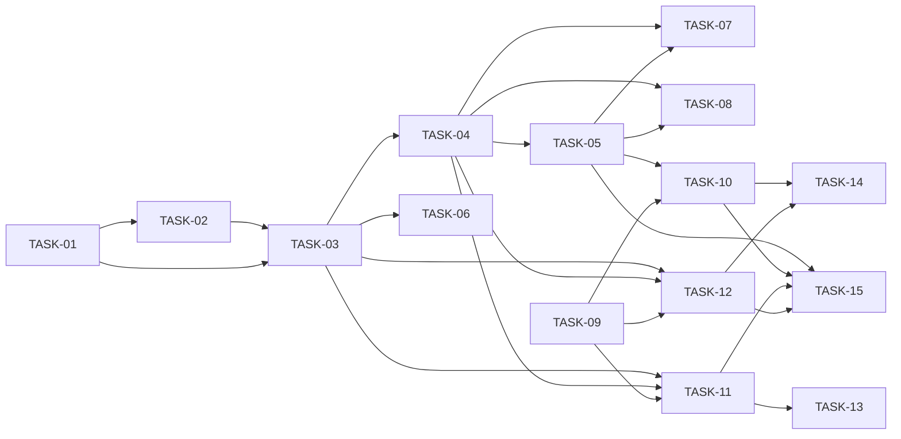

# HU-03 — Alta, edición y búsqueda de candidatos, con consentimiento — Roadmap de tareas

## Resumen
- **Fuente de verdad:** `plans/TECHNICAL_DOC-backend.md` y `plans/TECHNICAL_DOC-frontend.md` (no el PRD).
- **Tareas:** **15** (S: 0 · M: 5 · L: 10) · estimación total: **45 h** (API 24 h, web 21 h, e2e incluida).
- **Capa:** `api` 8 (TASK-01 a TASK-08: M 3 · L 5 · 24 h) · `web` 7 (TASK-09 a TASK-15, incluida la `[e2e]`: M 2 · L 5 ·
  21 h).
- **Cobertura:** cada RF del PRD → tareas; cada CA → al menos un test; cada edge case de RF Must → test o `N/A`
  razonado (tablas de abajo). Todos los RF del PRD están cubiertos por el diseño (paso 2 sin huecos de RF).
- **Tope de 15:** se usa entero. Los TD estimaban 14 (B-01 a B-08 y W1 a W6), pero dos de sus filas incumplen el
  gate 4 (ver «Ajustes respecto a los TD»). Arreglarlas da 16; para quedar en 15 se juntan B-05 y B-06 en una L. **No
  se saca UC-13 ni se parte la HU.**

| ID | Título | Capa | Complejidad | Depende de | TD |
|---|---|---|---|---|---|
| TASK-01 | Enmienda de DEC-11.4: `details` acotado, `existingId` y `forbiddenFields`, con regresión de ofertas `[setup]` | api | L (3,5 h) | — | B-01 |
| TASK-02 | Tabla de candidatos, puerto de procesos y fórmula de retención `[migration]` | api | L (3 h) | TASK-01 | B-02 |
| TASK-03 | Alta y ficha en la API (`POST /api/candidates`, `GET /:id`) | api | L (4 h) | TASK-01, TASK-02 | B-03 |
| TASK-04 | Edición y consentimiento en la API (`PATCH /:id`, `POST /:id/consent`, `/withdrawal`) | api | L (4 h) | TASK-03 | B-04 |
| TASK-05 | Listado y búsqueda en la API, seed de 30 y rendimiento con 1 000 | api | L (3,5 h) | TASK-04 | B-05 + B-06 |
| TASK-06 | Alta en la API frente a hostiles y fallos `[adversarial]` | api | M (2 h) | TASK-03 | B-07 (1/2) |
| TASK-07 | Edición en la API y datos personales en logs y errores `[adversarial]` | api | M (2 h) | TASK-04, TASK-05 | B-07 (2/2) |
| TASK-08 | Listado y consentimiento en la API frente a hostiles y fallos `[adversarial]` | api | M (2 h) | TASK-04, TASK-05 | B-08 |
| TASK-09 | Piezas compartidas de la web (movidas de ofertas) y cliente de candidatos `[setup]` `[refactor]` | web | L (3,5 h) | — | W1 |
| TASK-10 | Listado y búsqueda de candidatos en la web | web | L (3 h) | TASK-05, TASK-09 | W2 |
| TASK-11 | Formulario de alta y edición en la web | web | L (4 h) | TASK-03, TASK-04, TASK-09 | W3 |
| TASK-12 | Ficha y sección de consentimiento en la web | web | L (4 h) | TASK-03, TASK-04, TASK-09 | W4 |
| TASK-13 | Formulario en la web frente a hostiles y fallos `[adversarial]` | web | M (1,5 h) | TASK-11 | W5 (1/2) |
| TASK-14 | Listado, ficha y consentimiento en la web frente a hostiles y fallos `[adversarial]` | web | M (2 h) | TASK-10, TASK-12 | W5 (2/2) |
| TASK-15 | Recorridos e2e de candidatos `[e2e]` | web | L (3 h) | TASK-05, TASK-10, TASK-11, TASK-12 | W6 |

## Ajustes respecto a los TD

| # | Qué | Por qué | Efecto |
|---|---|---|---|
| A-1 | B-07 (`[adversarial]` L) se parte en TASK-06 (alta) y TASK-07 (edición + `privacy-logs`) | Gate 4: una `[adversarial]` es S o M | +1 tarea |
| A-2 | W5 (`[adversarial]` «M, ~2,5 h») se parte en TASK-13 (formulario) y TASK-14 (listado y ficha) | Gate 4 y gate 2: 2,5 h supera M (1–2 h), así que en realidad es una L | +1 tarea |
| A-3 | B-05 (listado, M) y B-06 (seed y rendimiento, M) se juntan en TASK-05 (L, 3,5 h) | Volver a 15. Es cohesivo: el criterio de RF-08 se comprueba con el propio listado (`GET /api/candidates?pageSize=100` → 30) y el rendimiento mide el listado | −1 tarea |
| A-4 | EC-38 («`GET` tras un `PATCH`») pasa de `get.test.ts` (B-03) a `update.test.ts` (TASK-04) | Necesita el `PATCH`, que no existe hasta TASK-04 | Sin cambio de ficheros |
| A-5 | En `get.test.ts` (TASK-03), los estados «vigente» y «retirado» de CA-22 se preparan con el alta y un `UPDATE` directo sobre el `db` de test | Los endpoints de consentimiento llegan en TASK-04; el flujo de punta a punta lo prueban `consent.test.ts` y el e2e | Sin cambio de ficheros |
| A-6 | B-04 y B-05 van en serie, no en paralelo como dice el TD | Comparten `schemas.ts`, `repository.ts`, `service.ts` y `routes.ts`; el seed usa `setConsent` (B-04) | Orden 03 → 04 → 05 |
| A-7 | Mensaje de tipo `array` en el manejador (TASK-01) | El TD-backend lo pide pero no da el texto | **«Debe ser una lista.»**, confirmado en la validación humana (2026-10-06) |

Balance: 14 + 1 (A-1) + 1 (A-2) − 1 (A-3) = **15**.

## Fases

| Fase | Tareas | Objetivo |
|---|---|---|
| 1 · Setup | TASK-01, TASK-02, TASK-09 | Manejador de errores enmendado (DEC-11.4) con la regresión de ofertas; tabla, puerto y fórmula; piezas compartidas de la web y cliente de candidatos |
| 2 · Núcleo API | TASK-03, TASK-04, TASK-05 | Las 6 rutas de candidatos, el recálculo de la retención, el seed de 30 y el rendimiento |
| 3 · Pantallas | TASK-10, TASK-11, TASK-12 | Listado con búsqueda en memoria, formulario de alta y edición, ficha con consentimiento |
| 4 · Adversariales y e2e | TASK-06, TASK-07, TASK-08, TASK-13, TASK-14, TASK-15 | Casos hostiles por RF Must (API y web) y recorridos de Playwright |

## Dependencias

**Camino crítico:** TASK-01 → 02 → 03 → 04 → 05 → 10 → 15 (3,5 + 3 + 4 + 4 + 3,5 + 3 + 3 = **24 h**). La cadena
01 → 05 es secuencial: TASK-01 va primero por decisión del aprobador, y TASK-03 a TASK-05 tocan los mismos cuatro
ficheros de `apps/api/src/modules/candidates/`. TASK-09 tiene holgura (va en paralelo con toda la API). En la práctica,
TASK-10, TASK-11 y TASK-12 también van en serie porque las tres modifican `apps/web/src/App.tsx`.

Las pantallas dependen de la tarea de la API que crea su endpoint (regla de `/task-planner`), aunque sus tests de
Vitest simulan `fetch`.

## Orden de implementación

En el taller, una por tarea y en orden: **01, 02, 03, 04, 05, 06, 07, 08, 09, 10, 11, 12, 13, 14, 15**. Cada una
cumple sus dependencias en ese orden.

Paralelismo posible **sin compartir ficheros** (máx. 4 builders, `docs/IMPLEMENTATION-RULE.md`):
- TASK-09 (web) en paralelo con TASK-01 a TASK-08 (API).
- TASK-06 en paralelo con TASK-04 y TASK-05 (solo crea `create-adversarial.test.ts`, salvo arreglos).
- TASK-07 y TASK-08 en paralelo entre sí (ficheros de test distintos; si destapan arreglos en el mismo fichero de
  producción, en serie).
- TASK-13 en paralelo con TASK-12; TASK-14 en paralelo con TASK-15.
- **No** en paralelo: TASK-10, TASK-11 y TASK-12 (`App.tsx`).

## RF Must × tarea `[adversarial]` (gate 4)

| RF (Must) | Tarea(s) `[adversarial]` | Categorías de `QUALITY-GATES.md` §3 cubiertas |
|---|---|---|
| RF-01 Alta | TASK-06 (API), TASK-13 (web) | Input inválido (EC-01, EC-02), fallo de dependencia (EC-04), concurrencia (EC-05), seguridad (EC-07), idempotencia (EC-08); datos corruptos N/A (EC-06) |
| RF-02 Validar y normalizar | TASK-06 (API), TASK-13 (web) | Input inválido (EC-09, EC-10, EC-58), boundary (EC-11, EC-13 rechazados), seguridad (EC-17, EC-59); el resto N/A razonado o en el camino feliz (EC-14, EC-15, EC-16, EC-18) |
| RF-03 Editar | TASK-07 (API), TASK-13 (web) | Fallo de dependencia (EC-23), concurrencia (EC-22), seguridad (EC-25); input inválido y boundary en TASK-04 (EC-19 a EC-21) y en TASK-13 (EC-19) |
| RF-04 Buscar y listar | TASK-08 (API), TASK-14 (web) | Input inválido (EC-27, CA-20), seguridad (EC-33); fallo de dependencia en TASK-10 (EC-30); concurrencia, datos corruptos e idempotencia N/A (EC-31, EC-32, EC-34) |
| RF-05 Ver la ficha | TASK-14 (web) | Seguridad (EC-40, RNF-06, RNF-09), forma inesperada; input inválido, boundary y fallo de dependencia en TASK-03 y TASK-12 (EC-35, EC-36, EC-37); N/A EC-39, EC-41 |
| RF-06 Consentimiento | TASK-08 (API), TASK-14 (web) | Input inválido (EC-42), fallo de dependencia (EC-45), concurrencia (EC-46), seguridad (EC-48, DEC-12), idempotencia (EC-49 web); datos corruptos en TASK-02 (EC-47) |
| RF-07 Fórmula, puerto y recálculo | TASK-08 (API; también EC-53 del alta en TASK-06) | Fallo de dependencia (EC-53), seguridad (EC-56); boundary, datos corruptos e idempotencia en TASK-02 (EC-51, EC-52, EC-55, EC-57); N/A EC-50, EC-54 |

RF-08 es Should: no exige `[adversarial]`. Ninguna `[adversarial]` pasa de M.

## Cobertura PRD → tareas

| RF / RNF | Task(s) |
|---|---|
| RF-01 | TASK-01, TASK-03, TASK-06, TASK-09, TASK-11, TASK-13, TASK-15 |
| RF-02 | TASK-01, TASK-03, TASK-06, TASK-11, TASK-13 |
| RF-03 | TASK-04, TASK-07, TASK-11, TASK-13, TASK-15 |
| RF-04 | TASK-05, TASK-08, TASK-10, TASK-14, TASK-15 |
| RF-05 | TASK-03, TASK-12, TASK-14, TASK-15 |
| RF-06 | TASK-04, TASK-08, TASK-12, TASK-14, TASK-15 |
| RF-07 | TASK-02, TASK-03, TASK-04, TASK-06, TASK-08 |
| RF-08 | TASK-05 |
| RNF-01, RNF-02 | TASK-05 |
| RNF-03 | TASK-07 |
| RNF-04 | TASK-03 (esquema), TASK-05 |
| RNF-05 | TASK-03 (`DELETE` → 404), TASK-06 (JSON malformado) |
| RNF-06 | TASK-12, TASK-14 |
| RNF-07 | TASK-10, TASK-11, TASK-12, TASK-15 (consultas por rol y nombre; teclado en el diálogo) |
| RNF-08 | TASK-01, TASK-06 |
| RNF-09 | TASK-10, TASK-11, TASK-12, TASK-13, TASK-14, TASK-15 |

| CA | Task(s) | CA | Task(s) |
|---|---|---|---|
| CA-01 | TASK-03, TASK-11, TASK-12, TASK-15 | CA-17 | TASK-05, TASK-10, TASK-15 |
| CA-02 | TASK-02 | CA-18, CA-19 | TASK-05, TASK-10 |
| CA-03 | TASK-03, TASK-11, TASK-15 | CA-20 | TASK-08, TASK-14 |
| CA-04 | TASK-03, TASK-06, TASK-11 | CA-21 | TASK-10, TASK-15 |
| CA-05 | TASK-06, TASK-13, TASK-15 | CA-22 | TASK-03, TASK-12, TASK-15 |
| CA-06 | TASK-06, TASK-11 | CA-23 | TASK-03, TASK-12 |
| CA-07 | TASK-04, TASK-11, TASK-15 | CA-24 | TASK-12 |
| CA-08 a CA-13 | TASK-04, TASK-11 | CA-25 a CA-27 | TASK-04, TASK-12, TASK-15 |
| CA-14 | TASK-07, TASK-11 | CA-28 | TASK-04, TASK-12 |
| CA-15, CA-16 | TASK-05, TASK-10 | CA-29, CA-30 | TASK-08, TASK-14 |
| CA-31 | TASK-02, TASK-04 | CA-32 | TASK-07 |

| Edge case | Task(s) | Edge case | Task(s) |
|---|---|---|---|
| EC-01 | TASK-06 | EC-30 | TASK-10 |
| EC-02 | TASK-06, TASK-13 | EC-31, EC-32, EC-34 | N/A (TD-backend) |
| EC-03 | TASK-03, TASK-11 | EC-33 | TASK-07 (logs), TASK-08, TASK-14 |
| EC-04 | TASK-06, TASK-11 | EC-35 | TASK-03, TASK-12 |
| EC-05 | TASK-06 | EC-36 | TASK-03, TASK-12 |
| EC-06 | N/A (tabla nueva) | EC-37 | TASK-12 |
| EC-07, EC-08 | TASK-06, TASK-13 | EC-38 | TASK-04, TASK-11 |
| EC-09, EC-10 | TASK-06, TASK-11 | EC-39, EC-41 | N/A (TD-backend) |
| EC-11, EC-13 | TASK-03, TASK-06, TASK-11 | EC-40 | TASK-03, TASK-14 |
| EC-12 | TASK-03, TASK-11 | EC-42 | TASK-08 |
| EC-14, EC-15 | N/A (validación pura) | EC-43 | TASK-04, TASK-12 |
| EC-16 | TASK-02 | EC-44 | TASK-02, TASK-04 |
| EC-17 | TASK-06, TASK-13 | EC-45 | TASK-08, TASK-14 |
| EC-18 | TASK-03 | EC-46 | TASK-08 |
| EC-19 | TASK-04, TASK-13 | EC-47 | TASK-02 |
| EC-20 | TASK-04 | EC-48 | TASK-08, TASK-14 |
| EC-21 | TASK-04, TASK-11 | EC-49 | TASK-04, TASK-14 |
| EC-22, EC-23 | TASK-07, TASK-11 | EC-50, EC-54 | N/A (entrada interna, función pura) |
| EC-24 | TASK-04 | EC-51, EC-52, EC-55 | TASK-02 |
| EC-25 | TASK-07, TASK-13 | EC-53 | TASK-06, TASK-08, TASK-11, TASK-14 |
| EC-26 | TASK-04, TASK-11 | EC-56 | TASK-08, TASK-14 |
| EC-27 | TASK-08 | EC-57 | TASK-02, TASK-04 |
| EC-28 | TASK-05, TASK-10 | EC-58 | TASK-06, TASK-13 |
| EC-29 | TASK-05 | EC-59 | TASK-01, TASK-06, TASK-13 |

UC-12 · A1 («Mientras dure el proceso») queda fuera (HU-04); la ficha ya pinta ese texto con `retentionEndsAt: null`
(TASK-12).

## Riesgos

| Riesgo | Origen | Mitigación |
|---|---|---|
| **Sin margen en el tope de 15.** Cuatro tareas están en 4 h (TASK-03, TASK-04, TASK-11, TASK-12). Si una se pasa y hay que partirla, la HU pasaría a 16 | Este plan (A-1 a A-3) y TD-frontend (W3, W4 al límite) | Si ocurre, **se para y se escala** al aprobador. La propuesta de los dos TD (sacar UC-13 · consentimiento desde la ficha a otra HU) necesita el visto bueno del aprobador: no se aplica aquí. Una reapertura de la review va dentro de la tarea existente, no como tarea nueva |
| La enmienda de DEC-11.4 toca código y tests de ofertas | TD-backend (prob. 4, imp. 2) | TASK-01: regresión escrita y en verde **antes** del cambio y después; solo cambian las 5 aserciones de DD-11, listadas con fichero:línea en el commit; `/module-sync` actualiza `docs/05_modules/ofertas/technical.md` |
| Mover piezas de `jobs` rompe ofertas en la web | TD-frontend (prob. 2, imp. 3) | TASK-09: re-exportar los nombres públicos; `npm test -w @ats/web -- jobs` en verde sin tocar sus tests y e2e de ofertas en verde |
| TASK-09 supera 4 h | TD-frontend (prob. 3, imp. 2) | El cliente de candidatos (`types.ts`, `api.ts`, `paths.ts`, `consent.ts`) pasa al principio de TASK-10, sin tarea nueva |
| `isDuplicateEmailError` depende del texto del mensaje de SQLite | TD-backend (prob. 2, imp. 3) | Comprueba también `errcode === 2067`; lo fijan EC-05 (TASK-06) y CA-12 (TASK-04) |
| Copias de `v1` y del texto del consentimiento en API y web | TD-backend DD-07, TD-frontend DD-04 | Constante única por *workspace*; el e2e compara la versión mostrada con `consentVersion` (TASK-15) |
| Fechas del seed relativas al reset | TD-backend DD-10 | Los e2e usan datos propios con nombres únicos (DD-11) y no fijan fechas del seed |
| `Intl` con ICU reducido | TD-backend (prob. 1, imp. 4) | Node 24 trae ICU completo; `retention.test.ts` cubre el cambio de hora (TASK-02) |
| Tests de rendimiento inestables en portátiles lentos | Este plan | Medir varias repeticiones y comparar el peor caso con el umbral, como `apps/api/test/jobs/performance.test.ts` |
| Un esquema futuro sin `additionalProperties: false` rompería el tope de `details` | TD-backend (prob. 2, imp. 3) | DEC-07 lo exige; `error-details.test.ts` lo documenta (TASK-01) |
