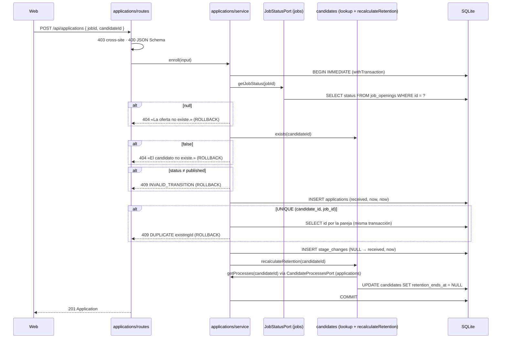

# HU-04 — Inscribir en una oferta publicada, sin duplicados — Diseño técnico (backend)

- **Origen:** `specs/PRD.md` (estado Ready, 2026-10-06)
- **Generado por:** backend-architect
- **Scope cubierto:** RF-01, RF-02, RF-03, RF-04, RF-05, RF-10 (parte API), RF-11, RF-12. RF-07 y RF-08 son del
  TD-frontend; este documento fija el contrato de API que consumen. RF-06, RF-09 y RF-13: fuera (movidos a HU-05 o
  hechos en T-04).

## Enfoque técnico

Nace `apps/api/src/modules/applications/` (nuevo) con las capas de siempre (`routes` → `service` → `repository`,
`schemas`) y dos piezas de colaboración. Todo se compone en `apps/api/src/app.ts`; **ningún módulo importa a otro**.

1. **Migración `003-create-applications.sql`** con `applications` y `stage_changes`. Las invariantes van en la base:
   índice único de la pareja (INV-01), `CHECK` de etapas, de transiciones (INV-04), de motivo y nota (INV-07, INV-10),
   FK `ON DELETE RESTRICT` a `candidates` y `job_openings`, y **dos triggers, solo para la inmutabilidad de
   `stage_changes`** (`UPDATE` y `DELETE`, INV-03). Ningún otro trigger.
2. **Inscribir** (`POST /api/applications`) es una sola `withTransaction` (`BEGIN IMMEDIATE`): lectura del puerto
   «estado de la oferta» → existencia del candidato → guarda de estado → `INSERT` de la inscripción (el índice único
   decide el duplicado) → `INSERT` del `StageChange` inicial → `recalculateRetention` de `candidates`. Cualquier
   error deshace todo (DT-08, DEC-06).
3. **Puertos.** `applications` define `JobStatusPort` (lo implementa `jobs`) y `CandidateLookupPort` (lo implementan
   operaciones de `candidates`), y además implementa el `CandidateProcessesPort` de `candidates`, que sustituye a
   `noCandidateProcesses` en `buildApp`. Las implementaciones cumplen el puerto por tipado estructural, sin importar
   su tipo: es `app.ts` quien lo comprueba al conectarlas (DD-01).
4. **Pipeline** (`GET /api/jobs/:jobId/applications`, registrada por el plugin de `applications`): estado de la oferta
   por el puerto, inscripciones por SQL propio (con el motivo del `StageChange` de rechazo) y nombres por una
   operación de `candidates` que solo lee `id` y `full_name`. Lista plana ordenada; la web agrupa por etapa (DD-07).
5. **SEC-02 (RF-12):** guarda de estado en el `WHERE` del `UPDATE` y del `DELETE` de
   `apps/api/src/modules/jobs/repository.ts`; el servicio traduce 0 filas a 409 (DD-09).
6. **Seed** de 40 inscripciones en `apps/api/src/db/seed-applications.ts` (nuevo), con la retención recalculada por
   `recalculateRetention` con el puerto real (DD-10).

**Alternativa principal descartada:** que `applications` haga `INSERT … SELECT … FROM job_openings WHERE status =
'published'` o un `JOIN` con `candidates`. Sería una sola sentencia, pero DEC-06 prohíbe consultar tablas de otro
módulo con SQL, y DT-08 lo descartó expresamente.

**Ventana de INV-05 (DT-10, OQ-10):** `JobApplicationsPort` **no se conecta** en esta HU: `buildApp` sigue con
`noJobApplications`. Entre el merge de HU-04 y el de HU-05, `GET /api/jobs/:id/close-preview` dice 0 y
`POST /api/jobs/:id/close` deja abiertas las inscripciones de la oferta, que siguen en etapa no final (INV-05 roto en
datos creados a mano) y con la retención del candidato en `null`. El seed respeta INV-05 (solo `hired` y `rejected` en
las cerradas), ningún test de HU-04 cierra una oferta con inscripciones y, tras el merge de HU-05, se hace
`npm run db:reset`.

## Módulos y ficheros afectados

| Módulo | Fichero | Cambio |
|---|---|---|
| transversal | `apps/api/src/db/migrations/003-create-applications.sql` | **nuevo**: tablas, índices, `CHECK`, FK y los 2 triggers |
| transversal | `apps/api/src/db/seed-applications.ts` | **nuevo**: `insertApplicationWithHistory` (la usan también los tests) y `seedApplications` (40 inscripciones) |
| transversal | `apps/api/src/db/seed.ts` | modificar: guarda los IDs de las ofertas y llama a `seedApplications` en la misma transacción |
| transversal | `apps/api/src/db/seed-candidates.ts` | modificar: `seedCandidates` devuelve los IDs (`number[]`); el resto igual |
| transversal | `apps/api/src/app.ts` | modificar: compone `applications`, `candidateProcesses` real por defecto y opción `jobStatus?` |
| applications | `apps/api/src/modules/applications/ports.ts` | **nuevo**: `JobStatus`, `JobStatusPort`, `CandidateLookupPort` |
| applications | `apps/api/src/modules/applications/schemas.ts` | **nuevo**: `STAGES`, `REJECTION_REASONS`, tipos y JSON Schema |
| applications | `apps/api/src/modules/applications/repository.ts` | **nuevo**: SQL preparado sobre `applications` y `stage_changes` |
| applications | `apps/api/src/modules/applications/candidate-processes.ts` | **nuevo**: `createCandidateProcessesReader` (implementa `CandidateProcessesPort`) |
| applications | `apps/api/src/modules/applications/service.ts` | **nuevo**: `enroll` y `getPipeline` |
| applications | `apps/api/src/modules/applications/routes.ts` | **nuevo**: plugin `applicationsRoutes` (prefijo `/api`) |
| jobs | `apps/api/src/modules/jobs/repository.ts` | modificar: guarda de estado en `UPDATE_SQL` y en el `DELETE`; `findStatusById` |
| jobs | `apps/api/src/modules/jobs/service.ts` | modificar: 0 filas en `update` y `remove` → 409 `INVALID_TRANSITION` |
| jobs | `apps/api/src/modules/jobs/job-status.ts` | **nuevo**: `createJobStatusReader` (implementa `JobStatusPort`) |
| candidates | `apps/api/src/modules/candidates/repository.ts` | modificar: `existsById` y `findNamesByIds`, con columnas explícitas (DP-02) |
| candidates | `apps/api/src/modules/candidates/service.ts` | modificar: `exists` y `findNames` en `CandidatesService` |
| tests | `apps/api/test/helpers/test-app.ts` · `apps/api/test/helpers/applications.ts` (**nuevo**) | `jobStatus` en `createTestApp` · `enroll(app, jobId, candidateId)` y `createJobStatusStub({ status, fail })` |
| tests | `apps/api/test/applications/*.test.ts` (**nuevos**), `apps/api/test/module-boundaries.test.ts` (**nuevo**), `apps/api/test/jobs/state-guards.test.ts` (**nuevo**) | ver *Estrategia de tests* |
| tests | `apps/api/test/candidates/migration.test.ts:73` · `apps/api/test/candidates/seed.test.ts` | modificar: la lista de migraciones incluye la `003` · la retención del seed se compara con el puerto real |
| docs | `docs/07_architecture_principles/DECISIONS.md` | modificar: aclaración de DEC-06 (tarea B-01, texto en *Impacto en decisiones*) |

`noCandidateProcesses` (`apps/api/src/modules/candidates/processes-port.ts`) se conserva: lo usan los tests y
`seed-candidates.ts`, que corre **antes** de que existan inscripciones; `seedApplications` recalcula después con el
puerto real. `apps/api/src/modules/jobs/applications-port.ts` no cambia.

## Contrato de API

Errores en el envelope `{ error: { code, message, details? } }` del manejador único
(`apps/api/src/http/error-handler.ts`). Ajv estricto (DEC-11.1); la guarda `CROSS_SITE_REQUEST` (DEC-12) es global y
la heredan los `POST` nuevos.

### Tipos de respuesta

```ts
type Stage = 'received' | 'screening' | 'interview' | 'offer' | 'hired' | 'rejected';
type RejectionReason = 'not_a_fit' | 'candidate_withdrew' | 'other' | 'job_closed';
// Etiquetas (DT-07 g, las pinta la web): no encaja con el perfil · retirada del candidato · otro · oferta cerrada

interface Application {          // 201 de POST /api/applications: exactamente estos 6 campos, sin datos del candidato
  id: number; jobId: number; candidateId: number; stage: Stage; createdAt: string; lastChangeAt: string;
}
interface PipelineItem {         // exactamente 5 campos (RNF-04); nunca email, phone ni note
  id: number; candidateName: string; stage: Stage; lastChangeAt: string; rejectionReason: RejectionReason | null;
}
interface Pipeline {
  job: { id: number; status: 'draft' | 'published' | 'closed' };
  items: PipelineItem[];         // orden lastChangeAt DESC, id DESC; sin paginar (S-18)
}
```

`rejectionReason` es no nulo si y solo si `stage === 'rejected'`. Instantes en ISO 8601 UTC con milisegundos.

### Endpoints

| Método y ruta | Entrada (JSON Schema) | Éxito | Errores |
|---|---|---|---|
| `POST /api/applications` | `body`: `{ type: 'object', additionalProperties: false, required: ['jobId', 'candidateId'], properties: { jobId: ID, candidateId: ID } }` con `ID = { type: 'integer', minimum: 1, maximum: 9007199254740991 }` | **201** `Application` en `received` | 400 · 403 · 404 · 409 `INVALID_TRANSITION` · 409 `DUPLICATE` · 413 · 415 · 500 |
| `GET /api/jobs/:jobId/applications` | `params`: `{ jobId: { type: 'string', pattern: idParamsSchema.properties.id.pattern } }` (`^[1-9][0-9]{0,14}$`, reutilizado de `apps/api/src/http/validation.ts`); `querystring`: objeto vacío con `additionalProperties: false` | **200** `Pipeline`, para una oferta existente en cualquier estado (DT-03); sin inscripciones, `items: []` | 400 · 404 · 500 |

`response` declarado por código (`201: applicationSchema`, `200: pipelineSchema`, ambos con `additionalProperties:
false` y `required` completos) para que nada más pueda salir.

**Orden de comprobación del `POST`** (RF-01): `CROSS_SITE_REQUEST` (403, `onRequest`) → parser (415, 413, JSON mal
formado → 400) → JSON Schema (400) → **dentro de `withTransaction`**: puerto de estado → `null` = 404 de la oferta →
`candidates.exists` → 404 del candidato → estado ≠ `published` = 409 `INVALID_TRANSITION` → `INSERT` (choque con el
índice único = 409 `DUPLICATE`) → `INSERT` del `StageChange` → `recalculateRetention` (500 y `ROLLBACK` si falla).
`now()` se llama una sola vez, tras las comprobaciones.

### Errores específicos

| `code` | HTTP | `message` | `details` |
|---|---|---|---|
| `VALIDATION_ERROR` | 400 | «Hay campos con errores.» (JSON mal formado: «El cuerpo de la petición no es JSON válido.») | Uno por campo declarado (`jobId`, `candidateId`) + uno `{ field: 'body', message: 'Hay campos no permitidos.' }` para todas las claves no declaradas, sin nombrarlas (`stage`, `id`… no se declaran con `forbiddenFields`: EC-01 pide agruparlas). En el pipeline, `{ field: 'jobId' }` o `{ field: 'querystring' }` |
| `NOT_FOUND` | 404 | «La oferta no existe.» · «El candidato no existe.» | — |
| `INVALID_TRANSITION` | 409 | «La oferta no está publicada: no admite inscripciones.» (igual en `draft` y `closed`, CA-05) | — |
| `DUPLICATE` | 409 | «Este candidato ya está inscrito en la oferta.» | `[{ field: 'candidateId', message: <el mismo>, existingId: <ID de la inscripción> }]` con `duplicate()` de `apps/api/src/errors.ts` (DEC-11.4) |
| `CROSS_SITE_REQUEST` · `PAYLOAD_TOO_LARGE` · `UNSUPPORTED_MEDIA_TYPE` · `INTERNAL_ERROR` | 403 · 413 · 415 · 500 | Los de siempre | — |

Ningún `message` ni `details` lleva nombre, email, teléfono ni nota; el 409 solo lleva `existingId`.

### Firmas internas

```ts
// apps/api/src/modules/applications/ports.ts — los define applications (DEC-06)
export type JobStatus = 'draft' | 'published' | 'closed';
export interface JobStatusPort { getJobStatus(jobId: number): JobStatus | null }      // null = no existe
export interface CandidateLookupPort {
  exists(candidateId: number): boolean;
  findNames(candidateIds: readonly number[]): Map<number, string>;                    // solo id → full_name
}

// apps/api/src/modules/applications/service.ts
export interface ApplicationsService {
  enroll(input: { jobId: number; candidateId: number }): Application;
  getPipeline(jobId: number): Pipeline;
}
export interface ApplicationsServiceDeps {
  repository: ApplicationsRepository; now: Clock; transaction: <T>(fn: () => T) => T;
  jobStatus: JobStatusPort; candidates: CandidateLookupPort;
  recalculateRetention: (candidateId: number) => void;                                // operación interna de candidates
}

// apps/api/src/modules/applications/repository.ts — createApplicationsRepository(db)
insert(row: { candidateId; jobId; stage: Stage; createdAt; lastChangeAt }): Application   // RETURNING con columnas explícitas
insertStageChange(c: { applicationId; fromStage: Stage | null; toStage: Stage; changedAt;
                       reason: RejectionReason | null; note: string | null }): void
findIdByPair(candidateId: number, jobId: number): number | undefined
isDuplicatePairError(error: unknown): boolean        // errcode 2067 y 'applications.candidate_id' en el mensaje
listByJob(jobId: number): { id; candidateId; stage; lastChangeAt; rejectionReason }[]
getProcessFacts(candidateId: number): { total: number; open: number; lastClosedAt: string | null }

// apps/api/src/modules/applications/candidate-processes.ts — implementa CandidateProcessesPort sin importarlo
createCandidateProcessesReader(repo: Pick<ApplicationsRepository, 'getProcessFacts'>)
  → { getProcesses(id) { hasOpenApplication: open > 0, hadAnyApplication: total > 0,
                         lastProcessClosedAt: open > 0 ? null : lastClosedAt } }

// apps/api/src/modules/jobs/job-status.ts — implementa JobStatusPort sin importarlo
createJobStatusReader(repo: Pick<JobsRepository, 'findStatusById'>) → { getJobStatus(id): JobStatus | null }
// jobs/repository.ts:       findStatusById(id): JobStatus | undefined   → SELECT status FROM job_openings WHERE id = ?
// candidates/repository.ts: existsById(id): boolean                     → SELECT 1 FROM candidates WHERE id = ?
//                           findNamesByIds(ids): Map<number, string>    → SELECT id, full_name FROM candidates
//                                                                         WHERE id IN (SELECT value FROM json_each(?))
// candidates/service.ts:    exists(id) y findNames(ids) delegan en el repositorio (findNames([]) no consulta)
```

**Composición en `apps/api/src/app.ts`** (orden; sin ciclos):

```ts
const applicationsRepository = createApplicationsRepository(db);
const jobsRepository = createJobsRepository(db);
// jobs: igual que hoy, con `applications: jobApplications` (noJobApplications por defecto, HU-05)
const candidatesService = createCandidatesService({ …,
  processes: candidateProcesses ?? createCandidateProcessesReader(applicationsRepository) });
const jobStatusPort: JobStatusPort = jobStatus ?? createJobStatusReader(jobsRepository); // comprobación estructural
const applicationsService = createApplicationsService({ repository: applicationsRepository, now,
  transaction: (fn) => withTransaction(db, fn), jobStatus: jobStatusPort,
  candidates: { exists: (id) => candidatesService.exists(id), findNames: (ids) => candidatesService.findNames(ids) },
  recalculateRetention: (id) => { candidatesService.recalculateRetention(id); } });
app.register(applicationsRoutes, { prefix: '/api', service: applicationsService });
```

`AppOptions` gana `jobStatus?: JobStatusPort` (solo para inyectar fallos en tests, EC-18) y `candidateProcesses?`
deja de tener `noCandidateProcesses` por defecto. Comprobado con Fastify del repo: `/api/jobs/:id` (plugin `jobs`) y
`/api/jobs/:jobId/applications` (plugin `applications`) conviven sin conflicto de rutas.

## Migración de datos

`apps/api/src/db/migrations/003-create-applications.sql` (nueva; `001` y `002` no se tocan, DEC-03). `migrate.ts` la
aplica una vez y la anota en `schema_migrations`. `ISO` = el mismo `GLOB` de las migraciones `001` y `002`.

```sql
-- HU-04: inscripciones (Application) e historial (StageChange). Dueño: applications (DEC-06). Las FK a candidates y
-- job_openings son integridad referencial de la base, no acoplamiento de código (aclaración de DEC-06).
CREATE TABLE applications (
  id             INTEGER PRIMARY KEY AUTOINCREMENT,
  candidate_id   INTEGER NOT NULL REFERENCES candidates (id) ON DELETE RESTRICT,
  job_id         INTEGER NOT NULL REFERENCES job_openings (id) ON DELETE RESTRICT,
  stage          TEXT    NOT NULL CHECK (stage IN ('received','screening','interview','offer','hired','rejected')),
  created_at     TEXT    NOT NULL CHECK (created_at GLOB ISO),
  last_change_at TEXT    NOT NULL CHECK (last_change_at GLOB ISO),
  CHECK (last_change_at >= created_at)
);
CREATE UNIQUE INDEX applications_candidate_job_uq ON applications (candidate_id, job_id);  -- INV-01, DEC-08
CREATE INDEX applications_job_pipeline_idx ON applications (job_id, last_change_at DESC, id DESC);

CREATE TABLE stage_changes (
  id             INTEGER PRIMARY KEY AUTOINCREMENT,
  application_id INTEGER NOT NULL REFERENCES applications (id) ON DELETE RESTRICT,
  from_stage     TEXT,
  to_stage       TEXT    NOT NULL,
  changed_at     TEXT    NOT NULL CHECK (changed_at GLOB ISO),
  reason         TEXT    CHECK (reason IS NULL OR reason IN ('not_a_fit','candidate_withdrew','other','job_closed')),
  note           TEXT    CHECK (note IS NULL OR length(note) BETWEEN 1 AND 500),                -- INV-10
  CHECK ((from_stage IS NULL AND to_stage = 'received')
      OR (from_stage IS 'received'  AND to_stage IN ('screening','rejected'))
      OR (from_stage IS 'screening' AND to_stage IN ('interview','rejected'))
      OR (from_stage IS 'interview' AND to_stage IN ('offer','rejected'))
      OR (from_stage IS 'offer'     AND to_stage IN ('hired','rejected'))),                   -- INV-04, EC-13
  CHECK ((reason IS NOT NULL) = (to_stage = 'rejected')),                                      -- INV-07
  CHECK (note IS NULL OR to_stage = 'rejected')                                                -- INV-10
);
CREATE INDEX stage_changes_application_idx ON stage_changes (application_id, id);
CREATE UNIQUE INDEX stage_changes_one_initial_uq ON stage_changes (application_id) WHERE from_stage IS NULL;
CREATE UNIQUE INDEX stage_changes_one_final_uq ON stage_changes (application_id) WHERE to_stage IN ('hired','rejected');

-- INV-03: los únicos triggers del esquema (DT-07). Única excepción, RGPD §5 (anonimizar el texto libre):
-- UPDATE stage_changes SET note = NULL. Cualquier otro cambio de columna, o una nota distinta de NULL, aborta.
CREATE TRIGGER stage_changes_no_update BEFORE UPDATE ON stage_changes
WHEN NEW.id IS NOT OLD.id
  OR NEW.application_id IS NOT OLD.application_id
  OR NEW.from_stage IS NOT OLD.from_stage
  OR NEW.to_stage IS NOT OLD.to_stage
  OR NEW.changed_at IS NOT OLD.changed_at
  OR NEW.reason IS NOT OLD.reason
  OR NEW.note IS NOT NULL
BEGIN SELECT RAISE(ABORT, 'stage_changes es inmutable'); END;
CREATE TRIGGER stage_changes_no_delete BEFORE DELETE ON stage_changes
BEGIN SELECT RAISE(ABORT, 'stage_changes es inmutable'); END;
```

- **`IS` y no `=` en el `CHECK` de transiciones** (comprobado en SQLite): con `from_stage = 'received'`, la fila
  `(NULL, 'screening')` da `NULL` en ese término y un `CHECK` que vale `NULL` **se acepta**. Con `IS` es falso y se
  rechaza (EC-13).
- **INV-08 sin trigger:** toda inscripción tiene su `StageChange` inicial (misma transacción), la FK `RESTRICT` de
  `stage_changes` impide borrarla y el trigger impide borrar el `StageChange`. Ni `candidates` ni `job_openings` se
  pueden borrar con inscripciones (FK `RESTRICT`); un borrador nunca tiene inscripciones (INV-02), así que
  `DELETE /api/jobs/:id` no cambia.
- `applications_candidate_job_uq` empieza por `candidate_id`: sirve también al puerto de procesos (no hace falta otro
  índice). `stage_changes_one_final_uq` garantiza que el `LEFT JOIN` del pipeline da como mucho una fila por inscripción.
- No están en la base (lo garantiza la transacción de `enroll` y lo prueba el seed): INV-02, INV-05, INV-06
  (`stage` = destino del último cambio, `last_change_at` = su fecha, `created_at` = la del inicial).
- Los triggers `fail_*` que crea `failWrites` (`apps/api/test/helpers/test-app.ts`) son fixtures de test sobre bases
  `:memory:`, no parte del esquema.
- **Filas existentes:** ninguna (tablas nuevas). `candidates` y `job_openings` no cambian de esquema.

**Seed** (`apps/api/src/db/seed-applications.ts`, nuevo; DT-05). `seed(db, now)` lo llama dentro de su transacción, con
los IDs de las 10 ofertas (en el orden de `SEED_JOBS`) y de los 30 candidatos (`i` = posición en `SEED_CANDIDATES`).
Exactamente **40** inscripciones, cada una con su historial paso a paso escrito con `insertApplicationWithHistory`
(inscripción con su etapa final y `last_change_at`, más un `StageChange` por paso):

| Oferta (posición en `SEED_JOBS`) | Estado | N | Etapas (motivo) |
|---|---|---|---|
| Desarrollador/a backend (Node.js) (4) | `published` | 10 | 3 `received`, 2 `screening`, 2 `interview`, 1 `offer`, 1 `hired`, 1 `rejected` (`not_a_fit`, con nota) |
| Administrativo/a contable (5) | `published` | 0 | — (estado vacío del pipeline) |
| Técnico/a de selección de personal (6) | `published` | 10 | 2 `received`, 2 `screening`, 1 `interview`, 1 `offer`, 1 `hired`, 3 `rejected` (`candidate_withdrew`; `other` con nota; `not_a_fit`) |
| Responsable de gestión de nóminas (7) | `published` | 10 | 2 `received`, 2 `screening`, 2 `interview`, 2 `offer`, 2 `rejected` (`other`, `candidate_withdrew`) |
| Becario/a de marketing digital (8) | `closed` | 5 | 1 `hired`, 1 `rejected` (`not_a_fit`, antes del cierre), 3 `rejected` (`job_closed`, sin nota, en `2026-09-26T15:30:00.000Z`) |
| Auxiliar de logística (9) | `closed` | 5 | 1 `hired`, 1 `rejected` (`other`, antes del cierre), 3 `rejected` (`job_closed`, sin nota, en `2026-09-15T16:00:00.000Z`) |
| Borradores (0-3) | `draft` | 0 | — |

- **Candidatos:** las publicadas usan `i` = 1-20 (10 con dos inscripciones; al menos 3 con dos abiertas; uno con una
  sola inscripción y `rejected`, para EC-51); las cerradas, `i` = 25-29 (cada uno en las dos). `i` = 0 y 21-24 no
  tienen inscripciones.
- **Fechas.** Publicadas: relativas al reset, todos los pasos en `(now − 90 h, now − 1 h]`, crecientes dentro de cada
  inscripción (después de su publicación si `now ≥ 2026-10-05T22:00Z`, y después del alta del candidato, que tiene
  `i ≥ 1`, es decir ≥ 8 días). Cerradas: ancladas a las fechas fijas de la oferta, entre su publicación y su cierre;
  los `job_closed` justo en `closed_at` (INV-07).
- **Notas** inventadas y no sensibles (p. ej., «Busca jornada parcial y la oferta es a jornada completa.»).
- **Retención:** al final, `seedApplications` llama a `recalculateRetention` de un `createCandidatesService` con
  `createCandidateProcessesReader` para cada candidato inscrito: con una abierta, `null`; con todas finales, la
  fórmula con `lastProcessClosedAt` (no se duplica la fórmula).
- **e2e existentes:** cuentan ofertas (10) y candidatos (≥ 30), crean sus propios datos y solo borran o cierran ofertas
  creadas por ellos; el seed no cambia ninguna de esas cifras ni toca borradores.

## Diagrama de secuencia



## Error paths

| Edge case (PRD) | Dónde se detecta | Estrategia | Respuesta o efecto observable | Test |
|---|---|---|---|---|
| EC-01 | JSON Schema del `body` | rechazar | 400 `VALIDATION_ERROR`; `stage` agrupada en `{ field: 'body' }`; 0 filas | `applications/enroll-adversarial.test.ts` |
| EC-02 | Parser de Fastify | rechazar | JSON roto o vacío → 400; `text/plain` → 400 (no es objeto); form → 415; 0 filas | `applications/enroll-adversarial.test.ts` |
| EC-03 | Esquema (`maximum`) · puerto | rechazar | `MAX_SAFE_INTEGER` inexistente → 404 sin datos; `+1` → 400 | `applications/enroll-adversarial.test.ts` |
| EC-04 | Índice único | traducir | 409 `DUPLICATE` con el ID de la `rejected` del seed; 0 filas nuevas | `applications/enroll.test.ts` |
| EC-05 | SQLite (`failWrites` en `applications`, `stage_changes` o `candidates.retention_ends_at`) | `ROLLBACK` | 500 `INTERNAL_ERROR` sin *stack*; 0 inscripciones, 0 `StageChange`, retención igual | `applications/enroll-adversarial.test.ts` |
| EC-06 | Índice único | traducir | Dos `inject` en paralelo: 201 y 409 con el ID del primero; 1 fila y 1 `StageChange` | `applications/enroll-adversarial.test.ts` |
| EC-07 | Puerto dentro de la transacción | rechazar | Oferta cerrada antes del `POST` → 409 `INVALID_TRANSITION`; 0 filas | `applications/enroll-adversarial.test.ts` |
| EC-08 | `recalculateRetention` | aplicar | Retención vencida (reloj adelantado) → 201 y `retentionEndsAt: null` | `applications/enroll.test.ts` |
| EC-09 | Mensajes fijos · manejador | no exponer | Cuerpos de 404, 409 y 500 sin nombre, email ni teléfono; logs igual | `applications/privacy-logs.test.ts` |
| EC-10 | Hook `onRequest` (DEC-12) | rechazar | 403 `CROSS_SITE_REQUEST` con `cross-site` y `same-site`; 0 filas | `applications/enroll-adversarial.test.ts` |
| EC-11 | Índice único | traducir | Reintento → 409 con el ID; 1 `StageChange`; retención igual | `applications/enroll.test.ts` |
| EC-12 | `CHECK` | rechazar | `INSERT` directo con etapa `foo`, motivo en `screening` o nota de 501 → error de SQLite | `applications/migration.test.ts` |
| EC-13 | `CHECK` de transiciones (`IS`) | rechazar | `(NULL, received)` se acepta; `(NULL, screening)` falla | `applications/migration.test.ts` |
| EC-14 | Índice único | rechazar | Segundo `INSERT` directo de la pareja falla | `applications/integrity-adversarial.test.ts` |
| EC-15 | Triggers · FK `RESTRICT` | rechazar | `UPDATE` de `stage_changes` (salvo `SET note = NULL`, DD-04) y `DELETE` abortan; `DELETE` de candidato u oferta con inscripciones falla | `applications/migration.test.ts` (CA-27), `applications/integrity-adversarial.test.ts` |
| EC-16 | `schema_migrations` | no reaplicar | Segundo `migrate` → `[]` | `applications/migration.test.ts` |
| EC-17 | Puerto de estado | 404 / 409 | `draft` 409, `published` 201, `closed` 409, inexistente y borrador borrado 404 | `applications/enroll.test.ts` |
| EC-18 | `createJobStatusStub({ fail: true })` | `ROLLBACK` | 500 sin datos; 0 filas | `applications/enroll-adversarial.test.ts` |
| EC-19 | Puerto en el mismo `BEGIN IMMEDIATE` | serializar | Un puerto espía registra `db.isTransaction === true` en la llamada; cerrar y luego inscribir → 409 | `applications/enroll-adversarial.test.ts` |
| EC-20 | Test de dependencias | fallar el test | Ningún `import` entre módulos; sin SQL de `applications` sobre `job_openings`/`candidates` ni al revés | `module-boundaries.test.ts` |
| EC-21 | `createCandidateProcessesReader` | calcular | Los 4 casos con fixtures de `insertApplicationWithHistory` | `applications/ports.test.ts` |
| EC-22 | Puerto de procesos que falla en la inscripción (togglingPort) | `ROLLBACK` | 500; 0 inscripciones y 0 `StageChange` | `applications/enroll-adversarial.test.ts` |
| EC-23 | Fórmula (`hasOpenApplication` prevalece) | aplicar | Consentimiento vigente + inscripción → `null` | `applications/enroll.test.ts` |
| EC-24 | Manejador (log del objeto de error) | no exponer | Logs del 500 del puerto sin nombre, email ni teléfono | `applications/privacy-logs.test.ts` |
| EC-25 | Lector puro | idempotente | Dos llamadas → mismo resultado; `total_changes` igual | `applications/ports.test.ts` |
| EC-26 | `params` (`pattern`) · `querystring` | rechazar | `abc`, `0`, `01`, 16 dígitos, `?foo=1` → 400 | `applications/pipeline-adversarial.test.ts` |
| EC-27 | SQL `ORDER BY last_change_at DESC, id DESC` | ordenar | 0, 1, 200 sin paginar; empate por ID desc | `applications/pipeline.test.ts` |
| EC-28 | Servicio (sin guarda de estado en lectura) | permitir | `draft` → 200 con `status: 'draft'` e `items: []` | `applications/pipeline.test.ts` |
| EC-29 | SQLite (tabla renombrada en el test) | 500 | Envelope sin SQL ni *stack* | `applications/pipeline-adversarial.test.ts` |
| EC-30 | `response` schema · columnas explícitas | minimizar | Con teléfono y nota en la base: 0 claves y 0 valores de email, teléfono o nota | `applications/pipeline-adversarial.test.ts` |
| EC-31 a EC-34, EC-47 a EC-50 | — | — | Movidos a HU-05 (DT-11) | — |
| EC-35 a EC-46 | Web | — | TD-frontend (la API ya cubre su parte: 404, 409 y `GET /api/candidates?q=`) | TD-frontend |
| EC-51 | Lector + fórmula | calcular | Única inscripción `rejected` → fecha de `lastProcessClosedAt` + 6 meses | `applications/seed.test.ts` |
| EC-52 | `failWrites` en `retention_ends_at` | `ROLLBACK` | `GET /api/candidates/:id` con la fecha de antes | `applications/enroll-adversarial.test.ts` (con EC-05) |
| EC-53 | Fórmula | aplicar | Consentimiento retirado + inscripción → `null` | `applications/enroll.test.ts` |
| EC-54 a EC-56 | Seed | componer | Composición de la tabla del seed; INV-04..07; `@example.com`, teléfonos `+34 600 000 0xx` | `applications/seed.test.ts` |
| EC-57 | Seed | determinista | Dos bases nuevas con `migrate` + `seed(NOW)` → mismos recuentos e invariantes | `applications/seed.test.ts` |

## Threat modeling

DEC-04: sin login; un único rol. API solo en `127.0.0.1`.

| STRIDE | Amenaza concreta | Mitigación |
|---|---|---|
| Suplantación | Otra web abierta lanza `POST /api/applications` (CSRF) | DEC-12: 403 `CROSS_SITE_REQUEST`; el `POST` con JSON exige además *preflight* |
| Manipulación | *Mass assignment*: `stage: 'hired'`, `createdAt`, `id` en el cuerpo | `additionalProperties: false` → 400; `stage` y fechas solo los fija el servicio |
| Manipulación | Inyección SQL por `jobId`/`candidateId` | Enteros validados por esquema; sentencias preparadas; la lista de nombres va como JSON en un parámetro (`json_each(?)`), nunca concatenada |
| Manipulación | Reescribir el historial | Triggers de inmutabilidad; no hay ruta de edición ni borrado de inscripciones ni de `StageChange` |
| Repudio | Cambios de etapa sin rastro | `StageChange` inmutable con fecha del reloj inyectado |
| Exposición | Datos del candidato en el pipeline, en errores o en logs | Pipeline de 5 campos con `response` schema; mensajes fijos; logger sin cuerpo ni query; ningún `SELECT *` nuevo sobre `candidates` (DP-02) |
| Exposición | Enumeración de IDs (404 de oferta frente a 404 de candidato) | Aceptada con DEC-04 (un único rol); los 404 no devuelven ningún dato |
| Denegación | Pipeline sin paginar | S-18: acotado por las inscripciones de una oferta; RNF-01 con 200 (< 200 ms); cuerpo del `POST` limitado por Fastify (413) |
| Elevación | — | N/A — sin roles (DEC-04). Con login, `POST` y pipeline exigirían el rol «reclutador» y la guarda DEC-12 seguiría |

## Datos personales

- **Entran:** solo IDs (`jobId`, `candidateId`). **Se guardan:** el vínculo candidato-oferta y su historial (RGPD §1);
  la nota solo existe en el seed (ninguna ruta de HU-04 la escribe ni la devuelve). **Se devuelven:** el `POST`,
  la inscripción sin datos del candidato; el pipeline, solo `candidateName` (S-18, RGPD §6.2). La búsqueda del panel
  usa `GET /api/candidates?q=` sin cambios.
- **Retención (RGPD §3):** `recalculateRetention` en la misma transacción del `INSERT`; con una inscripción abierta,
  `retention_ends_at = NULL` (INV-09), también si ya había vencido (DT-06). Cerrar inscripciones y recalcular: HU-05.
- **Lecturas de `candidates`:** `existsById` (`SELECT 1`) y `findNamesByIds` (`id`, `full_name`), sin `SELECT *`
  (DP-02). `recalculateRetention` sigue usando su `findById`, que no se copia.
- **Nunca en logs ni errores (DP-01):** el manejador registra el objeto de error solo en los 500; los errores de los
  puertos y del recálculo no llevan datos del candidato (los de SQLite nombran columnas o expresiones del `CHECK`,
  no valores; el de `computeRetentionEndsAt` es fijo). Ni el servicio ni los puertos envuelven errores con datos de
  contexto ni añaden logs.
- **Supresión:** la base ya permite vaciar `stage_changes.note` (`SET note = NULL`, excepción RGPD §5 de DD-04) para
  la anonimización de la feature A; HU-04 no la ejecuta.

## Decisiones de diseño

### DD-01: Puertos sin `import` entre módulos, comprobados en `app.ts`
- **Contexto:** DEC-06 dice que un módulo importa a los de su derecha; `docs/ARCHITECTURE.md` y la decisión del
  responsable técnico, que ningún módulo importa a otro (hoy ninguno lo hace).
- **Opciones consideradas:** A) `jobs` importa `JobStatusPort` de `applications` y `applications` importa
  `CandidateProcessesPort` de `candidates`. B) Cada implementación declara su propia forma y `app.ts` la asigna al
  tipo del puerto (tipado estructural).
- **Elegida:** B.
- **Razón:** cero aristas de `import` entre módulos; el test de fronteras es una regla simple («ningún `import` cruzado»).
- **Tradeoff:** formas duplicadas (`JobStatus` en `jobs` y en `applications`; la de `CandidateProcesses`). Un cambio en
  un puerto se detecta al compilar `app.ts`, no en el módulo que lo implementa.

### DD-02: La guarda de inscribir es la lectura del puerto en el mismo `BEGIN IMMEDIATE`
- **Contexto:** INV-02 y EC-19, con DEC-06 prohibiendo SQL sobre `job_openings` desde `applications` (DT-08).
- **Opciones consideradas:** A) `INSERT … SELECT … WHERE status = 'published'`. B) Trigger `BEFORE INSERT` en
  `applications`. C) Leer el puerto dentro de `withTransaction`, antes del `INSERT`.
- **Elegida:** C.
- **Razón:** A viola DEC-06; B viola DT-07 (triggers solo para la inmutabilidad). Con `BEGIN IMMEDIATE`, SQLite
  serializa a los escritores: un cierre no puede intercalarse entre la lectura y el `INSERT`.
- **Tradeoff:** la garantía depende de que toda escritura del estado de una oferta vaya en transacción (hoy lo hacen
  todas) y de una conexión síncrona; lo fija el test del puerto espía (`db.isTransaction`).

### DD-03: El duplicado lo decide el índice único, sin `SELECT` previo
- **Contexto:** DEC-08 y CA-07.
- **Opciones consideradas:** A) `SELECT` previo de la pareja. B) `INSERT` y traducir el `UNIQUE`, consultando el ID en la
  misma transacción (patrón de `candidates`).
- **Elegida:** B.
- **Razón:** una comprobación previa no basta ante concurrencia; B es el patrón ya probado (`isDuplicateEmailError`).
- **Tradeoff:** `isDuplicatePairError` depende del texto de SQLite (`applications.candidate_id`); se compensa con
  `errcode === 2067` y el test de CA-06/CA-07.

### DD-04: Inmutabilidad con dos triggers; las inscripciones se protegen por FK
- **Contexto:** INV-03 e INV-08; DT-07 limita los triggers a `stage_changes`.
- **Opciones consideradas:** A) Triggers también en `applications`. B) Triggers solo en `stage_changes` y FK `RESTRICT`
  desde `stage_changes` a `applications`.
- **Elegida:** B.
- **Razón:** cumple DT-07 y, como toda inscripción nace con su `StageChange`, la FK basta para impedir su borrado.
- **Excepción RGPD: anonimizar el texto libre** (`docs/RGPD.md` §5; decisión del responsable técnico, opción b). El trigger de
  `UPDATE` deja pasar **solo** `UPDATE stage_changes SET note = NULL`: aborta si cambia cualquier otra columna
  (comparadas con `IS NOT`, que trata bien los `NULL`) o si la nota nueva no es `NULL`. Ningún `CHECK` exige nota en un
  `rejected` (es opcional, RN-05), así que vaciarla no choca con la tabla. HU-04 no la usa desde ninguna ruta; la usará
  la anonimización de la feature A. El `DELETE` sigue bloqueado sin excepciones.
- **Tradeoff:** una inscripción sin `StageChange` (imposible por el servicio) sí se podría borrar con SQL directo; el
  `UPDATE` de `applications` queda libre porque HU-05 lo necesita para avanzar; y el historial deja de ser
  estrictamente inmutable en una columna (la nota solo puede pasar a `NULL`, nunca a otro texto).

### DD-05: Transiciones de RV-19 en un `CHECK` de `stage_changes`
- **Contexto:** INV-04 debe defenderse también en la base; EC-13 lo pide para el inicial.
- **Opciones consideradas:** A) Solo «origen nulo si y solo si destino `received`». B) La tabla completa de transiciones.
- **Elegida:** B (con `IS` por los `NULL`).
- **Razón:** el seed de HU-04 ya escribe historiales completos y HU-05 escribirá el resto: la base rechaza cualquier
  salto, retroceso o salida de una etapa final.
- **Tradeoff:** cambiar la máquina de estados exigiría reconstruir la tabla (SQLite no altera un `CHECK`), con su
  migración.

### DD-06: Puerto de procesos con una sola consulta sobre `applications`
- **Contexto:** RF-04 pide `lastProcessClosedAt` = instante del último `StageChange` a etapa final.
- **Opciones consideradas:** A) `MAX(changed_at)` con `JOIN` a `stage_changes`. B) `COUNT`, `SUM(stage no final)` y
  `MAX(last_change_at)` de las finales, solo sobre `applications`.
- **Elegida:** B.
- **Razón:** por INV-06, el `last_change_at` de una inscripción final es la fecha de su `StageChange` final; usa el
  índice único (`candidate_id` primero) y respeta el contrato (`hadAny && !hasOpen` ⇒ fecha no nula).
- **Tradeoff:** depende de INV-06, que garantiza la transacción y comprueba el test del seed.

### DD-07: Pipeline como lista plana y nombres por operación de `candidates`
- **Contexto:** RF-05 («agrupables por etapa»), DEC-06 (sin `JOIN` con `candidates`) y RNF-01.
- **Opciones consideradas:** A) Objeto agrupado por etapa. B) Lista plana ordenada que la web agrupa. Para los nombres:
  C) una consulta por nombre; D) `findNamesByIds` con `json_each(?)`.
- **Elegida:** B + D, sin transacción (lecturas síncronas en una conexión, sin intercalado posible).
- **Razón:** B tiene un solo orden y un esquema simple; D son dos sentencias preparadas fijas para cualquier tamaño.
- **Tradeoff:** dos consultas en lugar de una, y la agrupación queda en la web. Si la conexión dejara de ser única,
  habría que envolver la lectura en una transacción.

### DD-08: `jobStatus?` en `buildApp` y `candidateProcesses` real por defecto
- **Contexto:** EC-18 y RNF-03 piden un 500 provocado en el puerto de estado a través de la app (con su log).
- **Opciones consideradas:** A) Probar el fallo solo en el servicio. B) Opción `jobStatus?` en `AppOptions`.
- **Elegida:** B.
- **Razón:** el 500 y su línea de log solo existen a través del manejador de errores.
- **Tradeoff:** una opción más en `buildApp`, solo para tests (como `jobApplications` y `candidateProcesses`).

### DD-09: SEC-02, 0 filas → 409 con un mensaje propio
- **Contexto:** RF-12 lleva la guarda al `WHERE`; bajo `BEGIN IMMEDIATE`, tras `requireJob` y `checkAction`, 0 filas
  solo puede significar un estado no permitido.
- **Opciones consideradas:** A) Releer y volver a llamar a `checkAction`. B) Lanzar directamente `INVALID_TRANSITION`
  con «El estado de la oferta ha cambiado: recarga e inténtalo de nuevo.».
- **Elegida:** B.
- **Razón:** es un camino defensivo inalcanzable por la API; A añade ramas sin valor.
- **Tradeoff:** ese mensaje difiere de los de `rules.ts`, pero solo aparece si alguien se salta el servicio.

### DD-10: Seed con fechas relativas en las publicadas y ancladas en las cerradas
- **Contexto:** DT-05 pide fechas relativas al reset y «oferta cerrada» en la fecha del cierre, que en `seed.ts` es fija.
- **Opciones consideradas:** A) Todo relativo (rompe INV-07: la fecha del cierre es fija). B) Publicadas relativas
  (últimas 90 h) y cerradas ancladas a sus fechas fijas; retención con `recalculateRetention` y el puerto real.
- **Elegida:** B.
- **Razón:** cumple INV-04..07 y RF-11 sin cambiar las fechas de las ofertas (`seed.ts`) ni las de los candidatos
  (`seed-candidates.ts`) de HU-01 a HU-03.
- **Tradeoff:** ver *Riesgos* (alta del candidato posterior a sus inscripciones en ofertas cerradas si el reset es muy
  tardío).

## Impacto en decisiones

- **Se aplican:** DEC-01, DEC-03 (migración `003`, seed inventado), DEC-04, DEC-06, DEC-07 (201, 400, 404, 409
  `INVALID_TRANSITION` y `DUPLICATE` con `existingId`), DEC-08 (índice único, estado en la transacción), DEC-09 (UTC,
  reloj inyectado), DEC-10 (búsqueda reutilizada; el pipeline sin paginar es la excepción que declara el PRD), DEC-11
  (1, 2, 4, 5, 6, 7) y DEC-12 (heredada). DEC-11.3 y DEC-11.8: N/A, sin textos de entrada.
- **Reutiliza sin duplicar:** `withTransaction`, `Clock`, `ajvOptions`, el patrón de `idParamsSchema`, `duplicate()` y
  el envelope con `existingId`, la guarda DEC-12, `computeRetentionEndsAt` y `recalculateRetention`;
  `createTestApp`, `createTestClock`, `failWrites`, `createProcessesStub`, `createCandidate`, `createPublishedJob` y
  `closeJob`. `forbiddenFields`, `rejectBody`, `NO_CONTROL_CHARS*` y `foldSearchText` no aplican (sin campos de solo
  lectura nombrados, sin acciones sin cuerpo, sin textos de entrada y la búsqueda es la de `GET /api/candidates`).
- **Aclaración de DEC-06** (DT-07 y decisión del responsable técnico). La escribe la tarea **B-01** en
  `docs/07_architecture_principles/DECISIONS.md`: sustituye la viñeta «Dirección de dependencias» por las dos
  siguientes y añade a *Estado* «aclarada en el diseño de HU-04 (claves foráneas entre módulos; ningún módulo importa
  a otro)»:

  > - Dirección de dependencias, sin ciclos: `ofertas → inscripciones → candidatos` es la dirección de las llamadas que
  >   compone `apps/api/src/app.ts`; los puertos los implementa el módulo de la izquierda y se conectan allí. **Ningún
  >   módulo importa a otro**, tampoco sus tipos: la implementación cumple el puerto por tipado estructural y `app.ts`
  >   lo comprueba al conectarla.
  > - **Las claves foráneas entre tablas de módulos distintos son integridad referencial de la base, no un acoplamiento
  >   de código.** Las declara la migración del módulo dueño de la tabla que referencia (p. ej.,
  >   `003-create-applications.sql`: `applications.candidate_id → candidates.id` y `applications.job_id →
  >   job_openings.id`, con `ON DELETE RESTRICT`) y no autorizan a ningún módulo a consultar ni escribir con SQL las
  >   tablas de otro.

- **No hace falta un `DEC-NN` nuevo.**

## Estrategia de tests

Vitest + `app.inject` sobre `:memory:` migrada (`createTestApp`), reloj con `createTestClock`, fallos de escritura con
`failWrites` (creados **después** de preparar los datos: el alta del candidato ya escribe `retention_ends_at`) y dobles
reales sin mocks de módulo: `createJobStatusStub({ status, fail })` y un puerto espía de `db.isTransaction`
(`apps/api/test/helpers/applications.ts`), y `createProcessesStub`. Historiales de fixture con
`insertApplicationWithHistory`. Datos inventados (`@example.com`, `+34 600 000 0xx`). Ficheros en
`apps/api/test/applications/` salvo indicación.

| Criterio | Test previsto (fichero · nombre) |
|---|---|
| CA-01 · RF-10 | `enroll.test.ts` · «CA-01 inscribir → 201 received, StageChange NULL→received con el reloj, retentionEndsAt null en GET del candidato» |
| CA-02, CA-08, CA-16 | N/A en API: web y e2e (TD-frontend); la API que usan la cubren CA-01, CA-06 y CA-15 |
| CA-03 | `enroll-adversarial.test.ts` · «CA-03 candidateId como lista → 400 y 0 filas» (la parte web, TD-frontend) |
| CA-04, CA-05 | `enroll.test.ts` · «CA-04 draft → 409 INVALID_TRANSITION, nada creado, retención igual», «CA-05 closed → 409 con el mismo mensaje» |
| CA-06 | `enroll.test.ts` · «CA-06 repetir en received y en rejected → 409 DUPLICATE con existingId, retención igual» |
| CA-07 | `enroll-adversarial.test.ts` · «CA-07/EC-06 dos POST a la vez → 201 y 409 con el ID; 1 inscripción y 1 StageChange» |
| CA-09 | `enroll.test.ts` · «CA-09 oferta y candidato inexistentes → 404 con su mensaje, sin datos» |
| CA-10 | `enroll-adversarial.test.ts` · «CA-10/EC-01/EC-02 sin candidateId, "7", 0, -3, 1.5, stage, no JSON, form → 400/415» |
| CA-11 · EC-52 | `enroll-adversarial.test.ts` · «CA-11 fallo en INSERT de applications, de stage_changes y en retention_ends_at → 500 y nada cambia» |
| CA-12, CA-14, CA-15 | `pipeline.test.ts` · «CA-12 orden last_change desc + id desc, motivo solo en rejected, sin paginar», «CA-14 publicada sin inscripciones → 200 vacío», «CA-15 inexistente → 404» |
| CA-13 · RNF-04 | `pipeline.test.ts` · «CA-13 cada item con exactamente 5 claves; 0 email, phone ni note» |
| CA-19 (API) | `enroll.test.ts` (CA-01) · la ficha y el e2e, TD-frontend |
| CA-20 | `ports.test.ts` · «CA-20 buildApp por defecto: con abierta → true/true; sin inscripciones → false/false/null» |
| CA-21 | `apps/api/test/module-boundaries.test.ts` · «CA-21 ningún import entre módulos; sin SQL sobre tablas ajenas» |
| CA-22 | `apps/api/test/jobs/state-guards.test.ts` · «CA-22 UPDATE sobre cerrada y DELETE sobre publicada → 0 filas e intactas», «CA-22 el servicio traduce 0 filas a 409» |
| CA-25 · RF-11 | `seed.test.ts` · «CA-25 40 inscripciones con la composición de DT-05, INV-04..07 y retención = fórmula con el puerto real» |
| CA-26 (API) | `pipeline.test.ts` · «EC-28 draft → 200 status draft y vacío»; la pantalla, TD-frontend |
| CA-27 | `migration.test.ts` · «CA-27 UPDATE y DELETE directos sobre stage_changes → abortan y la fila no cambia» |
| DD-04 (excepción RGPD §5) | `migration.test.ts` · «RGPD §5 SET note = NULL en un rejected con nota → se vacía y el resto de la fila no cambia»; «RGPD §5 note a otro texto, note = NULL junto a otra columna, cada columna (id, application_id, from_stage, to_stage, changed_at, reason) y DELETE → abortan y la fila no cambia» |
| RF-03 · EC-19 | `enroll-adversarial.test.ts` · «EC-19 el puerto de estado se lee con db.isTransaction === true» |
| RNF-01, RNF-02 | `performance.test.ts` · «RNF-01 pipeline de 200 < 200 ms con 1 000 candidatos y 2 000 inscripciones», «RNF-02 POST < 500 ms» |
| RNF-03 | `privacy-logs.test.ts` · «RNF-03 logs y errores sin nombre, email, teléfono ni nota en 404, 409 y los 500 del puerto de estado, del de procesos y del recálculo» |

**SEC-02 (B-02)**, en `apps/api/test/jobs/state-guards.test.ts`: primero una **regresión** que se escribe y pasa
**antes** de tocar el SQL (PATCH de `draft` y `published` → 200 con el mismo `Job`; PATCH de `closed` → 409 «Una
oferta cerrada no se puede editar.»; DELETE de `draft` → 204; DELETE de `published` y `closed` → 409 con sus mensajes;
inexistente → 404 «La oferta no existe.») y que sigue en verde después; luego CA-22 sobre el repositorio y, para el
servicio, un repositorio real envuelto cuyo `findById` devuelve la oferta como `published` cuando en la base está
`closed`. `update.test.ts`, `delete.test.ts`, `status-rules*.test.ts` y el resto de `apps/api/test/jobs/` no se tocan.

**Tests que cambian:** `apps/api/test/candidates/migration.test.ts:73` (la lista incluye
`003-create-applications.sql`) y el último test de `apps/api/test/candidates/seed.test.ts` (compara con
`createCandidateProcessesReader` en lugar de `noCandidateProcesses` y admite `null` con inscripción abierta).

**Adversariales** (tareas aparte, ≥ 1 por RF Must): B-07 (RF-01, RF-03, RF-04, RF-10: `enroll-adversarial`,
`privacy-logs`) y B-08 (RF-02, RF-05, RF-11: `pipeline-adversarial`, `integrity-adversarial`, que además comprueba el
seed contra `INSERT` directos que violen INV-04 e INV-07).

## Riesgos

| Riesgo | Probabilidad (1–5) | Impacto (1–5) | Mitigación |
|---|---|---|---|
| Techo de 15 tareas: el backend estima **8** (6 + 2 adversariales), así que la web y el e2e disponen de 7 | 3 | 4 | Sin piezas especulativas. Si el frontend necesitara más de 7, **propuesta** (no aplicada): sacar el estado de borrador del pipeline (EC-28 en web, CA-26) a HU-05 junto con UC-17 · A1, que ya es de allí; la API no cambia |
| Ventana de INV-05 hasta HU-05 (DT-10) | 4 | 2 | Aceptada; ningún test cierra ofertas con inscripciones; `npm run db:reset` tras el merge de HU-05 |
| Las ofertas del seed tienen fechas fijas y los candidatos, relativas: con un reset posterior a ~2026-12-26, el alta de los candidatos 25-29 quedaría después de sus inscripciones en las ofertas cerradas | 2 | 2 | No rompe ninguna invariante (INV-04..07) ni la retención; el test del seed usa un `NOW` fijo. Si se necesitara, una HU futura hace relativo el seed de ofertas |
| `CHECK` con `=` en lugar de `IS` dejaría pasar `(NULL, screening)` | 2 | 4 | Fijado en la migración y en EC-13 |
| `isDuplicatePairError` depende del texto de SQLite | 2 | 3 | `errcode === 2067` y test de CA-06/CA-07 |
| Formas de puerto duplicadas (DD-01) desfasadas | 2 | 2 | `app.ts` las asigna a los tipos de los puertos: un desfase no compila |

## Open Decisions

No hay decisiones abiertas.

## Fuera de scope

- `JobApplicationsPort` real (`countActiveApplications`, `rejectActiveApplications`), UC-19 y UC-04 · A1: HU-05.
- Detalle de la inscripción y su historial (`GET /api/applications/:id`), avanzar, rechazar y recalcular al cerrar una
  inscripción: HU-05.
- Búsqueda nueva de candidatos (se reutiliza `GET /api/candidates`), inscripción múltiple o desde la ficha del candidato.
- Estado «anonimizado» y bloqueo de su inscripción (feature A); cambios de esquema en `candidates` o `job_openings`.
- Cabeceras de endurecimiento, lista de `Host` y `\p{Cf}` (deuda de HU-02 y HU-03 para la auditoría de sprint).

## Checklist de implementación (base de `/task-planner`)

| # | Tarea | Tamaño | Ficheros principales |
|---|---|---|---|
| B-01 | Migración `003` (tablas, `CHECK` con `IS`, índices, FK `RESTRICT`, 2 triggers, el de `UPDATE` con la excepción `SET note = NULL` de DD-04) y sus tests (estructura, EC-12, EC-13, EC-15, EC-16, CA-27, vaciar la nota funciona y cualquier otro `UPDATE` o el `DELETE` aborta); actualizar `candidates/migration.test.ts:73`; aclaración de DEC-06 en `DECISIONS.md` | M | `003-create-applications.sql`, `applications/migration.test.ts`, `candidates/migration.test.ts`, `DECISIONS.md` |
| B-02 | SEC-02 (RF-12): regresión de respuestas de ofertas **en verde antes**; guarda en `UPDATE_SQL` (`status IN ('draft','published')`) y en el `DELETE` (`status = 'draft'`); 0 filas → 409 (DD-09); CA-22 | M | `jobs/repository.ts`, `jobs/service.ts`, `jobs/state-guards.test.ts` |
| B-03 | Puertos y lecturas cruzadas: `ports.ts`, `repository.ts` de `applications` (`insert`, `insertStageChange`, `getProcessFacts`), `candidate-processes.ts`, `jobs/job-status.ts` + `findStatusById`, `exists`/`findNames` en `candidates`; `insertApplicationWithHistory` en `seed-applications.ts`; composición en `app.ts` (`candidateProcesses` real, `jobStatus?`); *helpers*; CA-20, CA-21, EC-21, EC-25 | L | `applications/{ports,repository,candidate-processes}.ts`, `jobs/{job-status,repository}.ts`, `candidates/{repository,service}.ts`, `db/seed-applications.ts`, `app.ts`, `test/helpers/*`, `applications/ports.test.ts`, `module-boundaries.test.ts` |
| B-04 | `POST /api/applications`: `schemas.ts`, `enroll`, `findIdByPair`, `isDuplicatePairError`, plugin `applicationsRoutes`; CA-01, 04, 05, 06, 09, EC-04, 08, 11, 17, 23, 53 | L | `applications/{schemas,service,routes,repository}.ts`, `app.ts`, `applications/enroll.test.ts` |
| B-05 | `GET /api/jobs/:jobId/applications`: `listByJob`, `getPipeline`, ruta y `pipelineSchema`; CA-12 a CA-15, EC-27, EC-28 | M | `applications/{repository,service,routes,schemas}.ts`, `applications/pipeline.test.ts` |
| B-06 | Seed de 40 (DD-10), IDs devueltos por `seed-candidates`, recálculo con el puerto real; `seed.test.ts` (CA-25, EC-51, EC-54 a EC-57); test de retención del seed de candidatos; rendimiento (RNF-01, RNF-02) | L | `db/seed-applications.ts`, `db/seed.ts`, `db/seed-candidates.ts`, `applications/seed.test.ts`, `candidates/seed.test.ts`, `applications/performance.test.ts` |
| B-07 | [adversarial] Inscribir: CA-03, CA-07, CA-10, CA-11, EC-01 a EC-03, EC-05, EC-06, EC-07, EC-10, EC-18, EC-19, EC-22, EC-52; privacidad (EC-09, EC-24, RNF-03) | L | `applications/enroll-adversarial.test.ts`, `applications/privacy-logs.test.ts` |
| B-08 | [adversarial] Pipeline e integridad: EC-26, EC-29, EC-30; EC-14, EC-15 (FK y triggers con `UPDATE` de cada columna), `INSERT` directos contra INV-04/INV-07/INV-10 | M | `applications/pipeline-adversarial.test.ts`, `applications/integrity-adversarial.test.ts` |

Orden: B-01 → B-02 (independiente; puede ir en paralelo) → B-03 → B-04 → B-05 → B-06 → (B-07, B-08). El contrato de API
de este documento basta para que la web empiece en paralelo con B-04.
