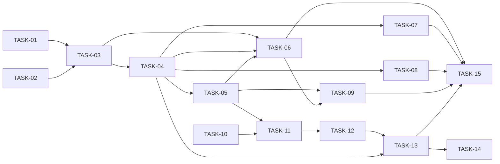

# HU-04 — Inscribir en una oferta publicada, sin duplicados — Roadmap de tareas

## Resumen
- **Fuente de verdad:** `plans/TECHNICAL_DOC-backend.md` y `plans/TECHNICAL_DOC-frontend.md` (no el PRD).
- **Tareas:** **15** (S: 0 · M: 10 · L: 5) · estimación total: **36,5 h** (API 22 h, web 14,5 h, e2e incluida).
- **Capa:** `api` 9 (TASK-01 a TASK-09: M 6 · L 3 · 22 h) · `web` 6 (TASK-10 a TASK-15, incluida la `[e2e]`: M 4 · L 2
  · 14,5 h).
- **Adversariales:** 4 (TASK-07, TASK-08, TASK-09 en API; TASK-14 en web), todas M.
- **Cobertura:** cada RF del PRD → tareas; cada CA → al menos un test; cada edge case de RF Must → test o `N/A`
  razonado (tablas de abajo). Todos los RF del PRD están cubiertos por el diseño (paso 2 sin huecos de RF; matices en
  «Coherencia PRD ↔ diseño»).
- **Tope de 15:** se usa entero, sin partir la HU ni mover alcance. Los TD suman 14 (B-01 a B-08 y W1 a W6), pero dos
  filas incumplen el gate 4 (ver «Ajustes respecto a los TD»). El plan B del TD-backend (sacar el estado borrador de la
  web, CA-26, a HU-05) **no se aplica**: lo decide el aprobador.

| ID | Título | Capa | Complejidad | Depende de | TD |
|---|---|---|---|---|---|
| TASK-01 | Migración `003`: inscripciones e historial inmutable, y aclaración de DEC-06 `[migration]` | api | M (2 h) | — | B-01 |
| TASK-02 | SEC-02: guarda de estado en el SQL de edición y borrado de ofertas, con regresión previa | api | M (1,5 h) | — | B-02 |
| TASK-03 | Puertos entre módulos, lecturas de candidatos y puerto de procesos real en `buildApp` `[setup]` | api | L (4 h) | TASK-01, TASK-02 | B-03 |
| TASK-04 | Inscribir por API (`POST /api/applications`) | api | L (3,5 h) | TASK-03 | B-04 |
| TASK-05 | Pipeline por API (`GET /api/jobs/:jobId/applications`) | api | M (2 h) | TASK-04 | B-05 |
| TASK-06 | Seed de 40 inscripciones con su historial, y rendimiento | api | L (3,5 h) | TASK-03, TASK-04, TASK-05 | B-06 |
| TASK-07 | Inscribir frente a entradas hostiles y concurrencia `[adversarial]` | api | M (2 h) | TASK-04 | B-07 (1/2) |
| TASK-08 | Inscribir frente a fallos de dependencias, y datos personales en logs y errores `[adversarial]` | api | M (2 h) | TASK-04 | B-07 (2/2) |
| TASK-09 | Pipeline e integridad de la base frente a hostiles `[adversarial]` | api | M (1,5 h) | TASK-05, TASK-06 | B-08 |
| TASK-10 | Contrato de inscripciones en la web y piezas compartidas `[setup]` | web | M (2 h) | — | W1 |
| TASK-11 | Pantalla del pipeline y enlace «Ver pipeline» | web | L (3,5 h) | TASK-05, TASK-10 | W2 (+2 tests de W5) |
| TASK-12 | Panel «Inscribir candidato» y búsqueda de candidatos | web | L (3 h) | TASK-11 | W3 |
| TASK-13 | Inscribir desde el pipeline: aviso, alertas, recarga y foco | web | M (2 h) | TASK-04, TASK-12 | W4 |
| TASK-14 | Pipeline y panel de inscribir frente a hostiles y fallos `[adversarial]` | web | M (2 h) | TASK-13 | W5 |
| TASK-15 | Recorrido e2e de inscripción `[e2e]` | web | M (2 h) | TASK-01 a TASK-09, TASK-11, TASK-13 | W6 |

## Ajustes respecto a los TD

| # | Qué | Por qué | Efecto |
|---|---|---|---|
| A-1 | B-07 (`[adversarial]` L) se parte en TASK-07 (entradas hostiles y concurrencia) y TASK-08 (fallos de dependencias y `privacy-logs`) | Gate 4: una `[adversarial]` es S o M | +1 tarea |
| A-2 | W5 (`[adversarial]` «M, ~2,5 h», en realidad L) queda en M (2 h): sus dos pruebas de la tarjeta que no son hostiles, «200 tarjetas» (EC-27, *boundary*) y «campos de más no se pintan» (EC-30), pasan a TASK-11, donde el TD ya prueba EC-27 (vacío, 1, orden) | Gate 4 sin pasar de 15. Partir W5 daría 16; la otra salida del TD (juntar W3 y W4 en una L «de ~4 h») suma 5 h con sus propias cifras | 0 tareas; TASK-11 sube a 3,5 h |
| A-3 | Ficheros de test hermanos para no pasar de 300 líneas: `applications/migration-triggers.test.ts` (TASK-01), `applications/enroll-retention.test.ts` (TASK-04), `applications/enroll-failures-adversarial.test.ts` (TASK-08), `applications/seed-invariants.test.ts` (TASK-06), `features/applications/PipelineScreen.states.test.tsx` (TASK-11) | Regla del aprobador: ≤ 300 líneas tras Prettier, tests incluidos | Sin cambio de tareas; mismos tests del TD repartidos |
| A-4 | `jobStatus?` de `buildApp` se conecta en TASK-04, no en TASK-03 | En TASK-03 no tiene consumidor (variable sin uso) | Sin cambio de tareas |
| A-5 | `applications/schemas.ts` nace en TASK-03 solo con constantes y tipos; los JSON Schema, en TASK-04 y TASK-05 | El repositorio de TASK-03 necesita los tipos | Sin cambio de tareas |
| A-6 | `fixtures.ts` de la web nace en TASK-10 solo con datos; `renderPipeline`, en TASK-11 | Necesita `PipelineScreen`, que nace en TASK-11 | Sin cambio de tareas |
| A-7 | `JobDetailScreen.actions.test.tsx` (300 líneas): constante `PUBLISHED_CONTROLS` en la línea 24 (hoy en blanco) usada en `:77` y `:215` | Con «Ver pipeline», la línea 215 mide 102 caracteres; Prettier (`printWidth` 100) la partiría y el fichero llegaría a 302. El TD solo prevé cambiar las líneas 77 y 215 | TASK-11 lista `:24`, `:77` y `:215` |
| A-8 | El estilo `.enroll-panel` va en TASK-12; `.pipeline` y `.pipeline-card`, en TASK-11 | El TD lo pone todo en W2, pero el panel nace en W3 | Sin cambio de tareas |
| A-9 | TASK-09 depende también de TASK-06 | Comprueba la base sembrada contra `INSERT` directos (RF-11) | Orden 06 → 09 |
| A-10 | `createJobStatusStub` y el espía de `db.isTransaction` nacen en TASK-03 (`apps/api/test/helpers/applications.ts`); `enroll(app, …)`, en TASK-04 | TASK-07 y TASK-08 no tocan el *helper* y pueden ir en paralelo | Sin cambio de tareas |

Balance: 14 + 1 (A-1) + 0 (A-2) = **15**.

## Fases

| Fase | Tareas | Objetivo |
|---|---|---|
| 1 · Setup | TASK-01, TASK-02, TASK-03, TASK-10 | Migración `003` con triggers y aclaración de DEC-06; SEC-02 con regresión previa; puertos y puerto de procesos real; contrato de la web, `reload` y `Notice` con `ref` |
| 2 · Núcleo API | TASK-04, TASK-05, TASK-06 | Inscribir, pipeline, seed de 40 y rendimiento |
| 3 · Pantallas | TASK-11, TASK-12, TASK-13 | Pipeline y «Ver pipeline», panel y búsqueda, inscribir |
| 4 · Adversariales y e2e | TASK-07, TASK-08, TASK-09, TASK-14, TASK-15 | Casos hostiles por RF Must (API y web) y recorrido de Playwright |

## Dependencias

**Camino crítico:** TASK-01 → 03 → 04 → 05 → 11 → 12 → 13 → 15 (2 + 4 + 3,5 + 2 + 3,5 + 3 + 2 + 2 = **22 h**).
TASK-02 (1,5 h) va en paralelo con TASK-01 y no alarga el camino; si se hacen en serie, +1,5 h. La rama de la API
(05 → 06 → 09, 5 h) acaba antes que la de las pantallas (11 → 12 → 13, 8,5 h), así que no es crítica. TASK-03 a
TASK-05 van en serie porque comparten `apps/api/src/modules/applications/` y `apps/api/src/app.ts`; TASK-11 a TASK-13,
porque comparten `PipelineScreen.tsx`.

Las pantallas dependen de la tarea de la API que crea su endpoint (regla de `/task-planner`), aunque sus tests de
Vitest simulan `fetch`.

## Orden de implementación

En el taller, una por tarea y en orden: **01, 02, 03, 04, 05, 06, 07, 08, 09, 10, 11, 12, 13, 14, 15**. Cada una
cumple sus dependencias en ese orden.

Paralelismo posible **sin compartir ficheros** (máx. 4 builders, `docs/IMPLEMENTATION-RULE.md`):
- TASK-01 ∥ TASK-02 (migración y `DECISIONS.md` frente a `jobs/repository.ts`, `jobs/service.ts` y
  `jobs/state-guards.test.ts`).
- TASK-10 (solo ficheros de `apps/web/`) en paralelo con cualquier tarea de la API.
- TASK-07 ∥ TASK-08 ∥ TASK-06: cada una crea sus propios ficheros de test (las dos adversariales no tocan el *helper*,
  A-10). Si una destapa un arreglo en `applications/service.ts`, pasan a serie.
- TASK-09 ∥ TASK-07 ∥ TASK-08 (ficheros de test distintos; misma salvedad de arreglos).
- TASK-11 a TASK-13 (web) ∥ TASK-06 a TASK-09 (API).
- TASK-14 ∥ TASK-15 (`PipelineScreen.adversarial.test.tsx` frente a `e2e/applications.spec.ts`).
- **No** en paralelo: TASK-02 y TASK-03 (`jobs/repository.ts`); TASK-03, TASK-04 y TASK-05 (`applications/` y
  `app.ts`); TASK-11, TASK-12 y TASK-13 (`PipelineScreen.tsx` y `styles.css`).

## RF Must × tarea `[adversarial]` (gate 4)

| RF (Must) | Tarea(s) `[adversarial]` | Categorías de `QUALITY-GATES.md` §3 cubiertas |
|---|---|---|
| RF-01 Inscribir por API | TASK-07, TASK-08 | Input inválido (EC-01, EC-02), boundary (EC-03), fallo de dependencia (EC-05), concurrencia (EC-06, EC-07), seguridad (EC-09, EC-10); boundary EC-04, datos corruptos EC-08 e idempotencia EC-11 en TASK-04 |
| RF-02 Persistencia | TASK-09 | Concurrencia (EC-14), datos corruptos (EC-15: FK `RESTRICT`), transiciones e INV-07/INV-10 por `INSERT` directo; input inválido (EC-12), boundary (EC-13), idempotencia (EC-16) e inmutabilidad (EC-15 triggers, CA-27) en TASK-01; fallo de dependencia y seguridad `N/A` (PRD) |
| RF-03 Puerto «estado de la oferta» | TASK-07, TASK-08 | Concurrencia (EC-19, EC-07), fallo de dependencia (EC-18); boundary (EC-17) en TASK-04; seguridad (EC-20) en TASK-03; input inválido e idempotencia `N/A` (PRD) |
| RF-04 Puerto de procesos real | TASK-08 | Fallo de dependencia (EC-22), seguridad (EC-24); boundary (EC-21) e idempotencia (EC-25) en TASK-03; datos corruptos (EC-23) en TASK-04; input inválido y concurrencia `N/A` (PRD) |
| RF-05 Pipeline por API | TASK-09 | Input inválido (EC-26), fallo de dependencia (EC-29), seguridad (EC-30, RNF-04); boundary (EC-27, EC-28) en TASK-05; concurrencia, datos corruptos e idempotencia `N/A` (PRD) |
| RF-07 Pantalla del pipeline | TASK-14 | Seguridad (EC-38, EC-39, RNF-06); input inválido (EC-35), boundary (EC-36) y fallo de dependencia (EC-37) en TASK-11; concurrencia, datos corruptos e idempotencia `N/A` (PRD) |
| RF-08 Inscribir desde la web | TASK-14 | Fallo de dependencia al inscribir (EC-42), seguridad (EC-45, RNF-05), idempotencia (EC-46, EC-11); input inválido (EC-40) y boundary (EC-41) en TASK-12; concurrencia (EC-43, EC-44) en TASK-13; datos corruptos `N/A` (PRD) |
| RF-10 «Mientras dure el proceso» | TASK-08 | Fallo de dependencia (EC-52), seguridad (EC-09); boundary (EC-51) en TASK-06; datos corruptos (EC-53) e idempotencia (EC-11) en TASK-04; concurrencia (EC-06) en TASK-07 |
| RF-11 Seed | TASK-09 | Datos corruptos: la base sembrada rechaza `INSERT` directos contra INV-04 e INV-07 (EC-55); boundary (EC-54), seguridad (EC-56) e idempotencia (EC-57) en TASK-06; input inválido, fallo de dependencia y concurrencia `N/A` (PRD) |

RF-12 es Should: no exige `[adversarial]` (CA-22 en TASK-02). Ninguna `[adversarial]` pasa de M.

## Cobertura PRD → tareas

| RF / RNF | Task(s) |
|---|---|
| RF-01 | TASK-04, TASK-07, TASK-08 (web: TASK-10, TASK-13) |
| RF-02 | TASK-01, TASK-03, TASK-09 |
| RF-03 | TASK-03, TASK-04, TASK-07, TASK-08 |
| RF-04 | TASK-03, TASK-04, TASK-08 |
| RF-05 | TASK-05, TASK-09 |
| RF-06, RF-09 | Movidos a HU-05 (DT-11) |
| RF-07 | TASK-10, TASK-11, TASK-14, TASK-15 |
| RF-08 | TASK-10, TASK-12, TASK-13, TASK-14, TASK-15 |
| RF-10 | TASK-03, TASK-04, TASK-06, TASK-08, TASK-15 |
| RF-11 | TASK-06, TASK-09 |
| RF-12 | TASK-02 |
| RF-13 | Hecho en T-04 |
| RNF-01, RNF-02 | TASK-06 |
| RNF-03 | TASK-08 |
| RNF-04 | TASK-05, TASK-09 |
| RNF-05 | TASK-12, TASK-14, TASK-15 |
| RNF-06 | TASK-11, TASK-14 |
| RNF-07 | TASK-11, TASK-12, TASK-13 |

| CA | Task(s) | CA | Task(s) |
|---|---|---|---|
| CA-01 | TASK-04 | CA-13 | TASK-05, TASK-09 |
| CA-02 | TASK-13, TASK-15 | CA-14 | TASK-05, TASK-11, TASK-15 |
| CA-03 | TASK-07 (API), TASK-13 (web) | CA-15 | TASK-05, TASK-11 |
| CA-04, CA-05 | TASK-04 | CA-16 | TASK-11 |
| CA-06 | TASK-04 | CA-17, CA-18 | Movidos a HU-05 |
| CA-07 | TASK-07 | CA-19 | TASK-04 (API), TASK-15; `CandidateDetailScreen.test.tsx:183` (existente) |
| CA-08 | TASK-13, TASK-15 | CA-20, CA-21 | TASK-03 |
| CA-09 | TASK-04, TASK-08 | CA-22 | TASK-02 |
| CA-10 | TASK-07 | CA-23, CA-24 | Hechos en T-04 |
| CA-11 | TASK-08 | CA-25 | TASK-06 |
| CA-12 | TASK-05, TASK-11 | CA-26 | TASK-05 (API), TASK-11, TASK-15 |
| | | CA-27 | TASK-01 |

| Edge case | Task(s) | Edge case | Task(s) |
|---|---|---|---|
| EC-01, EC-02 | TASK-07 (API), TASK-10, TASK-14 (web) | EC-26 | TASK-09 (API), TASK-11 (web) |
| EC-03 | TASK-07 | EC-27 | TASK-05, TASK-11 |
| EC-04 | TASK-04 | EC-28 | TASK-05, TASK-11, TASK-15 |
| EC-05 | TASK-08, TASK-14 (web) | EC-29 | TASK-09, TASK-11 (web) |
| EC-06 | TASK-07, TASK-14 (1 `POST`) | EC-30 | TASK-09, TASK-11 (web) |
| EC-07 | TASK-07, TASK-13 (web) | EC-31 a EC-34 | Movidos a HU-05 |
| EC-08 | TASK-04 | EC-35, EC-36 | TASK-11 |
| EC-09 | TASK-08 | EC-37 | TASK-10, TASK-11 |
| EC-10 | TASK-07, TASK-14 (web) | EC-38 | TASK-14 |
| EC-11 | TASK-04, TASK-14 (web) | EC-39 | TASK-11, TASK-14, TASK-15 |
| EC-12, EC-13 | TASK-01 | EC-40, EC-41 | TASK-12 |
| EC-14 | TASK-09 | EC-42 | TASK-12 (buscar), TASK-14 (inscribir) |
| EC-15 | TASK-01 (triggers), TASK-09 (FK) | EC-43, EC-44 | TASK-13 |
| EC-16 | TASK-01 | EC-45 | TASK-14, TASK-15 |
| EC-17 | TASK-04 | EC-46 | TASK-14 |
| EC-18 | TASK-08 | EC-47 a EC-50 | Movidos a HU-05 |
| EC-19 | TASK-07 | EC-51 | TASK-06 |
| EC-20 | TASK-03 | EC-52 | TASK-08 |
| EC-21 | TASK-03 | EC-53 | TASK-04 |
| EC-22 | TASK-08 | EC-54, EC-56, EC-57 | TASK-06 |
| EC-23 | TASK-04 | EC-55 | TASK-06, TASK-09 |
| EC-24 | TASK-08 | | |
| EC-25 | TASK-03 | | |

## Coherencia PRD ↔ diseño (paso 2)

Ningún RF del PRD queda sin cubrir en los TD. Matices para la validación:
1. **RF-02 y CA-27** dicen que los triggers abortan «`UPDATE` y `DELETE`» sobre `StageChange`; el TD (DD-04, decisión
   del responsable técnico, RGPD §5) deja pasar `UPDATE stage_changes SET note = NULL`. El PRD no recoge la excepción: TASK-01 prueba
   CA-27 con un `UPDATE` distinto de vaciar la nota. Conviene anotarlo en el PRD o en `/module-sync`.
2. **CA-15** pide que la web muestre «el estado de error» con un 404; el TD-frontend (DD-09) muestra «Página no
   encontrada» (como EC-35). Es decisión de diseño sin Open Decision; se implementa así.
3. **Modelo de datos del PRD:** sugería un índice del pipeline con `stage` y otro por `candidate_id`; el TD decide
   `(job_id, last_change_at DESC, id DESC)` y reutiliza el único `(candidate_id, job_id)`. El PRD lo dejaba al diseño.
4. **TD-frontend, riesgo de `JobDetailScreen.actions.test.tsx`:** «solo cambian 2 asserts en sus líneas» no basta para
   mantener 300 líneas (A-7).

## Riesgos

| Riesgo | Origen | Mitigación |
|---|---|---|
| **Sin margen en el tope de 15.** TASK-03 está en 4 h y TASK-04, TASK-06 y TASK-11 en 3,5 h. Si una se pasa y hay que partirla, la HU pasaría a 16 | Este plan y los dos TD | Si ocurre, **se para y se escala** al aprobador. El plan B del TD-backend (estado borrador del pipeline web, CA-26 y EC-28 en web, a HU-05) lo decide el aprobador; no se aplica aquí. Un arreglo de la review va dentro de la tarea existente |
| TASK-14 en 2 h justas (A-2) | TD-frontend (W5 «~2,5 h») | Los dos casos no hostiles ya van en TASK-11; si aun así se pasa, se para y se escala |
| SEC-02 toca código de ofertas en producción | TD-backend (DD-09) | TASK-02: regresión de las respuestas de ofertas escrita y en verde **antes** de tocar el SQL, y en verde después sin tocarla; el resto de `apps/api/test/jobs/` no se toca |
| Ventana de INV-05 hasta HU-05: cerrar una oferta deja inscripciones abiertas | TD-backend (DT-10), prob. 4, imp. 2 | Aceptada; ningún test cierra ofertas con inscripciones; `npm run db:reset` tras el merge de HU-05 |
| Seed con fechas fijas (ofertas) y relativas (candidatos): con un reset posterior a ~2026-12-26, altas de los candidatos 25-29 después de sus inscripciones en las cerradas | TD-backend (DD-10), prob. 2, imp. 2 | No rompe INV-04..07 ni la retención; los tests del seed usan `NOW` fijo |
| `CHECK` con `=` en lugar de `IS` dejaría pasar `(NULL, screening)` | TD-backend, prob. 2, imp. 4 | Fijado en la migración y en EC-13 (TASK-01) |
| `isDuplicatePairError` depende del texto de SQLite | TD-backend (DD-03), prob. 2, imp. 3 | `errcode === 2067` y los tests de CA-06 (TASK-04) y CA-07 (TASK-07) |
| Formas de puerto duplicadas (DD-01) desfasadas | TD-backend, prob. 2, imp. 2 | `app.ts` las asigna a los tipos de los puertos: un desfase no compila; `module-boundaries.test.ts` (TASK-03) |
| `reload()` cambia `useResource`, que usan `jobs` y `candidates` | TD-frontend, prob. 2, imp. 3 | Método nuevo, sin tocar `retry` ni `setData`; suites de `jobs` y `candidates` en verde sin tocarlas (TASK-10) |
| Foco movido por efectos intermitente | TD-frontend, prob. 3, imp. 2 | `expectFocusOn` en todas las aserciones de foco (TASK-11 a TASK-14) |
| Ficheros de más de 300 líneas | Regla del aprobador | Hermanos previstos (A-3, A-7) y criterio de done con `wc -l` tras Prettier en cada tarea |
| e2e sobre la base compartida | TD-frontend, prob. 2, imp. 2 | Datos propios con *token* único; la `closed` por `GET /api/jobs?status=closed`, sin IDs fijos; `tsconfig` de `e2e/` sin `dom` |
| Tests de rendimiento inestables en portátiles lentos | Este plan | Varias repeticiones y el peor caso contra el umbral, como `apps/api/test/jobs/performance.test.ts` |

## Nota · review ronda 1 (2026-10-07)
- Los matices 1 y 2 de «Coherencia PRD ↔ diseño» quedaron resueltos en el PRD v1.1 (DT-12 y CA-15).
- Reparto real de los tests (A-3): EC-08, EC-23 y EC-53 están en `apps/api/test/applications/enroll-retention.test.ts`;
  EC-05, EC-18, EC-22, EC-52 y CA-11, en `apps/api/test/applications/enroll-failures-adversarial.test.ts`; EC-15,
  CA-27 y la excepción RGPD §5, en `apps/api/test/applications/migration-triggers.test.ts`; EC-51, en
  `apps/api/test/applications/seed-invariants.test.ts`. Los TD citan el fichero previsto antes del reparto.
