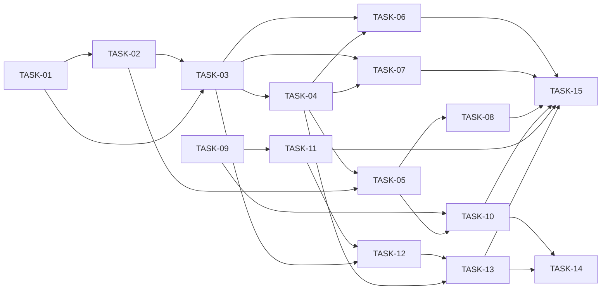

# HU-05 — Pipeline con cambio de etapa e historial — Roadmap de tareas

## Resumen
- **Fuente de verdad:** `plans/TECHNICAL_DOC-backend.md` y `plans/TECHNICAL_DOC-frontend.md` (no el PRD; PRD v1.2 para
  los RF Must y la cobertura).
- **Tareas:** **15** (S: 0 · M: 9 · L: 6) · estimación total: **36 h** (API 18 h, web 18 h, e2e incluida).
- **Capa:** `api` 8 (TASK-01 a TASK-08: M 6 · L 2 · 18 h) · `web` 7 (TASK-09 a TASK-15, incluida la `[e2e]`: M 3 · L 4
  · 18 h).
- **Adversariales:** 4 (TASK-06, TASK-07 y TASK-08 en API; TASK-14 en web), todas M.
- **Cobertura:** cada RF del PRD → tareas; cada CA → al menos un test; cada edge case de RF Must → test o `N/A` del PRD
  (tablas de abajo). Ningún RF del PRD queda sin cubrir en los TD (paso 2; matices en «Coherencia PRD ↔ diseño»).
- **Tope de 15 (decisión del aprobador, QUALITY-GATES §2):** se usa entero. Los TD suman 14 (B-01 a B-07 y W1 a W7);
  B-06 incumple el gate 4 y se parte (A-1). No se funde ninguna tarea para ganar margen.

| ID | Título | Capa | Complejidad | Depende de | TD |
|---|---|---|---|---|---|
| TASK-01 | RF-09: casos de uso como funciones de módulo, reglas de transición puras y `stageMismatch` `[refactor]` `[setup]` | api | M (2 h) | — | B-01 |
| TASK-02 | Lecturas, guarda de la escritura y `getJobSummary` en el puerto de ofertas `[setup]` | api | M (2 h) | TASK-01 | B-02 |
| TASK-03 | Avanzar por API (`POST /api/applications/:id/advance`) | api | L (3,5 h) | TASK-01, TASK-02 | B-03 |
| TASK-04 | Rechazar por API (`POST /api/applications/:id/reject`) | api | L (3 h) | TASK-03 | B-04 |
| TASK-05 | Detalle de la inscripción por API (`GET /api/applications/:id`) y rendimiento | api | M (2 h) | TASK-02, TASK-04 | B-05 |
| TASK-06 | Avanzar y rechazar frente a entradas hostiles y concurrencia `[adversarial]` | api | M (2 h) | TASK-03, TASK-04 | B-06 (1/2) |
| TASK-07 | Avanzar y rechazar frente a fallos de escritura y a la etapa desfasada `[adversarial]` | api | M (1,5 h) | TASK-03, TASK-04 | B-06 (2/2) |
| TASK-08 | Datos personales en logs y errores, y detalle frente a hostiles y fallos `[adversarial]` | api | M (2 h) | TASK-03, TASK-04, TASK-05 | B-07 |
| TASK-09 | Contrato de etapas en la web y piezas puras `[setup]` | web | L (2,5 h) | — | W1 |
| TASK-10 | Pantalla de detalle de la inscripción (`/applications/:id`) | web | M (2 h) | TASK-09, TASK-05 | W2 |
| TASK-11 | Enlaces al detalle y «Ver pipeline» en una oferta cerrada | web | M (2 h) | TASK-09 | W3 |
| TASK-12 | Avanzar y contratar desde las tarjetas del pipeline | web | L (3,5 h) | TASK-09, TASK-11, TASK-03 | W4 |
| TASK-13 | Rechazar desde el pipeline: diálogo con motivo y nota | web | L (3 h) | TASK-12, TASK-04 | W5 |
| TASK-14 | Pipeline y detalle frente a hostiles, dobles envíos y fugas en el navegador `[adversarial]` | web | M (2 h) | TASK-10, TASK-13 | W6 |
| TASK-15 | Recorridos e2e de etapas, detalle y oferta cerrada `[e2e]` | web | L (3 h) | TASK-01 a TASK-08, TASK-10, TASK-11, TASK-13 | W7 |

## Ajustes respecto a los TD

| # | Qué | Por qué | Efecto |
|---|---|---|---|
| A-1 | B-06 (`[adversarial]` L) se parte en TASK-06 (entradas hostiles y concurrencia: `stage-change-adversarial.test.ts`) y TASK-07 (fallos inyectados y DD-02: `stage-change-failures-adversarial.test.ts`) | Gate 4: una `[adversarial]` es S o M. Los dos ficheros ya eran distintos en el TD | **+1 tarea → 15** |
| A-2 | W6 (`[adversarial]` «M, ~2,5 h», en realidad L) queda en M (2 h): «salir de la pantalla con la petición en vuelo» pasa a TASK-12 (dueña de `useLifetimeSignal`) y «`note` en un cambio no final o `reason` en uno no rechazado» (EC-45) a `api.stage.test.ts` de TASK-09 (dueña de `isApplicationDetail`) | Gate 4 sin pasar de 15: partir W6 daría 16 | 0 tareas; TASK-09 a 2,5 h |
| A-3 | W1 «M, ~2,5 h» se declara **L** (2,5 h) | M es 1–2 h; L no está prohibida en una `[setup]` | 0 tareas |
| A-4 | `e2e/jobs-lifecycle.spec.ts:160` y `:246` pasan de W7 a **TASK-11** | TASK-11 cambia la ficha de una cerrada y el paso de integración ejecuta ese spec (`docs/IMPLEMENTATION-RULE.md` R2.4): con el TD quedaría en rojo de TASK-11 a TASK-15 | 0 tareas |
| A-5 | Ficheros hermanos para no pasar de 300 líneas tras Prettier (regla del aprobador): `apps/api/test/applications/advance-hire.test.ts` (TASK-03), `apps/api/test/applications/reject-note.test.ts` (TASK-04), `apps/web/test/features/applications/PipelineScreen.hire.test.tsx` (TASK-12), `apps/web/test/features/applications/PipelineScreen.reject-form.test.tsx` (TASK-13), `e2e/pipeline-closed.spec.ts` (TASK-15). Los del TD se mantienen (`JobDetailScreen.closed.test.tsx`, `api.stage.test.ts`) | El TD estima `advance` en ~270, `reject` en ~280 y `pipeline-stages.spec.ts` en ~260 líneas en el web; los de API acumulan 10-13 tests cada uno | 0 tareas; mismos tests del TD repartidos |
| A-6 | `schemas.ts` recibe en TASK-02 **solo tipos** (`StageChangeEntry`, `ManualRejectionReason`, `RejectionReason`); los JSON Schema, en TASK-03 a TASK-05 | `listHistory` (TASK-02) devuelve `StageChangeEntry` | TASK-02 y TASK-03 comparten `schemas.ts` (ya iban en serie) |
| A-7 | `stage-fixtures.ts` nace en TASK-09 solo con datos; `renderDetail`, en TASK-10 | Necesita `ApplicationDetailScreen`, que nace en TASK-10 (como A-6 de HU-04) | 0 tareas |
| A-8 | Los 3 tests de DT-09 con «HU-06 lo revisa» (decisión 3 del aprobador): CA-39 (avance) en TASK-03, con el espía vacío como aserto; rechazo de una activa de una `closed` y «ni advance ni reject llaman al puerto de estado» en TASK-04 | El TD ponía el espía en B-03, pero su nombre cubre los dos endpoints | 0 tareas |
| A-9 | `JobDetailScreen.states.test.tsx`: además de `:82`, `:105` y `:141` (TD), cambian `:88` (bucle sin `CLOSED`) y el título de `:95` («… y solo «Duplicar»») | El título dejaría de describir el test | 0 tareas |
| A-10 | DD-02 (`findById` desfasado) se prueba componiendo `createApplicationsService` con un repositorio real envuelto, sin pasar por `buildApp` | `buildApp` no admite repositorio inyectado y `app.ts` no cambia en la HU | 0 tareas |

Balance: 14 + 1 (A-1) = **15**. Si otra tarea tuviera que partirse, la HU pasaría a 16: **se para y se escala** (ver
«Riesgos»).

## Fases

| Fase | Tareas | Objetivo |
|---|---|---|
| 1 · Setup | TASK-01, TASK-02, TASK-09 | RF-09 y reglas puras; lecturas, guarda y `getJobSummary`; contrato de la web y `ConfirmDialog` |
| 2 · Núcleo API | TASK-03, TASK-04, TASK-05 | Avanzar, rechazar, detalle y rendimiento |
| 3 · Pantallas | TASK-10, TASK-11, TASK-12, TASK-13 | Detalle, enlaces y cerrada, avanzar y contratar, rechazar |
| 4 · Adversariales y e2e | TASK-06, TASK-07, TASK-08, TASK-14, TASK-15 | Casos hostiles por RF Must (API y web) y recorridos de Playwright |

## Dependencias

**Camino crítico** (con paralelismo): TASK-01 → 02 → 03 → 04 → 05 → 08 → 15 (2 + 2 + 3,5 + 3 + 2 + 2 + 3 = **17,5 h**).
La rama de las pantallas (01 → 02 → 03 → 12 → 13 → 15: 17 h) va a 0,5 h: casi crítica. TASK-09 y TASK-11 (4,5 h)
acaban antes de que TASK-12 pueda empezar (necesita TASK-03, a las 7,5 h). En el taller, en serie: **36 h**.

TASK-01 a TASK-05 van en serie porque comparten `applications/{service,schemas,routes}.ts`; TASK-11 a TASK-13, porque
comparten `PipelineBoard.tsx`, `PipelineScreen.tsx`, `StageDialogs.tsx` y `use-stage-actions.ts`. Las pantallas dependen
de la tarea de la API que crea su endpoint, aunque sus tests de Vitest simulan `fetch`.

## Orden de implementación

En el taller, una por tarea y en orden: **01, 02, 03, 04, 05, 06, 07, 08, 09, 10, 11, 12, 13, 14, 15**. Cada una cumple
sus dependencias en ese orden.

Paralelismo posible **sin compartir ficheros** (máx. 4 builders, `docs/IMPLEMENTATION-RULE.md` R4.1):
- **TASK-09** (solo `apps/web/`) ∥ cualquier tarea de la API (TASK-01 a TASK-08).
- **TASK-11** (tras TASK-09; `apps/web/` y `e2e/jobs-lifecycle.spec.ts`) ∥ TASK-01 a TASK-08.
- **TASK-06 ∥ TASK-07 ∥ TASK-08**: cada una crea sus propios ficheros de test y no toca el *helper* (nace completo en
  TASK-02). Si una destapa un arreglo en `applications/service.ts`, pasan a serie.
- **TASK-10 ∥ TASK-11** y **TASK-10 ∥ TASK-13** (ficheros distintos).
- **TASK-14 ∥ TASK-15** (tests de Vitest frente a `e2e/`; misma salvedad de arreglos en producción).
- **No** en paralelo: TASK-01, 03, 04 y 05 (`service.ts`); TASK-02 a TASK-05 (`schemas.ts`); TASK-11 → 12 → 13
  (`PipelineBoard.tsx`, `PipelineScreen.tsx`, `StageDialogs.tsx`, `use-stage-actions.ts`); TASK-10 y TASK-12
  (`styles.css`).

## RF Must × tarea `[adversarial]` (gate 4)

| RF (Must) | Tarea(s) `[adversarial]` | Categorías de `QUALITY-GATES.md` §3 cubiertas |
|---|---|---|
| RF-01 Avanzar por API | TASK-06, TASK-07, TASK-08 | Input inválido (EC-01, EC-02) y concurrencia (EC-06) en TASK-06; fallo de dependencia (EC-05, CA-11) y guarda DD-02 en TASK-07; seguridad (EC-09: 403 en TASK-06, logs y cuerpos en TASK-08). Boundary (EC-03, EC-04), datos corruptos (EC-08, CA-39) e idempotencia (EC-10) en TASK-03 |
| RF-02 Rechazar por API | TASK-06, TASK-07, TASK-08 | Input inválido (EC-11, EC-12), concurrencia (EC-15) y seguridad (EC-17) en TASK-06; fallo de dependencia (EC-14, CA-20) en TASK-07; seguridad (CA-21, RNF-04) en TASK-08. Boundary (EC-13), datos corruptos (EC-16) e idempotencia (EC-18) en TASK-04 |
| RF-03 Detalle por API | TASK-08 | Input inválido (EC-19), fallo de dependencia (EC-21), datos corruptos (EC-22: 500 sin inventar), seguridad (EC-23). Boundary (EC-20) y EC-22 `job_closed` en TASK-05; concurrencia e idempotencia `N/A` (PRD) |
| RF-05 Acciones en las tarjetas | TASK-14 | Seguridad (EC-34), idempotencia (EC-35, EC-10 en la web), input inválido y seguridad de la respuesta (EC-01, EC-09: 400, 403, forma). Boundary (EC-31), fallo de dependencia (EC-32) y concurrencia (EC-33) en TASK-12; datos corruptos `N/A` (PRD) |
| RF-06 Formulario de rechazo | TASK-14 | Seguridad (EC-40, RNF-06), idempotencia (EC-41). Input inválido (EC-36), boundary (EC-37), fallo de dependencia (EC-38) y concurrencia (EC-39) en TASK-13; datos corruptos `N/A` (PRD) |
| RF-07 Detalle en la web y enlaces | TASK-14 | Seguridad (EC-46, EC-23 en la web, RNF-07). Input inválido (EC-42), boundary (EC-43), fallo de dependencia (EC-44) y datos corruptos (EC-45) en TASK-10 y TASK-09; concurrencia e idempotencia `N/A` (PRD) |
| RF-08 Cerrada en solo lectura | TASK-14 | Concurrencia (EC-48). Boundary (EC-47) y datos corruptos (EC-49) en TASK-11; seguridad (EC-50) en TASK-15; input inválido, fallo de dependencia e idempotencia `N/A` (PRD) |

RF-09 es Should: no exige `[adversarial]` (CA-38 en TASK-01 y en la review). Ninguna `[adversarial]` pasa de M.

## Cobertura PRD → tareas

| RF / RNF | Task(s) |
|---|---|
| RF-01 | TASK-01, TASK-02, TASK-03, TASK-06, TASK-07, TASK-08, TASK-15 |
| RF-02 | TASK-01, TASK-02, TASK-04, TASK-06, TASK-07, TASK-08, TASK-15 |
| RF-03 | TASK-02, TASK-05, TASK-08, TASK-15 |
| RF-04 | Movido a HU-06 (DT-01) |
| RF-05 | TASK-09, TASK-12, TASK-14, TASK-15 |
| RF-06 | TASK-09, TASK-13, TASK-14, TASK-15 |
| RF-07 | TASK-09, TASK-10, TASK-11, TASK-14, TASK-15 |
| RF-08 | TASK-11, TASK-12 (`actions` solo en `published`), TASK-14, TASK-15 |
| RF-09 | TASK-01 (factoría), TASK-02 (DP-02); ≤ 300 líneas y ≤ 50 por función en el *done* de todas |
| RNF-01, RNF-02 | TASK-05 |
| RNF-03 | Movido a HU-06 (DT-01) |
| RNF-04 | TASK-08 |
| RNF-05 | TASK-03, TASK-04 (6 campos), TASK-05 (nota solo en el detalle), TASK-08 |
| RNF-06 | TASK-10 (título), TASK-13, TASK-14, TASK-15 |
| RNF-07 | TASK-14 |
| RNF-08 | TASK-10 (`ol`), TASK-12 (nombres y foco al aviso), TASK-13 (`label`, `legend`, foco al cancelar) |

| CA | Task(s) | CA | Task(s) |
|---|---|---|---|
| CA-01 | TASK-03 | CA-21 | TASK-08 |
| CA-02 | TASK-12, TASK-15 | CA-22 | TASK-11 (enlaces), TASK-12 (acciones) |
| CA-03 | TASK-03 | CA-23 | TASK-11, TASK-15 |
| CA-04, CA-05 | TASK-03 (`advance-hire.test.ts`) | CA-24 | TASK-05, TASK-10, TASK-15 |
| CA-06, CA-07 | TASK-03 | CA-25 | TASK-05, TASK-10 |
| CA-08 | TASK-01 (unitario), TASK-03 | CA-26 | TASK-05, TASK-10, TASK-15 |
| CA-09 | TASK-06 | CA-27 | TASK-05, TASK-10, TASK-15 |
| CA-10 | TASK-03 | CA-28 | TASK-10 |
| CA-11 | TASK-07 | CA-29 a CA-35 | Movidos a HU-06 |
| CA-12 | TASK-04 | CA-36 | TASK-11, TASK-15 |
| CA-13 | TASK-13, TASK-15 | CA-37 | TASK-02, TASK-05 |
| CA-14, CA-15 | TASK-04 | CA-38 | TASK-01 (factoría); review (umbrales) |
| CA-16 | TASK-04 (`reject-note.test.ts`) | CA-39 | TASK-03 (avance), TASK-04 (rechazo y espía) |
| CA-17 a CA-19 | TASK-04 | CA-40 | TASK-12, TASK-15 |
| CA-20 | TASK-07 | | |

| Edge case | Task(s) | Edge case | Task(s) |
|---|---|---|---|
| EC-01 | TASK-06 (API), TASK-09, TASK-14 (web) | EC-31 a EC-33 | TASK-12 |
| EC-02 | TASK-06, TASK-09 | EC-34, EC-35 | TASK-14 |
| EC-03 | TASK-03, TASK-15 | EC-36, EC-37 | TASK-09, TASK-13 |
| EC-04 | TASK-01, TASK-03, TASK-09 (`nextStage`) | EC-38, EC-39 | TASK-13 |
| EC-05 | TASK-07, TASK-12 (web) | EC-40 | TASK-14, TASK-15 |
| EC-06 | TASK-06, TASK-12 (web) | EC-41 | TASK-14 |
| EC-07 | Movido a HU-06 | EC-42 | TASK-10 |
| EC-08 | TASK-03, TASK-04 (DT-09) | EC-43 | TASK-10, TASK-11 |
| EC-09 | TASK-06 (403), TASK-08 (logs), TASK-14 (web) | EC-44 | TASK-10 |
| EC-10 | TASK-03, TASK-14 (web) | EC-45 | TASK-09, TASK-10 |
| EC-11 | TASK-04, TASK-06, TASK-09 | EC-46 | TASK-14 |
| EC-12 | TASK-06, TASK-09, TASK-13 | EC-47 | TASK-11; `PipelineScreen.states.test.tsx:79` (existente) |
| EC-13 | TASK-04, TASK-09 | EC-48 | TASK-14 |
| EC-14 | TASK-07, TASK-13 (web) | EC-49 | TASK-11 |
| EC-15 | TASK-06 | EC-50 | TASK-15 |
| EC-16 | TASK-04 | EC-24 a EC-30 | Movidos a HU-06 |
| EC-17 | TASK-06 (API), TASK-14 (EC-46 en la web) | | |
| EC-18 | TASK-04 | | |
| EC-19 | TASK-08 | | |
| EC-20 | TASK-02, TASK-05, TASK-10 | | |
| EC-21 | TASK-08 | | |
| EC-22 | TASK-05 (`job_closed`), TASK-08 (500), TASK-10 | | |
| EC-23 | TASK-08, TASK-14 | | |

## Tests de HU-04 que cambian (`fichero:línea`)

| Fichero | Líneas | Tarea | Cambio |
|---|---|---|---|
| `apps/api/test/applications/privacy-logs.test.ts` | 43 | TASK-02 | El literal `statusPort` implementa también `getJobSummary` |
| `apps/api/test/applications/ports.test.ts` | 192 (`describe`) | TASK-02 | Test nuevo del lector real `getJobSummary` |
| `apps/api/test/applications/performance.test.ts` | 115 (`describe`) | TASK-05 | RNF-01 y RNF-02 nuevos |
| `apps/web/test/features/applications/PipelineScreen.test.tsx` | 59, 63, 64, 66-68 y 133-147 | TASK-11 | De `card.textContent` a los `
` de la tarjeta; la lista de `link` incluye los nombres; el título deja de decir «sin link» |
| `apps/web/test/features/jobs/JobDetailScreen.states.test.tsx` | 82-93 (88), 95, 105 y 141 | TASK-11 | «Ver pipeline» ausente solo en `draft`; `['Ver pipeline', 'Duplicar']` en `closed` |
| `e2e/jobs-lifecycle.spec.ts` | 160 y 246 | TASK-11 (A-4) | `['Ver pipeline', 'Duplicar']` |
| `e2e/applications.spec.ts` | 8-59 (helpers), 126 y 144 | TASK-15 | Helpers a `e2e/support/applications.ts`; el test de CA-08 pasa a CA-36 (enlace «Ver la inscripción» → detalle) |
| `apps/web/test/features/jobs/JobDetailScreen.actions.test.tsx` | — | — | No se toca (300 líneas); sus tests nuevos van a `JobDetailScreen.closed.test.tsx` |
| `apps/web/test/features/applications/PipelineScreen.enroll.test.tsx` | 126 | — | No se toca: su 409 no trae `existingId` y sigue sin enlace (cubre también EC-43) |

## Coherencia PRD ↔ diseño (paso 2)

Ningún RF del PRD queda sin cubrir en los TD (RF-04, RNF-03, CA-29 a CA-35, EC-07 y EC-24 a EC-30 están en HU-06 por
DT-01). Matices para la validación:
1. **Versión citada:** los dos TD dicen «PRD v1.1», pero ya incorporan lo de v1.2 (DT-12 = DD-10, DT-13 = DD-05).
   Cosmético.
2. **RN-23 / RV-23:** DT-13 del PRD cita «RN-23»; el resto del PRD y los TD, «RV-23». Se toma como errata: los tests
   se llaman «RV-23 (DT-13) …».
3. **TD-frontend, W7:** pone `e2e/jobs-lifecycle.spec.ts:160` y `:246` en la última tarea, lo que dejaría el spec en
   rojo desde W3 (A-4).
4. **Tamaños del TD-frontend:** W1 y W6 dicen «M, ~2,5 h» (M es 1–2 h) (A-2, A-3); el TD-backend marca B-06
   `[adversarial]` como L (A-1). Con los tres ajustes, los TD dejan de sumar 14 y pasan a 15.
5. **`JobDetailScreen.states.test.tsx`:** el TD lista `:82`, `:105` y `:141`; también cambian `:88` y el título de `:95`
   (A-9).
6. **`PipelineScreen.enroll.test.tsx:126`** («DUPLICATE … sin link») no lo lista el TD y no necesita cambio (sin
   `existingId`); su título queda correcto para EC-43.

## Riesgos

| Riesgo | Origen | Mitigación |
|---|---|---|
| **Sin margen en el tope de 15.** TASK-03 y TASK-12 están en 3,5 h; TASK-14 en 2 h justas (A-2). Si una se pasa y hay que partirla, la HU pasaría a 16 | Este plan y los dos TD | **Se para y se escala** al aprobador. Las salidas que dan los TD (fundir W2 y W3 en una L de ~4 h, o B-01 con B-02) las decide el aprobador; no se aplican aquí. Un arreglo de la review va dentro de la tarea existente |
| DT-09: la API avanza y rechaza inscripciones de ofertas cerradas hasta HU-06 | TD-backend (DD-03), prob. 3, imp. 2 | Los 3 tests con «HU-06 lo revisa» en el nombre (TASK-03, TASK-04); la web no ofrece acciones en `closed` (TASK-11, TASK-12) |
| Ventana de INV-05 abierta: ningún test puede cerrar ofertas con inscripciones activas | HU-04 (DT-10) | CA-39 con la oferta cerrada vacía + `insertApplicationAt` (DD-09); e2e solo lee la `closed` del seed |
| `service.ts` pasa de 300 líneas | TD-backend, prob. 2, imp. 2 | Previsto ~210; si no, `advance`/`reject` a `stage-change.ts` (DD-06), dentro de TASK-05 |
| Dobles del puerto desfasados al añadir `getJobSummary` | TD-backend (DD-04), prob. 2, imp. 1 | `app.ts` y el tipado de los dobles fallan al compilar; TASK-02 los cambia todos (`privacy-logs.test.ts:43`) |
| Foco movido por efectos intermitente (orden `ConfirmDialog` → `usePipelineFeedback`) | TD-frontend, prob. 2, imp. 3 | `expectFocusOn` en todos los asertos; si fallara, `useLayoutEffect` (DD-10 de HU-04) |
| `ConfirmDialog` es compartido (cerrar y borrar oferta) | TD-frontend, prob. 2, imp. 3 | Solo `description` opcional, con su test; `npm test -w @ats/web -- features/jobs` en el *done* de TASK-09 |
| Los botones nuevos de las tarjetas rompen asertos de HU-04 (`card.textContent`) | TD-frontend, prob. 4, imp. 2 | TASK-11 deja esos asertos por `
` antes de que TASK-12 añada los botones |
| `PipelineScreen.tsx` hacia ~195 líneas y `PipelineLoader` hacia 50 | TD-frontend, prob. 2, imp. 2 | La lógica vive en `use-stage-actions.ts`; criterio ≤ 50 por función en TASK-12 y TASK-13 |
| e2e sobre la base compartida: contratar cambia la retención | TD-frontend, prob. 2, imp. 2 | Oferta y candidato propios con *token* único; la `closed` del seed solo se lee |
| Reloj que retrocede (`now()` < `created_at`) | TD-backend, prob. 1, imp. 2 | Aceptado: relojes de test que solo avanzan |
| Tests de rendimiento inestables en portátiles lentos | Este plan | Varias repeticiones y el peor caso contra el umbral (TASK-05) |
| Ficheros de más de 300 líneas | Regla del aprobador | Hermanos previstos (A-5) y `wc -l` tras Prettier en el *done* de cada tarea |
