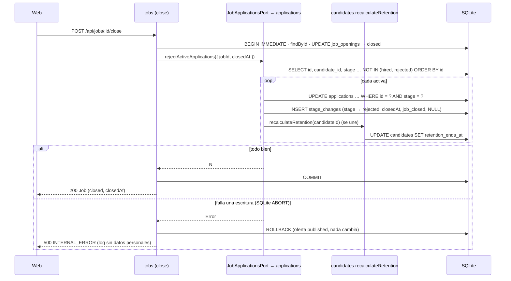
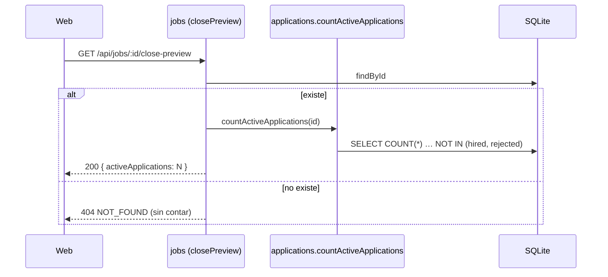
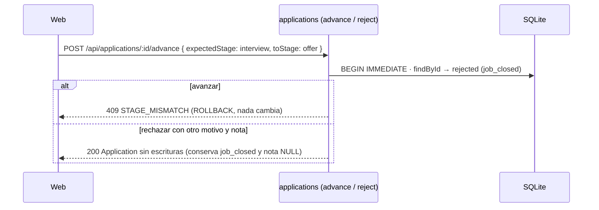

# HU-06 — Cerrar una oferta con inscripciones activas — Diseño técnico (backend)

- **Origen:** `specs/PRD.md` (estado Ready, v1.1, 2026-10-07; mandan DT-01 a DT-05)
- **Generado por:** backend-architect
- **Scope cubierto:** RF-01, RF-02, RF-03, RF-04 y la parte API de RF-06. RF-05 (diálogo y e2e) y la parte web de
  RF-06 son del TD-frontend, que consume el contrato de este documento **sin cambios**.

## Enfoque técnico

`jobs` ya hace todo lo suyo: `close` (`apps/api/src/modules/jobs/service.ts:127-138`) invoca
`rejectActiveApplications` dentro de su `BEGIN IMMEDIATE`, después del `UPDATE` y solo en la transición real, y
`closePreview` llama a `countActiveApplications`. **La HU no toca `jobs` salvo comentarios**: aporta la implementación
real del puerto en `applications` y la conecta en `apps/api/src/app.ts`. **Sin migración** y sin cambios de contrato HTTP.

1. **Repositorio** (`applications/repository.ts`): dos consultas nuevas con columnas explícitas, `countActiveByJob`
   (`COUNT(*)`) y `listActiveByJob` (`id, candidate_id, stage`). La escritura reutiliza `updateStage` (guarda de la
   etapa en el `WHERE`) e `insertStageChange`.
2. **Casos de uso** (`applications/job-closing.ts`, nuevo): `countActiveApplications(deps, jobId)` y
   `rejectActiveApplications(deps, { jobId, closedAt })` como funciones de módulo, igual que `enroll` o `advance`
   (patrón de HU-05). Por cada activa, en orden de `id`: `UPDATE` con guarda → `StageChange` (`job_closed`, nota
   `null`, `changed_at = closedAt`) → `recalculateRetention(candidateId)`. `createApplicationsService` las expone en dos
   líneas; la del rechazo va envuelta en `deps.transaction`, que **se une** a la del cierre (DEC-11.7).
3. **Composición** (`app.ts`): `buildApp` mide hoy 61 líneas (`app.ts:57-117`) y esta HU lo modifica, así que se
   extrae `composeServices` (DD-06). `applications` se crea antes que `jobs` y el puerto se conecta con un objeto de
   dos lambdas tipado como `JobApplicationsPort` (la asignación comprueba la forma, DEC-06).
4. **DT-01:** avanzar y rechazar no cambian. Solo se renombran tres tests y se añaden los de invariante INV-05.

**Alternativa principal descartada:** rechazo en bloque (`INSERT INTO stage_changes … SELECT … FROM applications` +
`UPDATE … WHERE job_id = ? AND stage NOT IN (…)`). Dos sentencias en vez de 2N, pero pierde la guarda por fila que pide
RF-01, necesita un tercer paso para saber a quién recalcular y deja a `recalculateRetention` fuera del bucle (DD-02).

## Módulos y ficheros afectados

| Módulo | Fichero | Cambio |
|---|---|---|
| applications | `apps/api/src/modules/applications/job-closing.ts` | **nuevo** (~55 líneas): `JobClosingDeps`, `countActiveApplications`, `rejectActiveApplications` |
| applications | `apps/api/src/modules/applications/repository.ts` | modificar (203 → ~235): `ActiveApplicationRow`, `COUNT_ACTIVE_BY_JOB_SQL`, `LIST_ACTIVE_BY_JOB_SQL` y `createActiveByJobQueries(db)` esparcida en la factoría. `createApplicationsRepository` pasa de 49 a **50** líneas: nada más dentro |
| applications | `apps/api/src/modules/applications/service.ts` | modificar (232 → ~248): 2 métodos en `ApplicationsService` y 2 líneas en `createApplicationsService` |
| jobs | `apps/api/src/modules/jobs/applications-port.ts` | modificar solo comentarios (líneas 1-4 y 15): ya no «HU-05»; `noJobApplications` queda como doble neutro de tests (DD-07) |
| transversal | `apps/api/src/app.ts` | modificar (~130): `composeServices` (≤ 50), `buildApp` (≤ 50), sin `noJobApplications`, comentario de `jobApplications?` (línea 28) |
| tests | `apps/api/test/helpers/test-app.ts` | modificar: comentario de `createTestApp` (líneas 13-16: el puerto por defecto es el real); `FailWritesTarget.whenNew` (DD-09) |
| tests | `apps/api/test/jobs/close.test.ts` | modificar: **eliminar** el bloque `describe` de las líneas 199-216 (EC-14 de HU-02, con su comentario de la línea 200) |
| tests | `apps/api/test/applications/advance.test.ts:283` · `reject.test.ts:265` · `reject.test.ts:287` | modificar: solo el nombre del `it` (CA-13); siguen en 300 líneas |
| tests | `apps/api/test/applications/close-*.test.ts`, `stage-change-after-close.test.ts` | **nuevos**: ver *Estrategia de tests* |
| docs | `docs/07_architecture_principles/DECISIONS.md` (DEC-06) · `docs/ARCHITECTURE.md:24` | modificar: aclaración literal de *Impacto en decisiones*; quitar «sigue con su stub hasta HU-06» |

Sin cambios: `apps/api/src/modules/jobs/{service,repository,routes,schemas}.ts` (`createJobsRepository` sigue en 72),
`apps/api/src/modules/candidates/` (DT-02), `apps/api/src/modules/applications/{routes,schemas,transitions}.ts`, la
migración `003`, `seed.ts` y `module-boundaries.test.ts`.

## Contrato de API

Errores en el envelope `{ error: { code, message, details? } }` del manejador único
(`apps/api/src/http/error-handler.ts`). **Ningún contrato HTTP cambia**: el frontend lo cita tal cual.

| Método y ruta | Entrada (JSON Schema) | 2xx | Errores |
|---|---|---|---|
| `GET /api/jobs/:id/close-preview` | `params`: `idParamsSchema` (`id` texto, `^[1-9][0-9]{0,14}$`, `additionalProperties: false`) | 200 `closePreviewSchema`: `{ activeApplications: integer ≥ 0 }`, `additionalProperties: false` | 400 `VALIDATION_ERROR` · 404 `NOT_FOUND` («La oferta no existe.») · 500 `INTERNAL_ERROR` |
| `POST /api/jobs/:id/close` | `params`: `idParamsSchema`; sin cuerpo (`rejectBody`) | 200 `jobSchema` (el `Job` de HU-02; también al repetir) | 400 `VALIDATION_ERROR` · 403 `CROSS_SITE_REQUEST` · 404 `NOT_FOUND` · 409 `INVALID_TRANSITION` (`draft`) · 500 `INTERNAL_ERROR` |
| `POST /api/applications/:id/advance` · `/reject` | Esquemas de HU-05, sin cambios (`reason` sin `job_closed`) | 200 `Application` | 400 · 403 · 404 · 409 `STAGE_MISMATCH` / `INVALID_TRANSITION` · 500 |

Comportamiento nuevo, sin cambio de esquema: `activeApplications` es el número real (no finales de la oferta, en
cualquier estado); `POST /close` rechaza además las activas en la misma transacción.

**Interfaces internas** (firmas que implementa el builder):

```ts
// apps/api/src/modules/jobs/applications-port.ts — SIN cambios de firma (DT-02 de HU-02)
export interface JobApplicationsPort {
  countActiveApplications(jobId: number): number;
  rejectActiveApplications(input: { jobId: number; closedAt: string }): number;
}

// apps/api/src/modules/applications/repository.ts — nuevo
export interface ActiveApplicationRow { id: number; candidateId: number; stage: Stage }
const COUNT_ACTIVE_BY_JOB_SQL = `SELECT COUNT(*) AS active FROM applications
  WHERE job_id = ? AND stage NOT IN ('hired', 'rejected')`;
const LIST_ACTIVE_BY_JOB_SQL = `SELECT id, candidate_id, stage FROM applications
  WHERE job_id = ? AND stage NOT IN ('hired', 'rejected') ORDER BY id`;
countActiveByJob(jobId: number): number;
listActiveByJob(jobId: number): ActiveApplicationRow[];

// apps/api/src/modules/applications/job-closing.ts — nuevo
export interface JobClosingDeps {
  repository: Pick<ApplicationsRepository, 'countActiveByJob' | 'listActiveByJob' | 'updateStage' | 'insertStageChange'>;
  recalculateRetention: (candidateId: number) => void;
}
export function countActiveApplications(deps: JobClosingDeps, jobId: number): number;
export function rejectActiveApplications(deps: JobClosingDeps, input: { jobId: number; closedAt: string }): number;

// apps/api/src/modules/applications/service.ts — 2 métodos más en ApplicationsService
countActiveApplications(jobId: number): number;                                  // sin transacción
rejectActiveApplications(input: { jobId: number; closedAt: string }): number;   // deps.transaction(…)
```

## Migración de datos

N/A — sin cambios de esquema (DEC-03: `003-create-applications.sql` ya admite `reason = 'job_closed'`, tiene
`applications_job_pipeline_idx (job_id, …)` y `stage_changes_one_final_uq`). Sin cambios en `seed.ts`: ya cumple INV-05
(dos `closed` con 1 `hired`, 1 rechazo manual y 3 `job_closed` cada una). **Datos de la ventana** (EC-18): sin
migración de datos ni script; la nota de cierre de la HU recuerda `npm run db:reset` tras el merge.

## Diagrama de secuencia

**RF-01 + RF-03 · cierre con activas (UC-19 · P, UC-04 · A1) y fallo de una escritura (UC-19 · E1)**



**RF-02 · recuento del diálogo (feliz y oferta inexistente)**



**RF-03 · repetición (UC-04 · A3, idempotente) y guarda entre sitios (DEC-12)**

```mermaid
sequenceDiagram
  participant W as Web
  participant J as jobs (close)
  participant D as SQLite
  W->>J: POST /api/jobs/:id/close (otra vez)
  alt ya closed
    J->>D: BEGIN IMMEDIATE · findById → closed
    J-->>W: 200 Job (closedAt original; sin puerto ni StageChange)
  else Sec-Fetch-Site: cross-site
    J-->>W: 403 CROSS_SITE_REQUEST (hook global, antes del servicio)
  end
```

**RF-04 · cambio de etapa tras el cierre (UC-19 · E2)**



## Error paths

| Edge case (PRD) | Dónde se detecta | Estrategia | Respuesta o efecto observable | Test |
|---|---|---|---|---|
| EC-01 | `CHECK` de `applications.last_change_at` (`GLOB`) en el `UPDATE`, antes que el de `stage_changes` | abortar y propagar; `deps.transaction` deshace | Error de SQLite, nada escrito; `jobId` sin inscripciones o inexistente → 0 sin escribir | `close-operation.test.ts` |
| EC-02 | `listActiveByJob` (filtro `NOT IN`) + `computeRetentionEndsAt` | rechazar solo las 4 no finales | 4 rechazadas; `hired` y la rechazada a mano intactas (motivo y nota); retención `2027-04-07` | `close-reject.test.ts` |
| EC-03 | Trigger `failWrites` con `whenNew` en la 2.ª de 3 (`UPDATE applications`, `INSERT stage_changes`, `UPDATE OF retention_ends_at`) | propagar → `ROLLBACK` del cierre | 500 `INTERNAL_ERROR` sin *stack*; oferta `published`, `closedAt` nulo; 0 cambios de etapa, de historial y de retención | `close-reject-adversarial.test.ts` |
| EC-04 | Lectura de activas al confirmar; guarda de `enroll` (HU-04) | rechazar las que haya al confirmar; inscribir en `closed` → 409 | Las 2 en `rejected`; inscripción posterior 409 `INVALID_TRANSITION` | `close-reject.test.ts` |
| EC-05 | `recalculateRetention` (sin cambios) | se fija el comportamiento actual (RGPD §7, cuestión 4) | Retención vencida → `2027-04-07` | `close-reject.test.ts` |
| EC-06 | Manejador de errores + `loggerOptions`; `rejectBodySchema` | mensajes fijos; enum sin `job_closed` | 500 y log sin marcadores; rechazo manual con `job_closed` → 400 | `close-reject-privacy.test.ts` |
| EC-07 | `listActiveByJob` vacío; `checkAction('close')` → `noop` | idempotencia por estado | 2.ª llamada directa → 0, sin `StageChange` ni recálculo; 2.º `POST` no invoca | `close-operation.test.ts` · `close-reject.test.ts` (CA-10) |
| EC-08 | `idParamsSchema`; `requireJob` | rechazar / 404 | 400 `VALIDATION_ERROR` (`abc`, `1.5`); 404 sin datos | `close-reject-adversarial.test.ts` · `jobs/close.test.ts:186` (existente) |
| EC-09 | `COUNT_ACTIVE_BY_JOB_SQL` | agregado | 0 · 1 · 4 · 200 (< 200 ms) | `close-preview-count.test.ts` · `close-performance.test.ts` |
| EC-10 | Puerto doble que lanza en `countActiveApplications` | propagar | 500 `INTERNAL_ERROR` sin datos; web: ver TD-frontend | `close-reject-adversarial.test.ts` |
| EC-11 | Recuento por lectura; rechazo al confirmar | N en la previa, N + 1 rechazadas | Aviso «Oferta cerrada.» (web: ver TD-frontend) | `close-reject.test.ts` (CA-03) |
| EC-12 | Mismo agregado, cualquier estado | sin guarda de estado (DD-11 de HU-02) | `draft` y `closed` del seed → 0 | `close-preview-count.test.ts` |
| EC-13 | `closePreviewSchema` (`additionalProperties: false`); 404 del manejador | minimización | Exactamente `{ activeApplications }`; 404 sin datos | `close-reject-privacy.test.ts` |
| EC-14 | `rejectBody` · `idParamsSchema` | rechazar antes del servicio | 400; oferta e inscripciones intactas, 0 `StageChange` | `close-reject-adversarial.test.ts` |
| EC-15 | `listActiveByJob` vacío | no escribir | 200 `closed`; 0 `StageChange`; retenciones intactas | `close-reject.test.ts` (CA-04) |
| EC-16 | `failWrites(db, 'UPDATE')` en `job_openings` | `markClosed` lanza antes del puerto → `ROLLBACK` | 500; inscripciones, historial y retenciones intactos | `close-reject-adversarial.test.ts` |
| EC-17 | `BEGIN IMMEDIATE` + `checkAction` | serializar; la 2.ª es `noop` | Dos `POST` en `Promise.all`: ambos 200 con el mismo `closedAt`; `StageChange` solo de la 1.ª | `close-reject-adversarial.test.ts` |
| EC-18 | `checkAction('close')` sobre `closed` | `noop`; se corrige con `db:reset` | 200 sin rechazar las abiertas escritas por SQL; CA-15 fija la base regenerada | `close-reject-adversarial.test.ts` · `close-invariants.test.ts` |
| EC-19 | Hook `registerCrossSiteGuard`; `module-boundaries.test.ts` | rechazar antes del servicio | 403 `CROSS_SITE_REQUEST`, nada rechazado; fronteras en verde | `close-reject-adversarial.test.ts` · `module-boundaries.test.ts` |
| EC-20 | `checkAction('close')` → `noop` | idempotencia | 200 con `closedAt` original 1 h después; 0 `StageChange`; retenciones iguales | `close-reject.test.ts` (CA-10) |
| EC-21 | `decideAdvance` (esperada `offer` ≠ `rejected`) | 409 | `STAGE_MISMATCH`; nunca `hired` en una `closed` | `stage-change-after-close.test.ts` |
| EC-22 | `BEGIN IMMEDIATE` en ambos lados | serializar | Cierre primero → avance 409; avance primero → `StageChange` `offer → rejected` con `job_closed` | `stage-change-after-close.test.ts` |
| EC-23 | Sin guarda de oferta (DT-01) | defensa en profundidad | 200 y `StageChange` (estado creado por SQL) | `advance.test.ts:283` · `reject.test.ts:265` (renombrados) |
| EC-24 | Envelope 409; `rejectBodySchema` | mensajes fijos | 409 sin datos del candidato; `job_closed` manual → 400 | `close-reject-privacy.test.ts` |
| EC-25 | `decideReject` → `noop` | idempotencia (DT-13 de HU-05) | 200 sin `StageChange`; conserva `job_closed` y nota `null` | `stage-change-after-close.test.ts` |
| EC-26 | Web | ver TD-frontend | — | ver TD-frontend |
| EC-27 | Web | ver TD-frontend | — | ver TD-frontend |
| EC-28 | Web (la API lo cubre con CA-03) | ver TD-frontend | — | ver TD-frontend |
| EC-29 | Web | ver TD-frontend | — | ver TD-frontend |
| EC-30 | Web (si llegaran dos `POST`, EC-17 y EC-20) | ver TD-frontend | — | ver TD-frontend |

## Threat modeling

DEC-04: sin login, un único rol. Superficie: dos rutas existentes de `jobs` y una operación interna nueva.

| STRIDE | Amenaza concreta | Mitigación |
|---|---|---|
| Suplantación | Otra web abierta en el navegador lanza `POST /api/jobs/:id/close` (CSRF) y rechaza en bloque los procesos de una oferta | Guarda global DEC-12 (403 `CROSS_SITE_REQUEST`), probada con el puerto real (EC-19) |
| Manipulación | Inyección SQL por `:id`; *mass assignment* del motivo `job_closed` | `idParamsSchema` + sentencias preparadas (el `jobId` es un número validado; `closedAt` sale del reloj); `POST /close` sin cuerpo; `job_closed` fuera de `MANUAL_REJECTION_REASONS` (S-15) |
| Repudio | No queda quién cerró ni rechazó | `StageChange` inmutable (triggers INV-03) con fecha y motivo. **Si llega login:** columna `changed_by` en `stage_changes` (migración nueva) y actor en `job_openings` |
| Exposición de datos | Nombres o emails en la previa, en el 500 del rechazo o en el log | La previa devuelve un número; `POST /close`, el `Job`; `job-closing.ts` no lee datos del candidato; errores con mensaje fijo; log sin cuerpo ni query (`loggerOptions`) (RNF-03, RNF-04) |
| Denegación de servicio | Cierre de una oferta con muchas activas bloquea escrituras (`BEGIN IMMEDIATE`) | Coste lineal; RNF-01 mide 200 activas < 500 ms. Si no baja, se escala (DT-02) |
| Elevación de privilegios | N/A — un único rol. **Si llega login:** solo «reclutador» puede pedir la previa y cerrar | — |

Enumeración de IDs: la previa de un ID cualquiera revela un recuento, nunca nombres ni IDs de candidatos; aceptado
con un único rol. Excepción de RNF-05: el helper de tests `failWrites` compone DDL (SQLite no admite parámetros en
`CREATE TRIGGER`) solo con literales del propio test y un entero validado (DD-09); nunca con entrada externa.

## Datos personales

- **Qué se lee:** `applications.candidate_id` y `stage` de las activas (sin nombre, email, teléfono ni nota).
  `recalculateRetention` lee la ficha con `SELECT *` (DP-01 de HU-05, deuda para la feature A, DT-02) y descarta el
  retorno.
- **Qué se escribe:** `applications.stage`/`last_change_at`, un `StageChange` sin texto libre (`note = NULL`, S-16) y
  `candidates.retention_ends_at` vía `candidatos` (único escritor; sin duplicar la fórmula).
- **Retención:** sin inscripciones no finales, la más tardía entre «día del cierre en Europe/Madrid + 6 meses» y
  «consentimiento vigente + 24 meses» (RGPD §3). Con otra abierta, `null`. Retención vencida al inscribirse (EC-05):
  pasa a «cierre + 6 meses»; se fija con test y no se resuelve aquí (RGPD §7, cuestión 4).
- **Qué se devuelve:** `{ activeApplications }` y el `Job`. Ningún dato del candidato.
- **Qué NO aparece en logs ni errores:** nombre, email, teléfono, nota. Los errores de `job-closing.ts` son
  `new Error('<texto fijo>')`; los de SQLite no llevan valores. Lo prueban CA-11 y EC-06 con marcadores inventados.
- **Datos de prueba:** inventados, `@example.com` y teléfonos `+34 600 000 0xx` (RGPD §6.3).

## Decisiones de diseño

### DD-01: Operación y recuento como funciones de módulo en `job-closing.ts`, expuestas por el servicio
- **Contexto:** RF-01/RF-02; patrón de HU-05 (casos de uso como funciones de módulo; factoría de 6 líneas).
- **Opciones consideradas:** A) funciones en `job-closing.ts` que reciben `deps`, expuestas por
  `createApplicationsService`; B) añadirlas a `service.ts` (232 → ~280); C) factoría aparte tipo
  `createCandidateProcessesReader` con su propio cableado en `app.ts`.
- **Elegida:** A. `JobClosingDeps` es un `Pick` del repositorio más `recalculateRetention`, así `job-closing.ts` no
  importa `service.ts` (sin ciclo) y `ApplicationsServiceDeps` lo cumple por forma.
- **Razón:** mismo patrón que `enroll`/`advance`; `service.ts` lejos de 300; tests directos con un repositorio real y un
  espía de `recalculateRetention`.
- **Tradeoff:** un fichero más en el módulo y dos métodos del servicio que no tienen ruta HTTP.

### DD-02: Rechazo fila a fila con la guarda de etapa, en orden de `id`
- **Contexto:** RF-01 pide guarda de la etapa leída en el `WHERE` y un `StageChange` por inscripción con su origen.
- **Opciones consideradas:** A) bucle con `updateStage` + `insertStageChange` reutilizados; B) dos sentencias en bloque
  (`INSERT … SELECT` y `UPDATE` masivo).
- **Elegida:** A.
- **Razón:** reutiliza SQL ya probado (HU-05), conserva la guarda y el origen exacto, y el orden por `id` hace
  determinista el «segundo de tres» de EC-03.
- **Tradeoff:** 2N sentencias + N recálculos (~6 sentencias cada uno). Lo mide RNF-01; si no baja de 500 ms se escala
  (DT-02), no se optimiza aquí.

### DD-03: `recalculateRetention` para cada inscripción rechazada, justo tras su `StageChange`
- **Contexto:** RF-01 deja al diseño invocar para todos los afectados o solo para los que quedan sin abiertas.
- **Opciones consideradas:** A) para todos, dentro del bucle; B) solo para los que se quedan sin abiertas (lectura
  extra de procesos por candidato).
- **Elegida:** A. Por `applications_candidate_job_uq`, cada candidato aparece una sola vez en una oferta: no hace falta
  deduplicar.
- **Razón:** un solo camino; la fórmula ya devuelve `null` con otra abierta (CA-05), igual que `applyStageChange`.
- **Tradeoff:** un `UPDATE` de `candidates` que reescribe `null` para quien sigue con otra abierta.

### DD-04: El rechazo va envuelto en `deps.transaction`; el recuento, sin transacción
- **Contexto:** RF-01: «sin abrir transacción propia: se une a la del cierre»; EC-01 y EC-07 la llaman directamente.
- **Opciones consideradas:** A) `deps.transaction(() => rejectActiveApplications(deps, input))`; B) sin envoltorio.
- **Elegida:** A. Dentro del cierre, `withTransaction` ve `db.isTransaction` y se une (DEC-11.7): no abre otra.
- **Razón:** en una llamada directa (tests, futuros llamadores) sigue siendo todo o nada.
- **Tradeoff:** fuera de una transacción sí abre la suya; el comportamiento depende del contexto del llamador.

### DD-05: Guarda sin fila en el rechazo por cierre → `Error` genérico (500), no `STAGE_MISMATCH`
- **Contexto:** bajo `BEGIN IMMEDIATE`, `updateStage` no puede devolver `undefined` tras `listActiveByJob`.
- **Opciones consideradas:** A) `throw new Error('Inscripción activa sin actualizar al cerrar la oferta')`; B)
  `stageMismatch` como `applyStageChange`.
- **Elegida:** A, como `markClosed` en `jobs/service.ts:133`.
- **Razón:** un 409 `STAGE_MISMATCH` en `POST /api/jobs/:id/close` no tendría sentido para el cliente; lo imposible es un
  500 con `ROLLBACK`.
- **Tradeoff:** rama no alcanzable por la API: no tiene test de ruta (sí razonamiento en la review).

### DD-06: `composeServices` en `app.ts`; puerto conectado con dos lambdas
- **Contexto:** `buildApp` mide 61 líneas y esta HU lo modifica (umbral 50, CA-14); `jobs` necesita el servicio de
  `applications`, que hoy se crea después.
- **Opciones consideradas:** A) extraer `composeServices(db, now, ports)` que crea, en este orden, repositorios de
  `jobs` y `applications`, servicio de `candidates`, de `applications` y de `jobs`; `buildApp` solo registra; B)
  mantener `buildApp` y reordenar dentro (seguiría > 50); C) pasar `applicationsService` entero como puerto.
- **Elegida:** A, con `const jobApplicationsPort: JobApplicationsPort = jobApplications ?? { countActiveApplications:
  (jobId) => applications.countActiveApplications(jobId), rejectActiveApplications: (input) =>
  applications.rejectActiveApplications(input) }`.
- **Razón:** las dos funciones ≤ 50; la asignación tipada comprueba la forma (DEC-06); `jobs` no recibe en tiempo de
  ejecución `enroll`, `advance`…, igual que el `CandidateLookupPort` de `app.ts:106-109`.
- **Tradeoff:** se toca la composición de los tres módulos (riesgo de regresión de cableado; lo cubren todas las suites).

### DD-07: `noJobApplications` se queda como doble neutro
- **Contexto:** `buildApp` deja de usarlo; lo importa `apps/api/test/jobs/state-guards.test.ts:5,163`.
- **Opciones consideradas:** A) mantenerlo en `applications-port.ts` con el comentario «doble neutro para tests de
  `jobs`»; B) moverlo a `apps/api/test/helpers/test-app.ts`.
- **Elegida:** A.
- **Razón:** diff mínimo; el fichero del puerto sigue sin cambios de firma.
- **Tradeoff:** 4 líneas de `src/` que solo usan los tests.

### DD-08: CA-15 ejecuta el script real de `npm run db:reset` sobre un fichero temporal
- **Contexto:** CA-15 pide la invariante «sobre la base regenerada con `npm run db:reset`»; `seed-invariants.test.ts:125`
  ya la mira sobre `seed(db, NOW)` en `:memory:`.
- **Opciones consideradas:** A) `execFileSync(process.execPath, ['src/db/reset.ts'], { cwd: apps/api, env: { …,
  ATS_DB_PATH: <tmp>/ats.db } })` y abrir esa base; B) `migrate` + `seed` en `:memory:`.
- **Elegida:** A, en un `mkdtempSync(os.tmpdir())` que se borra en `afterAll`.
- **Razón:** prueba el comando real (fecha de sistema incluida), no una réplica; B ya existe.
- **Tradeoff:** ~1 s más de suite y dependencia del sistema de ficheros temporal.

### DD-09: `failWrites` con `whenNew: { column: 'id' | 'application_id'; equals: number }`
- **Contexto:** EC-03 hace fallar la segunda de tres; hoy el trigger falla en la primera escritura.
- **Opciones consideradas:** A) opción `whenNew` → `WHEN NEW.<column> = <entero>`, con `Number.isSafeInteger` o
  `throw`; B) triggers ad hoc con subconsultas de conteo en el test.
- **Elegida:** A (`id` para `applications` y `candidates`; `application_id` para el `INSERT` en `stage_changes`).
- **Razón:** legible y reutilizable; `column` es una unión literal y `equals` un entero validado.
- **Tradeoff:** más DDL compuesto en un helper de tests (excepción de RNF-05 anotada en *Threat modeling*).

## Impacto en decisiones

| DEC | Efecto |
|---|---|
| DEC-01 · DEC-07 | Aplican sin cambios: envelope, 200 con el `Job`, 409 `STAGE_MISMATCH` tras el cierre |
| DEC-03 | Aplica: sin migración; la ventana de INV-05 se corrige con `npm run db:reset` |
| DEC-04 | Aplica: sin login (ver *Threat modeling* para cuando llegue) |
| DEC-06 | **Se aclara su texto, sin cambiar la decisión (DT-04)**. Texto literal abajo |
| DEC-08 · DEC-11.7 | Aplican: estado comprobado dentro de `BEGIN IMMEDIATE`; guarda en el `WHERE`; la operación se une a la transacción |
| DEC-09 | Aplica: `closedAt` del reloj inyectado, en UTC; retención por día de Europe/Madrid |
| DEC-12 | Aplica: `POST /close` sigue tras la guarda global |

Ninguna `DEC-NN` nueva.

**Aclaración de DEC-06** (la aplica una task en `docs/07_architecture_principles/DECISIONS.md`). Sustituye las líneas
93-101: las viñetas «Una lectura de otro módulo…» (93-97) y «Dirección de dependencias, sin ciclos…» (98-101), cuya
frase «los puertos los implementa el módulo de la izquierda» deja de ser cierta con el tercer puerto (OQ-04 del PRD).
La decisión no cambia: ningún módulo importa a otro y los puertos se cumplen por tipado estructural. Texto nuevo:

> - Una lectura de otro módulo va por un **puerto** (interfaz) que define el módulo que la necesita y que implementa el
>   dueño de los datos. Hoy hay tres:
>   - **Procesos del candidato:** lo define `candidatos` (fórmula de retención, S-06) y lo implementa `inscripciones`.
>   - **Estado de la oferta:** lo define `inscripciones` (inscribir solo en `published`, RV-17 y UC-14 · E1; pipeline en
>     solo lectura de una oferta `closed`, S-18) y lo implementa `ofertas`.
>   - **Inscripciones activas de una oferta** (`JobApplicationsPort`, en `apps/api/src/modules/jobs/applications-port.ts`):
>     lo define `ofertas` y lo implementa `inscripciones`, en la dirección de las llamadas (`ofertas → inscripciones`).
>     Reúne la lectura del recuento del diálogo de cierre (`countActiveApplications`) y la operación interna de UC-19
>     (`rejectActiveApplications`), que `ofertas` invoca dentro de su transacción de cierre. Se conecta en
>     `apps/api/src/app.ts`, como los otros dos.
> - Dirección de dependencias, sin ciclos: `ofertas → inscripciones → candidatos` es la dirección de las llamadas que
>   compone `apps/api/src/app.ts`. Los puertos de lectura que van contra la dirección de las llamadas (procesos del
>   candidato, estado de la oferta) los implementa el módulo de la izquierda; el que va en la dirección de las llamadas
>   (`JobApplicationsPort`) lo implementa el de la derecha; todos se conectan allí. **Ningún módulo importa a otro**,
>   tampoco sus tipos: la implementación cumple el puerto por tipado estructural y `app.ts` lo comprueba al conectarla.
> - *Aclaración 2026-10-07 (HU-06, DT-04):* cambian dos frases. «Hoy hay dos» pasa a «Hoy hay tres», y «los puertos
>   los implementa el módulo de la izquierda» pasa a distinguir el sentido de cada puerto. El motivo es el tercer
>   puerto, `JobApplicationsPort`: va en la dirección de las llamadas (`ofertas → inscripciones`), lo define `ofertas` y
>   lo implementa `inscripciones`, el módulo de la derecha. La decisión no cambia: ningún módulo importa a otro y los
>   puertos se conectan en `apps/api/src/app.ts` por tipado estructural.

La línea de aclaración va justo debajo de la viñeta «Dirección de dependencias» y dentro de la «Decisión» de DEC-06.
Además, al final de la línea **Estado**: «; aclarada en el diseño de HU-06 (tercer puerto, `JobApplicationsPort`, sin
cambiar la decisión).»

**`docs/ARCHITECTURE.md:24`: cambio trivial, sin línea de aclaración.** Solo cambia un hito (el stub deja de ser el
valor por defecto). Se sustituye «`jobApplications` (de `jobs` hacia `inscripciones`) sigue con su stub hasta HU-06;
`candidateProcesses` y `jobStatus` usan por defecto los lectores reales y solo se inyectan en tests» por «los tres
usan por defecto las implementaciones reales (`jobApplications`, de `jobs` hacia `inscripciones`, desde HU-06) y solo
se inyectan en tests».

## Estrategia de tests

Vitest con `app.inject` sobre `:memory:` migrada (`createTestApp`, puerto real por defecto), reloj `createTestClock`,
fallos reales con `failWrites` (sin mocks de módulo) y datos inventados. Ficheros nuevos en `apps/api/test/applications/`
(hermanos de `advance.test.ts` y `reject.test.ts`, que no crecen). Todos ≤ 300 líneas.

| Fichero (nuevo salvo indicación) | Contenido |
|---|---|
| `close-operation.test.ts` | Llamadas directas al servicio con repositorio real y espía de `recalculateRetention`: EC-01, EC-07, DD-04 |
| `close-reject.test.ts` | Cierre por la API con el puerto real: CA-01..CA-05, CA-09, CA-10, EC-02, EC-04, EC-05 |
| `close-preview-count.test.ts` | Previa real: CA-08, EC-09 (0/1/4), EC-12 (seed con `seed(db, NOW)`) |
| `close-invariants.test.ts` | CA-15 (DD-08) y CA-16, con una misma consulta: `applications` `JOIN job_openings` donde `status = 'closed'` y etapa no final → 0, y comprobación de no vacuidad (≥ 1 `closed` con inscripciones) |
| `stage-change-after-close.test.ts` | CA-07, EC-21, EC-22 (los dos órdenes), EC-25 |
| `close-reject-adversarial.test.ts` **[adversarial]** | CA-06/EC-03 (3 puntos × «2.ª de 3»), EC-08 (`1.5`), EC-10, EC-14, EC-16, EC-17, EC-18, EC-19 |
| `close-reject-privacy.test.ts` **[adversarial]** | CA-11/EC-06 con log capturado (`loggerOptions` + `Writable`, como `privacy-logs.test.ts`) en los 3 puntos de fallo; EC-13, EC-24; RNF-04 (claves de la previa y del `Job`) |
| `close-performance.test.ts` | RNF-01 (3 cierres, cada uno de una oferta con 200 activas, `max < 500`) y RNF-02 (3 previas, `max < 200`) con 1 000 candidatos y 2 000 inscripciones |
| `advance.test.ts:283`, `reject.test.ts:265`, `:287` (modificar) | CA-13: solo el nombre (Prettier mantiene la llamada en una línea: siguen en 300) |
| `jobs/close.test.ts:199-216` (modificar) | Se elimina EC-14 de HU-02; lo sustituyen CA-01, CA-04, CA-06, CA-10 |

**Criterio → test** (nombres previstos):

| CA / EC / RNF | Test |
|---|---|
| CA-01 | `close-reject.test.ts` › `CA-01 previa 2; cierre rechaza received y offer con job_closed en closedAt; hired intacta` |
| CA-02 | `close-reject.test.ts` › `CA-02 los rechazados sin otras abiertas quedan con retención 2027-04-07; la del contratado no cambia` |
| CA-03 · EC-04 · EC-11 | `close-reject.test.ts` › `CA-03/EC-04 inscrita tras la previa también se rechaza; inscribir tras el cierre → 409` |
| CA-04 · EC-15 | `close-reject.test.ts` › `CA-04 sin activas o todas finales: closed, 0 StageChange y retenciones iguales` |
| CA-05 | `close-reject.test.ts` › `CA-05 con otra abierta en B: A rechazada, B intacta, retención null` |
| CA-06 · EC-03 | `close-reject-adversarial.test.ts` › `CA-06/EC-03 falla %s en la 2.ª de 3 → 500 y nada cambia` (`it.each` sobre los 3 puntos) |
| CA-07 · EC-25 | `stage-change-after-close.test.ts` › `CA-07 tras el cierre: advance 409 STAGE_MISMATCH; reject 200 sin cambios con job_closed y nota null` |
| CA-08 · EC-09 · EC-12 | `close-preview-count.test.ts` › `CA-08 previa: 6 etapas → 4, draft → 0, closed del seed → 0, solo activeApplications` |
| CA-09 | `close-reject.test.ts` › `CA-09 buildApp sin jobApplications rechaza con el puerto real` + `module-boundaries.test.ts` (existente) |
| CA-10 · EC-20 | `close-reject.test.ts` › `CA-10/EC-20 segundo cierre 1 h después: closedAt original, 0 StageChange, retenciones iguales` |
| CA-11 · EC-06 · RNF-03 | `close-reject-privacy.test.ts` › `CA-11 fallo en %s: ni el 500 ni el log llevan nombre, email ni teléfono` |
| CA-12 | e2e: ver TD-frontend |
| CA-13 · EC-23 | `advance.test.ts:283` › `CA-13/EC-23 defensa en profundidad: activa en una closed creada por SQL (inalcanzable por la API) → advance 200 y StageChange interview → offer`; `reject.test.ts:265` › `CA-13/EC-23 defensa en profundidad: activa en una closed creada por SQL (inalcanzable por la API) → reject 200 y StageChange interview → rejected`; `reject.test.ts:287` › `CA-13 DT-01 (mantiene DT-09) ni advance ni reject llaman al puerto de estado: espía sin llamadas` |
| CA-14 | Review: `wc -l`, funciones ≤ 50, `grep -n 'SELECT \*'` en el diff, comentarios actualizados, EC-14 de HU-02 eliminado |
| CA-15 · EC-18 | `close-invariants.test.ts` › `CA-15 INV-05 tras npm run db:reset: 0 inscripciones no finales en ofertas closed` |
| CA-16 | `close-invariants.test.ts` › `CA-16 INV-05 tras POST /close: 0 no finales en la oferta (received, screening, interview, offer)` |
| EC-01 | `close-operation.test.ts` › `EC-01 closedAt no ISO → error y nada escrito; jobId sin inscripciones o inexistente → 0` |
| EC-02 | `close-reject.test.ts` › `EC-02 6 etapas: 4 rechazadas; hired y rechazo manual (motivo y nota) intactos; retención 2027-04-07` |
| EC-05 | `close-reject.test.ts` › `EC-05 inscrita con la retención vencida → cierre + 6 meses (RGPD §7, cuestión 4)` |
| EC-07 · DD-04 | `close-operation.test.ts` › `EC-07 segunda llamada → 0 sin StageChange ni recálculo`; `DD-04 dentro de una transacción se une: ROLLBACK exterior lo deshace` |
| EC-08 · EC-14 | `close-reject-adversarial.test.ts` › `EC-08/EC-14 id 1.5 o con cuerpo → 400 y nada rechazado` |
| EC-10 | `close-reject-adversarial.test.ts` › `EC-10 el recuento lanza → 500 INTERNAL_ERROR sin datos` |
| EC-13 · EC-24 · RNF-04 | `close-reject-privacy.test.ts` › `EC-13 previa con 1 clave y 404 sin datos`; `EC-24 409 tras el cierre sin datos; reject con job_closed → 400`; `RNF-04 POST /close con las claves del Job` |
| EC-16 | `close-reject-adversarial.test.ts` › `EC-16 falla el UPDATE de job_openings → 500 y ninguna inscripción cambia` |
| EC-17 | `close-reject-adversarial.test.ts` › `EC-17 dos cierres a la vez → un closedAt y StageChange solo del primero` |
| EC-18 | `close-reject-adversarial.test.ts` › `EC-18 closed con activas escritas por SQL → POST /close no-op` |
| EC-19 | `close-reject-adversarial.test.ts` › `EC-19 Sec-Fetch-Site cross-site → 403 y nada rechazado` |
| EC-21 · EC-22 | `stage-change-after-close.test.ts` › `EC-21 offer rechazada por cierre → avanzar a hired 409`; `EC-22 avance antes del cierre → StageChange offer → rejected con job_closed` |
| RNF-01 · RNF-02 | `close-performance.test.ts` › `RNF-01 cierre con 200 activas < 500 ms`; `RNF-02 previa con 200 activas < 200 ms` |
| RNF-05 | `module-boundaries.test.ts` (existente) + `grep` del diff en la review |

**Checklist de implementación** (base del `task-planner`; objetivo 7 tasks):

1. `[api]` `repository.ts` (`countActiveByJob`, `listActiveByJob`) → `job-closing.ts` → `service.ts` (2 métodos) →
   `close-operation.test.ts`.
2. `[api]` `app.ts` (`composeServices`, conexión), comentarios de `app.ts:28`, `applications-port.ts:1-4,15` y
   `test-app.ts:13-16`; eliminar `close.test.ts:199-216`; `close-reject.test.ts` y `close-preview-count.test.ts`.
3. `[api]` DT-01: renombrar los tres tests; `stage-change-after-close.test.ts`; `close-invariants.test.ts`; aclaración
   de DEC-06 y `docs/ARCHITECTURE.md:24`.
4. `[api] [adversarial]` `failWrites.whenNew` + `close-reject-adversarial.test.ts`.
5. `[api] [adversarial]` `close-reject-privacy.test.ts`.
6. `[api]` `close-performance.test.ts` (si falla RNF-01: parar y escalar, DT-02).
7. `[web]` recorrido e2e de RF-05 (ver TD-frontend).

## Riesgos

| Riesgo | Probabilidad (1–5) | Impacto (1–5) | Mitigación |
|---|---|---|---|
| RNF-01 > 500 ms por los ~8 accesos por inscripción (incluido el `SELECT *` doble de `recalculateRetention`) | 2 | 3 | `close-performance.test.ts`; si falla, se para y se escala (DT-02), sin optimizar en la HU |
| Regresión de cableado al reordenar la composición (DD-06) | 2 | 4 | Suite completa de los tres módulos; la asignación tipada a los tres puertos falla al compilar si cambia una forma |
| `createApplicationsRepository` en 50 líneas: cualquier añadido rompe el umbral | 3 | 2 | Consultas nuevas en `createActiveByJobQueries`; nota en *Módulos y ficheros afectados* |
| Reloj que retrocede: `closedAt` < `created_at` de una inscripción → `CHECK (last_change_at >= created_at)` aborta y el cierre da 500 | 1 | 3 | Reloj del sistema monotónico en la práctica (DEC-09); el error deshace todo (UC-19 · E1) |
| Bases creadas en la ventana de INV-05 siguen con `closed` + activas | 3 | 2 | `npm run db:reset` en la nota de cierre (EC-18); CA-15 sobre la base regenerada |
| CA-15 depende de un proceso hijo y de `os.tmpdir()` | 2 | 2 | Directorio temporal propio y `rmSync` en `afterAll`; sin tocar `data/ats.db` |

## Open Decisions

No hay decisiones abiertas.

## Fuera de scope

- Guarda del estado de la oferta en avanzar y rechazar (DT-01: se mantiene DT-09 de HU-05).
- Columnas explícitas en `recalculateRetention` (DP-01 de HU-05, feature A; DT-02) y cuestiones 1 a 6 de RGPD §7.
- Número de rechazadas en la respuesta de `POST /close` o en el aviso (DT-10 de HU-05).
- Migración o script que repare bases de la ventana de INV-05.
- Reabrir ofertas, despublicar, nota en el rechazo por cierre.
- Diálogo, pipeline y e2e: TD-frontend.
