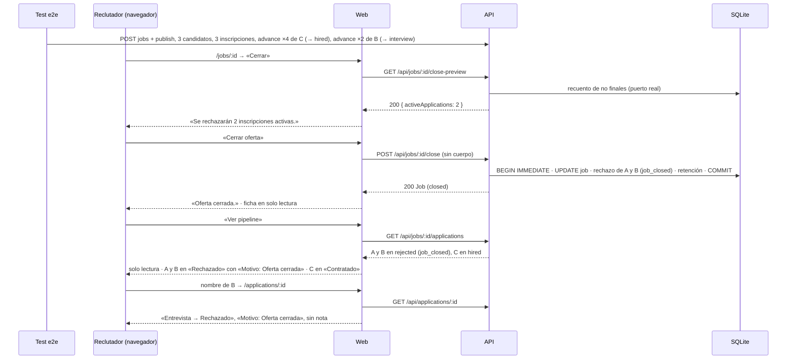
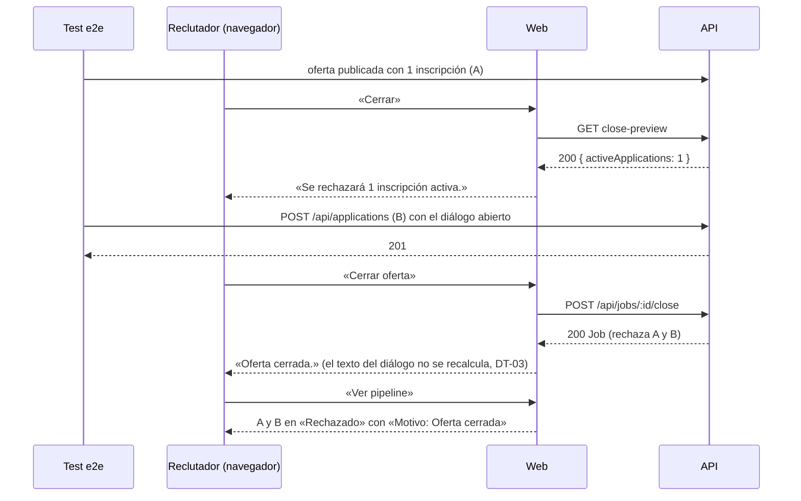

# HU-06 — Cerrar una oferta con inscripciones activas — Diseño técnico (frontend)

- **Origen:** `specs/PRD.md` (estado Ready, v1.1, 2026-10-07; DT-01 a DT-05)
- **Generado por:** frontend-architect
- **Scope cubierto:** RF-05 (frontend) y la parte web de RF-06 (umbrales de ficheros). RF-01 a RF-04 son solo backend:
  aquí se consumen por la UI y se recorren en el e2e. EC-26 a EC-30 son de este documento; el resto, del TD-backend.

## Enfoque técnico

**Sin código nuevo en `apps/web/src/`.** La web ya hace todo lo que pide RF-05; lo confirma el código:

| Pieza | Dónde | Qué hace ya | Por qué basta |
|---|---|---|---|
| Recuento en el diálogo | `apps/web/src/features/jobs/CloseJobAction.tsx` (`useClosePreview`) | Al abrir, `GET /api/jobs/:id/close-preview` con `AbortController`; mientras, «Comprobando las inscripciones activas…»; luego `activeApplicationsText(n)` en un `
` | Pinta lo que devuelva la API: con el stub era 0; con el puerto real, el número real (RF-02). DT-03: el texto no cambia |
| Textos | `apps/web/src/features/jobs/labels.ts` (`activeApplicationsText`) | Singular para 1, plural para el resto | Es el texto de DT-08 de HU-02 que DT-03 mantiene |
| Confirmar | `CloseJobAction.tsx` (`useCloseJob`) | Un solo `POST /api/jobs/:id/close` (guarda por `ref` + `busy`); 200 → `onClosed(job)` | La respuesta sigue siendo el `Job` (DT-10 de HU-05) |
| Aviso | `apps/web/src/features/jobs/JobDetailScreen.tsx` (`CLOSED_NOTICE = 'Oferta cerrada.'`) | Aviso tras cerrar y ficha en solo lectura con «Ver pipeline» | RF-05 exige el mismo aviso |
| Pipeline y detalle de una `closed` | `apps/web/src/features/applications/PipelineBoard.tsx`, `ApplicationDetails.tsx`, `labels.ts` (`job_closed: 'Oferta cerrada'`) | Tablero sin acciones; «Motivo: Oferta cerrada» en la tarjeta y en el historial; nota solo si existe | Es lo que comprueba CA-12 (HU-05, RF-08) |

El trabajo de la HU en la parte web es **un recorrido e2e nuevo** contra la API y la web reales (`e2e/`), con datos
creados en el test por la API (sin IDs fijos, *token* único), y un *helper* nuevo para llevar una inscripción a
`hired` por la API. Es la primera vez que un e2e cierra una oferta con inscripciones (DT-10 de HU-04 lo prohibía
mientras el puerto era un stub), así que se actualizan dos comentarios de specs que lo daban por hecho.

**Alternativa principal descartada:** volver a pedir la previa al confirmar o mostrar el número de rechazadas en el
aviso para cubrir la carrera de EC-11. Choca con DT-03 (texto sin cambios) y DT-10 de HU-05 (aviso «Oferta cerrada.» y
`POST /close` devuelve el `Job`).

## Dependencias

**Contrato consumido (sin cambios, HU-02).** Lo fija el backend; la web lo consume tal cual. Fuentes: PRD
«Interfaces / endpoints / pantallas» y `apps/api/src/modules/jobs/routes.ts` (rutas `/:id/close-preview` y `/:id/close`)
y `apps/api/src/modules/jobs/schemas.ts` (`closePreviewSchema`, `jobSchema`).

| Llamada | Entrada | 2xx | Errores (envelope `{ error: { code, message, details? } }`) | Cliente web |
|---|---|---|---|---|
| `GET /api/jobs/:id/close-preview` | `:id` entero ≥ 1 | 200 `{ activeApplications }` (entero ≥ 0, `additionalProperties: false`) | 400 `VALIDATION_ERROR` · 404 `NOT_FOUND` · 500 `INTERNAL_ERROR` | `getClosePreview` en `apps/web/src/features/jobs/api.ts` (valida la forma) |
| `POST /api/jobs/:id/close` | Sin cuerpo (`rejectBody`) | 200 `Job` (también al repetir) | 400 · 403 `CROSS_SITE_REQUEST` · 404 · 409 `INVALID_TRANSITION` · 500 | `closeJob` en `apps/web/src/features/jobs/api.ts` |

**Solo para preparar datos del e2e** (no los usa la UI nueva, porque no hay): `POST /api/jobs`, `/publish`,
`POST /api/candidates`, `POST /api/applications` (ya en `e2e/support/applications.ts`) y `POST
/api/applications/:id/advance` con `{ expectedStage, toStage }`, solo a la etapa siguiente (`advanceBodySchema` en
`apps/api/src/modules/applications/schemas.ts`; `NEXT_STAGE` en `transitions.ts`).

- **Depende del backend completo:** el e2e solo pasa con RF-01 a RF-03 conectados (`app.ts` sin el stub). Va
  **después** de las tareas de API en el plan.
- No hay `TECHNICAL_DOC-backend.md` aún: si el backend cambiara el contrato (no está previsto: PRD RF-02, RF-03), solo
  afectaría a `apps/web/src/features/jobs/api.ts`.

## Módulos y ficheros afectados

| Módulo | Fichero | Cambio |
|---|---|---|
| ofertas (`jobs`) | `apps/web/src/features/jobs/CloseJobAction.tsx`, `labels.ts`, `JobDetailScreen.tsx` | Sin cambios (DD-01) |
| inscripciones (`applications`) | `apps/web/src/features/applications/*` | Sin cambios (PRD «Fuera de scope») |
| transversal (`e2e/`) | `e2e/jobs-close-applications.spec.ts` | **nuevo** (DD-04): CA-12 + flujo 2 del PRD y EC-28 |
| transversal (`e2e/`) | `e2e/support/applications.ts` (69 líneas) | modificar: `advanceByApi` (≈ +20 líneas) (DD-03) |
| transversal (`e2e/`) | `e2e/pipeline-closed.spec.ts` (líneas 4-6) | modificar solo el comentario: ya no es cierto que «ningún e2e cierra una oferta con inscripciones» ni que la `closed` venga siempre del seed (DD-05) |
| transversal (`e2e/`) | `e2e/applications.spec.ts` (líneas 13-14) | modificar solo el comentario (mismo motivo) |
| tests web | `apps/web/test/features/jobs/*` | Sin cambios; `CloseJobAction.test.tsx` se queda en 298 líneas (DD-02) |

## Pantallas y estados

No hay pantallas nuevas ni cambios. Estados ya implementados que recorre el e2e, con los roles y nombres accesibles que
usa:

| Pantalla · ruta | Estado | Qué ve el reclutador | Rol / nombre accesible (tests) |
|---|---|---|---|
| Ficha · `/jobs/:id` (publicada) | Con datos | Barra de acciones con «Cerrar» | `button` «Cerrar» (`exact`) |
| Diálogo de cierre | Cargando | «Comprobando las inscripciones activas…»; «Cerrar oferta» deshabilitado; foco en «Cancelar» | `dialog` «¿Cerrar la oferta?»; `status` |
| Diálogo de cierre | Con datos (incluido 0, el «vacío») | «Se rechazará 1 inscripción activa.» / «Se rechazarán N inscripciones activas.» | `status` dentro del `dialog`; `button` «Cerrar oferta» |
| Diálogo de cierre | Error en la previa | Mensaje con `role="alert"`; «Cerrar oferta» deshabilitado; reintento = «Cancelar» y volver a abrir | `alert` (tests de HU-02) |
| Diálogo de cierre | Enviando | Botones deshabilitados (`busy`); un doble clic = 1 `POST` | — |
| Ficha tras cerrar | Con datos | «Oferta cerrada.»; estado «Cerrada»; acciones «Ver pipeline» y «Duplicar» | texto «Oferta cerrada.»; `link` «Ver pipeline» |
| Pipeline · `/jobs/:id/pipeline` (cerrada) | Con datos | Seis columnas sin «Avanzar», «Rechazar», «Contratar» ni «Inscribir candidato»; rechazadas con «Motivo: Oferta cerrada» | `region` por etapa («Rechazado», «Contratado»…); `listitem` filtrado por nombre; `link` con el nombre |
| Detalle · `/applications/:id` | Con datos | «Etapa actual: Rechazado»; último cambio «{etapa} → Rechazado», «Motivo: Oferta cerrada», sin «Nota:» | `list` «Historial» → último `listitem`; título «Inscripción · ATS» |

Cargando, vacío y error del pipeline y del detalle ya los cubren HU-04 y HU-05; no cambian.

## Migración de datos

N/A — sin cambios de esquema ni de seed (PRD «Modelo de datos»). El e2e corre sobre `data/e2e.db`, que
`playwright.config.ts` regenera con `db:reset` en cada ejecución; las ofertas que cierra el spec nuevo se quedan en esa
base y no tocan `data/ats.db`.

## Diagrama de secuencia

RF-05 es el único RF Must de frontend. Dos recorridos: el principal (CA-12) y la carrera con el diálogo abierto (EC-28).

**CA-12 · cerrar con 2 activas y 1 contratada (e2e T1)**

**EC-28 / EC-11 · inscripción nueva con el diálogo abierto (e2e T2)**

## Error paths

| Edge case (PRD) | Dónde se detecta | Estrategia | Respuesta o efecto observable | Test |
|---|---|---|---|---|
| EC-01 | Operación interna (`CHECK` de `stage_changes`) | Ver TD-backend | Error y `ROLLBACK`; 0 sin escribir | API (en tasks) |
| EC-02 | Operación interna | Ver TD-backend | 4 rechazadas; `hired` y `rejected` intactas; retención `2027-04-07` | API |
| EC-03 | Escrituras del rechazo | Ver TD-backend. En la web, un 500 al cerrar ya se pinta en el diálogo (HU-02) | 500 y nada cambia | API; web: `CloseJobAction.test.tsx:186` (existente) |
| EC-04 | Cierre e inscripción concurrentes | Ver TD-backend. La parte visible la cubre EC-28 | La nueva también se rechaza; inscribir tras el cierre → 409 | API; e2e T2 |
| EC-05 | Retención vencida | Ver TD-backend | «cierre + 6 meses» (RGPD §7 cuestión 4, sin resolver) | API |
| EC-06 | Errores y log del rechazo | Ver TD-backend | Sin marcadores en 500 ni log; manual con `job_closed` → 400 | API |
| EC-07 | Doble invocación | Ver TD-backend | Segunda = 0 | API |
| EC-08 | `close-preview` con `:id` no válido o inexistente | Ver TD-backend. La web solo construye la URL con IDs válidos; 404 → «Esta oferta ya no existe.» (HU-02) | 400 / 404 | API; web: `CloseJobAction.test.tsx:251` (existente) |
| EC-09 | Recuento 0 / 1 / 4 / 200 | Ver TD-backend | Número correcto < 200 ms | API |
| EC-10 | El recuento falla | Ver TD-backend. Web: alerta en el diálogo y «Cerrar oferta» deshabilitado | 500 | API; web: `CloseJobAction.test.tsx:224` (existente) |
| EC-11 | Recuento viejo | Ver TD-backend. Web: el diálogo no se recalcula (DT-03); el resultado se ve en el pipeline | N + 1 rechazadas, aviso «Oferta cerrada.» | API; e2e T2 |
| EC-12 | Previa de `draft` y `closed` del seed | Ver TD-backend | 0 y 0 | API |
| EC-13 | Forma de la previa | Ver TD-backend. Web: `getClosePreview` rechaza otra forma | Exactamente `{ activeApplications }` | API; web: `CloseJobAction.test.tsx:241`, `CloseJobAction.adversarial.test.tsx:163` (existentes) |
| EC-14 | `POST /close` con cuerpo o `:id` no válido | Ver TD-backend. La web envía sin cuerpo | 400, nada cambia | API |
| EC-15 | Sin activas / todas finales | Ver TD-backend | 200 `closed`, 0 `StageChange` | API; web: 0 en `jobs-lifecycle.spec.ts:140` (existente) |
| EC-16 | Falla el `UPDATE` de `job_openings` | Ver TD-backend | 500, el rechazo no se invoca | API |
| EC-17 | Dos pestañas confirman | Ver TD-backend. Web: el segundo 200 se trata como éxito con la fecha de la primera (HU-02) | 200 sin cambios | API; e2e `jobs-lifecycle.spec.ts:166` (existente, con 0 activas) |
| EC-18 | Base de la ventana de INV-05 | Ver TD-backend (`npm run db:reset`) | No-op | API (CA-15) |
| EC-19 | `Sec-Fetch-Site: cross-site`; fronteras | Ver TD-backend. La web va por el proxy de Vite (`same-origin`) | 403, nada se rechaza | API |
| EC-20 | Segundo cierre una hora después | Ver TD-backend | 200 con el `closedAt` original | API |
| EC-21 | Avanzar a `hired` una rechazada por cierre | Ver TD-backend. Web: el pipeline de una `closed` no ofrece acciones | 409 `STAGE_MISMATCH` | API; e2e T1 (0 botones) |
| EC-22 | Avance y cierre casi a la vez | Ver TD-backend | Serializados; ninguna abierta | API |
| EC-23 | Inscripción abierta en `closed` por SQL | Ver TD-backend | 200 y `StageChange` (defensa en profundidad) | API (CA-13) |
| EC-24 | Cuerpo del 409; manual con `job_closed` | Ver TD-backend | Sin datos del candidato; 400 | API |
| EC-25 | Rechazo manual tras el cierre | Ver TD-backend | 200 sin `StageChange` | API |
| EC-26 | Diálogo con 0, 1 y 2 | `activeApplicationsText` sobre lo que dé la previa | «Se rechazarán 0…», «Se rechazará 1 inscripción activa.», «Se rechazarán 2 inscripciones activas.» | 0: `CloseJobAction.test.tsx:83`; 1: `:106`; 0/1/2: `labels.test.ts:51`; 2 real: **e2e T1**; 1 real: **e2e T2** |
| EC-27 | La previa no responde | `useClosePreview` → `error`; `confirmDisabled` | Alerta en el diálogo y «Cerrar oferta» deshabilitado | `CloseJobAction.test.tsx:224` (existente, sin cambios) |
| EC-28 | Otra inscripción con el diálogo abierto | Ninguna en la web (DT-03): el cierre rechaza las activas al confirmar | «Oferta cerrada.»; el pipeline muestra también la nueva en «Rechazado» | **e2e T2** |
| EC-29 | Nombres hostiles en el pipeline y el detalle | Texto JSX, sin `dangerouslySetInnerHTML`; el diálogo solo pinta un número | Texto literal, 0 `[onerror]` | `PipelineScreen.adversarial.test.tsx:25`, `ApplicationDetailScreen.adversarial.test.tsx:14`, `CloseJobAction.adversarial.test.tsx:87` (existentes) |
| EC-30 | Doble clic en «Cerrar oferta» | Guarda por `ref` + `busy` en `useCloseJob` | 1 `POST` | `CloseJobAction.adversarial.test.tsx:75` (existente); la API, EC-20 |

## Threat modeling

DEC-04: sin login, rol único. Superficie web nueva: ninguna; el e2e es código de test.

| STRIDE | Amenaza concreta | Mitigación |
|---|---|---|
| Suplantación | Otra web dispara `POST /close` desde el navegador del reclutador y rechaza inscripciones en masa | DEC-12 (`CROSS_SITE_REQUEST`, EC-19); la web va por el proxy `same-origin` |
| Manipulación | Doble clic o dos pestañas cierran dos veces | `ref` + `busy` (EC-30); la API es idempotente (EC-17, EC-20) |
| Repudio | Quién rechazó: el cierre, no una persona | Motivo `job_closed` visible en tarjeta e historial («Motivo: Oferta cerrada»); fecha = cierre |
| Exposición de datos | El diálogo o el aviso nombran candidatos; nombres hostiles ejecutan HTML | El diálogo solo muestra un número; el aviso es fijo; nombres como texto JSX (EC-29) |
| Denegación de servicio | Recuento lento bloquea el diálogo | Estado de carga con «Cerrar oferta» deshabilitado; `AbortController` al cancelar; RNF-02 < 200 ms (backend) |
| Elevación de privilegios | Acciones de etapa sobre una oferta cerrada desde la UI | El pipeline de una `closed` no ofrece acciones (HU-05); la API responde 409 (EC-21) |

## Datos personales

- **Entran / se guardan desde la web:** nada nuevo. El diálogo recibe un número; `POST /close` devuelve el `Job`, sin
  datos de candidatos (RNF-04).
- **Se muestran:** los nombres de los candidatos en el pipeline y el detalle, como ya hacía HU-05. El diálogo de cierre
  no nombra a nadie.
- **Almacenamiento del navegador / URL:** nada (sin `localStorage`, sin datos personales en la URL; las rutas llevan
  IDs).
- **e2e:** candidatos inventados con `createCandidateByApi` (`Inscribe Apellido{token}`, `inscribe.{token}@example.com`,
  sin teléfono, sin consentimiento; RGPD §6.3). El cierre fija su `retention_ends_at` en `data/e2e.db`, que se regenera
  en cada ejecución.
- **Logs:** la web no registra nada; los de la API, en el TD-backend (RNF-03).

## Decisiones de diseño

### DD-01: Ningún cambio en `apps/web/src/`
- **Contexto:** RF-05 pide el número real con el texto de DT-08 de HU-02 (DT-03) y el aviso «Oferta cerrada.» (DT-10
  de HU-05). `CloseJobAction.tsx` ya pide la previa al abrir y pinta `activeApplicationsText`.
- **Opciones consideradas:** A) No tocar la web; B) recalcular la previa al confirmar o anunciar las rechazadas en el
  aviso.
- **Elegida:** A.
- **Razón:** el número real llega solo con el puerto conectado en la API; B contradice DT-03 y DT-10 de HU-05.
- **Tradeoff:** con dos pestañas el diálogo puede quedarse corto (EC-11); el reclutador lo ve en el pipeline.

### DD-02: Sin tests nuevos de Vitest
- **Contexto:** EC-26, EC-27, EC-29 y EC-30 ya tienen tests (ver «Error paths»); `CloseJobAction.test.tsx` está en
  298 líneas.
- **Opciones consideradas:** A) Cubrir RF-05 con los tests existentes + e2e; B) fichero hermano
  `CloseJobAction.count.test.tsx` con N = 2 y `fetch` simulado.
- **Elegida:** A.
- **Razón:** B repetiría `labels.test.ts:51` y, con `fetch` simulado, no prueba el puerto real, que es lo único nuevo.
- **Tradeoff:** el número real solo lo comprueba el e2e (más lento y depende del backend completo).

### DD-03: Datos del e2e por la API, con `advanceByApi` nuevo
- **Contexto:** CA-12 pide 2 activas y 1 `hired` en una oferta creada en el test.
- **Opciones consideradas:** A) Crear todo por la API y llevar la contratada a `hired` con 4 `advance`; B) usar una
  publicada del seed con 10 inscripciones; C) avanzar a `hired` por la UI.
- **Elegida:** A. Firma: `advanceByApi(page, applicationId, target: 'screening' | 'interview' | 'offer' | 'hired')`,
  que recorre `received → … → target` con `{ expectedStage, toStage }` y espera 200 en cada paso.
- **Razón:** B cierra una oferta del seed que leen otros specs y ata el test a sus datos; C repite
  `pipeline-stages.spec.ts` y alarga el test.
- **Tradeoff:** cuatro peticiones de preparación por test; el *helper* asume que la inscripción parte de `received`.

### DD-04: Spec nuevo `e2e/jobs-close-applications.spec.ts`
- **Contexto:** el recorrido cruza `jobs` (ficha y diálogo) y `applications` (pipeline y detalle).
- **Opciones consideradas:** A) Spec nuevo; B) añadirlo a `jobs-lifecycle.spec.ts` (247 líneas); C) a
  `pipeline-closed.spec.ts`.
- **Elegida:** A.
- **Razón:** B pasaría de 300 líneas; C es de solo lectura del seed por diseño. El nombre lo agrupa con los e2e de
  ofertas.
- **Tradeoff:** un fichero más; se ejecuta antes que `pipeline-closed.spec.ts` (orden alfabético, `workers: 1`), lo que
  obliga a DD-05.

### DD-05: Actualizar los comentarios que suponían que ningún e2e cerraba ofertas con inscripciones
- **Contexto:** `pipeline-closed.spec.ts` busca «la primera `closed` con un rechazo `job_closed`» en
  `/api/jobs?status=closed` (orden por fecha de publicación descendente): tras el spec nuevo, encuentra antes una oferta
  del e2e, no del seed. Sus aserciones (seis columnas, sin acciones, «Motivo: Oferta cerrada», sin nota) se siguen
  cumpliendo con esa oferta.
- **Opciones consideradas:** A) Cambiar solo los comentarios; B) filtrar en ese spec las ofertas del seed.
- **Elegida:** A.
- **Razón:** el test sigue siendo válido y sin IDs fijos; B añade lógica para nada.
- **Tradeoff:** ese spec ya no prueba en concreto los datos del seed (los fija CA-15 en la API).

## Impacto en decisiones

- **DEC-01** (TypeScript estricto, Vitest y Playwright): se aplica; el e2e en `e2e/` con el tsconfig de e2e.
- **DEC-04** (sin login) y **DEC-12** (guarda entre sitios): se aplican sin cambios.
- **DEC-06:** sin efecto en la web. La anotación de su texto con el tercer puerto (DT-04) es del TD-backend.
- DT-03 de este PRD, DT-08 de HU-02 y DT-10 de HU-05: se respetan (DD-01). DT-10 de HU-04 deja de aplicar: este spec es
  el primero que cierra ofertas con inscripciones.
- **Sin `DEC-NN` nueva** ni dependencias nuevas.

## Estrategia de tests

**Vitest + Testing Library:** sin tests nuevos (DD-02). Los existentes deben seguir en verde sin tocarlos. Regla del
sprint (T-03) para cualquier test que se añada después: las aserciones sobre foco, `document.title` o `dialog.open` van
con `await waitFor` o `expectFocusOn` (`apps/web/test/helpers/focus.ts`).

**Playwright · `e2e/jobs-close-applications.spec.ts` (nuevo):** contra la API y la web reales sobre `data/e2e.db`;
*helpers* de `e2e/support/applications.ts`; sin IDs fijos; aserciones *web-first* (`await expect(...)`), sin esperas
fijas.

| Test | Criterio / EC | Preparación (API) | Pasos y aserciones (UI) |
|---|---|---|---|
| T1 «CA-12 y EC-26 cerrar con 2 activas y 1 contratada: diálogo con 2, «Oferta cerrada.», pipeline en solo lectura y detalle «Oferta cerrada» sin nota» | CA-12, EC-26, EC-21 (sin acciones), flujos 1 y 2 del PRD | Oferta publicada; candidatos A, B y C; A en `received`, B → `interview` (`advanceByApi`), C → `hired` | `/jobs/:id` → `button` «Cerrar» (`exact`) → en el `dialog` «¿Cerrar la oferta?», «Se rechazarán 2 inscripciones activas.» → «Cerrar oferta» → «Oferta cerrada.» y `dialog` oculto → `link` «Ver pipeline» → URL `/jobs/:id/pipeline`; 0 botones «Inscribir candidato», `/^Avanzar/`, `/^Rechazar/`, `/^Contratar/`; A y B en `region` «Rechazado» con «Motivo: Oferta cerrada»; C en «Contratado» sin «Motivo:»; 0 tarjetas de A en «Recibida» y de B en «Entrevista» → nombre de B → «Etapa actual» «Rechazado»; último `listitem` de «Historial» con «Entrevista → Rechazado», «Motivo: Oferta cerrada» y sin «Nota:» |
| T2 «EC-28 y EC-11 una inscripción creada con el diálogo abierto también se rechaza» | EC-28, EC-11, EC-04 (parte visible), CA-03 en la UI | Oferta publicada con A en `received`; B creado sin inscribir | Abrir el diálogo → «Se rechazará 1 inscripción activa.» → `enrollByApi(B)` con el diálogo abierto → «Cerrar oferta» → «Oferta cerrada.» → «Ver pipeline» → A y B en «Rechazado» con «Motivo: Oferta cerrada» |

**Criterio → test:**

| Criterio / EC | Test |
|---|---|
| CA-12 | T1 |
| EC-26 | T1 (2), T2 (1), `CloseJobAction.test.tsx:83` y `:106`, `labels.test.ts:51` |
| EC-27 | `CloseJobAction.test.tsx:224` |
| EC-28 (y EC-11 en la UI) | T2 |
| EC-29 | `PipelineScreen.adversarial.test.tsx`, `ApplicationDetailScreen.adversarial.test.tsx`, `CloseJobAction.adversarial.test.tsx:87` |
| EC-30 | `CloseJobAction.adversarial.test.tsx:75` |
| RF-06 (umbrales, parte web) | Spec ≤ 300 líneas, cada `test` y *helper* ≤ 50; `CloseJobAction.test.tsx` sigue en 298 |

**`[adversarial]` de RF-05:** T2 (concurrencia con datos reales). EC-27, EC-29 y EC-30 ya tienen su test adversarial
desde HU-02 y HU-05.

**Qué se simula:** nada en el e2e. En Vitest, solo `fetch` (`apps/web/test/helpers/fetch.ts`), como hoy.

## Checklist de implementación

Una sola task web (`Capa: e2e`, M), **después** de las de API (necesita el puerto real conectado en `app.ts`).
Recomendación para `/task-planner`: marcarla `[adversarial]` para RF-05 porque incluye T2; si prefiere separar, T1 y
T2 en dos tasks (7 en total).

1. `e2e/support/applications.ts`: añadir `advanceByApi` (DD-03), con su comentario.
2. `e2e/jobs-close-applications.spec.ts`: T1 y T2, con *helpers* locales (`closeDialog`, `cardIn`) al estilo de
   `jobs-lifecycle.spec.ts` y `pipeline-stages.spec.ts`; comentario de cabecera (qué cubre, datos creados por la API,
   *token* único).
3. Comentarios de `e2e/pipeline-closed.spec.ts` (líneas 4-6) y `e2e/applications.spec.ts` (líneas 13-14) (DD-05).
4. Verificación con salida pegada: `npm run e2e` (todos los specs, para ver el efecto de DD-05), `npm test -w
   apps/web`, `npm run typecheck`, `npm run lint`.

## Riesgos

| Riesgo | Probabilidad (1–5) | Impacto (1–5) | Mitigación |
|---|---|---|---|
| El e2e se ejecuta antes de conectar el puerto real y el diálogo dice 0 | 2 | 3 | La task web depende de las de API; el fallo de T1 lo delata («Se rechazarán 0…») |
| `pipeline-closed.spec.ts` encuentra ahora una `closed` del spec nuevo | 4 | 1 | Sus aserciones siguen valiendo con esa oferta (DD-05); `npm run e2e` completo en la verificación |
| Nombres en la región «Rechazado» con varios candidatos: un filtro por texto encuentra dos tarjetas | 2 | 2 | Apellido con *token* único que ningún otro nombre contiene (`createCandidateByApi`) |
| Con más de 999 activas el texto no lleva separador de miles («1000») | 1 | 1 | Fuera de los volúmenes del PRD (200); se anota, no se cambia (DT-03) |

## Open Decisions

No hay decisiones abiertas.

## Fuera de scope

- Cualquier cambio de texto, componente o estado en la ficha, el diálogo, el pipeline o el detalle (DT-03; PRD «Fuera de
  scope»).
- Mostrar el número de rechazadas en el aviso o recalcular la previa al confirmar (DT-10 de HU-05).
- Un e2e con dos pestañas confirmando el cierre a la vez con inscripciones (EC-17 lo prueba la API; la parte web ya la
  cubre `jobs-lifecycle.spec.ts:166`).
- Separador de miles en `activeApplicationsText`.
