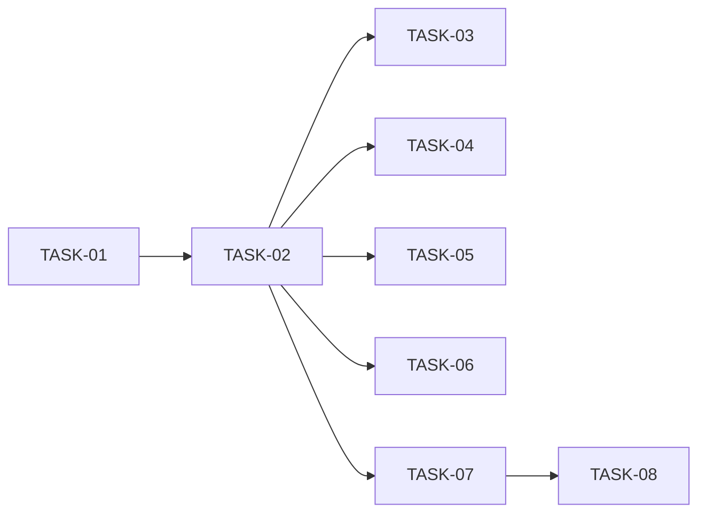

# HU-06 — Cerrar una oferta con inscripciones activas — Roadmap de tareas

## Resumen
- **Fuente de verdad:** `plans/TECHNICAL_DOC-backend.md` y `plans/TECHNICAL_DOC-frontend.md` (no el PRD; PRD v1.1 para
  los RF Must y la cobertura).
- **Tareas:** **8** (S: 1 · M: 6 · L: 1) · estimación total: **15 h** (API 12 h, e2e 3 h).
- **Capa:** `api` 6 (TASK-01 a TASK-06) · `web` 2 (TASK-07 y TASK-08, Playwright). Sin cambios en `apps/web/src/` ni
  tests nuevos de Vitest (DD-01 y DD-02 del TD-frontend).
- **Adversariales:** 3 (TASK-04 y TASK-05 en API, M; TASK-08 en e2e, S). Ninguna pasa de M y ninguna se funde con un
  camino feliz.
- **Sin migración** y sin cambios de contrato HTTP.
- **Cobertura:** cada RF del PRD → tareas; cada CA → al menos un test con nombre; cada edge case de RF Must → test o
  `N/A` del PRD (tablas de abajo). Ningún RF queda sin cubrir en los TD (paso 2).
- **Prueba de mutación de la review** (condición del responsable técnico): M1, M2 y M3 tienen test que las detecta,
  nombrado en el *done* de su tarea (tabla «Mutaciones»).

| ID | Título | Capa | Complejidad | Depende de | TD |
|---|---|---|---|---|---|
| TASK-01 | Recuento y rechazo de las inscripciones activas de una oferta en `applications` `[setup]` | api | M (2 h) | — | Checklist 1 |
| TASK-02 | Puerto real conectado en `buildApp`: cierre con rechazo y recuento de punta a punta | api | L (3 h) | TASK-01 | Checklist 2 |
| TASK-03 | Tras el cierre: DT-01, invariantes de INV-05 y aclaración de DEC-06 | api | M (2 h) | TASK-02 | Checklist 3 |
| TASK-04 | Cierre frente a fallos de escritura, entradas hostiles y concurrencia `[adversarial]` | api | M (2 h) | TASK-02 | Checklist 4 |
| TASK-05 | Datos personales y minimización en el cierre, la previa y el 409 posterior `[adversarial]` | api | M (1,5 h) | TASK-02 | Checklist 5 |
| TASK-06 | Rendimiento del cierre con 200 activas y de la previa (RNF-01, RNF-02) | api | M (1,5 h) | TASK-02 | Checklist 6 |
| TASK-07 | Recorrido e2e: cerrar una oferta con 2 activas y 1 contratada `[e2e]` | web | M (2 h) | TASK-02 | Checklist 7 · TD-frontend T1 |
| TASK-08 | Recorrido e2e: inscripción creada con el diálogo de cierre abierto `[e2e]` `[adversarial]` | web | S (1 h) | TASK-07 | Checklist 7 · TD-frontend T2 |

## Ajustes respecto a los TD

| # | Qué | Por qué | Efecto |
|---|---|---|---|
| A-1 | El e2e (punto 7 del TD-backend, una task M con T1 y T2) se parte en **TASK-07** (T1, camino feliz de RF-05) y **TASK-08** (T2, `[adversarial]` de RF-05) | Regla de la sesión: no fundir adversariales con el camino feliz. El TD-frontend ofrece las dos salidas («marcarla `[adversarial]`» o «T1 y T2 en dos tasks») | **8 tareas** en vez de las 7 del TD. Ver «Decisión pendiente» |
| A-2 | TD-frontend: «`Capa: e2e`» → **`Capa: web`** | `/task-planner` y R4.0: una `[e2e]` de Playwright es `web` (`web-builder`) | 0 tareas |
| A-3 | TASK-05 provoca sus fallos con `failWrites` **sin** `whenNew` (primera escritura de cada tipo) | `whenNew` nace en TASK-04; así TASK-05 no depende de ella y pueden ir en paralelo. CA-11 solo pide que no haya fugas, no el punto exacto | 0 tareas |
| A-4 | `close-operation.test.ts › EC-07 …` (TASK-01) comprueba además `countActiveApplications` antes (2, con una `hired`) y después (0) | Detecta M2 en la propia tarea del núcleo, no solo en TASK-02 | 0 tareas |
| A-5 | EC-22 «en los dos órdenes» se nombra en dos tests (`EC-22 avance antes del cierre …` y `EC-22 cierre antes del avance …`) | El TD solo da nombre al primer orden | 0 tareas |
| A-6 | TASK-06 prepara **4** ofertas con 200 activas (3 medidas + 1 de calentamiento) | El TD pide 3 cierres de ofertas distintas; la primera ejecución de cada sentencia no debe contar | 0 tareas |
| A-7 | EC-08 (previa) y EC-14 (cierre) comparten test en TASK-04 con el nombre del TD; `abc` y `999999` de EC-08 ya los cubre `apps/api/test/jobs/close.test.ts:186` | El TD solo lista `1.5` | 0 tareas |

**Decisión pendiente para la validación (paso 7):** el responsable técnico quería 6-7 tareas. Con A-1 son 8 (dentro del
ideal 4-8 y lejos del techo de 15). La alternativa para quedarse en 7 es juntar TASK-07 y TASK-08 en una sola M
`[e2e] [adversarial]`, como recomienda el TD-frontend, a costa de fundir el adversarial de RF-05 con su camino feliz.
**Recomendación: mantener 8.**

## Fases

| Fase | Tareas | Objetivo |
|---|---|---|
| 1 · Núcleo | TASK-01 | Recuento y rechazo en `applications`, con llamadas directas |
| 2 · Conexión | TASK-02 | Puerto real en `app.ts` (`composeServices`) y cierre de punta a punta por la API |
| 3 · Tras el cierre e invariantes | TASK-03 | DT-01 (renombres, sin guarda), INV-05 (CA-15, CA-16), DEC-06 y `docs/ARCHITECTURE.md` |
| 4 · Adversariales y rendimiento | TASK-04, TASK-05, TASK-06 | Fallos, entradas hostiles, concurrencia, privacidad y RNF-01/RNF-02 |
| 5 · e2e | TASK-07, TASK-08 | Recorrido del reclutador (CA-12) y carrera con el diálogo abierto (EC-28) |

## Dependencias

**Camino crítico:** TASK-01 → TASK-02 → TASK-07 → TASK-08 (2 + 3 + 2 + 1 = **8 h**). Las ramas TASK-03 y TASK-04 (2 h
cada una tras TASK-02) se quedan a 1 h del crítico. En el taller, en serie: **15 h**.

TASK-01 → TASK-02 van en serie porque TASK-02 conecta lo que crea TASK-01. Todo lo demás solo necesita el puerto real
conectado (TASK-02).

## Orden de implementación

En el taller, una por tarea y en orden: **01, 02, 03, 04, 05, 06, 07, 08**.

Paralelismo posible (**como mucho 3 builders a la vez**, y solo sin compartir ficheros), todo después de TASK-02:

| Ola | Tareas en paralelo | Ficheros de cada una | Por qué no chocan |
|---|---|---|---|
| 1 | TASK-03 ∥ TASK-04 ∥ TASK-07 | 03: `advance.test.ts`, `reject.test.ts`, 2 tests nuevos, `DECISIONS.md`, `ARCHITECTURE.md` · 04: `test/helpers/test-app.ts` + 1 test nuevo · 07: 4 ficheros de `e2e/` | Conjuntos disjuntos |
| 2 | TASK-05 ∥ TASK-08 | 05: 1 test nuevo · 08: `e2e/jobs-close-applications.spec.ts` | Disjuntos |
| 3 | TASK-06 **a solas** | 1 test nuevo | Rendimiento: sin otros tests compitiendo por CPU (falso > 500 ms → escalada innecesaria) |

Con las olas: 2 + 3 + 2 + 1,5 + 1,5 = **10 h** de reloj.

**No en paralelo:**
- TASK-01 y TASK-02 con nada (núcleo y conexión; `service.ts`, `repository.ts`, `app.ts`).
- TASK-02 y TASK-04 (`apps/api/test/helpers/test-app.ts`: comentario en 02, `whenNew` en 04); ya van en serie.
- TASK-07 y TASK-08 (`e2e/jobs-close-applications.spec.ts`; además, un solo Playwright a la vez: puertos 3101/5174 y
  `data/e2e.db`).
- TASK-06 con cualquier otra que ejecute tests.
- **Ojo con el árbol compartido:** los builders trabajan en el mismo directorio. Un fichero a medio escribir de un
  builder rompe el `npm run typecheck` o la suite de otro. La integración (typecheck, lint y tests con salida pegada)
  de cada tarea se ejecuta cuando su builder termina y, si falla por un fichero ajeno, se repite al acabar la ola antes
  de contarlo como ciclo de arreglo. Si TASK-04 o TASK-05 destapan un arreglo en `apps/api/src/`, la ola pasa a serie.

## RF Must × tarea `[adversarial]` (gate 4)

| RF (Must) | Tarea(s) `[adversarial]` | Categorías de `QUALITY-GATES.md` §3 cubiertas |
|---|---|---|
| RF-01 Operación interna de rechazo | TASK-04, TASK-05 | Fallo de dependencia (EC-03, CA-06: 2.ª de 3 en los 3 puntos) en TASK-04; seguridad (EC-06, CA-11) en TASK-05. Input inválido (EC-01) e idempotencia (EC-07) en TASK-01; boundary (EC-02), concurrencia (EC-04) y legacy (EC-05) en TASK-02 |
| RF-02 Recuento real | TASK-04, TASK-05 | Input inválido (EC-08) y fallo de dependencia (EC-10) en TASK-04; seguridad (EC-13) en TASK-05. Boundary (EC-09: 0/1/4 en TASK-02, 200 en TASK-06), concurrencia (EC-11) y legacy (EC-12) en TASK-02; idempotencia `N/A` (PRD) |
| RF-03 Conexión y cierre de punta a punta | TASK-04 | Input inválido (EC-14), fallo de dependencia (EC-16), concurrencia (EC-17), legacy (EC-18) y seguridad (EC-19). Boundary (EC-15) e idempotencia (EC-20) en TASK-02; INV-05 de la base regenerada (EC-18, CA-15) en TASK-03 |
| RF-04 Cambios de etapa tras el cierre | TASK-05 | Seguridad (EC-24). Boundary (EC-21), concurrencia (EC-22), legacy (EC-23) e idempotencia (EC-25) en TASK-03 (no `[adversarial]`); input inválido y fallo de dependencia `N/A` (PRD) |
| RF-05 Diálogo con el número real y e2e | TASK-08 | Concurrencia (EC-28, EC-11 en la UI). Boundary (EC-26: 2 en TASK-07, 1 en TASK-08); fallo de dependencia (EC-27), seguridad (EC-29) e idempotencia (EC-30) con tests existentes de HU-02/HU-05 sin cambios (`CloseJobAction.test.tsx:224`, `PipelineScreen.adversarial.test.tsx`, `ApplicationDetailScreen.adversarial.test.tsx`, `CloseJobAction.adversarial.test.tsx:75` y `:87`); input inválido y legacy `N/A` (PRD) |

Ningún RF Must queda sin `[adversarial]`. **Aviso:** la de RF-04 es fina: TASK-05 solo cubre su categoría de seguridad
(EC-24); el resto de sus edge cases vive en `stage-change-after-close.test.ts` de TASK-03, que no está marcada
`[adversarial]` porque también lleva CA-07, su camino feliz. Si el responsable técnico lo quiere separado, se saca
`stage-change-after-close.test.ts` a una `[adversarial]` S propia (9 tareas). RF-06 es Should: sin `[adversarial]`
obligatoria (CA-11 en TASK-05; CA-14 en la review).

## Mutaciones de la review → test que las detecta

| Mutación | Test(s) que fallan | Tarea |
|---|---|---|
| **M1** · quitar la llamada a `rejectActiveApplications` del cierre (en `jobs/service.ts:135` o en la lambda de `app.ts`) | `close-reject.test.ts › CA-01 previa 2; cierre rechaza received y offer con job_closed en closedAt; hired intacta` y `› CA-09 buildApp sin jobApplications rechaza con el puerto real`; `close-invariants.test.ts › CA-16 INV-05 tras POST /close: 0 no finales en la oferta (…)`; e2e T1. Si se quita en `jobs/service.ts`, también los tests del espía de `jobs/close.test.ts` | TASK-02, TASK-03, TASK-07 |
| **M2** · `countActiveApplications` cuenta también las finales | `close-operation.test.ts › EC-07 segunda llamada → 0 sin StageChange ni recálculo` (3 y 1 en vez de 2 y 0); `close-preview-count.test.ts › CA-08 previa: 6 etapas → 4, draft → 0, closed del seed → 0, solo activeApplications`; `close-reject.test.ts › CA-01 …` (previa 3); e2e T1 («Se rechazarán 3…») | TASK-01, TASK-02, TASK-07 |
| **M3** · sacar el rechazo fuera de la transacción del cierre | `close-reject-adversarial.test.ts › CA-06/EC-03 falla %s en la 2.ª de 3 → 500 y nada cambia`, en los 3 puntos (`failWrites` con `whenNew` sobre la 2.ª de 3, DD-09): la oferta queda `closed` o la 1.ª inscripción queda `rejected` | TASK-04 |

TASK-02, TASK-03 y TASK-04 piden al builder aplicar su mutación a mano, ver el rojo y deshacerla, sin commitearla.

## Cobertura PRD → tareas

| RF / RNF | Task(s) |
|---|---|
| RF-01 | TASK-01, TASK-02, TASK-04, TASK-05, TASK-06, TASK-07 |
| RF-02 | TASK-01, TASK-02, TASK-04, TASK-05, TASK-06, TASK-07 |
| RF-03 | TASK-02, TASK-03 (INV-05), TASK-04, TASK-07 |
| RF-04 | TASK-03, TASK-05 |
| RF-05 | TASK-07, TASK-08 |
| RF-06 | TASK-01 (sin `SELECT *`), TASK-03 (DEC-06), TASK-05 (datos personales); ≤ 300 líneas y ≤ 50 por función en el *done* de todas |
| RNF-01, RNF-02 | TASK-06 |
| RNF-03 | TASK-05 |
| RNF-04 | TASK-05 |
| RNF-05 | TASK-01 (SQL preparado, sin `SELECT *`), TASK-02 y TASK-04 (`module-boundaries`), TASK-04 (DDL de `failWrites` con entero validado) |

| CA | Task(s) | CA | Task(s) |
|---|---|---|---|
| CA-01 | TASK-02 | CA-09 | TASK-02 |
| CA-02 | TASK-02 | CA-10 | TASK-02 |
| CA-03 | TASK-02 (API), TASK-08 (UI) | CA-11 | TASK-05 |
| CA-04 | TASK-02 | CA-12 | TASK-07 |
| CA-05 | TASK-02 | CA-13 | TASK-03 |
| CA-06 | TASK-04 | CA-14 | *Done* de todas; review (`wc -l`, funciones ≤ 50, `grep 'SELECT \*'`, comentarios, EC-14 de HU-02 eliminado en TASK-02) |
| CA-07 | TASK-03 | CA-15 | TASK-03 |
| CA-08 | TASK-02 | CA-16 | TASK-03 |

| Edge case | Task(s) | Edge case | Task(s) |
|---|---|---|---|
| EC-01 | TASK-01 | EC-16 | TASK-04 |
| EC-02 | TASK-02 | EC-17 | TASK-04 |
| EC-03 | TASK-04 | EC-18 | TASK-04 (no-op), TASK-03 (CA-15) |
| EC-04 | TASK-02, TASK-08 (parte visible) | EC-19 | TASK-04, `module-boundaries.test.ts` |
| EC-05 | TASK-02 | EC-20 | TASK-02 |
| EC-06 | TASK-05 | EC-21 | TASK-03, TASK-07 (pipeline sin acciones) |
| EC-07 | TASK-01, TASK-02 (CA-10) | EC-22 | TASK-03 |
| EC-08 | TASK-04; `jobs/close.test.ts:186` (existente) | EC-23 | TASK-03 (renombres) |
| EC-09 | TASK-02 (0/1/4), TASK-06 (200) | EC-24 | TASK-05 |
| EC-10 | TASK-04 | EC-25 | TASK-03 |
| EC-11 | TASK-02 (API), TASK-08 (UI) | EC-26 | TASK-07 (2), TASK-08 (1); 0/1 en tests web existentes |
| EC-12 | TASK-02 | EC-27 | `CloseJobAction.test.tsx:224` (existente) |
| EC-13 | TASK-05 | EC-28 | TASK-08 |
| EC-14 | TASK-04 | EC-29 | Tests adversariales web existentes (HU-02, HU-05) |
| EC-15 | TASK-02 | EC-30 | `CloseJobAction.adversarial.test.tsx:75` (existente); API: EC-20 |

## Tests existentes que cambian (`fichero:línea`)

| Fichero | Líneas | Tarea | Cambio |
|---|---|---|---|
| `apps/api/test/jobs/close.test.ts` | 199-216 | TASK-02 | Se elimina el `describe` de EC-14 de HU-02 (lo sustituyen CA-01, CA-04, CA-06, CA-10) |
| `apps/api/test/helpers/test-app.ts` | 13-16 · `FailWritesTarget`/`failWrites` | TASK-02 · TASK-04 | Comentario de `createTestApp` · opción `whenNew` |
| `apps/api/test/applications/advance.test.ts` | 283 | TASK-03 | Solo el nombre (sigue en 300 líneas) |
| `apps/api/test/applications/reject.test.ts` | 265 y 287 | TASK-03 | Solo los nombres (sigue en 300 líneas) |
| `e2e/pipeline-closed.spec.ts` | 4-6 | TASK-07 | Solo el comentario (DD-05) |
| `e2e/applications.spec.ts` | 13-14 | TASK-07 | Solo el comentario (DD-05) |
| `apps/web/test/features/jobs/CloseJobAction.test.tsx` | — | — | No se toca (298 líneas) |

## Coherencia PRD ↔ diseño (paso 2)

Ningún RF del PRD queda sin cubrir en los TD. Matices para la validación:
1. **CA-06** habla de «dos inscripciones activas»; el TD (EC-03, DD-09) usa **tres** para fallar en la segunda. Se
   toma el TD: es un superconjunto y es lo que exige M3.
2. **RF-03** pide actualizar el comentario de `apps/api/test/jobs/close.test.ts:200`: está dentro del bloque que se
   elimina (TD), así que desaparece con él.
3. **TD-frontend:** dice «No hay `TECHNICAL_DOC-backend.md` aún» y «T1 y T2 en dos tasks (7 en total)»; ya existe y,
   con las 6 tareas de API del TD-backend, partir el e2e da 8 (A-1). Cosmético.
4. **TD-frontend, Checklist:** «`Capa: e2e`» no es un valor válido; se usa `web` (A-2).
5. **EC-08:** el nombre previsto del TD (`EC-08/EC-14 id 1.5 o con cuerpo …`) junta la previa y el cierre; se
   mantiene y se aclara qué ruta prueba cada uno (A-7).

## Riesgos

| Riesgo | Origen | Mitigación |
|---|---|---|
| **RNF-01 > 500 ms** por los ~8 accesos por inscripción (incluido el `SELECT *` de `recalculateRetention`) | TD-backend (prob. 2, imp. 3), DT-02 | TASK-06 lo mide; si no baja de 500 ms, **se para y se escala al responsable técnico antes de optimizar**. TASK-06 corre a solas |
| Regresión de cableado al reordenar la composición (DD-06) | TD-backend (prob. 2, imp. 4) | Suite completa de la API en el *done* de TASK-02; la asignación tipada de los tres puertos falla al compilar si cambia una forma |
| `createApplicationsRepository` en 50 líneas: cualquier añadido rompe el umbral | TD-backend (prob. 3, imp. 2) | Consultas en `createActiveByJobQueries`; *done* de TASK-01 exige 50 exactas |
| `advance.test.ts` y `reject.test.ts` en 300 líneas | PRD, TD-backend | TASK-03 solo renombra; `wc -l` = 300 en su *done* |
| `close-reject.test.ts` (9 tests) o `close-reject-adversarial.test.ts` cerca de 300 líneas | Este plan | El builder para y avisa antes de repartir: un fichero hermano no previsto en el TD lo aprueba el responsable técnico |
| Triggers de `failWrites` instalados antes de preparar los datos hacen fallar la preparación, no el cierre | Este plan | Nota en TASK-04 y TASK-05: instalar después |
| Reloj que retrocede: `closedAt` < `created_at` → `CHECK` aborta y el cierre da 500 | TD-backend (prob. 1, imp. 3) | Relojes de test posteriores a todos los `created_at` (nota en TASK-01, 02, 04, 06) |
| Prueba de mutación que no detecta M3 si el fallo cae en la primera fila | Condición del responsable técnico | TASK-04 falla siempre la **2.ª de 3** con `whenNew` y compara la 1.ª con la foto previa |
| `pipeline-closed.spec.ts` encuentra ahora una `closed` del spec nuevo | TD-frontend (prob. 4, imp. 1) | DD-05: sus aserciones siguen valiendo; TASK-07 ejecuta los tres specs juntos |
| El e2e corre antes de conectar el puerto y el diálogo dice 0 | TD-frontend (prob. 2, imp. 3) | TASK-07 depende de TASK-02; T1 lo delata |
| Builders en paralelo sobre el mismo árbol: typecheck o suites en rojo por ficheros ajenos a medio escribir | Este plan | Máx. 3 a la vez, olas disjuntas; integración repetida al acabar la ola antes de contar un ciclo de arreglo |
| CA-15 depende de un proceso hijo y de `os.tmpdir()` | TD-backend (prob. 2, imp. 2) | Directorio temporal propio y `rmSync` en `afterAll`; nunca `data/ats.db` |
| Bases creadas en la ventana de INV-05 siguen con `closed` + activas | TD-backend (prob. 3, imp. 2) | `npm run db:reset` tras el merge (nota de cierre de la HU, RF-03); CA-15 sobre la base regenerada |
| Adversarial de RF-04 fina (solo EC-24) | Este plan (gate 4) | Visible en la tabla del gate 4; opción de una 9.ª tarea si el responsable técnico la pide |
