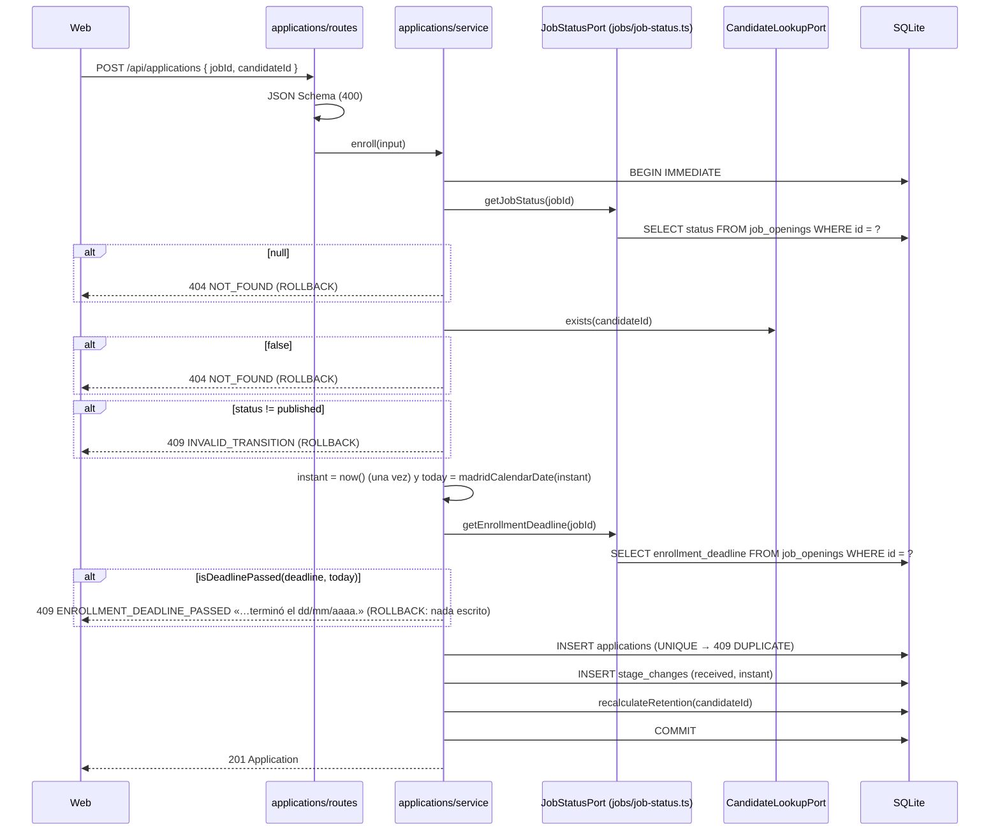

# HU-07 — Fecha límite de inscripción en una oferta — Diseño técnico (backend)

- **Origen:** `specs/PRD.md` (estado Ready, v1.1, 2026-10-13; manda DT-01 para los textos)
- **Generado por:** backend-architect
- **Scope cubierto:** RF-01, RF-02 y RF-05 enteros; la parte API de RF-04 (lo que el pipeline necesita saber) y de
  RF-06 (la oferta devuelve la fecha). RF-03, la parte web de RF-04 y la ficha (RF-06) son del TD-frontend, que consume
  el *Contrato de API* de este documento **sin cambios**.

## Enfoque técnico

Una columna nueva y opcional en `job_openings`, `enrollment_deadline` (día natural `AAAA-MM-DD` de Europe/Madrid,
`NULL` = sin límite), que la API expone como `enrollmentDeadline` en el `Job`. Cinco piezas:

1. **Calendario transversal** (`apps/api/src/calendar.ts`, nuevo): `madridCalendarDate` sale de
   `candidates/retention.ts` (sin cambiar su código) y se suman `isCalendarDate`, `addCalendarDays`,
   `formatCalendarDate` e `isDeadlinePassed`. Así `jobs` y `applications` calculan «hoy en Madrid» sin importar
   `candidates` (DEC-06, DD-02).
2. **`jobs`**: migración `004`, columna en `INSERT`/`UPDATE`/`toJob`, campo en los esquemas, recorte con `""` → `null`
   (DEC-11.3) y tres reglas en `rules.ts`: fecha válida y no anterior a hoy **solo si cambia** (RN-03, RN-05), plazo
   vencido al publicar (RN-04). Duplicar fija `enrollmentDeadline: null` de forma explícita (RN-08).
3. **Puerto «estado de la oferta»** (`JobStatusPort`, DEC-06): un método nuevo, `getEnrollmentDeadline(jobId)`, que
   implementa el lector de `jobs` (`job-status.ts`). Aditivo: `getJobStatus` y `getJobSummary` no cambian (DD-06).
4. **`applications`**: inscribir comprueba el plazo **dentro** de su `BEGIN IMMEDIATE`, después de «no publicada» y antes
   del `INSERT` que detecta el duplicado (RN-07), con el mismo `now()` que fecha la inscripción. 409 nuevo
   `ENROLLMENT_DEADLINE_PASSED`. El pipeline añade a `job` la fecha y si ya venció, calculado con el reloj del servidor.
5. **Seed**: dos ofertas publicadas reciben plazo relativo al día del reset (una +14 días, otra −3 días).

**Alternativa principal descartada:** que `jobs` exponga por el puerto un booleano «admite inscripciones» ya calculado.
Mezcla en `jobs` la regla de inscribir (que es de `applications`, RV-17), obliga a pasarle el reloj al lector y no da la
fecha que necesitan el mensaje del 409 y el pipeline. El puerto devuelve el dato; la regla vive en quien la aplica.

## Módulos y ficheros afectados

| Módulo | Fichero | Cambio |
|---|---|---|
| transversal | `apps/api/src/calendar.ts` | **nuevo** (~55 líneas): `madridCalendarDate` (movida), `isCalendarDate`, `addCalendarDays`, `formatCalendarDate`, `isDeadlinePassed` |
| transversal | `apps/api/src/db/migrations/004-add-job-enrollment-deadline.sql` | **nuevo**: `ALTER TABLE … ADD COLUMN` con `CHECK` (ver *Migración de datos*) |
| transversal | `apps/api/src/errors.ts` | modificar (47 → ~53): factoría `enrollmentDeadlinePassed(message)` |
| transversal | `apps/api/src/db/seed.ts` | modificar (166 → ~180): `enrollmentDeadlineInDays?` en `SeedJob` y cálculo relativo a `now` (DD-11) |
| candidates | `apps/api/src/modules/candidates/retention.ts` | modificar (77 → ~68): quita `MADRID_DAY` y `madridCalendarDate`; los importa de `../../calendar.ts`. Sin cambio de comportamiento |
| jobs | `apps/api/src/modules/jobs/schemas.ts` | modificar (205 → ~215): `enrollmentDeadline` en `Job`, `JobInput`, `jobFieldsSchema` y `jobSchema` (`required`) |
| jobs | `apps/api/src/modules/jobs/repository.ts` | modificar (189 → ~200): `JobRow`, `toJob`, `INSERT_SQL`, `UPDATE_SQL`, `JobEditableFields` (7 campos), `findEnrollmentDeadlineById`. `createJobWriteOperations` pasa de ~43 a ~45 líneas de código: no añadir nada más dentro |
| jobs | `apps/api/src/modules/jobs/rules.ts` | modificar (71 → ~100): `enrollmentDeadlineDetails`, `expiredDeadlineDetails` y sus tres mensajes (DT-01) |
| jobs | `apps/api/src/modules/jobs/service.ts` | modificar (156 → ~175): `create`, `updateJob`, `publishJob`, `duplicate` y `editableFields` (7 campos) |
| jobs | `apps/api/src/modules/jobs/routes.ts` | modificar: `enrollmentDeadline` en `trim` y `emptyToNull` de `trimJobText` |
| jobs | `apps/api/src/modules/jobs/job-status.ts` | modificar: `getEnrollmentDeadline` sobre `findEnrollmentDeadlineById` |
| applications | `apps/api/src/modules/applications/ports.ts` | modificar: `getEnrollmentDeadline(jobId): string \| null` en `JobStatusPort` |
| applications | `apps/api/src/modules/applications/service.ts` | modificar (243 → ~265): `enroll` (guarda del plazo, un solo `now()`), `getPipeline` (dos campos), mensaje del 409 |
| applications | `apps/api/src/modules/applications/schemas.ts` | modificar (230 → ~240): `Pipeline.job` y `pipelineSchema.properties.job` con `enrollmentDeadline` y `enrollmentDeadlinePassed` (`required`) |
| tests | `apps/api/test/helpers/applications.ts` | modificar: `createJobStatusStub({ enrollmentDeadline? })` con `getEnrollmentDeadline`; `createJobStatusSpy` registra también `deadlineInsideTransaction` |
| tests | `apps/api/test/applications/privacy-logs.test.ts` | modificar: `statusPort` implementa `getEnrollmentDeadline` (falla con `failStatus`) |
| tests | `apps/api/test/candidates/retention.test.ts` · `apps/api/test/candidates/seed.test.ts` · `apps/api/test/applications/seed-invariants.test.ts` | modificar: importan `madridCalendarDate` de `../../src/calendar.ts` |
| tests | `apps/api/test/jobs/{create,get,publish,duplicate,state-guards}.test.ts` | modificar donde comparan el `Job` entero: `enrollmentDeadline: null` (la suite confirma la lista exacta) |
| tests | `apps/api/test/applications/{pipeline,pipeline-adversarial,seed}.test.ts` | modificar donde comparan `job` del pipeline: los dos campos nuevos |
| tests | `apps/api/test/applications/ports.test.ts` | modificar (271 → ~285): lector real de `getEnrollmentDeadline` |
| tests | ver *Estrategia de tests* | **nuevos** |
| docs | `docs/_modules.md` (línea 16) · `docs/ARCHITECTURE.md` (filas «Reloj y transacciones», «Base de datos» y `JobStatusPort`) | modificar: `calendar.ts` como transversal, migración `004`, método nuevo del puerto |

Sin cambios: `apps/api/src/app.ts` (la asignación `const jobStatusPort: JobStatusPort = … createJobStatusReader(…)`
comprueba la forma nueva al compilar), `apps/api/test/helpers/test-app.ts`, `apps/api/src/modules/applications/routes.ts`,
`apps/api/src/http/*`, las migraciones `001`-`003` y `apps/api/test/module-boundaries.test.ts`.

## Contrato de API

Errores en el envelope `{ error: { code, message, details? } }` del manejador único
(`apps/api/src/http/error-handler.ts`); `details` = `[{ field, message }]`, nunca con el valor recibido (DEC-11.4). Las
escrituras heredan el 403 `CROSS_SITE_REQUEST` (DEC-12), y 413/415/500 como hoy.

### El campo

| Dónde | Forma |
|---|---|
| Entrada (`POST /api/jobs`, `PATCH /api/jobs/:id`) | `enrollmentDeadline`: `{ type: ['string', 'null'], maxLength: 32 }` en `jobFieldsSchema`. Se recorta antes de validar; `""` o solo espacios → `null` (EC-03). Opcional en los dos; en el `PATCH`, ausente = no cambia y `null` = quitar el plazo |
| Salida (`jobSchema`) | `enrollmentDeadline: { type: ['string', 'null'] }`, en `required`: siempre presente, `null` si no hay plazo. Formato `AAAA-MM-DD` |
| Listado (`GET /api/jobs`) | **No** aparece (`jobListItemSchema` sin cambios) |

**Reglas del servicio** (`rules.ts`, una vez superado el JSON Schema; mismo envelope y `field: 'enrollmentDeadline'`):

| Situación | Cuándo se comprueba | `details[].message` (DT-01) |
|---|---|---|
| No es `AAAA-MM-DD` con dígitos ASCII o el día no existe (`2026-02-31`, `2026-13-01`, `13/10/2026`, `2026-10-13T00:00:00Z`, `<script>`) | Alta con valor no nulo; edición solo si el valor **cambia** respecto al guardado | «Introduce una fecha válida.» |
| Día anterior a hoy en Europe/Madrid (reloj inyectado) | Ídem | «La fecha límite no puede ser anterior a hoy.» |
| Publicar un `draft` cuyo plazo ya venció | `POST /:id/publish`, en el mismo 400 que los obligatorios que falten | «La fecha límite de inscripción ya ha pasado.» |

Un número u otro tipo da el mensaje de Ajv («Debe ser un texto.»); más de 32 caracteres, «Debe tener como máximo 32
caracteres.» (DD-03). Todo 400 de campos lleva `message: 'Hay campos con errores.'` y `code: 'VALIDATION_ERROR'`.

### Por endpoint

| Método y ruta | Entrada | 2xx | Errores |
|---|---|---|---|
| `POST /api/jobs` | `createJobBodySchema` + `enrollmentDeadline` opcional | 201 `Job` en `draft` con `enrollmentDeadline` (o `null`) | 400 `VALIDATION_ERROR` (esquema; o servicio: banda salarial y fecha, en un solo 400) · 403 · 413 · 415 · 500 |
| `PATCH /api/jobs/:id` | `updateJobBodySchema` + `enrollmentDeadline` (`minProperties: 1` cuenta) | 200 `Job`; estado, `createdAt`, `publishedAt` y `closedAt` no cambian | 400 · 403 · 404 `NOT_FOUND` · 409 `INVALID_TRANSITION` («Una oferta cerrada no se puede editar.», también si solo cambia la fecha) · 500. Orden: esquema → 404 → 409 → reglas (400) |
| `POST /api/jobs/:id/publish` | Sin cambios | 200 `Job` publicado; ya publicada → 200 igual (S-01), aunque su plazo haya vencido | 400 con `details` = obligatorios que falten + `{ field: 'enrollmentDeadline', message: 'La fecha límite de inscripción ya ha pasado.' }`; sigue en `draft` · 403 · 404 · 409 (cerrada) |
| `POST /api/jobs/:id/duplicate` | Sin cambios | 201 `Job` en `draft` con `enrollmentDeadline: null`; la original no cambia | Sin cambios |
| `GET /api/jobs/:id` | Sin cambios | 200 `Job` con `enrollmentDeadline` | Sin cambios |
| `POST /api/applications` | Sin cambios (`{ jobId, candidateId }`) | 201 `Application` | Orden (todo dentro de `BEGIN IMMEDIATE`): 404 oferta → 404 candidato → 409 `INVALID_TRANSITION` (no `published`) → **409 `ENROLLMENT_DEADLINE_PASSED`** → 409 `DUPLICATE` (al insertar) → 500 |
| `GET /api/jobs/:jobId/applications` | Sin cambios | 200 `Pipeline` con `job` ampliado (abajo) | Sin cambios (400 · 404 · 500) |

**409 nuevo** (sin `details`, como `INVALID_TRANSITION`):

```json
{ "error": { "code": "ENROLLMENT_DEADLINE_PASSED",
             "message": "El plazo de inscripción de esta oferta terminó el 13/10/2026." } }
```

**`Pipeline.job`** (`pipelineSchema`, `additionalProperties: false`, los cuatro en `required`):

```ts
job: {
  id: number;
  status: 'draft' | 'published' | 'closed';
  enrollmentDeadline: string | null;   // 'AAAA-MM-DD' o null
  enrollmentDeadlinePassed: boolean;   // hay plazo y hoy (Europe/Madrid, reloj del servidor) es posterior
}
```

`enrollmentDeadlinePassed` es un hecho, **independiente del estado** (DD-08). Regla para la web: «Inscribir candidato»
solo si `status === 'published' && !enrollmentDeadlinePassed`; el texto de DT-01 solo si
`status === 'published' && enrollmentDeadlinePassed`; en `closed` manda lo de hoy (EC-28).

### Firmas internas

```ts
// apps/api/src/calendar.ts (nuevo, transversal)
export function madridCalendarDate(instant: string): string;            // movida tal cual (DEC-09)
export function isCalendarDate(text: string): boolean;                  // /^[0-9]{4}-[0-9]{2}-[0-9]{2}$/ + ida y vuelta UTC
export function addCalendarDays(date: string, days: number): string;    // aritmética UTC sobre 'AAAA-MM-DD'
export function formatCalendarDate(date: string): string;               // 'AAAA-MM-DD' → 'dd/mm/aaaa'
export function isDeadlinePassed(deadline: string | null, today: string): boolean; // deadline !== null && deadline < today

// apps/api/src/modules/applications/ports.ts
export interface JobStatusPort {
  getJobStatus(jobId: number): JobStatus | null;          // sin cambios
  getJobSummary(jobId: number): JobSummary | null;        // sin cambios
  /** 'AAAA-MM-DD' o null (sin plazo u oferta inexistente). Se llama tras getJobStatus, en la misma transacción. */
  getEnrollmentDeadline(jobId: number): string | null;
}

// apps/api/src/modules/jobs/rules.ts
export function enrollmentDeadlineDetails(value: string | null, today: string): ErrorDetail[]; // [] si null
export function expiredDeadlineDetails(deadline: string | null, today: string): ErrorDetail[];

// apps/api/src/errors.ts
export function enrollmentDeadlinePassed(message: string): AppError; // 409 ENROLLMENT_DEADLINE_PASSED, sin details
```

`isCalendarDate`: tras la expresión regular, `const d = new Date(0); d.setUTCFullYear(y, m - 1, day)` y
`d.toISOString().slice(0, 10) === text` (vale para años < 100, donde `Date.UTC` suma 1900). «Hoy» es siempre
`madridCalendarDate(now().toISOString())`.

## Migración de datos

`apps/api/src/db/migrations/004-add-job-enrollment-deadline.sql` (nueva; la aplica `migrate.ts` en su transacción y la
registra en `schema_migrations`):

```sql
-- HU-07: fecha límite de inscripción (FEAT-04 RN-01, RN-02). Día natural de Europe/Madrid 'AAAA-MM-DD', sin hora;
-- NULL = sin límite. «No anterior a hoy» depende del reloj: lo valida el servicio, no la base.
ALTER TABLE job_openings ADD COLUMN enrollment_deadline TEXT
  CHECK (enrollment_deadline IS NULL
      OR (enrollment_deadline GLOB '[0-9][0-9][0-9][0-9]-[0-9][0-9]-[0-9][0-9]'
          AND date(enrollment_deadline) IS enrollment_deadline));
```

- **Filas existentes:** quedan con `NULL` (sin plazo) y se comportan como hoy (EC-06, EC-14).
- **`CHECK`:** `date()` normaliza los días imposibles (`date('2026-02-31')` = `2026-03-03`, `date('2026-13-01')` =
  `NULL`), así que la igualdad rechaza todo lo que no sea un día real. Comprobado en Node 24.21 (SQLite 3.53.4):
  `2026-10-13` y `2028-02-29` pasan; `2026-02-31`, `2026-13-01`, `2027-02-29`, `13/10/2026` y `" 2026-10-13"` abortan.
  `date()` sin `'now'` es determinista y SQLite lo admite en un `CHECK`. Es la última defensa: el servicio responde 400
  antes.
- **Sin índice:** no se filtra ni se ordena por la fecha (fuera de scope); se lee por `id`.
- **INV-02** (nunca anterior al día en que se guarda) no cabe en un `CHECK` (depende del reloj): la garantizan el
  servicio y sus tests.
- **Seed** (`seed.ts`, DD-11), datos inventados ya existentes, fechas relativas al día de Madrid de `now`:

| Posición en `SEED_JOBS` | Oferta | Inscripciones | `enrollmentDeadlineInDays` | Con `now` = 2026-10-13 |
|---|---|---|---|---|
| 4 | «Desarrollador/a backend (Node.js)» | 10 | `+14` | `2026-10-27` |
| 5 | «Administrativo/a contable» | 0 | `−3` | `2026-10-10` (vencido) |
| resto | — | — | sin plazo | `null` |

  `seed()` hace `enrollmentDeadline = addCalendarDays(madridCalendarDate(now.toISOString()), offset)` y lo pasa en el
  `JobInput` de `repository.insert`. El seed escribe por el repositorio, no por el servicio: no aplica RN-03 (igual que
  hoy no aplica las transiciones).

## Diagrama de secuencia



Pipeline: `getJobStatus` (404) → `getEnrollmentDeadline` → `listByJob` → `findNames` → `today` con `now()` →
`{ job: { id, status, enrollmentDeadline, enrollmentDeadlinePassed: isDeadlinePassed(deadline, today) }, items }`.
Sin transacción, como hoy (DD-07 de HU-05).

## Error paths

| Edge case (PRD) | Dónde se detecta | Estrategia | Respuesta o efecto observable | Test |
|---|---|---|---|---|
| EC-01 | `rules.enrollmentDeadlineDetails` (texto) · JSON Schema (número) | rechazar | 400 `VALIDATION_ERROR`, `field: 'enrollmentDeadline'`, «Introduce una fecha válida.» (número: «Debe ser un texto.»); el cuerpo no contiene el valor | `jobs/deadline-adversarial.test.ts` |
| EC-02 | `rules.enrollmentDeadlineDetails` | aceptar o rechazar | Hoy, `2028-02-29` y `2036-10-13` → 201; ayer → 400 «…anterior a hoy.»; `2027-02-29` → 400 «Introduce una fecha válida.» | `jobs/deadline.test.ts` |
| EC-03 | `trimJobText` (`preValidation`) | normalizar | `""` y `"   "` → `null`: 201/200 sin plazo | `jobs/deadline.test.ts` |
| EC-04 | `UPDATE` de `job_openings` (`failWrites(db, 'UPDATE', { column: 'enrollment_deadline' })`) | `ROLLBACK` | 500 `INTERNAL_ERROR` genérico; `GET` devuelve la oferta igual | `jobs/deadline-adversarial.test.ts` |
| EC-05 | — (DEC-08) | última escritura gana | Dos `PATCH` seguidos: el `GET` da la segunda fecha | `jobs/deadline.test.ts` |
| EC-06 | Migración `004` | `NULL` por defecto | Oferta creada con `001`-`003` y migrada después: `enrollmentDeadline: null`, se publica e inscribe | `jobs/migration-deadline.test.ts` |
| EC-07 | `rules` + sentencias preparadas + `CHECK` | rechazar | `<script>…` y `' OR 1=1 --` → 400 DT-01; la fila no cambia; el cuerpo no repite el valor | `jobs/deadline-adversarial.test.ts` |
| EC-08 | `updateJob`: valor igual al guardado | no validar | `PATCH` con la misma fecha vencida → 200 | `jobs/deadline.test.ts` (CA-05) |
| EC-09 | `checkAction('update', 'closed')` antes de las reglas | 409 | `{ enrollmentDeadline: '2026-11-30' }` y `{ enrollmentDeadline: null }` sobre `closed` → 409 `INVALID_TRANSITION`; sin cambios | `jobs/deadline-adversarial.test.ts` |
| EC-10 | — | N/A | N/A — inscribir no recibe la fecha | — |
| EC-11 | `enroll`: `isDeadlinePassed(deadline, madridCalendarDate(now))` | reloj inyectado | Ver RNF-01 en *Estrategia de tests*: 201 dentro, 409 fuera | `applications/enroll-deadline.test.ts` |
| EC-12 | `INSERT` de `applications` (`failWrites`) con plazo hoy | `ROLLBACK` | 500; 0 inscripciones, 0 `StageChange`, retención igual | `applications/enroll-deadline-adversarial.test.ts` |
| EC-13 | `getEnrollmentDeadline` dentro de `BEGIN IMMEDIATE` | leer en la transacción | Espía: `deadlineInsideTransaction` = `[true]`; recortar a hoy y luego inscribir a las 23:59:59 → 201 | `applications/enroll-deadline-adversarial.test.ts` |
| EC-14 | `isDeadlinePassed(null, …)` = `false` | sin límite | `published` sin plazo → 201 | `applications/enroll-deadline.test.ts` (CA-09) |
| EC-15 | `enrollmentDeadlinePassed(message)` | mensaje fijo | El 409 es exactamente `{ error: { code, message } }`; sin `details`, sin nombre, email ni teléfono; sin log | `applications/enroll-deadline-adversarial.test.ts` |
| EC-16 | Guarda antes de cualquier escritura | idempotente | Dos intentos → el mismo 409; recuentos iguales | `applications/enroll-deadline.test.ts` (CA-10) |
| EC-17 | API: `rules` | rechazar | 400 DT-01 junto al campo (la web lo pinta: TD-frontend) | `jobs/deadline.test.ts` (CA-04) |
| EC-18 | API: `PATCH { enrollmentDeadline: null }` | quitar plazo | 200 con `null` (la web envía `null`: TD-frontend) | `jobs/deadline.test.ts` (CA-03) |
| EC-19 | Web | — | TD-frontend | TD-frontend |
| EC-20 | Web | — | TD-frontend | TD-frontend |
| EC-21 | API: `toJob` | — | Oferta sin plazo → `enrollmentDeadline: null` en el `GET` | `jobs/migration-deadline.test.ts` (EC-06) |
| EC-22 | — | N/A | N/A — sin texto libre | — |
| EC-23 | API: igual que EC-08 | no validar | 200 sin revalidar | `jobs/deadline.test.ts` (CA-05) |
| EC-24 | — | N/A | N/A | — |
| EC-25 | API: `getPipeline` | flag del servidor | Plazo hoy → `enrollmentDeadlinePassed: false`; ayer → `true`, también con `items: []` | `applications/pipeline-deadline.test.ts` |
| EC-26 | Web | — | TD-frontend | TD-frontend |
| EC-27 | API: igual que CA-10 | 409 | El pipeline leído antes de las 00:00 da `false`; inscribir después → 409; el pipeline releído → `true` | `applications/pipeline-deadline.test.ts` |
| EC-28 | API: `getPipeline` + `enroll` | estado manda | `closed` con plazo vencido → `status: 'closed'`, `enrollmentDeadlinePassed: true`; inscribir → 409 `INVALID_TRANSITION` | `applications/pipeline-deadline.test.ts` · `applications/enroll-deadline.test.ts` (CA-11) |
| EC-29 | — | N/A | N/A | — |
| EC-30 | API: `getPipeline` | lectura pura | Dos `GET` iguales | `applications/pipeline-deadline.test.ts` |

## Threat modeling

| STRIDE | Amenaza concreta | Mitigación |
|---|---|---|
| Suplantación | Otra web lanza `PATCH`/`POST` contra la API local para mover el plazo | DEC-12 (403 `CROSS_SITE_REQUEST`), heredado sin cambios. Sin login (DEC-04) |
| Manipulación | Inyección SQL por `enrollmentDeadline` | Sentencias preparadas con lista fija de columnas (`UPDATE_SQL`), `isCalendarDate` antes de escribir y `CHECK` en la base |
| Manipulación | *Mass assignment*: `status`, `publishedAt`… en el mismo cuerpo | `additionalProperties: false` y `forbiddenFields` sin cambios; la fecha solo entra por su columna |
| Manipulación | El cliente decide qué es «hoy» | «Hoy» sale siempre del reloj del servidor (DEC-09); la web no envía fecha de referencia |
| Repudio | No queda rastro de quién cambió el plazo | Aceptado: sin login (DEC-04) y el historial del plazo está fuera de scope |
| Exposición de datos | El 409 o los logs llevan datos del candidato | El mensaje solo lleva la fecha de la oferta; los 409 no se registran (solo los 500, `error-handler.ts`) |
| Exposición de datos | Enumeración de IDs de oferta por el 409 | Orden 404 → 409 sin cambios: el 409 solo sale de ofertas que existen, igual que `INVALID_TRANSITION` hoy |
| Denegación de servicio | Texto enorme en el campo | `maxLength: 32` y `bodyLimit` de Fastify |
| Elevación de privilegios | — | N/A — un único rol (DEC-04). Si llegase el login: fijar o cambiar el plazo sería permiso de quien edita la oferta, sin cambios en este diseño |

## Datos personales

Ninguno. La fecha límite es un dato de la oferta (FEAT-04 R7). No cambia la retención: un 409 por plazo no escribe nada
y no llama a `recalculateRetention` (CA-10). El mensaje del 409 solo lleva la fecha; `Pipeline.job` gana dos campos de
la oferta y los `items` no cambian (RNF-04 de HU-05). No hace falta el `datos-personales-auditor`.

## Decisiones de diseño

### DD-01: Columna `enrollment_deadline` `TEXT` `AAAA-MM-DD` con `CHECK` de día real; API `enrollmentDeadline`
- **Contexto:** RN-02 pide un día de calendario sin hora; DEC-09 ya guarda así el fin de retención.
- **Opciones consideradas:** A) día `AAAA-MM-DD` con `GLOB` y `date(x) IS x`; B) solo `GLOB`, como `retention_ends_at`;
  C) instante UTC del final del día.
- **Elegida:** A.
- **Razón:** el `CHECK` defiende también «día inexistente» (EC-01), no solo el formato; C rompe en los cambios de hora y
  contradice DEC-09.
- **Tradeoff:** el `CHECK` depende de `date()` de SQLite (verificado en la versión del repo); una ruta que escriba sin el
  servicio (seed) no puede guardar un día imposible, pero sí uno pasado.

### DD-02: Utilidades de calendario en `apps/api/src/calendar.ts` (transversal), moviendo `madridCalendarDate`
- **Contexto:** `jobs` y `applications` necesitan «hoy en Madrid» y no pueden importar `candidates` (DEC-06).
- **Opciones consideradas:** A) módulo transversal junto a `clock.ts`, con la función movida; B) copiar la función en
  `jobs` y en `applications`; C) que `jobs` calcule «vencido» y lo dé por el puerto.
- **Elegida:** A.
- **Razón:** una sola definición del día de Madrid (DEC-09) para tres módulos; `module-boundaries.test.ts` admite
  `../../calendar.ts` (no es `modules/`). C no da «hoy» al pipeline ni al mensaje.
- **Tradeoff:** toca `candidates/retention.ts` y tres imports de tests de un módulo que la HU no declara (refactor sin
  cambio de comportamiento: `retention.test.ts` lo vigila).

### DD-03: La validez y el «no anterior a hoy» van en el servicio; el esquema solo tipo y `maxLength: 32`
- **Contexto:** DT-01 fija «Introduce una fecha válida.» para cualquier fecha no válida; el manejador da mensajes por
  *keyword* (DEC-11.4), y `pattern`/`format` darían «Formato no válido.».
- **Opciones consideradas:** A) esquema `['string','null']` + `maxLength: 32`, regla en `rules.ts`; B) `pattern` o
  `format: 'date'` en el esquema y el resto en el servicio; C) mensaje por campo en el manejador.
- **Elegida:** A.
- **Razón:** un solo texto para «no válida», como pide DT-01; mismo patrón que la banda salarial (reglas tras el esquema).
  32 deja pasar cualquier fecha-hora ISO 8601 (29 caracteres con milisegundos y desfase) para que reciba el texto de DT-01.
  C cambiaría DEC-11.4 para un caso.
- **Tradeoff:** un cuerpo con errores de esquema y de fecha a la vez da dos 400 seguidos (primero el esquema); más de 32
  caracteres da el mensaje genérico de longitud.

### DD-04: «Solo si cambia» = el valor del `PATCH` difiere del guardado
- **Contexto:** RN-03, CA-05 y EC-08: reenviar la misma fecha vencida no da error.
- **Opciones consideradas:** A) validar si `patch.enrollmentDeadline !== undefined`, no es `null` y `!== current`;
  B) validar siempre que venga.
- **Elegida:** A.
- **Razón:** la web reenvía el formulario entero (TD-frontend); B rompería CA-05.
- **Tradeoff:** ninguno práctico: un valor guardado ya pasó la validación o el `CHECK`.

### DD-05: `JobEditableFields` con 7 campos y `duplicate` fija `enrollmentDeadline: null`
- **Contexto:** RN-08 (INV-05 de FEAT-04): el duplicado nace sin plazo.
- **Opciones consideradas:** A) la fecha es editable y `duplicate` la anula de forma explícita; B) dejarla fuera de
  `JobEditableFields` y confiar en que `insert` la ponga a `null` por omisión.
- **Elegida:** A.
- **Razón:** la regla queda escrita donde se aplica y la fusión del `PATCH` la trata como un campo más.
- **Tradeoff:** quien añada otro campo no copiable tendrá que anularlo igual.

### DD-06: Método aditivo `getEnrollmentDeadline` en `JobStatusPort`
- **Contexto:** `applications` necesita la fecha en inscribir y en el pipeline (DEC-06).
- **Opciones consideradas:** A) método nuevo; B) sustituir `getJobStatus` por una lectura conjunta
  `{ status, enrollmentDeadline }`; C) ampliar `JobSummary`.
- **Elegida:** A.
- **Razón:** no cambia la semántica de `getJobStatus` ni los tests que la vigilan (EC-18 y EC-19 de HU-04); los dobles
  solo suman un método. C lee el título sin necesitarlo.
- **Tradeoff:** dos `SELECT` por oferta en inscribir y en el pipeline (por `id`, despreciable).

### DD-07: Guarda del plazo tras «no publicada», con el `now()` único de la inscripción
- **Contexto:** RN-07 (no publicada > plazo > duplicado); hoy `now()` se llama una vez, tras las guardas.
- **Opciones consideradas:** A) 404 → 404 → 409 estado → `now()` → 409 plazo → `INSERT`; B) plazo antes de comprobar el
  candidato.
- **Elegida:** A.
- **Razón:** mantiene el orden de UC-14 y un solo instante: el día que decide el plazo es el de la inscripción.
- **Tradeoff:** con plazo vencido y candidato inexistente sale el 404, no el 409.

### DD-08: El pipeline devuelve `enrollmentDeadline` y `enrollmentDeadlinePassed` calculado en el servidor
- **Contexto:** RF-04 deja la forma a `/tech-design`; DEC-09 fija el reloj del servidor.
- **Opciones consideradas:** A) fecha + booleano de hecho; B) solo la fecha y la web calcula «hoy»; C) un único
  `canEnroll`.
- **Elegida:** A.
- **Razón:** el navegador puede estar en otra zona u hora; con B, web y API discreparían alrededor de las 00:00. C mezcla
  estado y plazo, y EC-28 necesita distinguirlos.
- **Tradeoff:** el booleano es `true` también en `draft` y `closed`: la web mira antes `status`.

### DD-09: 409 `ENROLLMENT_DEADLINE_PASSED` sin `details`, factoría en `errors.ts`
- **Contexto:** RN-06 fija código y mensaje; DEC-07, que no lleve datos de más.
- **Opciones consideradas:** A) sin `details`; B) `details: [{ field: 'jobId', … }]`.
- **Elegida:** A.
- **Razón:** igual que `INVALID_TRANSITION`; la fecha ya va en el mensaje y la web refresca el pipeline (RN-09).
- **Tradeoff:** la web no puede leer la fecha del 409 de forma estructurada (no lo necesita).

### DD-10: Publicar: el plazo vencido va en el mismo 400 que los obligatorios; `now()` una vez
- **Contexto:** RN-04 y CA-07; `publishJob` ya da un 400 con un elemento por campo pendiente.
- **Opciones consideradas:** A) `assertNoDetails([...missing, ...expiredDeadlineDetails])` con
  `publishedAt = now()` calculado tras el `noop`; B) un 409.
- **Elegida:** A.
- **Razón:** el PRD pide 400 con el campo en `details`; la web ya pinta esos 400 junto al campo. El `noop` sigue sin
  llamar a `now()` (S-01).
- **Tradeoff:** ninguno.

### DD-11: Seed con plazos relativos al día de Madrid del reset, en las posiciones 4 (+14) y 5 (−3)
- **Contexto:** CA-13 / FEAT-04 R7; las inscripciones del seed de las publicadas caen en las últimas 90 h
  (`seed-applications.ts`).
- **Opciones consideradas:** A) vencido en la publicada vacía (5); B) vencido en una con inscripciones.
- **Elegida:** A.
- **Razón:** B dejaría inscripciones creadas después de su plazo (rompe INV-01 de FEAT-04).
- **Tradeoff:** el seed no muestra «vencida con inscripciones»; CA-12 lo cubren los tests. Si la base se usa más de 14
  días después del reset, las dos quedan vencidas (se regenera con `npm run db:reset`).

### DD-12: Las ofertas con plazo vencido de los tests se crean moviendo el reloj, no con SQL
- **Contexto:** la API nunca acepta una fecha pasada; los CA parten de ofertas vencidas.
- **Opciones consideradas:** A) crear con `createTestClock` en un día anterior y luego `clock.set(...)`; B) `UPDATE` por
  SQL en el test.
- **Elegida:** A (B solo en `migration-deadline.test.ts`, que prueba la base).
- **Razón:** recorre los caminos reales y no fabrica estados que la API no puede producir.
- **Tradeoff:** cada test fija dos o tres instantes.

## Impacto en decisiones

| DEC | Efecto |
|---|---|
| DEC-03 | Se aplica: migración nueva `004`; ninguna editada |
| DEC-06 | Se aplica y **se aclara**: el puerto «estado de la oferta» suma la fecha límite (ver propuesta) |
| DEC-07 | Se aplica: código nuevo `ENROLLMENT_DEADLINE_PASSED` (409), fijado por el PRD |
| DEC-08 | Se aplica: guarda leída en la transacción; última escritura gana |
| DEC-09 | Se aplica y **se aclara**: dónde viven los cálculos de día (ver propuesta) |
| DEC-11 | Se aplica: recorte y `""` → `null`, esquema estricto, `details` sin el valor. Sin cambios |
| DEC-12 | Se hereda sin cambios |

**Propuestas de aclaración** (las escribe quien cierre la HU, no este documento; ninguna cambia la decisión):

- **DEC-09** — *Aclaración 2026-10-13 (HU-07):* «La **fecha límite de inscripción** de una oferta es otra fecha de
  calendario `AAAA-MM-DD` de Europe/Madrid, inclusiva. Los cálculos de día natural (`madridCalendarDate`,
  `isCalendarDate`, `addCalendarDays`, `formatCalendarDate`, `isDeadlinePassed`) viven en `apps/api/src/calendar.ts`,
  transversal, para que cualquier módulo los use sin importar otro (DEC-06). La decisión no cambia.»
- **DEC-06** — *Aclaración 2026-10-13 (HU-07):* en «Estado de la oferta», añadir «y su fecha límite de inscripción
  (`getEnrollmentDeadline`, HU-07): inscribir comprueba el plazo y el pipeline lo muestra». La decisión no cambia.

## Estrategia de tests

Vitest con `app.inject` sobre `:memory:` migrada (`createTestApp`), reloj `createTestClock` (DD-12), fallos reales con
`failWrites`, dobles de puerto sin mocks y datos inventados. Reloj por defecto `2026-10-13T10:00:00Z` (12:00 en Madrid).
Ficheros nuevos ≤ 300 líneas. `[adversarial]` en uno por RF Must (RF-01 y RF-02).

| Fichero (nuevo salvo indicación) | Contenido |
|---|---|
| `apps/api/test/calendar.test.ts` | Unitarios de `calendar.ts`: `isCalendarDate` (bisiestos, `2026-02-31`, `2026-13-01`, año `0050`, espacios, NUL), `addCalendarDays` (cruce de mes, año y cambio de hora), `formatCalendarDate`, `isDeadlinePassed` (`null`, igual, anterior, posterior), `madridCalendarDate` en las fronteras de RNF-01 |
| `apps/api/test/jobs/migration-deadline.test.ts` | Columna nullable; `CHECK` por SQL (válidos e inválidos); EC-06 (oferta creada con `001`-`003`, migrada con `migrate`) |
| `apps/api/test/jobs/deadline.test.ts` | CA-01..CA-06 (parte API de ofertas), EC-02, EC-03, EC-05, EC-08 |
| `apps/api/test/jobs/deadline-publish-duplicate.test.ts` | CA-07, CA-08; publicar una ya publicada con plazo vencido → 200 igual |
| `apps/api/test/jobs/deadline-adversarial.test.ts` **[adversarial]** | EC-01, EC-04, EC-07, EC-09; `maxLength`; frontera de día al crear (UTC 13, Madrid 14) |
| `apps/api/test/applications/enroll-deadline.test.ts` | CA-09, CA-10, CA-11, RN-07 en `draft`, CA-06 (inscribir tras ampliar o quitar), RNF-01 |
| `apps/api/test/applications/enroll-deadline-adversarial.test.ts` **[adversarial]** | EC-12, EC-13, EC-15 (con log capturado, como `privacy-logs.test.ts`), 500 si `getEnrollmentDeadline` lanza |
| `apps/api/test/applications/pipeline-deadline.test.ts` | CA-12 (API), CA-06 (pipeline), EC-25, EC-27, EC-28, EC-30 |
| `apps/api/test/jobs/seed-deadlines.test.ts` | CA-13 con `seed(db, NOW)` y con otro `NOW` (fechas desplazadas); INV-01 en el seed |
| `apps/api/test/applications/ports.test.ts` (modificar) | Lector real: `getEnrollmentDeadline` → fecha, `null` sin plazo, `null` si no existe |
| Tests que comparan el `Job` o `Pipeline.job` enteros (modificar) | Añadir los campos nuevos; el de «campo desconocido» y el de claves (`enumeration.test.ts`) siguen en verde con el esquema ampliado |

**RNF-01** (`enroll-deadline.test.ts`, `it.each`; plazo = día indicado):

| Plazo | Reloj (UTC) | Madrid | Esperado |
|---|---|---|---|
| 2026-10-13 | `2026-10-13T21:59:59Z` | 13/10 23:59:59 | 201 |
| 2026-10-13 | `2026-10-13T22:00:00Z` | 14/10 00:00:00 | 409 |
| 2026-10-13 | `2026-10-13T23:30:00Z` (UTC aún 13) | 14/10 01:30 | 409 |
| 2026-03-29 (cambio a verano) | `2026-03-29T21:59:59Z` | 29/03 23:59:59 | 201 |
| 2026-03-29 | `2026-03-29T22:00:00Z` | 30/03 00:00:00 | 409 |
| 2026-03-28 | `2026-03-28T22:59:59Z` / `2026-03-28T23:00:00Z` | 28/03 23:59:59 / 29/03 00:00 | 201 / 409 |
| 2026-10-25 (cambio a invierno) | `2026-10-25T22:59:59Z` | 25/10 23:59:59 | 201 |
| 2026-10-25 | `2026-10-25T23:00:00Z` | 26/10 00:00:00 | 409 |
| 2026-10-24 | `2026-10-24T21:59:59Z` / `2026-10-24T22:00:00Z` | 24/10 23:59:59 / 25/10 00:00 | 201 / 409 |

(Instantes comprobados con `Intl` en Node 24.21.) La oferta se crea con el reloj días antes y luego se fija el instante.

**Criterio → test** (nombres previstos):

| CA / EC / RNF | Test |
|---|---|
| CA-01 · EC-02 | `jobs/deadline.test.ts` › `CA-01 alta con hoy, con 2036-10-13 y sin fecha → 201 draft con la fecha o null` |
| CA-02 | `jobs/deadline.test.ts` › `CA-02 alta con 2026-10-12 → 400 «…anterior a hoy.» y con 2026-02-31 → 400 «Introduce una fecha válida.»; 0 ofertas` |
| CA-03 · EC-18 | `jobs/deadline.test.ts` › `CA-03 published 2026-10-20 → 15/10, 30/11 y null: 200, mismo estado y fechas` |
| CA-04 · EC-17 | `jobs/deadline.test.ts` › `CA-04 draft: 2026-10-12 y 2026-13-01 → 400 junto al campo; la oferta igual` |
| CA-05 · EC-08 · EC-23 | `jobs/deadline.test.ts` › `CA-05 published vencida: editar descripción y reenviar 2026-10-10 → 200` |
| CA-06 | `enroll-deadline.test.ts` › `CA-06 ampliar a hoy o quitar el plazo vencido → sigue published e inscribir da 201`; `pipeline-deadline.test.ts` › `CA-06 tras ampliar, enrollmentDeadlinePassed false` |
| CA-07 | `jobs/deadline-publish-duplicate.test.ts` › `CA-07 publicar con 2026-10-10 → 400 con enrollmentDeadline y sigue draft; con hoy → 200` |
| CA-08 | `jobs/deadline-publish-duplicate.test.ts` › `CA-08 duplicar una con 2026-10-20 → borrador con null; la original igual` |
| CA-09 · EC-14 | `enroll-deadline.test.ts` › `CA-09 plazo hoy a las 23:59:59 de Madrid y oferta sin plazo → 201` |
| CA-10 · EC-16 | `enroll-deadline.test.ts` › `CA-10 00:00:00 del 14 → 409 ENROLLMENT_DEADLINE_PASSED «…terminó el 13/10/2026.» dos veces; 0 inscripciones, 0 StageChange, retención igual` |
| CA-11 · EC-28 | `enroll-deadline.test.ts` › `CA-11 vencida con el candidato ya inscrito → 409 ENROLLMENT_DEADLINE_PASSED (no DUPLICATE); closed vencida → INVALID_TRANSITION; draft vencida → INVALID_TRANSITION` |
| CA-12 (API) · EC-25 | `pipeline-deadline.test.ts` › `CA-12 published vencida con y sin inscripciones → job con la fecha y enrollmentDeadlinePassed true; items iguales; avanzar y rechazar 200` |
| CA-13 | `jobs/seed-deadlines.test.ts` › `CA-13 seed(NOW): una publicada con plazo NOW+14 y otra con NOW−3, sin inscripciones posteriores al plazo` |
| RNF-01 · EC-11 | `enroll-deadline.test.ts` › `RNF-01 frontera %s → %i` (tabla anterior) |
| EC-01 · EC-07 | `jobs/deadline-adversarial.test.ts` › `EC-01/EC-07 %s → 400 sin repetir el valor y sin escribir` |
| EC-03 | `jobs/deadline.test.ts` › `EC-03 "" y espacios → null en alta y edición` |
| EC-04 | `jobs/deadline-adversarial.test.ts` › `EC-04 falla el UPDATE de enrollment_deadline → 500 y la oferta igual` |
| EC-05 | `jobs/deadline.test.ts` › `EC-05 dos ediciones seguidas: gana la última` |
| EC-06 · EC-21 | `jobs/migration-deadline.test.ts` › `EC-06 oferta previa a la migración: null, se publica y se inscribe` |
| EC-09 | `jobs/deadline-adversarial.test.ts` › `EC-09 closed: cambiar o quitar la fecha → 409 INVALID_TRANSITION` |
| EC-12 | `enroll-deadline-adversarial.test.ts` › `EC-12 falla el INSERT dentro de plazo → 500 y nada escrito` |
| EC-13 | `enroll-deadline-adversarial.test.ts` › `EC-13 el plazo se lee dentro de BEGIN IMMEDIATE; recortado a hoy, se inscribe` |
| EC-15 | `enroll-deadline-adversarial.test.ts` › `EC-15 el 409 solo lleva code y message con la fecha; nada en el log` |
| EC-27 · EC-30 | `pipeline-deadline.test.ts` › `EC-27 pipeline a las 23:59 false, inscribir a las 00:00 → 409, pipeline → true`; `EC-30 dos lecturas iguales` |
| Migración | `jobs/migration-deadline.test.ts` › `CHECK: 2026-02-31, 2026-13-01, 2027-02-29 y 13/10/2026 abortan; 2028-02-29 pasa` |
| Puerto | `ports.test.ts` › `HU-07 lector real: getEnrollmentDeadline → fecha, null sin plazo, null si no existe` |
| Fronteras de módulo | `module-boundaries.test.ts` (existente, sin cambios) |

**Checklist de implementación** (base del `task-planner`; 6 tasks de API más las de web del TD-frontend):

1. `[api]` `calendar.ts` + `calendar.test.ts`; `retention.ts` y los tres imports de tests; `_modules.md` y
   `ARCHITECTURE.md` (fila «Reloj y transacciones»).
2. `[api]` Migración `004` → `repository.ts` → `schemas.ts` → `trimJobText` → `job-status.ts` + `ports.ts`
   (`getEnrollmentDeadline`) y dobles de `helpers/applications.ts` y `privacy-logs.test.ts`; arreglar los tests que
   comparan el `Job` o el pipeline enteros; `migration-deadline.test.ts`; `ports.test.ts`.
3. `[api]` `rules.ts` → `service.ts` de `jobs` (`create`, `updateJob`, `publishJob`, `duplicate`) → `deadline.test.ts` y
   `deadline-publish-duplicate.test.ts`.
4. `[api] [adversarial]` `deadline-adversarial.test.ts`.
5. `[api]` `errors.ts` → `service.ts` y `schemas.ts` de `applications` (`enroll`, `getPipeline`) →
   `enroll-deadline.test.ts`, `pipeline-deadline.test.ts`; seguido de `[adversarial]`
   `enroll-deadline-adversarial.test.ts` (puede ser una task aparte).
6. `[api]` `seed.ts` → `seed-deadlines.test.ts`; `ARCHITECTURE.md` (fila «Base de datos» y `JobStatusPort`).

## Riesgos

| Riesgo | Probabilidad (1–5) | Impacto (1–5) | Mitigación |
|---|---|---|---|
| Frontera del día mal calculada (UTC frente a Madrid, cambios de hora) | 2 | 4 | Un único cálculo (`calendar.ts`) y la tabla de RNF-01 con instantes comprobados |
| Cascada de tests rojos al ampliar `jobSchema` y `pipelineSchema` | 5 | 2 | En la misma task que el cambio de esquema (task 2); lista confirmada por la suite |
| Mover `madridCalendarDate` rompe la retención | 1 | 4 | Movida sin cambios; `retention.test.ts` y los tests de seed de candidatos la cubren |
| Web y API discrepan sobre si venció | 2 | 2 | El booleano lo calcula el servidor (DD-08); la API decide siempre y la web refresca tras el 409 (RN-09) |
| Seed desfasado si la base se usa días después del reset | 3 | 1 | Documentado (DD-11); `npm run db:reset`; los e2e regeneran `data/e2e.db` en cada pasada |
| `date()` en un `CHECK` con otra versión de SQLite | 1 | 3 | Node ≥ 24.15 fijado (DEC-01); `migration-deadline.test.ts` lo comprueba |
| `createJobWriteOperations` cerca del umbral de 50 líneas | 3 | 1 | Solo dos líneas más; nada nuevo dentro (consulta nueva en `createJobQueries`) |

## Open Decisions

No hay decisiones abiertas.

## Fuera de scope

- Columna, filtro u orden por la fecha en `GET /api/jobs`; aviso de «plazo vencido» en la ficha.
- Cierre automático, estado nuevo, avisos, hora de corte, límite por etapa, fecha de apertura, excepciones por
  candidato e historial del plazo.
- Cambios en avanzar, rechazar, cerrar o en las inscripciones existentes (RN-10): `advance`, `reject` y
  `rejectActiveApplications` no leen el plazo.
- Formulario, pipeline y ficha en la web: TD-frontend.
