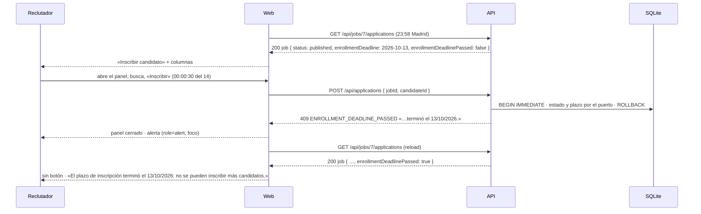
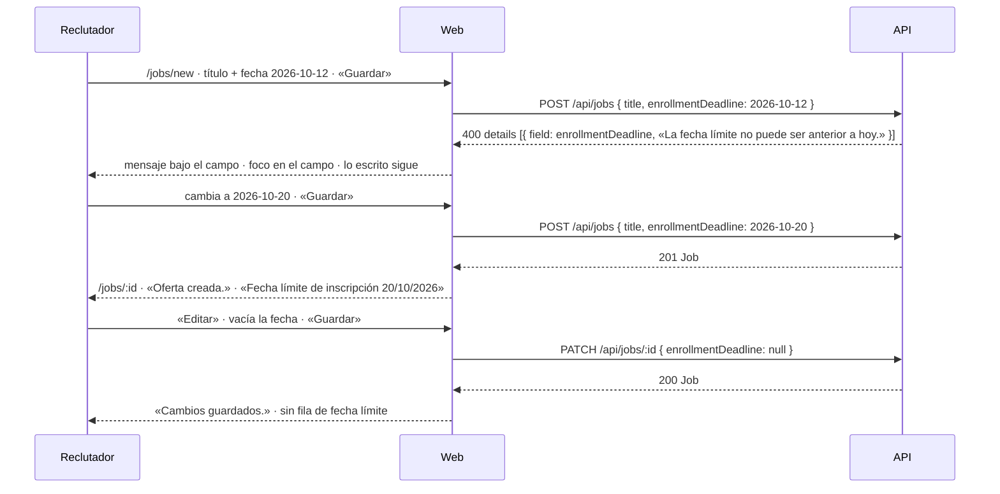

# HU-07 — Fecha límite de inscripción en una oferta — Diseño técnico (frontend)

- **Origen:** `specs/PRD.md` (estado Ready, v1.1, 2026-10-13; DT-01)
- **Generado por:** frontend-architect
- **Scope cubierto:** RF-03 y RF-04 (frontend, Must), RF-06 (Could, se incluye: DD-07) y la parte visible de RF-01
  (400 al publicar, CA-07) y RF-05 (seed, en el e2e). RF-01, RF-02 y RF-05 son de `TECHNICAL_DOC-backend.md`; aquí se
  consumen. EC-17 a EC-30 son de este documento; EC-01 a EC-16, del backend.

## Enfoque técnico

Tres superficies, todas sobre piezas que ya existen; ninguna pantalla ni ruta nueva y ninguna dependencia nueva.

| Superficie | Pieza actual | Cambio |
|---|---|---|
| Formulario de oferta (`/jobs/new`, `/jobs/:id/edit`) | `JobForm.tsx` + `job-form-model.ts` (valores como texto, `FIELD_ORDER`, `toCreateInput`, `toPatch`) | Campo nuevo `enrollmentDeadline` con `<input type="date">` y su `<label>`. Alta: vacío no se envía. Edición: solo si cambia; vaciarlo envía `null`. El 400 de la API cae junto al campo sin código nuevo, porque `splitValidationDetails` ya reparte por `FIELD_ORDER` |
| Ficha (`/jobs/:id`) | `JobDetails.tsx` · `use-job-actions.ts` | Fila «Fecha límite de inscripción» `dd/mm/aaaa` si existe (RF-06). El 400 de publicar con el plazo vencido muestra el texto de DT-01 en lugar de «Hay campos con errores.» |
| Pipeline (`/jobs/:id/pipeline`) | `PipelineScreen.tsx` · `enroll-errors.ts` · `use-enrollment.ts` | El `job` del pipeline trae la fecha y si el plazo venció según **el reloj del servidor**. Con el plazo vencido en una `published`: sin «Inscribir candidato» y con el texto de DT-01 (`role="status"`). El 409 `ENROLLMENT_DEADLINE_PASSED` cierra el panel, muestra el `message` de la API con `role="alert"` y recarga |

**La web nunca decide qué día es hoy.** El «plazo vencido» lo calcula la API (DEC-09, RN-02: reloj del servidor,
Europe/Madrid) y la web lo pinta. La fecha se formatea como texto con `formatCalendarDate` (sin `Date`, así que no
depende de la zona del portátil).

**Alternativa principal descartada:** calcular el vencimiento en el navegador comparando la fecha con
`Intl.DateTimeFormat('es-ES', { timeZone: 'Europe/Madrid' })`. Dos relojes pueden discrepar (portátil con hora mal
puesta, pestaña abierta a medianoche) y RN-02 fija el del servidor; además obligaría a falsear el reloj en los tests de
la web. Ver DD-04.

## Dependencias

**Contrato que la web asume** (no hay aún `plans/TECHNICAL_DOC-backend.md`). Lo fija el backend: si cambia un nombre o
una forma, solo cambian `apps/web/src/features/jobs/types.ts`, `api.ts`, `job-form-model.ts` (`FIELD_ORDER`),
`apps/web/src/features/applications/types.ts`, `api.ts` y los *fixtures* de test. **`/tech-design` debe cruzar S1-S6
con el «Contrato de API» del backend antes de pasar a tareas.**

| ID | Llamada | Lo que la web necesita | Nombre asumido |
|---|---|---|---|
| S1 | `Job` de `POST /api/jobs` (201), `GET /api/jobs/:id`, `PATCH /api/jobs/:id`, `/publish`, `/close` (200) y `/duplicate` (201) | Campo **siempre presente**: `AAAA-MM-DD` o `null` | `enrollmentDeadline` |
| S2 | `POST /api/jobs` · `PATCH /api/jobs/:id` | Acepta el campo opcional (`string`) y, en `PATCH`, `null` para quitarlo. 400 `VALIDATION_ERROR` con `details: [{ field: 'enrollmentDeadline', message }]` y los textos de DT-01: «La fecha límite no puede ser anterior a hoy.» o «Introduce una fecha válida.» | `enrollmentDeadline` |
| S3 | `POST /api/jobs/:id/publish` | 400 `VALIDATION_ERROR` con un elemento `{ field: 'enrollmentDeadline', message: 'La fecha límite de inscripción ya ha pasado.' }` en `details`, solo o junto a los obligatorios que falten | — |
| S4 | `GET /api/jobs/:jobId/applications` | `job` lleva, además de `id` y `status`, la fecha límite y un booleano «plazo vencido» calculado con el reloj inyectado (hoy en Madrid > fecha límite), **en cualquier estado**; vencido ⇒ fecha no nula | `job: { id, status, enrollmentDeadline, enrollmentDeadlinePassed }` |
| S5 | `POST /api/applications` | 409 `{ code: 'ENROLLMENT_DEADLINE_PASSED', message: 'El plazo de inscripción de esta oferta terminó el dd/mm/aaaa.' }`; `details`, si viene, se ignora | — |
| S6 | Seed (`npm run db:reset`, también `data/e2e.db`) | Una `published` con plazo futuro y otra con el plazo vencido, localizables sin IDs fijos (por `GET /api/jobs?status=published` y su pipeline) | — |

- `GET /api/jobs` (listado) no cambia (PRD «Fuera de scope»).
- Sin S4, RF-04 no se puede hacer sin romper DEC-06 por analogía (`applications` no importa `jobs`) o DD-04.

## Módulos y ficheros afectados

| Módulo | Fichero | Cambio |
|---|---|---|
| transversal | `apps/web/src/components/format.ts` (40 líneas) | modificar: `isCalendarDate(text)` (formato `AAAA-MM-DD` y día que existe, reutiliza `CALENDAR_DATE_PATTERN`) |
| transversal | `apps/web/src/components/form-errors.ts` (36) | modificar: `hasBadInput(form, name)` (DD-02) |
| ofertas (`jobs`) | `apps/web/src/features/jobs/types.ts` | modificar: `enrollmentDeadline: string \| null` en `Job`; opcional en `JobInput` (`JobPatch` lo hereda) |
| ofertas | `apps/web/src/features/jobs/api.ts` | modificar: `JOB_CHECKS.enrollmentDeadline` = `null` o `isCalendarDate` |
| ofertas | `apps/web/src/features/jobs/job-form-model.ts` (184) | modificar: `enrollmentDeadline` al final de `FIELD_ORDER`, `EMPTY_FORM`, `validateJobForm` (opción `deadlineBadInput`), `toCreateInput`, `jobToForm`, `toPatch` |
| ofertas | `apps/web/src/features/jobs/JobForm.tsx` (149) | modificar: `DeadlineField` tras los salarios |
| ofertas | `apps/web/src/features/jobs/JobFormScreen.tsx` (214) | modificar: `handleSubmit` pasa `deadlineBadInput: hasBadInput(form, 'enrollmentDeadline')` |
| ofertas | `apps/web/src/features/jobs/JobDetails.tsx` (54) | modificar: fila «Fecha límite de inscripción» si no es `null` (DD-07) |
| ofertas | `apps/web/src/features/jobs/use-job-actions.ts` (121) | modificar: `classify` de publicar compone obligatorios + plazo vencido (DD-06) |
| ofertas | `apps/web/src/features/jobs/labels.ts` | modificar: `jobFieldLabel('enrollmentDeadline')` → «Fecha límite de inscripción» |
| inscripciones (`applications`) | `apps/web/src/features/applications/types.ts` | modificar: `PipelineJob` = `{ id, status, enrollmentDeadline, enrollmentDeadlinePassed }` |
| inscripciones | `apps/web/src/features/applications/api.ts` (179) | modificar: `isPipeline` valida los dos campos y la coherencia (vencido ⇒ fecha) |
| inscripciones | `apps/web/src/features/applications/labels.ts` | modificar: `canEnroll(job)` y `deadlinePassedText(date)` |
| inscripciones | `apps/web/src/features/applications/enroll-errors.ts` | modificar: tipo `'deadline-passed'` por `code` |
| inscripciones | `apps/web/src/features/applications/use-enrollment.ts` | modificar: callback `onDeadlinePassed(message)` |
| inscripciones | `apps/web/src/features/applications/use-enroll-panel.ts` | modificar solo el nombre del parámetro `published` → `enrollable` (ya significa «admite inscripciones») |
| inscripciones | `apps/web/src/features/applications/PipelineScreen.tsx` (172) | modificar: `DeadlinePassedNotice`, `canEnroll`, callback del 409 |
| tests web | ver «Estrategia de tests» | nuevos y *fixtures* |
| e2e | `e2e/jobs-deadline.spec.ts` | **nuevo** |

`App.tsx`, `router.tsx`, `http.ts`, `EnrollPanel.tsx`, `PipelineBoard.tsx` y `StageDialogs.tsx` no cambian.

## Pantallas y estados

### Formulario de oferta · `/jobs/new` y `/jobs/:id/edit` (`JobFormScreen` → `JobForm`)

| Estado | Qué ve el reclutador | Rol / nombre accesible (tests) |
|---|---|---|
| Cargando (edición) | «Cargando la oferta…» (sin cambios) | `status` |
| Error de carga (edición) | Mensaje + «Reintentar» (sin cambios) | `alert`, `button` «Reintentar» |
| Vacío / con datos | Campo «Fecha límite de inscripción» tras «Salario máximo (€/año)»; en la edición, con la fecha de la oferta o vacío si no tiene (EC-21) | `getByLabelText('Fecha límite de inscripción')` → `input[type=date]`, `name="enrollmentDeadline"` |
| Enviando | «Guardando…», botón deshabilitado; un doble clic = 1 petición (EC-20, sin cambios) | `button` «Guardando…» |
| Error de validación (cliente o API) | Mensaje bajo el campo; foco en el campo; lo escrito se conserva | `aria-invalid="true"`, `aria-describedby="enrollmentDeadline-error"` |
| Error general (red, 500) | Alerta del formulario; lo escrito se conserva (EC-19, sin cambios) | `alert` |

**Campo** (`DeadlineField`, presentacional, en `JobForm.tsx`):

- `<FormField id="enrollmentDeadline" label="Fecha límite de inscripción" error={errors.enrollmentDeadline}>` con
  `<input type="date" name="enrollmentDeadline" value={values.enrollmentDeadline} onChange=…>`. Sin `required`, sin
  `min` ni `max` (DD-03), sin texto de ayuda (DD-08). El formulario sigue `noValidate`.

**Reglas en el cliente** (`validateJobForm`, que refleja el esquema; la API tiene la última palabra):

| Valor | Resultado en el cliente | Mensaje |
|---|---|---|
| `''` y sin entrada a medias | Válido: sin plazo | — |
| Entrada a medias en el control (`validity.badInput`, DD-02) | Error, sin petición | «Introduce una fecha válida.» |
| No cumple `isCalendarDate` (solo posible si el navegador degrada a texto, EC-17) | Error, sin petición | «Introduce una fecha válida.» |
| Día válido anterior a hoy | **Se envía**: lo decide la API (DD-03) | 400 de la API junto al campo: «La fecha límite no puede ser anterior a hoy.» |

Los dos textos de DT-01 se repiten en la web y en la API (como `requiredPublished`, DD-08 de HU-01).

**Cuerpo de las peticiones:**

| Caso | `POST /api/jobs` | `PATCH /api/jobs/:id` |
|---|---|---|
| Con fecha | `enrollmentDeadline: 'AAAA-MM-DD'` | Solo si difiere de `original.enrollmentDeadline` |
| Vacío | La clave no viaja (CA-01) | `enrollmentDeadline: null` si la oferta tenía plazo (EC-18); si no, nada |
| Sin tocar | — | No viaja, aunque esté vencida (CA-05, EC-23) |

### Ficha · `/jobs/:id` (`JobDetailScreen` → `JobDetails`, `JobActions`)

| Estado | Qué ve el reclutador | Rol / nombre accesible |
|---|---|---|
| Con datos, con plazo | En el `dl`, tras «Banda salarial»: `dt` «Fecha límite de inscripción», `dd` `<time dateTime="AAAA-MM-DD">dd/mm/aaaa</time>`. Sin aviso de vencida (RF-06) | `term` / `definition` |
| Con datos, sin plazo | No hay fila (como las fechas `null`, EC-42 de HU-01) | — |
| Publicar con el plazo vencido (400) | Alerta «La fecha límite de inscripción ya ha pasado.»; con obligatorios pendientes, «Para publicar falta: Descripción. La fecha límite de inscripción ya ha pasado.»; foco de vuelta a «Publicar»; sigue en borrador | `alert` |

Cargando, error y no encontrada no cambian.

### Pipeline · `/jobs/:id/pipeline` (`PipelineScreen` → `PipelineContent`, `PipelineBoard`, `EnrollPanel`)

`canEnroll(job) = job.status === 'published' && !job.enrollmentDeadlinePassed`.

| `status` · plazo | Qué ve el reclutador | Rol / nombre accesible |
|---|---|---|
| Cargando · error · no encontrada | Sin cambios (HU-04) | `status` · `alert` + «Reintentar» · «Página no encontrada» |
| `draft` (con o sin plazo) | Solo «Esta oferta es un borrador: publícala para inscribir candidatos.» (sin cambios) | — |
| `published`, sin plazo o en plazo (incluido hoy, EC-25) | «Inscribir candidato» y columnas o vacío (sin cambios) | `button` «Inscribir candidato» |
| `published`, **vencido**, con inscripciones (CA-12) | En lugar del botón: «El plazo de inscripción terminó el 13/10/2026: no se pueden inscribir más candidatos.»; columnas con «Avanzar a …», «Rechazar» y enlaces al historial como hoy | `status` con ese texto; 0 `button` «Inscribir candidato»; `button` `/^Avanzar a/`, `/^Rechazar/` |
| `published`, vencido, sin inscripciones (CA-12, EC-25) | El mismo texto y «Todavía no hay candidatos inscritos en esta oferta.» | `status` |
| `closed` (con o sin plazo vencido, EC-28) | Como hoy: columnas sin acciones y **sin** el texto del plazo | 0 `status` del plazo |
| 409 `ENROLLMENT_DEADLINE_PASSED` al inscribir (CA-10, EC-27) | El panel se cierra; alerta de la página con el `message` de la API («El plazo de inscripción de esta oferta terminó el 13/10/2026.») y el foco; recarga: sin botón y con el texto de vencido | `alert` (foco); `status` tras recargar |
| Ese 409 y la recarga falla (EC-26) | La alerta sigue; debajo, el error del pipeline con «Reintentar» (`PageMessage` se pinta en todos los estados) | `alert` ×2, `button` «Reintentar» |

**Componentes:**

| Componente | Tipo | Props · responsabilidad |
|---|---|---|
| `PipelineLoader` | contenedor | `enrollable = success && canEnroll(job)` → `useEnrollPanel(enrollable, …)`: si una recarga trae el plazo vencido, el panel se descarta solo (mecanismo actual) |
| `PipelineContent` | presentacional | Decide botón, texto de vencido y panel con `canEnroll` y `status`; `actions` del tablero sigue dependiendo solo de `status === 'published'` (RN-10) |
| `DeadlinePassedNotice` (**nuevo**, en `PipelineScreen.tsx`) | presentacional | `{ deadline: string }` → `
{deadlinePassedText(deadline)}
` |
| `enrollCallbacks` | — | Nuevo `onDeadlinePassed(message)`: `panel.dismiss()`, `feedback.show('alert', message)`, `reload()` (como `onNotPublished`) |

## Migración de datos

N/A — sin cambios de esquema en la web. La migración `004-…` y el seed (S6) son del backend. El e2e lee el seed de
`data/e2e.db`, que `playwright.config.ts` regenera en cada ejecución.

## Diagrama de secuencia

**Flujo 4 del PRD · CA-10 en la web: pipeline cargado antes de medianoche, inscribir después**

**Flujos 1 y 2 · poner y quitar el plazo desde el formulario**

## Error paths

| Edge case (PRD) | Dónde se detecta | Estrategia | Respuesta o efecto observable | Test |
|---|---|---|---|---|
| EC-01 | API (esquema) | Ver TD-backend. Web: el control de fecha solo produce `AAAA-MM-DD`; si llega un 400, junto al campo | 400 junto al campo | API; web `JobFormScreen.deadline.test.tsx` (400 de la API) |
| EC-02 | API (servicio, reloj) | Ver TD-backend. Web: envía cualquier día válido (DD-03) | Hoy y futuras 201/200; ayer 400 junto al campo | API; web CA-01, CA-02 |
| EC-03 | API (`preValidation`) | Ver TD-backend. Web: vacío no viaja en el alta y es `null` en la edición | Sin plazo | API; web `job-form-model.deadline.test.ts` |
| EC-04 | API (escritura) | Ver TD-backend. Web: 500 → alerta del formulario y lo escrito se conserva | 500 | API; web EC-19 |
| EC-05 | API | Ver TD-backend (gana la última) | — | API |
| EC-06 | API (migración) | Ver TD-backend. Web: `null` → campo vacío y sin fila en la ficha | Sin plazo | API; web EC-21 |
| EC-07 | API (esquema) | Ver TD-backend. Web: el control no admite texto libre; el mensaje de la API se pinta como texto | 400 | API |
| EC-08 | API (solo valida si cambia) | Ver TD-backend. Web: `toPatch` no reenvía la fecha sin cambios | 200 | API; web CA-05 |
| EC-09 | API (409 de HU-02) | Sin cambios: una `closed` no tiene formulario (`ClosedJobNotice`) | 409 | API; web existente (`JobFormScreen.published.test.tsx`) |
| EC-10 | N/A | N/A — inscribir no recibe la fecha | — | — |
| EC-11 | API (reloj inyectado) | Ver TD-backend. Web: no calcula el día (DD-04) | 201 / 409 | API |
| EC-12 | API (transacción) | Ver TD-backend. Web: 500 → alerta del panel sin recarga (sin cambios) | 500 | API |
| EC-13 | API (transacción) | Ver TD-backend | — | API |
| EC-14 | API | Ver TD-backend. Web: `enrollmentDeadline: null` → botón visible | 201 | API; web `PipelineScreen.deadline.test.tsx` |
| EC-15 | API | Ver TD-backend. Web: el 409 se pinta como texto JSX; no lleva datos del candidato | Solo la fecha | API; web CA-10 |
| EC-16 | API | Ver TD-backend | Mismo 409 | API |
| EC-17 | Cliente (`validity.badInput`, `isCalendarDate`) y API | Bloquear en el cliente con «Introduce una fecha válida.»; si aun así llega, el 400 va junto al campo | Error junto al campo, sin petición o con 400 | `job-form-model.deadline.test.ts`, `JobFormScreen.deadline.test.tsx` |
| EC-18 | `toPatch` | Vaciar → `null` | `PATCH { enrollmentDeadline: null }` | `JobFormScreen.deadline.test.tsx` |
| EC-19 | `useJobSubmission` (existente) | Red caída → alerta del formulario | Lo escrito, fecha incluida, se conserva | `JobFormScreen.deadline.test.tsx` |
| EC-20 | `useJobSubmission` (guarda por `ref`) | Sin cambios | 1 `POST` con doble clic | existente (`JobFormScreen.adversarial.test.tsx`) + 1 caso con fecha en `JobFormScreen.deadline.test.tsx` |
| EC-21 | `jobToForm` | `null` → `''` | Campo vacío | `job-form-model.deadline.test.ts`, `JobFormScreen.deadline.test.tsx` |
| EC-22 | N/A | N/A — el valor es una fecha; sin texto libre que pintar | — | — |
| EC-23 | `toPatch` | Sin cambios → sin petición (existente) | Navega a la ficha sin `PATCH` | `JobFormScreen.deadline.test.tsx` |
| EC-24 | N/A | N/A — el pipeline no recibe datos del reclutador | — | — |
| EC-25 | `canEnroll` (flag de la API) | Hoy = no vencido → botón; ayer = vencido → texto; también vacío | Botón / texto | `PipelineScreen.deadline.test.tsx`; e2e |
| EC-26 | `useResource.reload` + `PageMessage` | La alerta del 409 se mantiene; el pipeline pasa a error con «Reintentar» | 2 alertas y «Reintentar» | `PipelineScreen.deadline.test.tsx` |
| EC-27 | `classifyEnrollError` por `code` | `dismiss` + alerta con foco + `reload` | Alerta con el `message`; botón fuera tras recargar | `PipelineScreen.deadline.test.tsx` |
| EC-28 | `PipelineContent` | El texto solo con `status === 'published'` | Una `closed` vencida se ve como cerrada | `PipelineScreen.deadline.test.tsx` |
| EC-29 | N/A | N/A — solo se pinta una fecha con formato fijo | — | — |
| EC-30 | `useResource` | Recargar = mismo estado | Sin botón tras recargar | `PipelineScreen.deadline.test.tsx`; e2e (`page.reload()`) |

Caso límite propio del diseño (no está en el PRD): respuesta del pipeline incoherente (`enrollmentDeadlinePassed: true`
con fecha `null`, o una fecha que no es de calendario) → `isPipeline` la rechaza → estado de error con «Reintentar».
Test en `apps/web/test/features/applications/api.test.ts`.

## Threat modeling

DEC-04: sin login, un único rol. Superficie nueva: un campo de fecha y un texto con fecha.

| STRIDE | Amenaza concreta | Mitigación |
|---|---|---|
| Suplantación | Otra web fija o quita el plazo con un `PATCH` desde el navegador del reclutador | DEC-12 (403 `CROSS_SITE_REQUEST`); la web va por el proxy `same-origin`. Sin cambios |
| Manipulación | Saltarse la validación del cliente (DevTools) para enviar una fecha pasada o malformada | La API valida siempre (QUALITY-GATES §4.5); la web pinta su 400 junto al campo |
| Manipulación | Vaciar la fecha sin querer con una entrada a medias del control, que da `''` | DD-02: `validity.badInput` bloquea el envío |
| Repudio | N/A — sin historial del plazo (PRD «Fuera de scope») | — |
| Exposición de datos | El 409 o el texto del pipeline con datos del candidato | Solo llevan la fecha (EC-15); se pintan como texto JSX, nunca con `dangerouslySetInnerHTML`; nada nuevo en URL, título ni almacenamiento |
| Denegación de servicio | Respuesta inesperada del pipeline que rompe la pantalla | `isPipeline` la rechaza → estado de error con «Reintentar» |
| Elevación de privilegios | Inscribir con el plazo vencido desde la UI con la página vieja | La API decide (409, RN-09); la UI recarga y quita el botón |

## Datos personales

- **Entran, se guardan o se muestran:** nada nuevo. La fecha límite es un dato de la oferta (PRD «Datos personales»).
- **409 `ENROLLMENT_DEADLINE_PASSED`:** solo la fecha; la web no añade el nombre del candidato a la alerta.
- **Navegador:** sin `localStorage`; la fecha no va a la URL ni a `history.state` (el aviso «Cambios guardados.» sí,
  como hoy, sin la fecha).
- **Tests y e2e:** ofertas y candidatos inventados (`@example.com`, *token* único), como el resto del repo.

## Decisiones de diseño

### DD-01: `<input type="date">` nativo
- **Contexto:** RF-03 pide un día sin hora; DEC-09, `dd/mm/aaaa` en la interfaz y `AAAA-MM-DD` en la API.
- **Opciones consideradas:** A) `type="date"`; B) `type="text"` con `dd/mm/aaaa` y conversión propia; C) tres
  selectores (día, mes, año).
- **Elegida:** A.
- **Razón:** el valor ya es `AAAA-MM-DD` (sin conversión ni zona), Chromium lo muestra en `dd/mm/aaaa` con locale
  `es-ES`, es accesible por teclado y su `<label>` lo nombra. B y C añaden código y casos de formato que la API ya cubre.
- **Tradeoff:** la presentación depende del navegador y su idioma; una entrada a medias vale `''` (DD-02); jsdom
  sanea los valores no válidos a `''`, así que el formato no válido solo se prueba en el modelo puro.

### DD-02: Bloquear la entrada a medias con `validity.badInput`
- **Contexto:** con `type="date"`, una fecha incompleta da `value === ''`. En la edición, `''` significa «quitar el
  plazo» (EC-18): el reclutador perdería el plazo sin enterarse.
- **Opciones consideradas:** A) al enviar, `hasBadInput(form, 'enrollmentDeadline')` y error «Introduce una fecha
  válida.»; B) aceptarlo como vacío; C) confirmar «¿Quitar el plazo?» al vaciar.
- **Elegida:** A. `hasBadInput` en `apps/web/src/components/form-errors.ts` (genérico); el contenedor lo pasa a
  `validateJobForm` como `deadlineBadInput`, que sigue siendo puro.
- **Razón:** evita una pérdida silenciosa con un `if`; C añade un diálogo que el PRD no pide.
- **Tradeoff:** en jsdom `badInput` siempre es `false`: el test lo simula con `Object.defineProperty` sobre el
  `input`; el caso real solo lo vería un e2e que escriba a medias (no se hace, ver «Riesgos»).

### DD-03: «No anterior a hoy» lo decide solo la API; sin `min`
- **Contexto:** RN-03 compara con hoy en Madrid y solo si la fecha cambia (RN-03, CA-05).
- **Opciones consideradas:** A) solo la API; B) validar también en el cliente con el reloj del navegador; C) `min` en el
  control.
- **Elegida:** A.
- **Razón:** el reloj que manda es el del servidor (DEC-09); B y C pueden discrepar del servidor a medianoche o con la
  hora del portátil mal puesta, y en la edición de una oferta con el plazo vencido sin tocar marcarían como inválido un
  valor que la API acepta (CA-05).
- **Tradeoff:** una fecha pasada cuesta una petición; el selector deja elegir días pasados.

### DD-04: El pipeline sabe si el plazo venció por la API (S4)
- **Contexto:** RF-04; `applications` no puede importar `jobs` (DEC-06 por analogía, `docs/ARCHITECTURE.md` «Web»).
- **Opciones consideradas:** A) el `job` del pipeline trae la fecha y `enrollmentDeadlinePassed`, calculado con el reloj
  inyectado; B) solo la fecha y la web calcula con el reloj del navegador; C) la pantalla pide además `GET
  /api/jobs/:id` con un cargador que le pasa `App.tsx`.
- **Elegida:** A.
- **Razón:** una sola fuente de «hoy» (RN-02), tests de la web sin falsear relojes y una sola petición. C sigue
  necesitando calcular el día y suma una carga más.
- **Tradeoff:** depende de que el backend acepte S4; el booleano queda «congelado» hasta recargar, que es justo lo que
  cubre el 409 (CA-10).

### DD-05: El 409 `ENROLLMENT_DEADLINE_PASSED` muestra el `message` de la API
- **Contexto:** HU-04 (DD-05) fijó que los textos del 409 viven en la web. Este lleva la fecha en que terminó el plazo.
- **Opciones consideradas:** A) el `message` de la API; B) texto fijo de la web sin fecha («El plazo de inscripción de
  esta oferta ha terminado.»); C) texto de la web con la fecha del pipeline cargado.
- **Elegida:** A, con el mismo destino que `INVALID_TRANSITION`: panel cerrado, alerta de la página con el foco y
  recarga.
- **Razón:** CA-10 pide ver «el mensaje», y la fecha correcta es la que usó la API (otra pestaña pudo cambiarla; C
  podría mostrar una vieja). El texto es de producto (RN-06) y solo lleva la fecha (EC-15).
- **Tradeoff:** se aparta de la convención de HU-04: si la API cambia la redacción, la web la hereda. Lo vigila el test
  de CA-10 con el texto literal.

### DD-06: El 400 de publicar con el plazo vencido, con su texto
- **Contexto:** hoy `classify` (`use-job-actions.ts`) solo reconoce un 400 cuyos `details` son obligatorios; con
  `enrollmentDeadline` en `details` mostraría «Hay campos con errores.».
- **Opciones consideradas:** A) componer «Para publicar falta: …» (si hay obligatorios) y el `message` del elemento
  `enrollmentDeadline`, separados por un espacio; B) dejar el mensaje genérico; C) navegar al formulario con el error en
  el campo.
- **Elegida:** A. Un `details` con otros campos sigue cayendo en `error.message`, como hoy.
- **Razón:** CA-07 cita el texto de DT-01; B no dice qué falla; C es una pantalla nueva que el PRD no pide.
- **Tradeoff:** dos frases en una alerta cuando faltan obligatorios y además venció el plazo.

### DD-07: La ficha muestra la fecha límite (RF-06, Could)
- **Contexto:** FEAT-04 R6, «como mucho el dato, si sale gratis». `JobDetails` ya pinta fechas opcionales en un `dl`.
- **Opciones consideradas:** A) fila «Fecha límite de inscripción» con `formatCalendarDate`, solo si existe; B) no
  mostrarla.
- **Elegida:** A, sin marca de vencida.
- **Razón:** son ~8 líneas y permiten comprobar en el e2e que el plazo se guardó y se quitó.
- **Tradeoff:** la ficha de una oferta vencida no avisa (fuera de scope por R6); el reclutador lo ve en el pipeline.

### DD-08: El campo sin texto de ayuda
- **Contexto:** los opcionales del formulario no llevan «(opcional)» ni ayuda; DT-01 cerró todos los textos.
- **Opciones consideradas:** A) solo el `<label>`; B) ayuda «Último día en que se admiten inscripciones. Déjalo vacío
  para no poner límite.».
- **Elegida:** A.
- **Razón:** coherencia con el formulario y cero asunciones de copy; RF-03 solo pide el `<label>`.
- **Tradeoff:** el formulario no explica que el día es inclusivo. Si la persona lo quiere, es un texto y un `help`.

### DD-09: *Fixture* de oferta compartido en los tests de `jobs`
- **Contexto:** `Job` gana un campo obligatorio y 15 ficheros de test definen su `Job` a mano;
  `apps/web/test/features/jobs/JobDetailScreen.actions.test.tsx` está en 300 líneas y no admite una más.
- **Opciones consideradas:** A) `apps/web/test/features/jobs/fixtures.ts` (**nuevo**) con `makeJob(overrides)`, usado
  por los tests nuevos y por ese fichero; los demás solo añaden `enrollmentDeadline: null`; B) migrar los 15 al
  *fixture*; C) partir ese fichero.
- **Elegida:** A.
- **Razón:** cumple el umbral de 300 con el menor diff.
- **Tradeoff:** convivirán *fixtures* en línea y el compartido.

## Impacto en decisiones

- **DEC-09:** se aplica: «hoy» es del servidor (DD-03, DD-04) y la web muestra `dd/mm/aaaa` con `formatCalendarDate`.
- **DEC-07 y DEC-11.4:** los errores se distinguen por `code` (`ENROLLMENT_DEADLINE_PASSED`) y por `details[].field`;
  los mensajes de `details` no repiten el valor.
- **DEC-06 (por analogía en la web):** `applications` sigue sin importar `jobs`; lo que necesita de la oferta viaja en
  el pipeline (DD-04).
- **DEC-12, DEC-04, DEC-05:** sin cambios; ninguna dependencia nueva.
- DD-05 se aparta conscientemente de DD-05 de HU-04 (no es un `DEC`). **Sin `DEC-NN` nueva.**

## Estrategia de tests

**Vitest + Testing Library**, consultas por rol y `label`; `fetch` simulado con `mockFetch`
(`apps/web/test/helpers/fetch.ts`, sobre `vi.stubGlobal`); foco con `expectFocusOn` y `waitFor` (QUALITY-GATES §4.12).
Reloj real: ningún test de la web depende del día (DD-03, DD-04). Datos inventados.

| Fichero | Estado | Qué cubre |
|---|---|---|
| `apps/web/test/components/format.test.ts` (38) | modificar | `isCalendarDate`: `2026-10-13`, `2028-02-29` sí; `2026-02-31`, `2026-13-01`, `13/10/2026`, `2026-10-13T00:00:00Z`, `''` no |
| `apps/web/test/features/jobs/fixtures.ts` | **nuevo** | `makeJob(overrides)` (DD-09) |
| `apps/web/test/features/jobs/job-form-model.deadline.test.ts` | **nuevo** | Validación (vacío, `badInput`, formato), `toCreateInput` (omite vacío), `jobToForm` (`null` → `''`), `toPatch` (cambia, vacía → `null`, igual → ausente) |
| `apps/web/test/features/jobs/JobFormScreen.deadline.test.tsx` | **nuevo** | Alta y edición con `fetch` simulado (ver tabla) |
| `apps/web/test/features/jobs/JobDetailScreen.deadline.test.tsx` | **nuevo** | Fila de la ficha y 400 de publicar |
| `apps/web/test/features/jobs/api.deadline.test.ts` | **nuevo** | `isJob` con fecha, `null`, ausente (no válido) y `2026-02-31` (no válido) |
| `apps/web/test/features/applications/PipelineScreen.deadline.test.tsx` | **nuevo** | Estados del plazo y el 409 |
| `apps/web/test/features/applications/api.test.ts` (222) | modificar | `isPipeline` con los dos campos y la incoherencia; `classifyEnrollError` → `'deadline-passed'` |
| `apps/web/test/features/applications/labels.test.ts` (70) | modificar | `deadlinePassedText('2026-10-13')` → texto de DT-01; `canEnroll` en los 3 estados × vencido |
| `apps/web/test/features/applications/fixtures.ts` | modificar | Los 4 pipelines con `enrollmentDeadline: null, enrollmentDeadlinePassed: false`; nuevos `EXPIRED_PIPELINE` y `EXPIRED_EMPTY_PIPELINE` (fecha `2026-10-10`) |
| *Fixtures* en línea | modificar | `Job` + `enrollmentDeadline: null` en `App.test.tsx` y los 14 de `apps/web/test/features/jobs/` que definen `closedAt`; `job` del pipeline en `App.test.tsx` (2), `PipelineScreen.states.test.tsx:80`, `PipelineScreen.test.tsx:31` y `:136`, `api.test.ts:84` y `:110` |

**Playwright · `e2e/jobs-deadline.spec.ts` (nuevo)**, contra API y web reales sobre `data/e2e.db`, `workers: 1`, sin
IDs fijos, aserciones *web-first*:

| Test | Criterio | Pasos y aserciones |
|---|---|---|
| E1 «CA-01 y CA-03 crear con fecha límite, verla en la ficha y quitarla» | CA-01, CA-03, EC-18, RF-06 | `/jobs/new` → título con *token* → `getByLabel('Fecha límite de inscripción').fill('2036-10-13')` → «Guardar» → «Oferta creada.» y `definition` «13/10/2036» → «Editar» → campo con `2036-10-13` → `fill('')` → «Guardar» → «Cambios guardados.» y 0 `term` «Fecha límite de inscripción» |
| E2 «CA-02 una fecha pasada da el error junto al campo» | CA-02 (web), RNF-02 | `/jobs/new` → título → `fill('2020-01-01')` → «Guardar» → URL sigue en `/jobs/new`; el campo tiene `aria-invalid="true"` y su descripción contiene «La fecha límite no puede ser anterior a hoy.»; el título se conserva |
| E3 «CA-12, CA-13 y EC-25 seed: la vencida sin botón y con el texto; la de plazo futuro con botón» | CA-12, CA-13, EC-25, EC-30 | Por la API: `GET /api/jobs?status=published&pageSize=100` y el pipeline de cada una → la de `enrollmentDeadlinePassed: true` y la de fecha futura. Vencida: 0 `button` «Inscribir candidato», `status` con «El plazo de inscripción terminó el {dd/mm/aaaa}: no se pueden inscribir más candidatos.» (fecha de la API reordenada en el test); si tiene tarjetas no finales, ≥1 `button` `/^Avanzar a/` y `/^Rechazar/`; `page.reload()` → igual. Futura: `button` «Inscribir candidato» y 0 texto de vencido |

CA-10 (medianoche), CA-06 y CA-07 no se pueden reproducir en el e2e sin manipular el reloj o el seed: los cubren
Vitest (web) y la API.

**Criterio → test (web):**

| Criterio / EC | Test (nombre orientativo) | Fichero |
|---|---|---|
| CA-01 | «CA-01 el campo tiene su label; con fecha viaja en el POST y vacío no viaja» | `JobFormScreen.deadline.test.tsx`; e2e E1 |
| CA-02 | «CA-02 un 400 de la API pone «La fecha límite no puede ser anterior a hoy.» junto al campo, con foco, y conserva lo escrito» | `JobFormScreen.deadline.test.tsx`; e2e E2 |
| CA-03 | «CA-03 en una publicada, cambiar la fecha envía solo `enrollmentDeadline` y vaciarla envía `null`» | `JobFormScreen.deadline.test.tsx`; e2e E1 |
| CA-04 | «CA-04 un 400 de la API en la edición queda junto al campo y no navega» | `JobFormScreen.deadline.test.tsx` |
| CA-05 | «CA-05 editar la descripción de una oferta vencida no reenvía la fecha» | `JobFormScreen.deadline.test.tsx` |
| CA-06 | «CA-06 con `enrollmentDeadlinePassed: false` tras ampliar, el pipeline vuelve a ofrecer «Inscribir candidato»» | `PipelineScreen.deadline.test.tsx` |
| CA-07 | «CA-07 publicar con el plazo vencido muestra «La fecha límite de inscripción ya ha pasado.»; con obligatorios, las dos frases» | `JobDetailScreen.deadline.test.tsx` |
| CA-08 | N/A en la web: el borrador nuevo llega con `null` y la ficha no pinta la fila (RF-06) | `JobDetailScreen.deadline.test.tsx` (caso `null`) |
| CA-10 | «CA-10 [adversarial] pipeline viejo: el 409 cierra el panel, alerta con el mensaje y foco, y la recarga quita el botón» | `PipelineScreen.deadline.test.tsx` |
| CA-12 | «CA-12 vencida con inscripciones: sin botón, texto en `status` y «Avanzar»/«Rechazar» presentes» y «CA-12 vencida sin inscripciones: texto y vacío» | `PipelineScreen.deadline.test.tsx`; e2e E3 |
| CA-13 | e2e E3 | `e2e/jobs-deadline.spec.ts` |
| RF-06 | «RF-06 la ficha muestra «Fecha límite de inscripción» 13/10/2026 sin aviso; sin fecha, sin fila» | `JobDetailScreen.deadline.test.tsx` |
| RNF-02 | `getByLabelText` del campo; `role="alert"` del 409; `role="status"` del texto; 0 controles nuevos sin nombre | los anteriores |
| EC-17 | «EC-17 [adversarial] entrada a medias (`badInput`) da «Introduce una fecha válida.» sin petición» | `JobFormScreen.deadline.test.tsx`, `job-form-model.deadline.test.ts` |
| EC-18, EC-21, EC-23 | `toPatch` y `jobToForm` + «guardar sin cambios no envía PATCH» | `job-form-model.deadline.test.ts`, `JobFormScreen.deadline.test.tsx` |
| EC-19 | «EC-19 red caída al guardar conserva la fecha escrita» | `JobFormScreen.deadline.test.tsx` |
| EC-20 | «EC-20 doble clic con fecha = 1 POST» | `JobFormScreen.deadline.test.tsx` |
| EC-25 | «EC-25 plazo hoy (`passed: false`) con botón; ayer (`passed: true`) sin él» | `PipelineScreen.deadline.test.tsx` |
| EC-26 | «EC-26 [adversarial] el 409 con la recarga en 500: alerta y error con «Reintentar»» | `PipelineScreen.deadline.test.tsx` |
| EC-28 | «EC-28 una cerrada con el plazo vencido no muestra el texto del plazo» | `PipelineScreen.deadline.test.tsx` |
| EC-30 | «EC-30 «Reintentar»/recarga mantiene el estado sin botón» | `PipelineScreen.deadline.test.tsx`; e2e E3 |
| Respuesta incoherente | «isPipeline rechaza vencido sin fecha y fecha no válida» | `api.test.ts` |

**`[adversarial]` por RF Must:** RF-03 → EC-17 y EC-20; RF-04 → CA-10 y EC-26.

**Qué se simula:** solo `fetch` en Vitest y `validity.badInput` (DD-02). Nada en el e2e.

## Checklist de implementación

Las tasks web van **después** de las de API que fijan S1-S5 (los tipos se escriben contra el contrato definitivo) y el
e2e, después del seed (S6). Propuesta para `/task-planner`: 3 tasks web.

1. **Tipos y cliente** (task A, `jobs`)
   1. `format.ts`: `isCalendarDate`; test en `format.test.ts`.
   2. `jobs/types.ts`, `jobs/api.ts` (`JOB_CHECKS`), `jobs/labels.ts`; `fixtures.ts` nuevo y `enrollmentDeadline: null`
      en los *fixtures* en línea (DD-09); `api.deadline.test.ts`.
2. **Modelo y formulario** (task A)
   1. `form-errors.ts`: `hasBadInput`.
   2. `job-form-model.ts`: `FIELD_ORDER`, `EMPTY_FORM`, `validateJobForm`, `toCreateInput`, `jobToForm`, `toPatch`;
      `job-form-model.deadline.test.ts`.
   3. `JobForm.tsx`: `DeadlineField`. `JobFormScreen.tsx`: `deadlineBadInput`. `JobFormScreen.deadline.test.tsx`.
3. **Ficha** (task A o B pequeña): `JobDetails.tsx` (fila) y `use-job-actions.ts` (DD-06);
   `JobDetailScreen.deadline.test.tsx`.
4. **Pipeline** (task B, `applications`, `[adversarial]`)
   1. `applications/types.ts`, `api.ts` (`isPipeline`), `labels.ts` (`canEnroll`, `deadlinePassedText`),
      `enroll-errors.ts`; *fixtures* de pipeline; `api.test.ts`, `labels.test.ts`.
   2. `use-enrollment.ts` (`onDeadlinePassed`), `use-enroll-panel.ts` (renombrar el parámetro), `PipelineScreen.tsx`
      (`DeadlinePassedNotice`, `enrollable`, `enrollCallbacks`); `PipelineScreen.deadline.test.tsx`.
5. **e2e** (task C): `e2e/jobs-deadline.spec.ts` (E1-E3).
6. **Verificación** con salida pegada: `npm test -w apps/web`, `npm run typecheck`, `npm run lint`, `npm run e2e`
   completo (el seed nuevo puede afectar a otros specs) y `npm run check:harness`. Ficheros ≤ 300 líneas y funciones
   ≤ 50 (`PipelineContent` y `validateJobForm` sin pasar de 10 ramas: extraer `deadlineError(values, options)`).

## Riesgos

| Riesgo | Probabilidad (1–5) | Impacto (1–5) | Mitigación |
|---|---|---|---|
| El backend nombra o forma el contrato distinto de S1-S6 | 3 | 3 | `/tech-design` los cruza antes de tareas; el cambio queda en `types.ts`, `api.ts`, `FIELD_ORDER` y *fixtures* |
| jsdom sanea `type="date"` y no implementa `badInput`: los formatos no válidos no se prueban por la UI | 4 | 2 | Formato en el modelo puro; `badInput` simulado con `Object.defineProperty` (DD-02); 400 de la API simulado |
| Un e2e escribiendo una fecha a medias en Chromium (DD-02 real) no se hace: depende del orden de segmentos del locale | 3 | 2 | Se acepta; queda cubierto en Vitest. Si `/reviewer` lo pide, `keyboard.type` con locale fijo en `playwright.config.ts` |
| Las dos ofertas publicadas nuevas del seed cambian recuentos de otros e2e (`jobs-list.spec.ts`, búsquedas de publicadas) | 2 | 3 | `npm run e2e` completo en la verificación; el backend lo declara en su TD |
| `JobDetailScreen.actions.test.tsx` pasa de 300 líneas | 5 si no se hace DD-09 | 2 | DD-09 |
| El e2e E3 cruza medianoche y la «futura» deja de serlo | 1 | 2 | El seed la pone a varios días vista (S6); `data/e2e.db` se regenera en cada pasada |

## Open Decisions

No hay decisiones abiertas. Queda una **dependencia** con el backend (S1-S6, nombres y forma de S4), que no es una
decisión de producto: la cierra `/tech-design` al cruzar los dos documentos.

## Fuera de scope

- Columna en el listado, filtros u orden por la fecha y aviso «Plazo vencido» en la ficha (PRD «Fuera de scope»).
- Validar «no anterior a hoy» en el cliente y `min` en el control (DD-03).
- Texto de ayuda del campo (DD-08).
- Cambios en `EnrollPanel`, `PipelineBoard`, `StageDialogs`, avanzar, rechazar, el historial y el cierre.
- e2e de CA-06, CA-07 y CA-10 (necesitan el reloj o una oferta vencida modificable; los cubren Vitest y la API).
