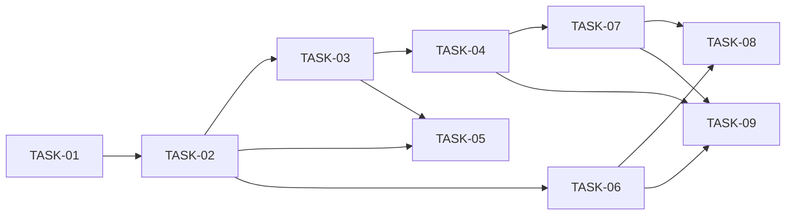

# HU-07 — Fecha límite de inscripción en una oferta — Roadmap de tareas

## Resumen
- **Fuente de verdad:** `plans/TECHNICAL_DOC-backend.md` y `plans/TECHNICAL_DOC-frontend.md` (no el PRD).
- **Tareas:** **9** (S: 0 · M: 5 · L: 4) · estimación total: **21,5 h**.
- **Capa:** `api` 5 (TASK-01 a TASK-05: M 2 · L 3 · 12,5 h) · `web` 4 (TASK-06 a TASK-09, incluida la `[e2e]`: M 3 ·
  L 1 · 9 h).
- **Adversariales:** 2, una por capa, cada una cubriendo los dos RF Must de su capa (TASK-05 en API, TASK-08 en web),
  las dos M.
- **Criterio de corte** (indicación de la persona): el menor número de tareas que cumplen los gates, en rebanadas
  verticales de menos de 4 h. **TASK-01 es la rebanada de API más pequeña con valor propio** (M, 1,5 h): migración
  `004` y el campo `enrollmentDeadline` en la oferta (alta, edición, detalle y duplicar sin copiarlo), sin reglas de
  día, sin el 409 de inscribir y sin web.
- **Cobertura:** todos los RF del PRD están en el diseño (paso 2 sin RF huérfanos; matices en «Coherencia PRD ↔
  diseño»); cada CA → al menos un test; cada edge case de RF Must → test o `N/A` del PRD.

| ID | Título | Capa | Complejidad | Depende de | Bloquea |
|---|---|---|---|---|---|
| TASK-01 | La oferta guarda y devuelve su fecha límite (migración `004`) `[migration]` | api | M (1,5 h) | — | TASK-02 |
| TASK-02 | Validar la fecha límite al crear, editar y publicar (calendario de Madrid) | api | L (3,5 h) | TASK-01 | TASK-03, TASK-05, TASK-06 |
| TASK-03 | Inscribir fuera de plazo: 409 `ENROLLMENT_DEADLINE_PASSED` | api | L (3 h) | TASK-02 | TASK-04, TASK-05 |
| TASK-04 | El pipeline dice si el plazo venció, y el seed trae ofertas con plazo | api | L (2,5 h) | TASK-03 | TASK-07, TASK-09 |
| TASK-05 | Fecha límite e inscripción frente a entradas hostiles, fallos y concurrencia `[adversarial]` | api | M (2 h) | TASK-02, TASK-03 | — |
| TASK-06 | Fecha límite en el formulario de oferta y en la ficha | web | L (3,5 h) | TASK-02 | TASK-08, TASK-09 |
| TASK-07 | Pipeline sin «Inscribir candidato» cuando el plazo venció | web | M (2 h) | TASK-04 | TASK-08, TASK-09 |
| TASK-08 | Formulario y pipeline frente a entradas a medias, fallos y el 409 del plazo `[adversarial]` | web | M (2 h) | TASK-06, TASK-07 | — |
| TASK-09 | Recorrido e2e de la fecha límite `[e2e]` | web | M (1,5 h) | TASK-04, TASK-06, TASK-07 | — |

## Ajustes respecto a los TD

| # | Qué | Por qué | Efecto |
|---|---|---|---|
| A-1 | El punto 2 del checklist del TD-backend (migración + esquemas + puerto + dobles + cascadas) se parte: migración y campo en TASK-01; el puerto `getEnrollmentDeadline`, sus dobles y `ports.test.ts`, con inscribir (TASK-03); la cascada del pipeline, en TASK-04 | TASK-01 mínima con valor propio; el puerto no tiene consumidor hasta inscribir | Sin tarea extra |
| A-2 | El punto 1 del TD-backend (`calendar.ts` y el traslado de `madridCalendarDate`) va con las reglas del punto 3 en TASK-02 | `calendar.ts` no tiene valor propio; su primer consumidor son las reglas | −1 tarea |
| A-3 | CA-08 (duplicar sin la fecha, DD-05) entra en TASK-01 | Al hacer editable la fecha, `duplicate` la copiaría: la anulación explícita tiene que ir en la misma tarea para no dejar un estado incorrecto | Sin tarea extra |
| A-4 | Los puntos 4 y la adversarial del 5 del TD-backend se juntan en una sola `[adversarial]` (TASK-05) para RF-01 y RF-02 | Misma capa; indicación de la persona; queda en M (2 h) | −1 tarea |
| A-5 | El punto 5 del TD-backend se parte: inscribir (TASK-03) y pipeline, que va con el seed del punto 6 (TASK-04) | Juntos superan 4 h; pipeline y seed son «lo que se ve de una oferta vencida» | Sin tarea extra |
| A-6 | Del TD-frontend, la task A (tipos, formulario y ficha) queda en TASK-06 **sin** `hasBadInput` (DD-02), que pasa a la `[adversarial]` TASK-08 | Gate 2 (TASK-06 en 3,5 h) y gate 4 (la defensa de EC-17 es adversarial) | Sin tarea extra |
| A-7 | La task B del TD-frontend se parte: estado vencido del pipeline (TASK-07) y el 409 de la página vieja con los adversariales de RF-03 y RF-04 (TASK-08) | Gate 4: la `[adversarial]` va aparte del camino feliz y en S o M | +1 tarea respecto a las 3 del TD |
| A-8 | `createJobStatusStub` gana `failDeadline` (TASK-03), que el TD no nombra | TASK-05 necesita que falle solo `getEnrollmentDeadline` (con `fail`, falla antes `getJobStatus`) | Sin tarea extra |
| A-9 | `docs/ARCHITECTURE.md`: fila «Reloj y transacciones» en TASK-02; filas «Base de datos» y `JobStatusPort` en TASK-04 | Cada fila con la tarea que crea lo que documenta (el TD las reparte entre sus puntos 1 y 6) | Sin tarea extra |

Balance: TD-backend 6 → 5 (A-2, A-4) · TD-frontend 3 → 4 (A-7) · **9**.

## Fases

| Fase | Tareas | Objetivo |
|---|---|---|
| 1 · Setup y dato | TASK-01 | Migración `004` y la fecha en la oferta por la API |
| 2 · Núcleo API | TASK-02, TASK-03, TASK-04 | Reglas de día y de publicar, 409 al inscribir, pipeline y seed |
| 3 · Pantallas | TASK-06, TASK-07 | Formulario y ficha; pipeline con el plazo vencido |
| 4 · Adversariales y e2e | TASK-05, TASK-08, TASK-09 | Casos hostiles por RF Must (API y web) y recorrido de Playwright |

## Dependencias

## Orden de implementación
`/implementar-hu` las ejecuta una a una en este orden: **TASK-01 → TASK-02 → TASK-03 → TASK-04 → TASK-05 → TASK-06 →
TASK-07 → TASK-08 → TASK-09**.

Podrían ir en paralelo **sin compartir ficheros**: TASK-06 con TASK-03, TASK-04 o TASK-05 (web frente a API); TASK-05
con TASK-04 (TASK-05 solo crea dos ficheros de test). TASK-06 y TASK-07 **no** (las dos tocan
`apps/web/test/App.test.tsx`); TASK-08 toca ficheros de las dos.

**Camino crítico:** TASK-01 → TASK-02 → TASK-03 → TASK-04 → TASK-07 → TASK-08 = **14,5 h** (TASK-09 cierra en paralelo
a TASK-08 con 1,5 h).

## RF Must × tarea `[adversarial]`

| RF Must | Capa | Tarea `[adversarial]` | Edge cases (categoría de QUALITY-GATES § 3) |
|---|---|---|---|
| RF-01 | api | TASK-05 | EC-01 (1), EC-04 (3), EC-07 (6), EC-09 (2), `maxLength` (1, 6), frontera de día al crear (2) |
| RF-02 | api | TASK-05 | EC-12 (3), EC-13 (4), EC-15 (6), fallo de `getEnrollmentDeadline` (3) |
| RF-03 | web | TASK-08 | EC-17 (1), EC-19 (3), EC-20 (4, 7) |
| RF-04 | web | TASK-08 | CA-10/EC-27 (4), EC-26 (3), EC-15 web (6) |

El resto de categorías de cada RF Must las cubre el camino feliz (EC-02, EC-03, EC-05, EC-06, EC-08, EC-11, EC-14,
EC-16, EC-18, EC-21, EC-23, EC-25, EC-28, EC-30) o son `N/A` en el PRD (EC-10, EC-22, EC-24, EC-29).

## Cobertura PRD → tareas

| RF / CA / RNF | Task(s) |
|---|---|
| RF-01 (Must) | TASK-01 (campo, duplicar), TASK-02 (reglas, publicar), TASK-05 |
| RF-02 (Must) | TASK-03, TASK-05 |
| RF-03 (Must) | TASK-06, TASK-08, TASK-09 |
| RF-04 (Must) | TASK-04 (API), TASK-07, TASK-08, TASK-09 |
| RF-05 (Should) | TASK-04, TASK-09 |
| RF-06 (Could) | TASK-01 (API), TASK-06 (ficha), TASK-09 |
| CA-01 | TASK-01, TASK-02, TASK-06, TASK-09 |
| CA-02 | TASK-02, TASK-06, TASK-09 |
| CA-03 | TASK-01, TASK-06, TASK-09 |
| CA-04 | TASK-02, TASK-06 |
| CA-05 | TASK-02, TASK-06 |
| CA-06 | TASK-03 (inscribir), TASK-04 (pipeline API), TASK-07 (web) |
| CA-07 | TASK-02, TASK-06 |
| CA-08 | TASK-01, TASK-06 (ficha sin fila) |
| CA-09 | TASK-03 |
| CA-10 | TASK-03 (API), TASK-08 (web) |
| CA-11 | TASK-03 |
| CA-12 | TASK-04 (API), TASK-07, TASK-09 |
| CA-13 | TASK-04, TASK-09 |
| RNF-01 | TASK-02 (`calendar.test.ts`), TASK-03 (tabla de fronteras) |
| RNF-02 | TASK-06 (`<label>`), TASK-07 (`role="status"`), TASK-08 (`role="alert"`), TASK-09 |

| EC | Task(s) | EC | Task(s) | EC | Task(s) |
|---|---|---|---|---|---|
| EC-01 | TASK-05 | EC-11 | TASK-03 | EC-21 | TASK-01 (API), TASK-06 |
| EC-02 | TASK-02 | EC-12 | TASK-05 | EC-22 | N/A (PRD) |
| EC-03 | TASK-01 | EC-13 | TASK-05 | EC-23 | TASK-02 (API), TASK-06 |
| EC-04 | TASK-05 | EC-14 | TASK-03, TASK-07 | EC-24 | N/A (PRD) |
| EC-05 | TASK-01 | EC-15 | TASK-05, TASK-08 | EC-25 | TASK-04, TASK-07, TASK-09 |
| EC-06 | TASK-01 | EC-16 | TASK-03 | EC-26 | TASK-08 |
| EC-07 | TASK-05 | EC-17 | TASK-02 (API), TASK-06, TASK-08 | EC-27 | TASK-04 (API), TASK-08 |
| EC-08 | TASK-02 | EC-18 | TASK-01 (API), TASK-06, TASK-09 | EC-28 | TASK-03, TASK-04, TASK-07 |
| EC-09 | TASK-05 | EC-19 | TASK-08 | EC-29 | N/A (PRD) |
| EC-10 | N/A (PRD) | EC-20 | TASK-08 | EC-30 | TASK-04, TASK-07, TASK-09 |

## Coherencia PRD ↔ diseño (paso 2)
- **RF:** RF-01 a RF-06 están en el diseño (RF-06, Could, incluido por DD-07 del TD-frontend). Ningún RF sin tarea.
- **H-1 · ficheros que el TD-backend no lista:** `apps/api/test/candidates/migration.test.ts:72-76` y
  `apps/api/test/applications/migration.test.ts:61-65` comparan con `toEqual` la lista exacta de migraciones; con la
  `004` fallarían. Van en TASK-01.
- **H-2 · texto obsoleto del TD-frontend:** su § Dependencias dice que «no hay aún» TD-backend y pide cruzar S1-S6. Se
  han cruzado aquí: nombres (`enrollmentDeadline`, `enrollmentDeadlinePassed`), formas (409 sin `details`, 400 de
  publicar con el elemento `enrollmentDeadline`) y textos de DT-01 coinciden. Sin efecto en las tareas.

## Riesgos
- **Heredados del TD-backend:** frontera del día mal calculada (mitigado con `calendar.ts` único y la tabla de RNF-01);
  cascada de tests rojos al ampliar `jobSchema` (TASK-01) y `pipelineSchema` (TASK-04); mover `madridCalendarDate`
  rompe la retención (lo vigila `retention.test.ts`); seed desfasado si la base se usa días después del reset;
  `date()` en un `CHECK` con otra versión de SQLite; `createJobWriteOperations` cerca de 50 líneas (no añadir nada
  dentro).
- **Heredados del TD-frontend:** jsdom sanea `type="date"` y no implementa `badInput` (formato en el modelo puro y
  `badInput` simulado); la entrada a medias real en Chromium no se prueba en el e2e; `JobDetailScreen.actions.test.tsx`
  en 300 líneas (usar `makeJob`); el e2e E3 si cruza medianoche (el seed deja la futura a 14 días).
- **Del plan:**
  - **Estado intermedio tras TASK-01:** la API acepta cualquier día real, también pasado, y un texto que no es un día
    lo para el `CHECK` como 500 hasta TASK-02. Consciente y documentado en TASK-01; no debe quedarse así en `main`
    (la HU se integra entera).
  - **TASK-02 y TASK-06 en 3,5 h**, cerca del techo de 4 h. Si una se desborda, se parte por funcionalidad: TASK-02 →
    «calendario + alta y edición» y «publicar con el plazo vencido»; TASK-06 → «formulario» y «ficha».
  - **Ficheros de test compartidos** por la tarea de camino feliz y su `[adversarial]` web (`JobFormScreen.deadline`,
    `PipelineScreen.deadline`): si alguno pasa de 300 líneas, se para y se avisa antes de crear un hermano.
