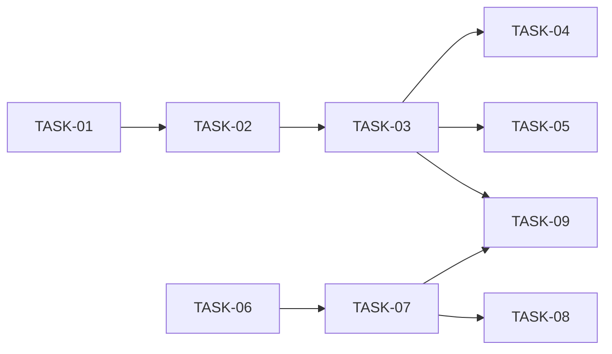

# HU-07 — Importar candidatos desde un CSV — Roadmap de tareas

## Resumen
- **Fuente de verdad:** `plans/TECHNICAL_DOC-backend.md` y `plans/TECHNICAL_DOC-frontend.md` (aprobados; no el PRD).
  PRD v1.3 (Ready) para los RF Must y la cobertura. **DT-08 / EC-50 / CA-19** (cambio del responsable técnico del
  2026-10-12, commit `5f6be5d`: PRD v1.3 y TD-backend actualizados; el TD-frontend no) se incorpora aquí (A-1).
- **Pre-flight:** OQ-01 a OQ-05 siguen «PENDIENTE DE RATIFICAR» con la recomendación aplicada y **no bloquean**, por
  decisión del responsable técnico anotada en el PRD. Los dos TD no tienen Open Decisions. Rama
  `hu/HU-07-importar-candidatos-csv` con el árbol limpio.
- **Tareas:** **9** (S: 0 · M: 6 · L: 3) · estimación total: **22 h** (API 12,5 h · web 7,5 h · e2e 2 h).
- **Capa:** `api` 5 (TASK-01 a TASK-05) · `web` 4 (TASK-06 a TASK-08 en `apps/web`, TASK-09 de Playwright).
- **Adversariales:** 3 (TASK-04 y TASK-05 en API; TASK-08 en web), todas M, ninguna fundida con un camino feliz.
- **Sin migración**, sin dependencias nuevas y sin tocar `apps/api/src/app.ts` (DEC-13).
- **Cobertura:** cada RF → tareas; cada CA → al menos un test con nombre; cada edge case de RF Must → test o `N/A` del
  PRD (tablas de abajo).
- **Requisitos del responsable técnico:** fixture de Excel en español con `;`, BOM y CRLF en la API y en el e2e
  (sección «Fixture «;»») y mutaciones M1, M2 y M3 con su test asesino nombrado (sección «Mutaciones»).

| ID | Título | Capa | Complejidad | Depende de | TD |
|---|---|---|---|---|---|
| TASK-01 | Decodificador UTF-8 y *parser* CSV puro con número de línea física (`csv.ts`) `[setup]` | api | M (2 h) | — | TD-backend, orden 1 |
| TASK-02 | Validación del fichero entero, reglas de fila del alta y 413 con texto propio | api | L (3 h) | TASK-01 | TD-backend, orden 2 |
| TASK-03 | `POST /api/candidates/import` de punta a punta: alta todo o nada, deduplicación e informe | api | L (3,5 h) | TASK-02 | TD-backend, orden 3 |
| TASK-04 | Ficheros hostiles, tipos de contenido y límites por la ruta de importación `[adversarial]` | api | M (2 h) | TASK-03 | TD-backend, orden 4-5 (A-4) |
| TASK-05 | Fallos de la base, concurrencia, reintento y datos personales de la importación `[adversarial]` | api | M (2 h) | TASK-03 | TD-backend, orden 4-5 (A-4) |
| TASK-06 | Cliente de importación en la web: `postBytes`, tipos, guarda `isImportReport` y modelo puro | web | M (2 h) | — (contrato) | TD-frontend, checklist 1 |
| TASK-07 | Pantalla «Importar candidatos» con su informe, la ruta y el enlace desde el listado | web | L (3,5 h) | TASK-06 | TD-frontend, checklist 2 |
| TASK-08 | Pantalla de importación frente a ficheros, respuestas y usos hostiles `[adversarial]` | web | M (2 h) | TASK-07 | TD-frontend, checklist 3 |
| TASK-09 | Recorrido e2e de la demo y del CSV de Excel en español separado por «;» `[e2e]` | web | M (2 h) | TASK-03, TASK-07 | TD-frontend, checklist 4 |

## Ajustes respecto a los TD

| # | Qué | Por qué | Efecto |
|---|---|---|---|
| A-1 | **DT-08 / EC-50**: si la cabecera no vale y, partida por `;`, da `nombre`, `email`, `telefono` (recortadas, sin distinguir mayúsculas), el 400 del fichero entero lleva `SEMICOLON_SEPARATOR_MESSAGE` = «El fichero está separado por «;». Guárdalo separado por comas (CSV UTF-8) y vuelve a importarlo.»; en cualquier otro caso de cabecera, `INVALID_HEADER_MESSAGE` (DT-03). La constante y la regla van en `import-file.ts` (TASK-02); CA-11 cambia en TASK-02, TASK-04 y TASK-07 (el caso `nombre;email;telefono` da el mensaje del separador; `email,nombre,telefono` y `nombre,email,telefono,resumen`, el de cabecera); el e2e T2 espera el texto de DT-08 (el TD-frontend decía «alert con `nombre,email,telefono`») | Cambio del responsable técnico durante la planificación (commit `5f6be5d`: PRD v1.3 con CA-19 y EC-50, TD-backend actualizado; TD-frontend sin actualizar) | 0 tareas (incluido en las 3 h de TASK-02, A-5) |
| A-2 | **Fixture de Excel en español** (`;`, BOM y CRLF): `excelSpanishCsv()` en `apps/api/test/helpers/csv.ts` (TASK-02) y un constructor equivalente en `e2e/candidates-import.spec.ts` (TASK-09), **en memoria** | Requisito del responsable técnico. El TD-backend pide «sin fixtures en disco en la API» y DD-08 del TD-frontend, CSV del e2e en memoria: se cumplen los dos | 0 tareas |
| A-3 | `apps/api/test/helpers/csv.ts` nace en **TASK-02** (`csvBytes` + fixture) y TASK-03 le añade `importCsv` | El TD lo pone en el orden 3, pero `import-file.test.ts` (orden 2) ya necesita construir ficheros | 0 tareas |
| A-4 | Reparto de los dos adversariales de API: **TASK-04** = `import-adversarial.test.ts` + RNF-01 en `performance.test.ts`; **TASK-05** = `import-failures-adversarial.test.ts` + `import-privacy.test.ts` (el TD: 4 = adversarial + fallos; 5 = privacidad + rendimiento) | Equilibrar las dos (el gate 4 exige S o M) y agrupar por RF: TASK-04 el fichero entero (RF-02, RF-03), TASK-05 E4 y datos personales (RF-04, RF-05, RF-06) | 0 tareas |
| A-5 | TASK-02 es **L (3 h)** y no M | 5 piezas (3 ficheros nuevos de `src`, un cambio transversal, el *helper*) + 2 ficheros de test + DT-08 | +1 h |
| A-6 | TD-frontend: «`Capa: e2e`» → **`Capa: web`** | `/task-planner`: una `[e2e]` de Playwright es `web` (`web-builder`) | 0 tareas |
| A-7 | El test de 415 (M3) añade `application/vnd.ms-excel`, `application/octet-stream` y «sin `Content-Type`», y manda en cada caso un CSV **válido** | Que aceptar el tipo se note (filas creadas o 400 en vez de 415). `vnd.ms-excel` es el `type` de un `.csv` en Windows: la mutación más probable | 0 tareas |
| A-8 | `CA-04 …` (TASK-03) aserta a la vez informe (`created: 1`, `duplicates: 1`, `notImported` exacto) y base (recuento + 1, un solo registro con ese email, Ana igual) | Que M1 caiga sea cual sea su forma | 0 tareas |
| A-9 | `import-api.test.ts` (TASK-06) envía los bytes del fichero de Excel (BOM, CRLF y `;`) y comprueba que llegan intactos; el e2e elige ese fichero con `mimeType: 'application/vnd.ms-excel'` | EC-50 de punta a punta: la web ni corrige ni rechaza, y siempre manda `text/csv` | 0 tareas |

**Decisión pendiente para la validación (paso 7):** `import.test.ts` (TASK-03, ~18 tests) puede pasar de 300 líneas.
El TD no prevé un fichero hermano; el plan dice al builder que **pare y avise**. Si se quiere decidir ya, la opción es
sacar los tests de A3 y de EC-18 a EC-25/EC-49 a `apps/api/test/candidates/import-rows.test.ts` como **TASK-10
`[adversarial]` (S/M, capa `api`, depende de TASK-03)**, lo que además engorda la adversarial de RF-03 (ver gate 4).
**Recomendación: mantener 9 tareas** y decidir solo si el builder topa con el umbral.

## Fases

| Fase | Tareas | Objetivo |
|---|---|---|
| 1 · Setup | TASK-01 | *Parser* CSV y decodificador UTF-8 puros |
| 2 · Núcleo API | TASK-02, TASK-03 | Reglas del fichero (con DT-08) y de la fila; ruta, transacción e informe |
| 3 · Adversariales API | TASK-04, TASK-05 | Ficheros hostiles, tipos, límites, rendimiento; fallos, concurrencia, privacidad |
| 4 · Pantalla | TASK-06, TASK-07 | Cliente y modelo; pantalla, ruta y enlace |
| 5 · Adversarial web y e2e | TASK-08, TASK-09 | Usos hostiles de la pantalla; demo y fichero de Excel con `;` |

## Dependencias

**Camino crítico:** TASK-01 → TASK-02 → TASK-03 → TASK-04 (o TASK-05, o TASK-09) = 2 + 3 + 3,5 + 2 = **10,5 h**. La
rama web (TASK-06 → TASK-07 = 5,5 h) acaba antes que TASK-03. En el taller, en serie: **22 h**.

## Orden de implementación

Orden de `/implementar-hu`, una tarea cada vez y **la API primero**: **01, 02, 03, 04, 05, 06, 07, 08, 09**. El e2e
(TASK-09) va al final, después de la ruta de la API (TASK-03) y de la pantalla (TASK-07).

Paralelismo posible, solo si el responsable técnico lo pide, sin romper «la API primero» y sin compartir ficheros
(**máx. 3 builders a la vez**):

| Ola | Tareas en paralelo | Ficheros de cada una | Por qué no chocan |
|---|---|---|---|
| 1 | TASK-01 → TASK-02 → TASK-03 (serie) | `apps/api/src/modules/candidates/`, `apps/api/src/http/error-handler.ts`, `apps/api/test/helpers/csv.ts` | Núcleo: cada una usa lo de la anterior |
| 2 | TASK-04 ∥ TASK-05 ∥ TASK-06 | 04: `import-adversarial.test.ts`, `performance.test.ts` · 05: `import-failures-adversarial.test.ts`, `import-privacy.test.ts` · 06: `apps/web/src/components/http.ts`, `apps/web/src/features/candidates/{types,api,import-model}.ts` y sus tests | Disjuntos. **La medida de RNF-01 de TASK-04 se repite a solas** al acabar la ola (un falso > 500 ms no cuenta como ciclo) |
| 3 | TASK-07 (sola) | `apps/web/src/…`, `App.tsx`, tests web | Pantalla |
| 4 | TASK-08 ∥ TASK-09 | 08: `CandidateImportScreen.adversarial.test.tsx` · 09: `e2e/candidates-import.spec.ts` | Disjuntos |

**No en paralelo:** TASK-02 y TASK-03 (`apps/api/test/helpers/csv.ts`); dos e2e a la vez (puertos y `data/e2e.db`).
Si TASK-04 o TASK-05 destapan un arreglo en `apps/api/src/`, la ola pasa a serie. Los builders comparten árbol: la
integración de cada tarea (tests, typecheck y lint con salida pegada) se repite al acabar la ola si falla por un
fichero ajeno a medio escribir.

## RF Must × tarea `[adversarial]` (gate 4)

| RF (Must) | Tarea(s) `[adversarial]` | Categorías de `QUALITY-GATES.md` §3 cubiertas |
|---|---|---|
| RF-01 Pantalla | TASK-08 | Input inválido (EC-01), concurrencia (EC-04), datos corruptos (EC-05), seguridad (EC-06). Boundary (EC-02) y fallo de dependencia (EC-03) en TASK-07/TASK-06; idempotencia (EC-07) en TASK-07 y TASK-09 |
| RF-02 Fichero entero | TASK-04, TASK-08 | Input inválido (EC-08, EC-09, EC-10, **EC-50**), boundary (EC-11, EC-12), datos corruptos (EC-15), seguridad (EC-16) e idempotencia (EC-17) en TASK-04; fallo de dependencia (EC-13) y bordes en cliente (EC-11, EC-16) en TASK-08. Concurrencia `N/A` (EC-14, PRD) |
| RF-03 Filas y numeración | TASK-04, TASK-05 | Seguridad (EC-26) e idempotencia (EC-27) en TASK-04; mensajes sin valores de CA-08 en TASK-05. Input inválido (EC-18 a EC-20), boundary (EC-21, EC-22, EC-49) y datos corruptos (EC-25) en TASK-03 (no `[adversarial]`); fallo de dependencia y concurrencia `N/A` (EC-23, EC-24) |
| RF-04 Deduplicación | TASK-05 | Fallo de dependencia (EC-30), concurrencia (EC-31, CA-06), seguridad (EC-33: solo `existingId`). Input inválido (EC-28), boundary (EC-29), legacy (EC-32) e idempotencia (EC-34) en TASK-03 |
| RF-05 Alta todo o nada | TASK-05 | Fallo de dependencia (EC-37, CA-15), concurrencia (EC-38), datos corruptos (EC-39), seguridad (EC-40, 500), idempotencia (EC-41). Boundary (EC-36) en TASK-03; input inválido `N/A` (EC-35) |
| RF-06 Informe | TASK-05, TASK-08 | Seguridad (EC-47) en las dos; boundary (EC-43) e idempotencia (EC-48) en TASK-08. Boundary y datos corruptos de la API (EC-43, EC-46) en TASK-03; `N/A` EC-42, EC-44, EC-45 |

Ningún RF Must queda sin `[adversarial]`. **Aviso:** la de RF-03 es la más fina (solo seguridad e idempotencia en
TASK-04): sus casos de input inválido y boundary viven en `import.test.ts` (TASK-03) junto a sus CA. La opción de la
«Decisión pendiente» (TASK-10) los separa. RF-07 es Should: sin `[adversarial]` obligatoria.

## Mutaciones de la review → test que las detecta

Se ejecutan **en serie** en `/reviewer`. Cada tarea indicada pide al builder aplicar la mutación a mano, ver el rojo
y deshacerla, sin commitearla.

| Mutación | Test(s) que fallan | Tarea |
|---|---|---|
| **M1** · una fila cuyo email ya existe en la base crea igualmente un registro | `import.test.ts › CA-04 duplicado con existingId y Ana sin cambios` (informe exacto **y** recuento + 1, un solo registro con el email, Ana igual); `› CA-05 reimportar → 0 creados y 3 duplicate`; `› EC-34 email existente repetido → todas duplicate`; `import-failures-adversarial.test.ts › CA-06/EC-31 dos importaciones a la vez → 1 creado y 1 duplicate, ninguna 500`; e2e T1 | TASK-03 (principal), TASK-05, TASK-09 |
| **M2** · quitar la guarda del límite de 500 filas (`readImportFile`) | `import-adversarial.test.ts › CA-14 500 → 500 creados; 501 → 400 con el límite de filas y 0 creados; …` (principal, por la ruta); `import-file.test.ts › 500 y 500 + 30 blancos pasan; 501 no` | TASK-04 (principal), TASK-02 |
| **M3** · aceptar un `Content-Type` distinto de `text/csv` en la ruta | `import-adversarial.test.ts › 415 con un CSV válido como cuerpo: application/json, text/plain, multipart/form-data, application/x-www-form-urlencoded, application/vnd.ms-excel, application/octet-stream y sin Content-Type` (`it.each`, 415 + recuento igual); complemento: `› text/csv en POST /api/candidates sigue en 415` (la mutación inversa, registrar el parser fuera del plugin) | TASK-04 |

## Fixture «;» (Excel en español: `;`, BOM y CRLF) — EC-50

| Dónde | Qué | Resultado esperado |
|---|---|---|
| `apps/api/test/helpers/csv.ts › excelSpanishCsv()` (TASK-02) | Constructor en memoria: `` + `nombre;email;telefono` + filas de CA-01 unidas por `;`, con CRLF | — |
| `import-file.test.ts › EC-50 / DT-08 cabecera separada por «;» → mensaje del separador` (TASK-02) | `readImportFile(excelSpanishCsv())` | `AppError` 400, `SEMICOLON_SEPARATOR_MESSAGE`, `details: [{ field: 'file', … }]`, sin `nombre;email` ni valores |
| **`import-adversarial.test.ts › EC-50 CSV de Excel en español (;, BOM y CRLF) → 400 con el mensaje del separador y 0 creados`** (TASK-04) | Por la ruta | 400 `VALIDATION_ERROR` con el texto exacto (`toEqual` del envelope) y recuento igual |
| `import-privacy.test.ts › ni logs, ni message/details, ni informe contienen valores …` (TASK-05) | El fixture entre los ficheros de CA-17 | 0 valores ni la cabecera recibida en logs ni respuesta |
| `import-api.test.ts › envía BOM, CRLF y ; tal cual` (TASK-06) | La web con esos bytes | Llegan intactos con `Content-Type: text/csv` |
| `CandidateImportScreen.test.tsx › 400 del separador «;» …` (TASK-07) | Respuesta simulada con el texto de DT-08 | `alert` con el texto tal cual, `aria-invalid` en el selector |
| **e2e T2** `CA-19 CSV de Excel en español (;, BOM y CRLF) rechazado con el mensaje del separador, corregido y reimportado` (TASK-09) | `excelSpanishCsv(token)` en memoria, `mimeType: 'application/vnd.ms-excel'` | `alert` con el texto **exacto** de DT-08, sin informe, `GET /api/candidates?q=<token>` → `total: 0`; corregido → 1 creado; reimportado → 1 duplicado |

## Cobertura PRD → tareas

| RF / RNF | Task(s) |
|---|---|
| RF-01 | TASK-06, TASK-07, TASK-08, TASK-09 |
| RF-02 | TASK-01, TASK-02, TASK-03, TASK-04, TASK-06, TASK-07, TASK-08, TASK-09 |
| RF-03 | TASK-01, TASK-02, TASK-03, TASK-04 |
| RF-04 | TASK-03, TASK-05, TASK-09 |
| RF-05 | TASK-03, TASK-05 |
| RF-06 | TASK-02 (mensajes), TASK-03, TASK-05, TASK-06, TASK-07, TASK-08 |
| RF-07 | TASK-09 (y los constructores de CSV inventados de TASK-02) |
| RNF-01 | TASK-04 |
| RNF-02 | TASK-05 |
| RNF-03 | TASK-05 (API), TASK-08, TASK-09 (navegador) |
| RNF-04 | TASK-05 |
| RNF-05 | TASK-02, TASK-04 |
| RNF-06 | TASK-05 |
| RNF-07 | TASK-07 |

| CA | Task(s) | CA | Task(s) |
|---|---|---|---|
| CA-01 | TASK-03, TASK-07 | CA-10 | TASK-03, TASK-07 |
| CA-02 | TASK-07, TASK-09 | CA-11 | TASK-02, TASK-04, TASK-07, TASK-09 (caso `;`, DT-08) |
| CA-03 | TASK-03, TASK-06 | CA-12 | TASK-01, TASK-04, TASK-07 |
| CA-04 | TASK-03, TASK-07, TASK-09 | CA-13 | TASK-02, TASK-04, TASK-07 |
| CA-05 | TASK-03, TASK-07, TASK-09 | CA-14 | TASK-02, TASK-04, TASK-07, TASK-08 |
| CA-06 | TASK-05 | CA-15 | TASK-05, TASK-07 |
| CA-07 | TASK-03, TASK-07 | CA-16 | TASK-07 |
| CA-08 | TASK-03, TASK-07 | CA-17 | TASK-05, TASK-08, TASK-09 |
| CA-09 | TASK-03, TASK-07 | CA-18 | TASK-07, TASK-09 |
| | | **CA-19** | TASK-07 (render), TASK-09 (e2e T2 con el fixture de Excel); API: TASK-02, TASK-04 |

| Edge case | Task(s) | Edge case | Task(s) |
|---|---|---|---|
| EC-01 | TASK-04, TASK-08 | EC-26 | TASK-04, TASK-08 |
| EC-02 | TASK-07 | EC-27 | TASK-04 |
| EC-03 | TASK-06 (timeout), TASK-07 (red) | EC-28 | TASK-03 |
| EC-04 | TASK-08 | EC-29 | TASK-03 |
| EC-05 | TASK-06, TASK-08 | EC-30 | TASK-05 |
| EC-06 | TASK-04 (403), TASK-08 | EC-31 | TASK-05 |
| EC-07 | TASK-03, TASK-07, TASK-09 | EC-32 | TASK-03 |
| EC-08 | TASK-02, TASK-04, TASK-07, TASK-09 (ahora con el texto de EC-50) | EC-33 | TASK-03, TASK-05, TASK-08, TASK-09 |
| EC-09 | TASK-01, TASK-04, TASK-06 | EC-34 | TASK-03 |
| EC-10 | TASK-02, TASK-04 | EC-35 | `N/A` (PRD) |
| EC-11 | TASK-02, TASK-04, TASK-06, TASK-08 | EC-36 | TASK-03 |
| EC-12 | TASK-01, TASK-02, TASK-04, TASK-06 | EC-37 | TASK-05 |
| EC-13 | TASK-08 | EC-38 | TASK-05 |
| EC-14 | `N/A` (PRD) | EC-39 | TASK-05 |
| EC-15 | TASK-01, TASK-04 | EC-40 | TASK-04 (cabecera), TASK-05 (500) |
| EC-16 | TASK-02, TASK-04, TASK-05, TASK-08 | EC-41 | TASK-05 |
| EC-17 | TASK-02, TASK-04, TASK-08 | EC-42 | `N/A` (PRD) |
| EC-18 | TASK-03 | EC-43 | TASK-03, TASK-08 |
| EC-19 | TASK-01, TASK-03 | EC-44 | `N/A` (PRD) |
| EC-20 | TASK-03 | EC-45 | `N/A` (PRD) |
| EC-21 | TASK-03 | EC-46 | TASK-03, TASK-06 |
| EC-22 | TASK-01, TASK-03 | EC-47 | TASK-05, TASK-08, TASK-09 |
| EC-23 | `N/A` (PRD) | EC-48 | TASK-08 |
| EC-24 | `N/A` (PRD) | EC-49 | TASK-01, TASK-03 |
| EC-25 | TASK-01, TASK-03 | **EC-50** | TASK-02, TASK-04, TASK-05, TASK-06, TASK-07, TASK-09 |

## Coherencia PRD ↔ diseño (paso 2)

Ningún RF del PRD queda sin cubrir en los TD (RF-01 y RF-07 en el TD-frontend; RF-02 a RF-06 en los dos). Matices:
1. **DT-08 / EC-50 / CA-19** llegaron durante la planificación (commit `5f6be5d`: PRD v1.3, TD-backend con la fila
   del contrato «separador «;»», EC-08 y EC-50, y UC-20 · E1 con CA-19). El texto de `SEMICOLON_SEPARATOR_MESSAGE`
   (TASK-02) es **idéntico** al del PRD y del TD-backend. El **TD-frontend no se actualizó**: su fila T2 aún dice
   «alert con `nombre,email,telefono`»; el plan aplica DT-08 (A-1) y cubre CA-19 en TASK-07 (render) y TASK-09 (T2).
2. Los dos TD citan el PRD v1.1; el PRD está en v1.3 (DT-07/EC-49, ya en DD-07 b del TD-backend; DT-08/EC-50, en su
   nota del 2026-10-12). Cosmético.
3. TD-frontend, checklist: «`Capa: e2e`» no es válido; se usa `web` (A-6).
4. **OQ-03** (solo coma) y **OQ-04** (límites) siguen pendientes de ratificar: si OQ-03 cambia para aceptar `;`,
   DT-08 deja de tener sentido y cambian TASK-01, TASK-02, TASK-04 y TASK-09.

## Riesgos

| Riesgo | Origen | Mitigación |
|---|---|---|
| El *parser* propio trata mal un CSV real de Excel o LibreOffice (comillas, CRLF dentro de campos) | TD-backend (prob. 3, imp. 3) | `csv.test.ts` (TASK-01) cubre cada regla de DD-07; el fixture de Excel con BOM y CRLF en la API y en el e2e |
| DT-08 no salta con el fichero real porque se cuela el BOM o el `\r` del CRLF en la cabecera | Este plan (A-1) | El fixture lleva los dos; `import-file.test.ts` y `import-adversarial.test.ts` comparan el texto exacto |
| Cambia una OQ pendiente (OQ-03 `;`, OQ-04 límites) | TD-backend (prob. 2, imp. 2) | Separador, límites, cabecera y textos son constantes de `csv.ts` e `import-file.ts`; los tests usan las constantes |
| `request.compileValidationSchema` cambia al subir Fastify | TD-backend (prob. 1, imp. 3) | Test contrato «mensajes de fila = mensajes del alta» (TASK-03); versión fijada (DEC-05) |
| El 413 por `config` rompe otros 413 | TD-backend (prob. 1, imp. 3) | Sin `config`, el genérico; `payload-too-large.test.ts` (TASK-02) y `error-handler.test.ts` sin cambios |
| RNF-01 > 500 ms con 500 filas (~2 500 sentencias) | TD-backend (prob. 2, imp. 2) | TASK-04 lo mide con calentamiento; si no baja de 500 ms, **se para y se escala** antes de optimizar |
| La web manda el `type` del `File` y recibe 415 | TD-backend y TD-frontend (prob. 2, imp. 3) | `import-api.test.ts` (TASK-06) con `type` vacío y `application/vnd.ms-excel`; el e2e elige el fichero de Excel con ese `mimeType` |
| `ArrayBuffer` de otro *realm* en jsdom | TD-frontend (prob. 2, imp. 2) | `fetch.ts` con `Object.prototype.toString` / `ArrayBuffer.isView` (TASK-06) |
| `import.test.ts` o `CandidateImportScreen.test.tsx` > 300 líneas | TD-frontend (prob. 3, imp. 1); este plan | El builder para y avisa; «Decisión pendiente» (TASK-10 opcional) |
| TASK-04 y TASK-05 en el borde de M (11-13 tests cada una) | Este plan (A-4) | Si una se va claramente de 2 h, se parte por RF en otra `[adversarial]` S (10-11 tareas, lejos del techo de 15) |
| Tests de concurrencia frágiles o que no llegan a chocar en el índice | TD-backend (EC-31, EC-38) | Se aserta el resultado (1 candidato, ninguna 500), no el entrelazado; EC-38 con una segunda conexión en fichero temporal propio (TASK-05) |
| Triggers de `failWrites` instalados antes de preparar los datos | Este plan | Nota en TASK-05: instalarlos después |
| Builders en paralelo sobre el mismo árbol | Este plan | Olas disjuntas, máx. 3; integración repetida al acabar la ola |
