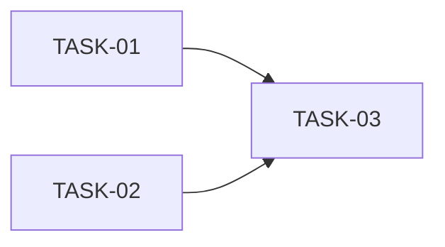

# HU-NN — <título> — Roadmap de tareas

## Resumen
- **Fuente de verdad:** `plans/TECHNICAL_DOC.md` (no el PRD).
- **Tareas:** N (S: x · M: y · L: z) · estimación total: h
- **Cobertura:** cada RF del PRD → task(s); cada edge case Must → task con su test.

## Fases

| Fase | Tareas | Objetivo |
|---|---|---|
| 1 | TASK-01, TASK-02 | … |

## Dependencias

## Orden de implementación
<Orden en que `/implementar-hu` las ejecutará y cuáles podrían ir en paralelo **sin compartir ficheros** (máx. 4).>

## Cobertura PRD → tareas

| RF / EC | Task(s) |
|---|---|

## Riesgos
- …
