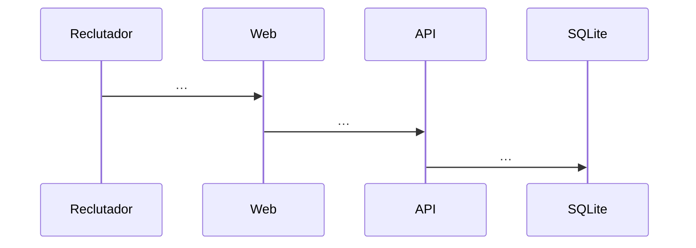

# HU-NN — <título> — Diseño técnico (<backend | frontend>)

- **Origen:** `specs/PRD.md` (estado Ready, AAAA-MM-DD)
- **Generado por:** <backend-architect | frontend-architect>
- **Scope cubierto:** RF-01, RF-02, …

> 🔒 Todas las secciones `##` son **obligatorias** (salvo *Fuera de scope*): no se renombran ni se eliminan, porque
> `/tech-design` y `/reviewer` las buscan por su nombre. Si no aplican, `N/A — <razón>`.
> Nada de rutas inventadas ni lenguaje vago («optimizar», «robusto»): concreto y verificable.
> En una HU fullstack hay dos documentos: `TECHNICAL_DOC-backend.md` (con *Contrato de API*) y
> `TECHNICAL_DOC-frontend.md` (con *Pantallas y estados*); se borra la sección que no corresponde.

## Enfoque técnico
<Cómo se resuelve, en media página. Alternativa principal descartada y por qué.>

## Módulos y ficheros afectados

| Módulo | Fichero | Cambio |
|---|---|---|
| jobs | `apps/api/src/modules/jobs/routes.ts` | nuevo / modificar |

## Contrato de API
<Solo backend. Por endpoint: método y ruta, JSON Schema de entrada (body, params, querystring), respuesta 2xx y errores
con el envelope `{ error: { code, message, details? } }` y sus códigos estables.>

## Pantallas y estados
<Solo frontend. Por pantalla: ruta, componentes, estados (cargando, vacío, error, con datos), formularios y validación,
accesibilidad (roles y nombres accesibles que usarán los tests).>

## Migración de datos
<Migración `apps/api/src/db/migrations/NNN-descripcion.sql`: tablas, columnas, índices, restricciones; cómo quedan las
filas existentes; cambios en `seed.ts` (datos inventados). `N/A — sin cambios de esquema` si no hay.>

## Diagrama de secuencia

## Error paths

| Edge case (PRD) | Dónde se detecta | Estrategia | Respuesta o efecto observable | Test |
|---|---|---|---|---|
| EC-01 | JSON Schema de la ruta | rechazar | 400 `VALIDATION_ERROR` | `apps/api/test/…` (en tasks) |

> Todos los edge cases del PRD aparecen aquí.

## Threat modeling
<STRIDE aplicado a esta HU: por cada amenaza que aplique (suplantación, manipulación, repudio, exposición de datos,
denegación de servicio, elevación de privilegios), la amenaza concreta y su mitigación. Recuerda DEC-04: sin login.>

## Datos personales
<Qué datos personales entran, se guardan, se devuelven o se registran; minimización, retención y supresión según
docs/RGPD.md; qué NO puede aparecer en logs ni en errores.>

## Decisiones de diseño

### DD-01: <título>
- **Contexto:** …
- **Opciones consideradas:** A) … B) …
- **Elegida:** …
- **Razón:** …
- **Tradeoff:** <lo que se pierde con la elegida — obligatorio>

## Impacto en decisiones
<`DEC-NN` que se aplican, se amplían o se contradicen. Si hace falta una nueva, propuesta de `DEC-NN` para
docs/07_architecture_principles/DECISIONS.md.>

## Estrategia de tests
<Unitarios y de ruta (Vitest + `fastify.inject`), de componente (Testing Library) y e2e (Playwright) por RF; tests
`[adversarial]` por RF Must; qué se simula y qué no; datos de prueba inventados.>

## Riesgos

| Riesgo | Probabilidad (1–5) | Impacto (1–5) | Mitigación |
|---|---|---|---|

## Open Decisions

### OD-01: <pregunta>
- **Por qué importa:** …
- **Recomendación:** …
- **Decisión:** PENDIENTE

> Con Open Decisions pendientes no se pasa a tareas. Si no hay: «No hay decisiones abiertas.»

## Fuera de scope
- …
